<!-- GENERATED FILE — do not edit directly.
     Source: d2-design/ pages. Regenerate with scripts/assemble_d2_design.py -->

# D2 Design — The MCP Server Pattern

> **Gate**: D2 — Design | **Status**: Draft | **D1 Approved**: TBD
>
> `d2-design.md` beside this directory is **generated** from these pages by
> `scripts/assemble_d2_design.py` — edit the pages, not the generated file.

## The pattern in one picture

Whatever the substrate, an MCP server on ACP is the same shape: **a remote HTTP MCP endpoint that
is reachable only from a Luminate gateway, registered as a catalogue resource, deployed onto a
gateway under a single-segment endpoint name, and granted to callers by access policy.**

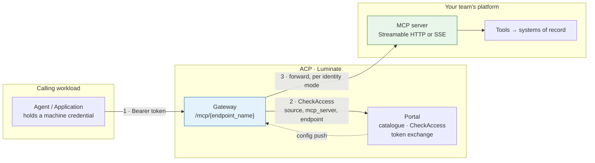

Steps 1 and 2 are identical for every server. **Step 3 is the whole design space** — what
credential, if any, reaches your server, and therefore what your server has to validate.

## Pick your shape

Three questions, answered in order. The first is disqualifying, the second decides your
requirements annex, the third decides what your server must implement.

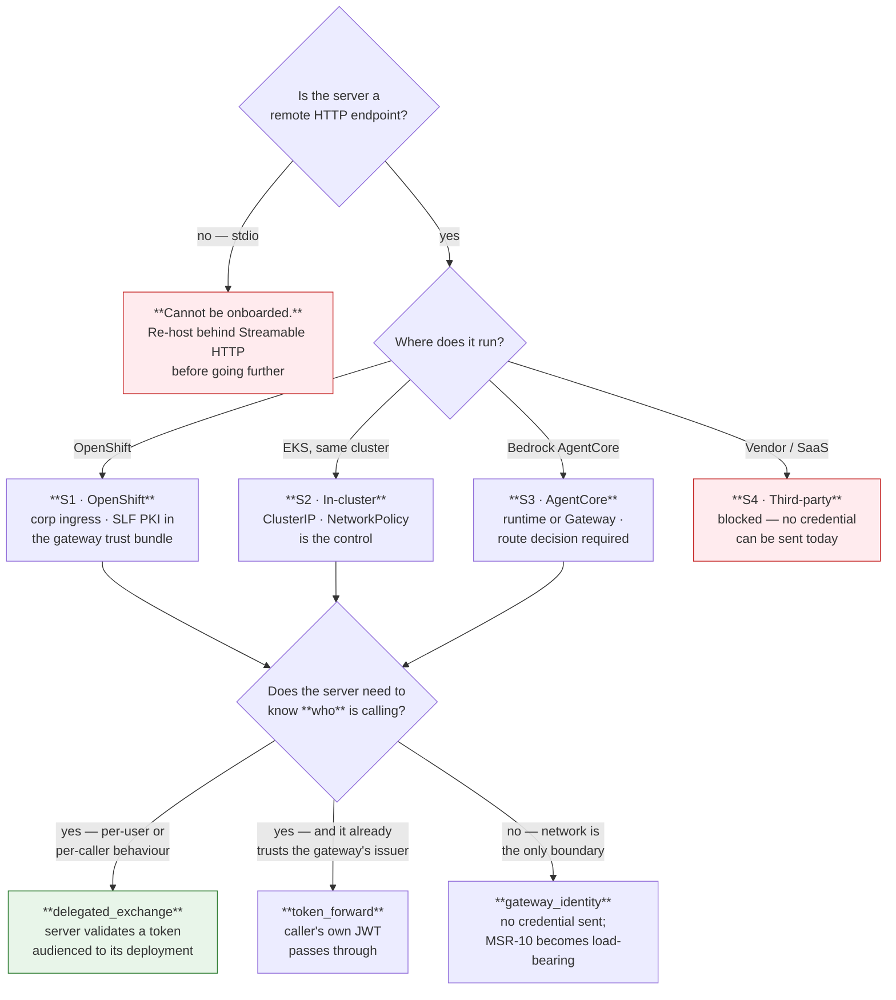

## The catalogue of shapes

| # | Shape | Who it is for | Maturity |
|---|---|---|---|
| **S1** | **OpenShift-hosted** — FastMCP or equivalent behind corporate ingress | Teams already on OpenShift; the current majority | **Works today** — `pharmacy-mcp-server` is live on this shape |
| **S2** | **In-cluster on EKS** — ClusterIP service beside the gateway | Platform-owned and demo servers | **Works today** — `claims-tools`, `underwriting-tools` |
| **S3** | **Bedrock AgentCore** — an MCP server on an AgentCore runtime, or fronted by AgentCore Gateway | Teams on AWS with an AgentCore footprint | **Partial** — reachable, but the governed-route decision is open |
| **S4** | **Third-party / vendor-hosted** — an MCP endpoint fronted by someone else's authorization server | Any SaaS tool vendor | **Blocked** — `injected_credential` / `external_exchange` unimplemented |

Identity mode composes with all four. A vendor server can technically be reached as
`gateway_identity`, but that means calling a third party with no credential, which is why S4 is
marked blocked rather than merely awkward.

## What is true on every shape

These are the platform properties a team cannot change, and they drive most of the profile.

| Property | Consequence for the server |
|---|---|
| **One route per server.** The gateway emits `path_prefix = /{endpoint_name}` per deployment; the multiplexed `mcp:` shorthand is gone from `origin/main` | Your server owns its own path segment and is addressed at `{gateway}/mcp/{endpoint_name}` |
| **Authorization is per server.** `AuthzRequest.selector` is the endpoint name; the JSON-RPC method is parsed *after* the decision | A grant covers every tool you expose — [Authorization](d2-design/authorization.md) |
| **The control plane is on the request path.** `CheckAccess` per request, no cache; portal unreachable → deny | Your availability is bounded by the portal's; there is no fail-open posture to rely on |
| **Configuration reaches gateways by push**, over a long-lived bidirectional stream | A registration or withdrawal propagates without a poll interval — but the actual latency must be measured |
| **The bundle is gateway-scoped, not caller-scoped** | Every deployment on a gateway is in that gateway's config; caller isolation is authorization, not routing |
| **The platform never probes your server** | Health, restarts and capacity are entirely yours — [Operations](d2-design/operations.md) |
| **`stdio` is refused at bundle build**, silently, into the `skipped` list | A local-process server never becomes a served one |

## Reading order

| Page | Covers | Answers |
|---|---|---|
| [Registration](d2-design/registration.md) | The catalogue model, what registration requires, the tool contract, lifecycle | *What do I have to declare?* |
| [Hosting](d2-design/hosting.md) | S1–S5 substrates, reachability, TLS, network control | *What must my platform provide?* |
| [Identity](d2-design/identity.md) | The five modes, the inbound eligibility matrix, RFC 9728 discovery | *What credential reaches me, and what do I validate?* |
| [Authorization](d2-design/authorization.md) | Access policies, the server-granularity boundary, guardrails | *What is actually enforced, and what must I enforce?* |
| [Build pipeline](d2-design/pipeline.md) | The JTE path, SonarQube / Snyk / Checkmarx, image provenance | *How do I build it so it will be accepted?* |
| [Operations](d2-design/operations.md) | Audit, tracing, session correlation, kill switch, cost | *What is visible once it runs?* |
| [ETAB and ISRA](d2-design/assurance.md) | The architecture to present and the control table to assess | *What do I take to the board?* |
| [Gaps](d2-design/gaps.md) | What is blocked and the ask that unblocks it | *What am I accepting as residual?* |

## The rule that catches everyone

**The server is the unit of trust, not the tool.** Every tool behind one endpoint name shares one
access grant, one classification tier and one blast radius — and a tool added next release is
covered by a grant made last quarter.

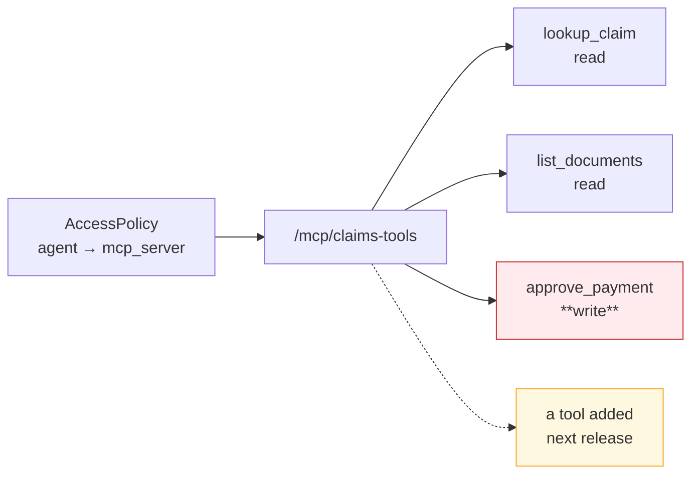

Design the endpoint boundary the way you would design a database role.

---

# Registration — the catalogue model and what you declare

## Two records, not one

Registering a server and making it reachable are separate acts, performed by different people.
This is the single most common source of "I registered it and nothing happened".

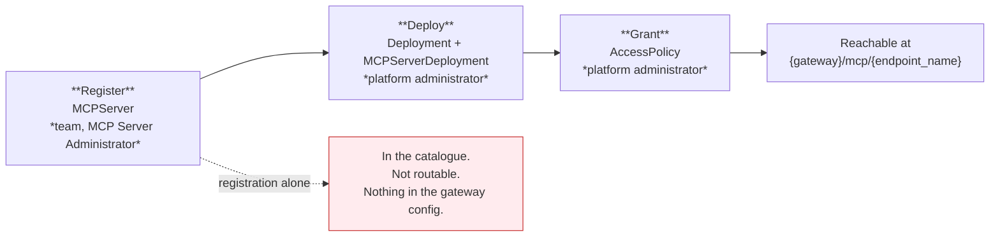

Registration is a **team** action — a holder of *MCP Server Administrator* on the project can do
it. Deployment and granting are **platform administrator** actions and cannot be delegated today.

## What registration requires

`POST /api/v1/catalog/mcp-servers`

| Field | Required | Notes |
|---|:---:|---|
| `key` | **yes** | Globally unique, validated, **permanent** |
| `name` | **yes** | Case-insensitively unique across the organisation |
| `transport` | **yes** | `http` (Streamable HTTP) · `sse` · `stdio` — see the warning below |
| `project` | **yes** | Sets ownership and the visibility scope; **permanent** |
| `identity_mode` | no | Defaults to `delegated_exchange`. **Decide it — MSR-9** |
| `status` | no | Defaults to `active`; `inactive` / `deprecated` / `unknown` |
| `version`, `description`, `documentation`, `tags`, `metadata`, `provider_id` | no | Populate them; they are what an assessor reads |
| `governance_state` | **write-refused** | Moves only through the transition action — a create or update carrying it is rejected outright |

### `stdio` registers and then silently does nothing

The catalogue accepts `stdio` because the transport is real MCP. The gateway bundle builder refuses
it — the deployment lands in the bundle's `skipped` list with
`stdio_transport_not_supported_for_remote_gateway`, no route is emitted, and **nothing surfaces in
the portal**. A server that speaks stdio must be re-hosted behind Streamable HTTP first.

## What deployment requires

Two rows, created by a platform administrator.

| Row | Fields | Constraint |
|---|---|---|
| `Deployment` | `resource_type = "mcp_server"`, `mcp_server`, `gateway`, `environment`, `location`, `project`, `deployment_key` | Unique on (`gateway`, `deployment_key`, `mcp_server`) |
| `MCPServerDeployment` | `endpoint_name`, `backend_endpoint` | One-to-one with the `Deployment`; both fields mandatory |

**`endpoint_name` is a single URL path segment and is read by two independent matchers**:
agentgateway routes on the path prefix `/{endpoint_name}`, and the gateway's own middleware derives
the endpoint's auth mode from the first segment of the request path. A value containing `/`, a dot
segment, or a character that percent-encodes differently on the two sides would let them disagree
about which server a request is for — so it is held to one URL-safe slug.

**`backend_endpoint` is the full URL including scheme and path.** A FastMCP server serves
Streamable HTTP at `/mcp` and SSE at `/sse`, so the value is `https://your-host/mcp`, not
`https://your-host`.

### Promotion across environments reuses the key

The same `deployment_key` is reused per gateway. That is what makes one catalogue entry a single
resource promoted through dev → sit → stage → prod, rather than four unrelated servers.

## The tool contract

`MCPTool`, `MCPResource` and `MCPPrompt` are catalogue records hanging off the server.

| Record | Fields |
|---|---|
| `MCPTool` | `name`, `description`, `input_schema`, `access_level` — `admin` / `read` / `write` |
| `MCPResource` | `uri`, `name`, `description`, `mime_type` |
| `MCPPrompt` | `name`, `description`, `input_schema` |

**These are entered by hand.** There is no discovery on `origin/main` — a search for
`last_discovery` across the backend returns zero, and a live production-path server in dev carries
zero tool records while its tools serve traffic. Discovery exists on an unmerged branch and must
not be assumed.

Three consequences, and they are the reason MSR-6 and MSR-7 exist:

- **The catalogue is a claim, not an inventory.** Verify it by diffing against the server's live
  `tools/list` at each release.
- **`access_level` is documentation.** It is not read by the gateway or the policy engine; nothing
  refuses a `write` tool to a read-only grant.
- **A new tool inherits every existing grant.** Because authorization is per server, adding a tool
  widens what every already-entitled caller can do, with no policy change and no approval. That is
  why adding or widening a tool is a governed change rather than a deploy.

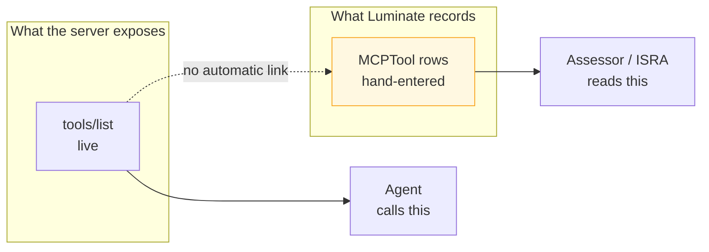

## Governance lifecycle

The server record carries a **second axis** beside operational `status`: `governance_state`, moved
only by `POST /api/v1/catalog/mcp-servers/{id}/transition`.

| State | Meaning |
|---|---|
| `not_evaluated` | No ruleset generation has decided this server. The starting state. |
| `out_of_scope` | Assessed, and no rule matches. Distinguishable from never-assessed. |
| `in_scope_unassessed` | In scope; required evidence not yet complete |
| `assessed` | Evidence complete; awaiting verdict |
| `approved` | Verdict recorded |
| `suspended` | Governance has halted the server |
| `retired` | Decommissioned. **Terminal.** |

Three properties matter for assurance:

- **The permission is a governance permission, not a registry one.** The action lives on the
  server's own route but is authorized on the governance verb deliberately, so it is not handed to
  every holder of the registry's update permission.
- **Direct writes are refused.** A create or update payload carrying `governance_state` or
  `governance_state_reason` is rejected with a transition-required error rather than silently
  ignored — the caller is never told the state moved when it did not.
- **Suspension must be previewed.** `POST .../suspension-preview` returns the deployment ids and
  access policy ids the suspension would take down, and **records that it was shown**; the
  suspension gate later checks against that recorded preview.

Today, governance rulesets are deployed but inert — with zero applicability rules, every server
sits at `not_evaluated`. The axis exists and decides nothing until `governance-intake` populates
it.

## Who can do what

| Action | Role | Scope |
|---|---|---|
| Register / edit / delete a server | MCP Server Administrator | Project |
| View a server | MCP Server Viewer | Project |
| Review without editing | MCP Server Approver | Project |
| Move `governance_state` | Governance Administrator | Organization |
| Create the deployment | Platform administrator | Not delegable |
| Create the access policy | Platform administrator | Not delegable |

Registry visibility is filtered by materialised scope tokens, and it **fails closed** — a caller
with no effective scope sees an empty list rather than an error.

---

# Hosting — the five substrates

The platform requirement is the same on all four: **the gateway must be able to reach your server,
and nothing else should be able to.** What differs is how you achieve each half.

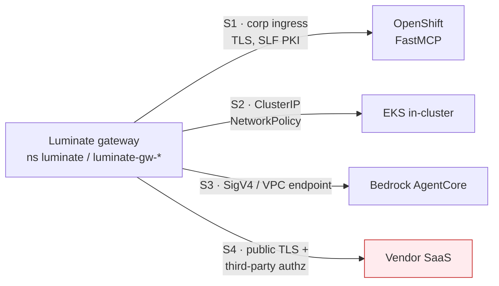

## S1 · OpenShift — the current majority

The shape in production today. `pharmacy-mcp-server` is registered against
`https://dev-corp-aws-ca1-k8s.sunlifecorp.com/dev-genai-pharmacymcp-ns/pharmacy-mcp-server/mcp`.

| Concern | Requirement |
|---|---|
| **Framework** | FastMCP or the official MCP SDK's HTTP server. Serve Streamable HTTP; bind `0.0.0.0` |
| **Path** | FastMCP serves at `/mcp` (Streamable HTTP) or `/sse`. The registered `backend_endpoint` **includes that path** |
| **Ingress** | Corporate OpenShift ingress. The route is a subpath — the server must not emit absolute self-links assuming its own hostname |
| **TLS** | **The load-bearing one.** Leaves under `*.sunlifecorp.com` are issued by `Sun Life Financial Issuing CA3`, which no public root store carries |
| **Container** | Non-root, `allowPrivilegeEscalation: false`, CPU + memory requests **and** limits |
| **Images** | Mirrored to Quay or ECR. There is no `docker.io` egress from Sun Life cluster pods |
| **Reachability control** | OpenShift NetworkPolicy plus route-level restriction. The ingress host is corporate-resolvable, so network control is not implied by the topology the way it is in S2 |

### The TLS trap, stated once

agentgateway resolves trust roots by **openssl-probe**, where `SSL_CERT_FILE` **replaces** the
system store rather than adding to it. Pointing the gateway at the Sun Life bundle alone would
trade public TLS (Bedrock) for internal TLS.

The correct wiring is a merge, and the chart distinguishes the two:

- **`gateway.caBundle` MERGES** — an init container concatenates the image's roots with the
  ConfigMap into `/etc/ssl/merged/ca-bundle.crt` and points `SSL_CERT_FILE` at the result.
- **`slf.caBundle` SUBSTITUTES** — correct for the backend, wrong for the gateway.

Symptom when it is missing: agentgateway logs `invalid peer certificate: UnknownIssuer` and the
caller sees **`500 upstream service error`**, which names neither TLS nor the certificate. Verify
with `grep -c BEGIN "$SSL_CERT_FILE"` inside the gateway pod — the count should exceed the image's
own root count.

The init container itself needs CPU and memory requests and limits, or Gatekeeper denies the
ReplicaSet while `rollout status` merely hangs on *"0 out of 1 new replicas have been updated"*.

## S2 · In-cluster on EKS

`claims-tools` and `underwriting-tools` run this way:
`http://claims-tools.luminate.svc.cluster.local:8000/mcp`.

| Concern | Requirement |
|---|---|
| **Address** | ClusterIP service DNS name, with port and path |
| **TLS** | Plain HTTP is acceptable **only** because the hop never leaves the pod network. That is a control, and MSR-10 requires it to be stated and enforced, not assumed |
| **Reachability control** | NetworkPolicy admitting **only** the gateway namespace. This is the entire boundary in `gateway_identity` mode |
| **Namespace** | If the server is not in the gateway's namespace, the policy must admit across namespaces explicitly |
| **DNS rebinding** | MCP SDK servers often ship DNS-rebinding protection that rejects unexpected `Host` headers. Configure it for the in-cluster service name the gateway dials |
| **Node scheduling** | Sun Life clusters require a region node selector and, on some node pools, a toleration. Without them the pod stays `Pending` |

**Do not treat "it is in-cluster" as the security argument on its own.** A namespace move, a second
caller, or a service mesh change turns an undefended plain-HTTP endpoint into an open one. The
NetworkPolicy is the control; write it down.

## S3 · Bedrock AgentCore

Two distinct things are called AgentCore in this context and they onboard differently.

| Variant | What it is | Onboarding |
|---|---|---|
| **MCP server on an AgentCore runtime** | Your MCP server hosted as an AgentCore runtime | Register the runtime's HTTPS endpoint as `backend_endpoint`; the gateway reaches it like any remote server |
| **AgentCore Gateway fronting other tools** | AWS's own MCP front end over Lambda / OpenAPI / Smithy targets | Register the AgentCore Gateway endpoint as the MCP server. Its own targets are outside ACP's view |

| Concern | Requirement |
|---|---|
| **Reachability** | The gateway must reach the AgentCore endpoint from the cluster. `us-east-1` has **no egress** from these clusters — a `us.*` regional endpoint is unusable; use `ca-central-1` |
| **TLS** | Public AWS certificates. This is exactly why the trust bundle must be merged and not substituted |
| **Credential** | AgentCore endpoints expect SigV4 or an inbound OAuth token. Luminate's outbound modes do **not** emit SigV4 for an MCP target — the exchange emits a bearer token. Where SigV4 is required, this is an open route decision, not a configuration |
| **Governed route** | Only `{gateway}/mcp/{endpoint_name}` is governed. A workload calling the runtime ARN directly is invisible to ACP — no policy, no audit event, no attribution |

The route decision — SigV4-direct versus through the gateway — is deliberately the same question
`integration-patterns` raises for agents, and should be answered once for both.

## S4 · Third-party / vendor-hosted — blocked today

A vendor MCP endpoint is fronted by the vendor's own authorization server, which cannot validate a
Luminate-issued token. Luminate names this case with two enum members and implements neither:

- `injected_credential` — *will* spend a stored per-deployment credential
- `external_exchange` — *will* run a second RFC 8693 exchange against the server's own
  authorization server

**Neither mechanism is implemented.** A server in either mode is served like `gateway_identity` —
**with no credential sent** — so the call arrives unauthenticated and the vendor rejects it, or
worse, does not.

The only mode that could reach such a server today is `token_forward`, and it applies only if the
vendor already trusts the *gateway's* issuer, which a third party by definition does not.

**Do not onboard S4 until one of the two mechanisms lands.** There is no local workaround; a shared
static credential injected by some other means would be an ungoverned secret outside the platform's
credential model.

Even once `injected_credential` lands, it covers only a vendor reached as a *service*. A vendor that
must be reached as the *individual user* — with that person's own three-legged OAuth token, as
per-user Atlassian, ServiceNow or Splunk access needs — waits on a separate consortium ask,
[ACPDIS-165](https://ai-consortium.atlassian.net/browse/ACPDIS-165) *Per-User Third-Party Connections*
([EACPP-1444](https://sunlife.atlassian.net/browse/EACPP-1444)).

## S5 · AWS Lambda — conditional

A Lambda can host an MCP server, but only behind something that gives it a stable HTTPS URL.
MCP is a remote HTTP protocol; a bare function is not addressable.

| Fronting | Verdict |
|---|---|
| **Function URL, `AuthType: NONE`** | ❌ Refused. Internet-reachable, so MSR-10 cannot be met — the backend would be reachable by more than the gateway |
| **Function URL, `AuthType: AWS_IAM`** | ❌ Not expressible. Requires SigV4, which the platform cannot emit — see below |
| **API Gateway, private, VPC endpoint + resource policy** | 🟡 The viable route. Satisfies MSR-10 by network, and the gateway presents a bearer or nothing |

| Concern | Requirement |
|---|---|
| **Transport** | Streamable HTTP. MCP permits a **stateless** server, so a Lambda that mints no `Mcp-Session-Id` is conformant — but it forfeits per-run correlation (MSR-29), because the MCP session is the gateway's preferred run unit on this lane |
| **SSE** | Avoid. API Gateway REST has a 29-second integration timeout, and the platform's own capture never buffers `text/event-stream`, so an SSE Lambda is classified status-only |
| **Cold start** | The portal token endpoint is rate-limited. A per-invocation token mint will pass in dev and throttle in production — cache in the execution context, not per handler call |
| **Reachability** | MSR-10 by resource policy and private endpoint. A public Function URL is the exact inverse of the requirement |
| **Build path** | Same JTE gates as every other substrate — a Lambda is not exempt from MSR-19 to MSR-23 |

## The constraint S3 and S5 share — AWS-native invoke auth is not expressible

Verified against `AI-Consortium/luminate` `origin/main` `1c4a00035` (2026-09-08): the MCP outbound
path emits exactly three backend-auth shapes — `token_exchange` (RFC 8693 bearer), `forward`
(passthrough of the caller's bearer), or `none`. A search for SigV4 or AWS auth across
`gateway/app/services` and `gateway/app/middleware` returns **zero**.

So any AWS target whose native invoke auth is **SigV4** — a Lambda Function URL with `AWS_IAM`,
or an AgentCore runtime expecting a signed request — cannot be reached with that auth. The
options are to front it with something that accepts a bearer, or to reach it as
`gateway_identity` over a network-restricted path and carry no caller identity at all.

This is one finding, not two. It is the same reason S3's governed-route question is open, and it
is recorded once in [Gaps](d2-design/gaps.md) rather than duplicated per substrate.

## Substrate comparison

| | S1 OpenShift | S2 EKS in-cluster | S3 AgentCore | S4 Vendor | S5 Lambda |
|---|---|---|---|---|---|
| Live today | ✅ | ✅ | 🟡 | ❌ | ❌ none built |
| TLS to the backend | Required · SLF PKI | Optional (pod network) | Required · public CA | Required · public CA | Required · public CA |
| Reachability control | NetworkPolicy + route | NetworkPolicy | VPC endpoint / SG | Vendor-side allowlist | Private API GW + resource policy |
| Typical identity mode | `delegated_exchange` or `gateway_identity` | `gateway_identity` | `token_forward` or open | **none available** | `gateway_identity`, or bearer if the function validates one |
| Build path | JTE + Quay | JTE + ECR | JTE + ECR | Vendor's | JTE + ECR |
| Blocker | None | None | Route decision · SigV4 | Unimplemented modes | Needs a bearer-accepting front door · SigV4 |

## Common to all substrates

- **Egress from the gateway to your server must be permitted** in both directions of policy — the
  gateway's egress and your server's ingress.
- **Do not expose the server publicly** to serve a convenience client. The gateway is the governed
  path; a second, ungoverned path defeats every control on this page.
- **Deploy per environment.** One catalogue entry, one `Deployment` per gateway, the same
  `deployment_key`. The gateway is the failure domain and the kill boundary.
- **The platform does not probe you.** Readiness, restart and capacity are entirely the hosting
  platform's responsibility.

---

# Identity — what reaches your server, and what you validate

Two independent hops, and confusing them is the most common design error.

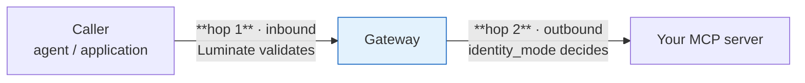

**Hop 1** is fixed by the platform — the caller authenticates to the gateway with one of four
credential shapes, and the gateway decides whether that shape is *eligible* for your endpoint.
**Hop 2** is your design decision — `identity_mode` on the catalogue record decides what, if
anything, your server receives.

## Hop 2 — the five outbound modes

| Mode | What your server receives | Implemented | You must validate |
|---|---|:---:|---|
| **`delegated_exchange`** *(default)* | A bearer token the gateway obtained by RFC 8693 exchange, minted for the **invoking caller** — user or machine — and audienced to **your deployment** | ✅ | Signature (portal JWKS), issuer, `aud` = your deployment audience, expiry |
| **`token_forward`** | The caller's **own validated JWT**, unchanged | ✅ | The same issuer the gateway trusts, plus your own claims checks |
| **`gateway_identity`** | **Nothing.** The gateway strips the caller's `Authorization` and `X-API-Key` before the backend call | ✅ | Nothing — you cannot. Network reachability is your only boundary |
| **`injected_credential`** | *Intended*: a stored per-deployment credential | ❌ | — served as `gateway_identity`, **no credential sent** |
| **`external_exchange`** | *Intended*: a token from your own authorization server via a second RFC 8693 exchange | ❌ | — served as `gateway_identity`, **no credential sent** |

The two unimplemented modes are the trap. Selecting one does **not** produce an error and does not
disable the server — it produces a server reached with no credential. The enum's own docstring
says so.

### The whole estate is on one mode

All four MCP servers registered in SLF dev are `gateway_identity`. None is on the platform default.
That makes network reachability the entire security boundary for every MCP tool call in the estate
today — which is why MSR-10 is mandatory and not merely recommended.

## How the mode is actually resolved

The gateway does not trust the mode field on its own. `effective_backend_auth` keys on the
**audience**:

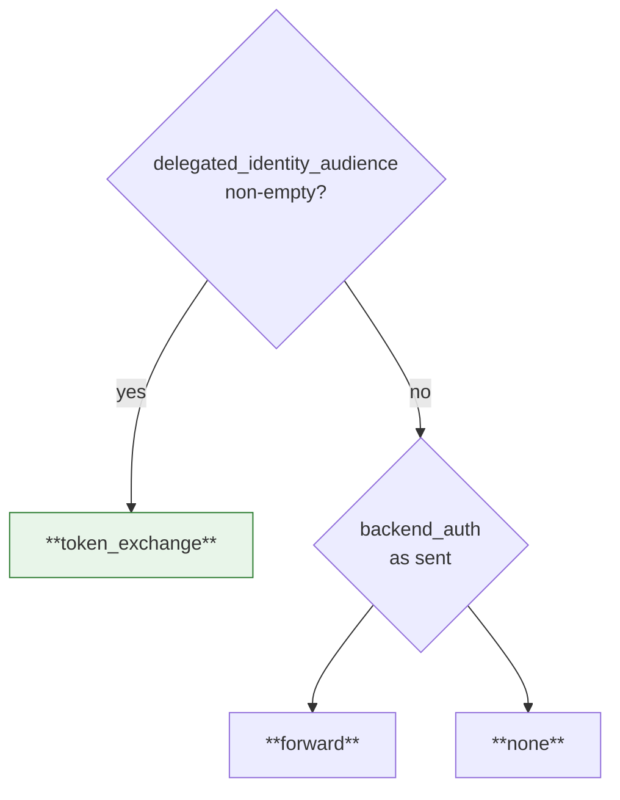

A non-empty audience **always** wins. The reason is version skew: a portal build predating the
`backend_auth` field still sets the audience for a delegated server, so keying on the audience
means an old bundle can never silently degrade an exchange endpoint to unauthenticated serving.
Both the translator and the request-time middleware call the same resolver, so they can never
disagree.

### A delegated target that cannot be exchanged is withheld, not downgraded

If the gateway holds no token endpoint or client id, or the assignment names no downstream
audience, the target is **dropped from the config entirely** and the endpoint reports that it
cannot be served here. Serving it as the gateway's own identity would silently substitute the
gateway for the user — a widening of what the call may reach — so the platform refuses.

**Operationally**: an endpoint that "disappeared" after a gateway change is this, not a routing
fault. The gateway logs `Withholding N delegated MCP target(s)` with the reason.

## Hop 1 — which caller credentials your endpoint accepts

The gateway gates the *inbound* credential by the endpoint's **effective** mode. This is where a
403 that looks like a policy denial usually comes from.

| Your mode → | `token_exchange` | `forward` | `none` |
|---|:---:|:---:|:---:|
| **OIDC JWT** — machine (`client_credentials`) | ✅ | ✅ | ✅ |
| **OIDC JWT** — delegated, carries `act` | ✅ | ✅ | ✅ |
| **OIDC JWT** — plain user, no actor | ❌ `not_exchangeable` | ✅ | ✅ |
| **API key** — `X-API-Key` or `Bearer lum_…` | ❌ `api_key_not_exchangeable` | ❌ `platform_minted_not_forwardable` | ✅ |
| **Delegated token** — `Bearer lud_at_…` | ✅ | ❌ `platform_minted_not_forwardable` | ✅ |

Every ❌ is an **HTTP 403** and is indistinguishable from a policy denial from the outside.

Two rules explain the whole table:

- **`token_exchange` spends the caller's credential as the exchange subject.** Only something the
  exchange can spend qualifies — a delegated identity or an entity's own machine token. An API key
  is not an IdP token, so it cannot be a subject.
- **`forward` hands the caller's `Authorization` header to a backend the platform does not
  control.** A `lum_` API key and a `lud_at_` delegated token are both Luminate-issued and
  Luminate-validated: your server cannot check either, and either one replayed against the portal
  acts as the caller. Only an IdP-signed JWT is safe to forward, so the gateway refuses the rest
  rather than leaking them upstream.

And the corollary for `none`: an API key is admitted because **the gateway strips it** before the
backend call. Your server never sees it.

## The delegated exchange, end to end

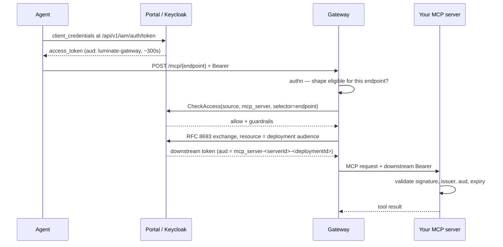

### The audience names the deployment, not the catalogue entry

```text
aud = mcp_server-<server-uuid>-<deployment-uuid>
```

One catalogue entry can be deployed to several gateways and environments, each with its own backend
endpoint. A catalogue-scoped audience would mint one token that **every** one of those backends
accepts — a staging credential spendable against production. The deployment is the narrowest thing
with a single backend and its own discovery document, so it is the unit a token is pinned to.

Which gateway may perform the swap follows from the deployment, since a deployment belongs to
exactly one gateway. A gateway asking for a deployment it does not front is refused even though the
audience is real.

**Your server must check `aud` against its own deployment audience.** Accepting any
platform-issued token is the error this design exists to prevent.

### Discovery — RFC 9728

The gateway publishes protected-resource metadata for **delegated endpoints only**:

```text
GET {gateway}/.well-known/oauth-protected-resource/mcp/{endpoint_name}
```

```json
{
  "resource": "mcp_server-<server-uuid>-<deployment-uuid>",
  "resource_name": "…",
  "bearer_methods_supported": ["header"],
  "authorization_servers": ["<issuer>"]
}
```

- **Deliberately unauthenticated** — a discovery document a backend must fetch before it holds a
  validated token cannot itself require one.
- **404 for a non-delegated endpoint** is the intended answer, not a fault: the endpoint is served
  as the gateway's own identity, so there is no per-resource audience to publish, and claiming one
  would invite a backend to enforce a value it will never see.
- Cached for 300s, matching the portal's authorization-server metadata.

Build your token validation against this document rather than hard-coding an issuer.

## Keycloak specifics that bite

The IdP is **Keycloak**; the portal proxies the token exchange to it. Three properties have each
cost real diagnosis time.

| Property | Why it matters |
|---|---|
| **Every entity gets its own Keycloak client**, id `{resource_type}-{entity_uuid}-{gateway_uuid}` | Fixing one client's configuration fixes nothing else. Always confirm *which* deployment the caller uses before concluding |
| **The gateway audience rides a client scope**, `luminate-gateway-aud`, whose mapper emits `luminate-gateway` | Inspecting a client's own `protocolMappers` gives a false negative. Check `defaultClientScopes`, or just decode the token — `aud` is ground truth |
| **Access tokens are short** — `expires_in` is commonly ~300s, and the token endpoint is rate-limited | Cache the token in memory and refresh shortly before expiry. Minting per request passes in dev and throttles in production |

### One error string covers several causes

The gateway's error handler sanitises every proxy-route error, so `401` and `403` both render as
`{"error":"upstream authentication failed"}` — and it fires on the proxy flag, which is set *before*
authentication, so the gateway's own rejection is relabelled as "upstream". Nothing about the
string implies your server was reached.

Read the real cause from the gateway logs, not the response body:

| Code | Meaning |
|---|---|
| **401** | Authentication failed — bad, missing or expired credential |
| **403** | Either the access policy denied, **or** the credential shape is ineligible for this endpoint, **or** the portal was unreachable (fail-closed) |

## Choosing a mode

| If your server… | Choose |
|---|---|
| Behaves differently per calling user or per calling agent | `delegated_exchange` |
| Must enforce its own per-tool authorization (MSR-16) | `delegated_exchange` or `token_forward` |
| Already validates tokens from the same issuer as the gateway | `token_forward` |
| Serves public, read-only data with no per-caller behaviour | `gateway_identity` — **and** MSR-10 becomes the whole control |
| Is fronted by a third-party authorization server | **Do not onboard yet** — see [Hosting · S4](d2-design/hosting.md) |

Record the rationale (MSR-9). `identity_mode` is in the server's audit snapshot precisely because
moving it changes who the downstream server sees calling it.

---

# Authorization — what is enforced, and what you must enforce

## What the platform decides

Every MCP request through the gateway makes a `CheckAccess` call to the portal. There is no local
policy cache, so the control plane is on the request path and a portal outage **denies**.

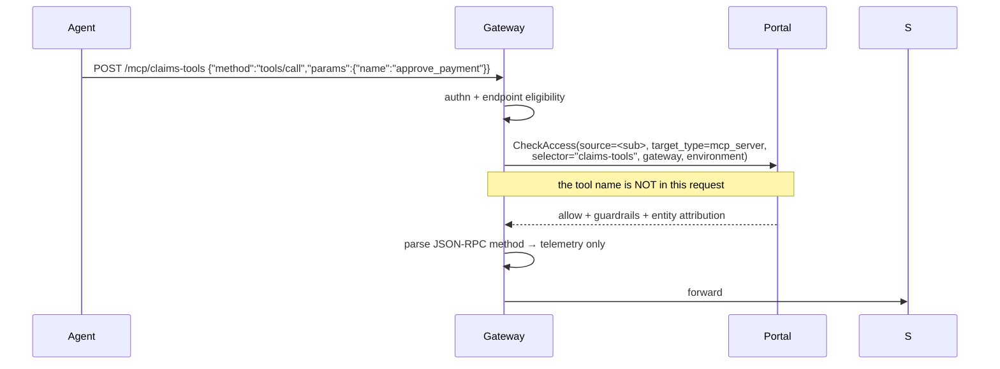

The decision input is the **endpoint name**, taken from the first path segment. The JSON-RPC method
is extracted afterwards, stamped onto the span as `x-luminate-mcp-method`, and used to type the
Langfuse observation — a `tools/call` becomes an `execute_tool` operation rather than a chat
generation. It is telemetry. It is never an input to the decision.

## The boundary, stated plainly

**An access policy on an MCP server grants every tool that server exposes, now and in future.**

Verified against `origin/main`:

| Claim | Evidence |
|---|---|
| No tool target type | `AccessPolicyTargetType` = `mcp_server`, `agent`, `model`, `location`, `environment`. None is a tool |
| `allowed_tool_ids` is inert | The column exists and is serialized; **no runtime consumer** — none in the gateway tree, none in the policy engine, none in any Rego package |
| The tool name is not in the decision | `AuthzRequest.selector` is the endpoint name; `_mcp_request_method` runs after `check_access` returns |
| `MCPTool.access_level` is documentation | `admin` / `read` / `write` is a catalogue label; nothing refuses a `write` tool to a read-only grant |

The [capability map](../../../../capability-map.md) currently marks **CAP-03 as ✅ Available**,
described as *"tools bound to agents rather than assumed"*. That over-states it. Server-granular
binding is real and works; tool-granular binding is modelled and not enforced. The correction is
D3 T25.

## The compensating controls

Two, in order of preference.

### MSR-15 · One server per trust boundary

Design the endpoint the way you would design a database role. If two tools would warrant different
grants, they belong behind different endpoint names.

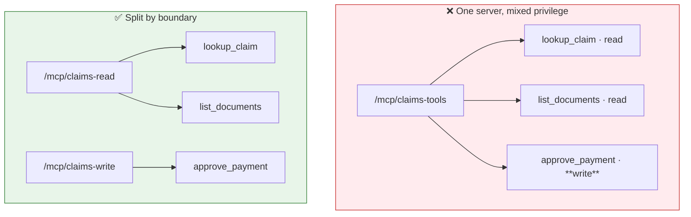

Splitting costs one extra catalogue entry and one extra deployment row. It buys a real,
platform-enforced grant boundary. It is also reversible in a way that a shared endpoint is not:
once agents hold a grant on a mixed server, narrowing it is a migration.

Split on any of these axes:

- **Read versus write**, or read versus anything with a side effect
- **Data classification tier** — a tool reaching personal information does not share an endpoint
  with one reaching reference data
- **System of record** — a tool that writes to a policy admin system does not share an endpoint
  with a calculator
- **Blast radius** — anything you would want to withdraw independently in an incident

### MSR-16 · Server-side tool authorization

Where the split cannot be made, the server authorizes per tool from the identity it receives. This
is **only possible in `delegated_exchange` or `token_forward`** — a `gateway_identity` server has
no identity to authorize, which is the strongest practical argument against that mode for anything
with a write tool.

The server derives the caller from the validated token (`sub`, and `act` for a delegated call) and
applies its own rule. That rule is then a control the ISRA assesses on the server, not on ACP.

## Guardrails

Content control **does** apply to the MCP lane. `GuardrailTargetType` includes `mcp_server`
alongside `model` and `agent`.

| Dimension | Values |
|---|---|
| Type | `banned_words` · `pii_detection` · `model_armor` |
| Direction | `request` · `response` |
| Mode | `enforce` (acts) · `warn` (records only) |
| Action | `block` · `redact` |

Two applications matter for MCP specifically:

- **Request direction** — a tool argument carrying personal information that should not leave the
  boundary. Redaction here is the difference between a governed call and an exfiltration path.
- **Response direction** — tool output is model input on the next turn. This is where prompt
  injection through tool results is caught, and it is why MSR-18 pairs a response guardrail with a
  server-side output bound.

Guardrails are returned on the access decision and applied by the gateway, so they are configured
centrally and need no server-side change.

## Quotas do not apply

`matched_quota_ids` is computed on the decision and put on a span as a count. The gateway tree has
**zero** quota references, and the quota dimension enum stops at requests and tokens. There is no
per-server call budget and no spend dimension.

Do not present a quota as a control for an MCP server. If a tool needs rate limiting, the server
implements it.

## Failure modes

Read in order; the first three are indistinguishable from outside the gateway.

| Symptom | Cause | How to tell |
|---|---|---|
| **403** | Access policy denied | Gateway log: decision `deny`, reason `policy_denied` |
| **403** | Credential shape ineligible for this endpoint | Refusal reason `api_key_not_exchangeable`, `not_exchangeable` or `platform_minted_not_forwardable` |
| **403** | Portal unreachable — fail closed | Reason `portal_unreachable` |
| **401** | Authentication failed | Validator reason: signature, issuer, audience, expiry, or missing authorization claim |
| **404** on `/mcp/` bare | No endpoint named | There is one route per server; the bare prefix matches nothing |
| **404** on `/mcp/{name}` | The endpoint is not on this gateway, or its delegated target was **withheld** | Gateway log: `Withholding N delegated MCP target(s)` |
| **500 upstream service error** | The gateway could not complete the backend TLS handshake | agentgateway log: `invalid peer certificate: UnknownIssuer` |
| Endpoint silently absent from config | `stdio` transport, or empty `backend_endpoint` | The bundle's `skipped` list |

All of `401` and `403` render to the caller as
`{"error":"upstream authentication failed"}`. Nothing about that string implies your server was
reached — the sanitiser fires on the proxy flag, which is set before authentication.

## Audit

Both planes are recorded in the append-only audit trail, which is protected by database triggers
rather than convention.

| Plane | What is recorded |
|---|---|
| **Control plane** | Create, update and delete of a server record, with a field-level snapshot. `identity_mode` is in the snapshot deliberately — moving it changes who the downstream server sees calling it. `metadata` is deliberately excluded: it is free-form operator JSON landing in a store that cannot be redacted |
| **Data plane** | Access decisions under `AccessProtocol.MCP`, actor = the calling entity, target = the server |

The events come from the gateway's front door. A request sent straight to the agentgateway
listener, bypassing it, emits **neither** — which reads as a missing audit trail and is actually a
bypassed one. That is the argument for MSR-10 in a form an assessor recognises.

---

# Build pipeline — the approved path and the scanning gates

An MCP server executes tool code on behalf of an autonomous caller, over an internet-shaped
protocol, against a system of record. It is exactly the class of workload the Sun Life build
controls exist for. This page states the approved path and what each gate actually does — because
two of the three are commonly configured in a way that makes them report success without checking
anything.

## The approved path

Builds use the Jenkins **JTE** libraries in
[`CSDP/pipeline-libraries`](https://bitbucket.sunlifecorp.com/projects/CSDP/repos/pipeline-libraries/browse)
— 62 libraries covering language toolchains, scanning, registries and deployment. An MCP server
uses a small, fixed subset.

| Library | Purpose |
|---|---|
| `pod_template` | The Jenkins build agent |
| `git` | Checkout |
| `python` · `npm` · `maven` · `gradle` · `dotnet` | The language toolchain — dependencies, unit tests, artefacts |
| **`sonarqube`** | Static analysis + quality gate — step `static_code_analysis()` |
| **`snyk`** | Software composition analysis + SBOM — step `sca_scan()` |
| **`checkmarx`** | SAST gate — step `code_analysis()` |
| `quay` or `ecr` | Container image build and push |
| `artifactory` | Approved dependency source |

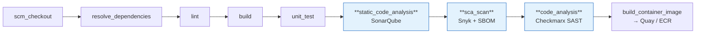

`Jenkinsfile` selects the steps; `pipeline_config.groovy` configures the libraries. Both live in
the MCP server's own repository.

## The gates, and what they really check

### SonarQube — `static_code_analysis()`

| Key | Type | Notes |
|---|---|---|
| `run_sonarqube_scan` | boolean | |
| `enforce_sonarqube_gate` | boolean | |
| `disable_gate_reason_sonarqube` | String | Required when disabled — make it an exception with an owner and an expiry, not a default |
| `scanner`, `scanner_parameters` | String | |
| `sonar_scanner_java_version` | String | |

Coverage reaches SonarQube through the language convention — `coverage.xml` for Python,
`coverage/lcov.info` for Node. Configure it or the gate assesses an untested project as clean.

### Snyk — `sca_scan()`

Library defaults, which are the right defaults:

| Default | Value |
|---|---|
| `RUN_SNYK_SCAN` | **`true`** |
| `ENFORCE_SNYK_GATE` | **`true`** |
| `SEVERITY_THRESHOLD` | **`high`** |
| SBOM artefact | `snyk-sbom.json` |
| Result artefacts | `snyk-results.html`, `snyk-sca-results.json` |

Configuration keys: `run_snyk_scan`, `enforce_snyk_gate`, `disable_gate_reason_snyk`,
`severity_threshold`, `artifactory_read_access_token_id`, `exclude`, `business_unit`,
`evaluate_against_branch`. The Python library adds `package_manager` and `python_command` so a
`uv` or Poetry project resolves correctly.

Two behaviours worth knowing:

- **`enforceSnykGate = true` forces `runSnykScan = true`.** You cannot enforce a gate on a scan
  that did not run.
- Where the repository has an **APM number** in its pipeline config, Snyk findings are tagged
  `apmNumber=<n>` — which is what makes them attributable to an application in the portfolio, and
  therefore what an ISRA can reference.

### Checkmarx — `code_analysis()` — read this one carefully

| Default | Value |
|---|---|
| `ENFORCE_CHECKMARX_GATE` | **`true`** |
| `BRANCHES_TO_SCAN` | **`["develop"]`** |
| Scan timeout | 900s |
| Gate-evaluation timeout | 900s |

**The step does not run a scan.** It resolves the repository's latest **merged pull request**,
looks up the scan Checkmarx already performed for that PR, waits for the scan and its gate
evaluation to complete, and reports the verdict. That means three ways to pass without being
scanned:

1. **No merged PR.** The step logs `New repository PR does not exist. Checkmarx scan is skipped.`
   and continues. A new repository is unscanned by construction.
2. **Branch mismatch.** The default `branches_to_scan` is `["develop"]`. A repository whose
   integration branch is `main` matches no pattern, so the whole stage is skipped unless it
   overrides.
3. **Gate disabled.** With `enforce_checkmarx_gate = false` the stage does nothing at all.

So a green Checkmarx stage is **not evidence**. MSR-20 requires the scan id and gate evaluation on
the build, which is what the step records when it genuinely ran.

## What the ACP estate does today, and why it must not be copied

Verified across `acp-agent-registry`, `acp-mcp-registry` and `agent-control-plane-ui`: all three
carry the same shape.

```groovy
snyk {
  sca_scan {
    run_snyk_scan = true
    enforce_snyk_gate = false
    disable_gate_reason_snyk = 'Snyk gate is disabled during initial CI setup for <repo>.'
  }
}
checkmarx {
  enforce_checkmarx_gate = false
  disable_gate_reason_checkmarx = 'Checkmarx gate is disabled until the issue with java.lang.Exception: Host name and enforceCheckmarxGate is set to true is resolved.'
}
```

The scans run; nothing fails on them. Both reasons describe setup-era workarounds that were never
revisited — the first says *"during initial CI setup"*, the second names a specific exception that
should be retested rather than carried forward.

**An MCP server repository ships with the gates on.** Where a gate genuinely cannot be enforced,
the `disable_gate_reason_*` string carries a named owner and a review date, and the exception is
recorded in the ISRA rather than in a Groovy literal.

## Reference `pipeline_config.groovy` — Python MCP server

```groovy
libraries {
  pod_template {
    use_existing_agent {
      agent_label = 'linux-jnlp-python-base'
    }
  }
  git
  python {
    run_unit_tests = true
    sca_scan {
      run_snyk_scan = true
      enforce_snyk_gate = true
      severity_threshold = 'high'
      package_manager = 'pip'
    }
  }
  sonarqube {
    run_sonarqube_scan = true
    enforce_sonarqube_gate = true
  }
  checkmarx {
    enforce_checkmarx_gate = true
    branches_to_scan = ['main', 'develop', 'release/.*']
  }
  ecr {
    build {
      build_container_image = true
    }
  }
}
```

`branches_to_scan` is the line most repositories need and most repositories omit.

## Image provenance and runtime hardening

| Requirement | Detail |
|---|---|
| **Built by the pipeline** | Not a laptop `docker build`. The image an MCP server serves from is the one the scanned commit produced |
| **Pushed to an approved registry** | Quay or ECR. There is **no `docker.io` egress from Sun Life cluster pods** — every base and runtime image must be mirrored first, and ECR repositories are not auto-created |
| **Immutable reference** | The deployment pins a digest or an immutable tag. Never `latest` |
| **Non-root** | A dedicated UID, `runAsNonRoot: true`, `allowPrivilegeEscalation: false` |
| **Resource requests *and* limits** | On **every** container including init containers — Gatekeeper denies the pod otherwise, and the denial appears only in `kubectl get events`, never in `rollout status` |
| **No secrets in the image** | Upstream credentials come from Vault via the Vault Secrets Operator, or AWS Secrets Manager |
| **Dependencies from Artifactory** | The approved source; `artifactory_read_access_token_id` wires it into the scan and the build |

## Reference `Dockerfile` shape

```dockerfile
FROM <approved-registry>/python:3.12-slim

WORKDIR /app
COPY requirements.txt .
RUN pip install --no-cache-dir -r requirements.txt

COPY server.py .

RUN useradd --uid 10001 --create-home mcp
USER 10001

EXPOSE 8000
CMD ["python", "server.py"]
```

The server binds `0.0.0.0` and serves Streamable HTTP; FastMCP exposes it at `/mcp`, which is the
path that must appear in the registered `backend_endpoint`.

## Evidence an assessor can retrieve

| Control | Evidence | Where |
|---|---|---|
| SAST performed | Checkmarx scan id + gate evaluation | Build log / Checkmarx project |
| SCA performed | `snyk-results.html`, `snyk-sca-results.json` | Build artefacts |
| SBOM produced | `snyk-sbom.json` | Build artefacts |
| Static analysis + coverage | SonarQube project and quality gate | SonarQube |
| Image provenance | Registry digest matches the deployed digest | Registry + deployment manifest |
| Dependency source | Artifactory token id in the pipeline config | Repository |

That table is the supply-chain block of the ISRA control set, and it is retrievable per build
rather than asserted.

---

# Operations — what is visible once it runs

## Attribution — the headers the gateway injects

The gateway stamps a fixed set of `x-luminate-*` headers onto the forwarded request. They are what
make a served MCP call attributable in Langfuse and in the portal's usage queries.

| Header | Value |
|---|---|
| `x-luminate-target-type` | `mcp_server` |
| `x-luminate-target-id` | The catalogue primary key of the server |
| `x-luminate-mcp-method` | The JSON-RPC method — `tools/call`, `tools/list`, `initialize`, … |
| `x-luminate-genai-operation` | `execute_tool` for a `tools/call`; **absent** for anything else |
| `x-luminate-entity-id` / `-type` / `-name` | The calling entity |
| `x-luminate-principal-id` | The principal, mapped to the Langfuse user |
| `x-luminate-session-id` | The run-correlation unit |
| `x-luminate-project-id` | The owning project |

Two design points worth knowing:

- **`gen_ai.operation.name` decides how Langfuse types the observation.** A span typed as a chat
  operation is ingested as a **generation**, and every portal usage and cost query selects
  generations. Stamping a constant would file every MCP request among the calling agent's model
  calls, reporting zero tokens. So only `tools/call` is typed — a handshake or a listing is neither
  a model call nor a tool execution, and Langfuse's default span type describes it exactly.
- **The method is stamped only when it is unambiguous.** A body that is absent, undecodable, not
  JSON, not JSON-RPC 2.0, carrying no string `method`, or a batch array, stamps nothing rather than
  guessing. A consumer counting by method cannot distinguish a guess from a fact, so the platform
  declines to guess.

## Run correlation — `Mcp-Session-Id`

On the MCP lane the unit of a run is the **MCP session**, and it takes precedence over every other
signal.

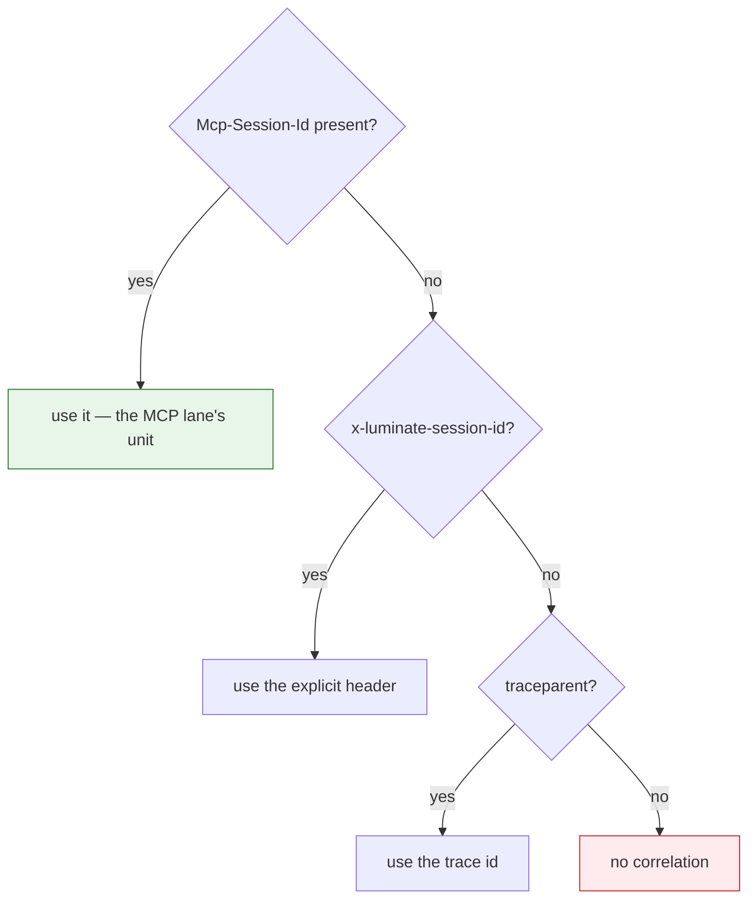

The server mints the session id on `initialize` and the client returns it on subsequent requests —
so **propagating it correctly is the server's job**, and a server that drops it costs the platform
per-run correlation for every call it serves.

The value is sanitised to printable ASCII, length-capped, and namespaced
`{entity_type}:{entity_id}:{raw}` before it reaches Langfuse, because Langfuse session ids are
project-global and an un-namespaced `run-1` from two different agents would otherwise merge.

## Audit

| Plane | Events |
|---|---|
| Control plane | Create / update / delete of the server record, with a field-level snapshot including `identity_mode` |
| Data plane | Access decisions under `AccessProtocol.MCP`, actor = calling entity, target = server |

The audit store is append-only and enforced by database triggers, not convention — the mutation and
truncate refusals back the `audit_event_append_only` and `_no_truncate` triggers. Dropping those
functions would silently make the audit log mutable.

**Data-plane events come from the gateway's front door.** A call sent straight to the agentgateway
listener, bypassing it, emits neither an authorize nor an access event. An audit trail that looks
incomplete is usually a bypassed path, which is the operational form of the MSR-10 argument.

## Cost and usage

Per-server and per-method figures are queryable: the portal's metrics service filters MCP targets
by server id and selects `luminate_mcp_method = "tools/call"` as the one value representing work
the server actually did.

Two boundaries to state in an ISRA:

- **Only traffic through the governed front door is attributable.** Aggregate counts include
  ungoverned probes; per-server breakdowns do not, because they join on identifiers only the front
  door stamps. An org total legitimately exceeding the sum of per-server totals is that, not a
  broken aggregation.
- **The chargeback ledger has no run dimension.** It aggregates by usage date. "What did this run
  cost" is answerable only as a Langfuse session grouping, not from the finance-facing surface.

## Health — the platform does not check

There is **no MCP server health probing anywhere in the platform.** A search across the MCP
registry app and the gateway sync for health, probe or readiness returns zero. `MCPServer.status`
is an operator-set field; nothing moves it automatically.

| What this means | Consequence |
|---|---|
| A dead backend is discovered by a failing call | Alert on gateway 5xx per endpoint; do not wait for a user report |
| `status = active` says nothing about liveness | Do not present it as a health signal in an ISRA |
| Readiness, restarts and capacity are yours | MSR-26 puts the probe on the hosting platform |

## Withdrawal — the kill path

Three mechanisms, of increasing formality.

| Action | Effect | Speed |
|---|---|---|
| Set `status` to `inactive` | The server drops out of the next policy fact export and the next config bundle | Next config push |
| Delete the `AccessPolicy` | The specific caller loses access at the next `CheckAccess` | Immediate — there is no policy cache |
| `governance_state → suspended` | Governance halts the server; the cascade must be **previewed first**, and the preview names the deployments and access policies it will take down | Next config push |

Configuration reaches gateways over a **long-lived bidirectional push stream**, not a poll — so
propagation is fast. It is nonetheless a number that must be **measured per environment and
published**, never quoted. FR-10 and D3 T13 exist for that.

Removing the access policy is the fastest true kill for a single caller, because authorization is
evaluated per request with no cache. Withdrawing the server is the right action for an incident
affecting every caller.

## Runbook — diagnosing a failing MCP endpoint

Work in this order. Each step distinguishes causes the layer above cannot.

1. **Is the endpoint in the gateway's config at all?**
   A `stdio` transport or an empty `backend_endpoint` puts the deployment in the bundle's `skipped`
   list, silently. A delegated target the gateway cannot exchange for is **withheld**, logged as
   `Withholding N delegated MCP target(s)`.
2. **Is the caller's credential shape eligible for this endpoint?**
   Check the endpoint's effective mode against the eligibility matrix in
   [Identity](d2-design/identity.md). An API key on a delegated endpoint is a 403 that reads exactly like a
   policy denial.
3. **Did the access policy allow?**
   Gateway log: decision and reason. `portal_unreachable` is a fail-closed deny, not a policy
   decision.
4. **Did the backend hop complete?**
   `500 upstream service error` with `invalid peer certificate: UnknownIssuer` is a trust-store
   problem, not an authentication one. Check the merged CA bundle in the gateway pod.
5. **Is the server itself healthy?**
   Only now. The platform never checked, so nothing upstream will have told you.

Never reason from the caller-facing body. `{"error":"upstream authentication failed"}` covers a
missing credential, a wrong audience, a policy denial and an unreachable portal, and the sanitiser
fires before authentication so it does not imply the upstream was reached.

---

# Assurance — the ETAB submission and the ISRA control set

| Record | Identifier |
|---|---|
| Architecture governance (ATG) | **ATG0005648** |
| Security risk assessment (ISRA) | **26-1904** |

The control set below (C-1–C-25) and the residual risks (R-1–R-8) are the content submitted
against ISRA 26-1904. The scope those records cover is the substrate list in
[Hosting](d2-design/hosting.md) — quoted verbatim under *What ETAB is being asked to approve* — so a
change to that list is a change to the assessed scope, not an editorial one.

This page exists so that a board submission and a security risk assessment can be produced from
the spec rather than reconstructed from the gateway source. It says three things: what the
architecture is, which decisions were taken and why, and which controls exist with what evidence.

## The architecture, as submitted

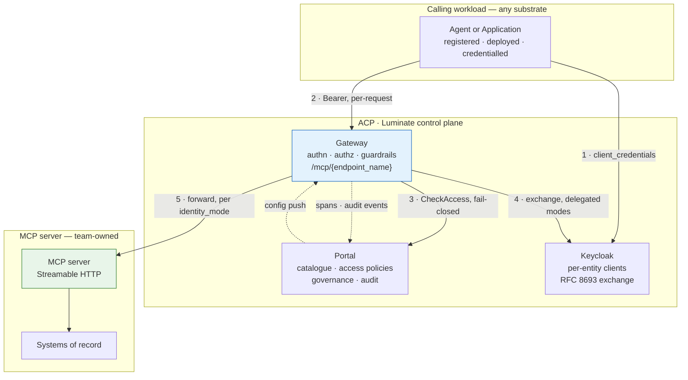

**The single assertion the architecture makes**: no caller reaches an MCP tool except through a
Luminate gateway, and every such call is authenticated, authorized against a central policy
decision, content-scanned and audited. Every control on this page either supports that assertion
or bounds what happens when it does not hold.

## Design decisions

| # | Decision | Rationale | Alternative rejected |
|---|---|---|---|
| **DD-1** | **The gateway is the only path to a tool.** An MCP backend is reachable from the gateway and from nothing else | Controls only exist on the path they sit on. A second path defeats authentication, authorization, guardrails and audit simultaneously | Publishing the server for direct use "for convenience" — creates an ungoverned path with no compensating control |
| **DD-2** | **The server, not the tool, is the unit of authorization** | It is what the platform enforces. Pretending otherwise would put a control in the ISRA that does not exist | Relying on `AccessPolicy.allowed_tool_ids` or `MCPTool.access_level` — both are inert at runtime |
| **DD-3** | **One server per trust boundary** — split read from write, and split classification tiers | Makes the platform's server-granular grant coincide with the intended privilege boundary. Cheap now, a migration later | A single large server with server-side authorization only — acceptable as MSR-16 but weaker: the control moves off the platform |
| **DD-4** | **`delegated_exchange` is the target identity mode**; `gateway_identity` requires a recorded rationale | The server can then authenticate the caller and enforce its own rules. `gateway_identity` makes network reachability the entire boundary | Leaving the estate default. All four dev servers are `gateway_identity` today, which is the state this decision changes |
| **DD-5** | **Third-party-fronted servers are not onboarded** until `injected_credential` or `external_exchange` is implemented | Both modes are enum-only; a server in either is served with **no credential**. Onboarding one would mean calling a third party unauthenticated | Injecting a shared static credential out-of-band — an ungoverned secret outside the platform's credential model |
| **DD-6** | **The catalogue's tool records are a release-time obligation** | There is no discovery on `origin/main`; the records are the only inventory an assessor can read, and a live server currently carries none | Treating the catalogue as authoritative — it would make the ISRA's inventory a fiction |
| **DD-7** | **Scanning gates ship enabled** on MCP server repositories | The library defaults are already `enforce = true`; the estate overrides them. An MCP server is not the workload to carry that forward | Following the existing ACP repositories' configuration |
| **DD-8** | **Evidence, not stage colour.** A control is met when its artefact is retrievable | The Checkmarx step reports success when no scan exists. A green pipeline is not an assessment | Accepting build status as evidence |
| **DD-9** | **Fail-closed availability is accepted.** The control plane is on the request path with no policy cache | A cached allow is an unrevoked allow. The correct posture for a governed egress path | A local policy cache with a TTL — improves availability, weakens revocation |
| **DD-10** | **Tool output is untrusted input** | It re-enters the model's context. Response guardrails plus a server-side output bound are the control | Trusting tool output because the tool is internal |

## Threat model — what an MCP server changes

An MCP server is not an ordinary internal API. It is invoked by a non-deterministic caller, with
arguments the caller composed, and its output re-enters that caller's reasoning.

| # | Threat | Where it bites | Control |
|---|---|---|---|
| **T1** | **Confused deputy** — an agent is induced to call a tool it is entitled to, for a purpose it is not | The grant is per server, so entitlement is coarse | DD-3 split · MSR-16 server-side authorization · MSR-27 classification |
| **T2** | **Excessive agency** — a tool added later is covered by an existing grant, with no approval | New tool, old policy | MSR-7 change control · MSR-6 catalogue diff at release |
| **T3** | **Prompt injection via tool output** — content returned by a tool instructs the model | Response path | MSR-18 bounded, non-instructional output · response guardrails · DD-10 |
| **T4** | **Tool poisoning** — a tool description written to steer model behaviour | Catalogue and `tools/list` | MSR-8 review of names and descriptions |
| **T5** | **Path bypass** — a workload calls the backend directly, skipping the gateway | Network | MSR-10 negative test · DD-1. Bypass emits **no** audit event, so absence of events is the detection signal |
| **T6** | **Credential leakage to a third party** — a platform-minted credential forwarded to an uncontrolled backend | `token_forward` mode | Enforced in the gateway: `platform_minted_not_forwardable`. Verified by negative test |
| **T7** | **Cross-environment token replay** — a staging credential spent against production | Delegated tokens | Audience is scoped to the **deployment**, not the catalogue entry. MSR-12 requires the server to check it |
| **T8** | **Silent unauthenticated serving** — a delegated endpoint degraded to gateway identity | Version skew, missing exchange config | The gateway **withholds** rather than downgrades; `effective_backend_auth` keys on the audience |
| **T9** | **Supply-chain compromise** — a dependency or image with a known vulnerability | Build | MSR-19 to MSR-23, with evidence per DD-8 |
| **T10** | **Data exfiltration through tool arguments** | Request path | Request-direction PII guardrails · MSR-27 · MSR-28 |
| **T11** | **Inventory drift** — the assessed tool set is not the served tool set | Catalogue | MSR-6 · DD-6 |
| **T12** | **Unbounded blast radius on withdrawal** — suspending a server takes down more than expected | Incident response | Suspension preview names the deployments and policies before commit |

## The ISRA control set

Each row is a control an assessor can test. **Type**: P = preventive, D = detective.
**Point** is where it is enforced.

| # | Control | Type | Point | Evidence | Owner |
|---|---|:---:|---|---|---|
| **C-1** | Caller authenticated before any MCP request is served | P | Gateway (JWKS / portal) | 401 on a negative test | Platform |
| **C-2** | Credential shape gated per endpoint mode | P | Gateway authn | 403 with the specific refusal reason | Platform |
| **C-3** | Central, fail-closed access decision on every request | P | Portal `CheckAccess` | Decision recorded per request; deny on portal outage | Platform |
| **C-4** | Grant is explicit — no implicit access to a server | P | `AccessPolicy` | The policy record | Platform admin |
| **C-5** | Tool-level restriction where privileges differ | P | Server-side (MSR-16) or split endpoints (MSR-15) | Architecture record; a negative test per tool | Team |
| **C-6** | Backend unreachable except from the gateway | P | NetworkPolicy / SG / private endpoint | Negative test from a non-gateway workload | Team |
| **C-7** | TLS on any hop leaving the pod network, with the correct trust chain | P | agentgateway TLS + merged CA bundle | Successful call; CA count in the gateway pod | Platform + Team |
| **C-8** | No platform-minted credential leaves the gateway | P | Gateway `_refuse_platform_minted` | 403 `platform_minted_not_forwardable` | Platform |
| **C-9** | Downstream token audienced to the deployment and validated by the server | P | Portal exchange + server validation | Refusal of a token minted for another deployment | Platform + Team |
| **C-10** | Delegated target withheld when it cannot be exchanged | P | Gateway translator | Gateway log; endpoint absent from config | Platform |
| **C-11** | Content control on request and response | P | Guardrails on `mcp_server` | Guardrail binding; a positive detection test | Platform admin |
| **C-12** | Tool output bounded and non-instructional | P | Server-side | Design review; response guardrail | Team |
| **C-13** | SAST performed and gated | P | Checkmarx | Scan id + gate evaluation on the build | Team |
| **C-14** | SCA performed and gated; SBOM retained | P | Snyk | `snyk-sbom.json`, `snyk-results.html` | Team |
| **C-15** | Static analysis gated | P | SonarQube | Project + quality gate status | Team |
| **C-16** | Image built by the pipeline, immutably referenced, non-root | P | Registry + manifest | Digest match; `runAsNonRoot` | Team |
| **C-17** | Secrets from Vault / Secrets Manager only | P | VSO / SM | Manifest review | Team |
| **C-18** | Tool inventory current and classified | D | Catalogue vs live `tools/list` | Release-time diff; classification per tool | Team |
| **C-19** | Tool contract changes are governed | P | Change process | Change record referencing the catalogue diff | Team |
| **C-20** | Every control-plane mutation audited, append-only | D | `audit_events` + DB triggers | The audit record; trigger presence | Platform |
| **C-21** | Every data-plane decision audited | D | `AccessProtocol.MCP` | Authorize + access events per call | Platform |
| **C-22** | Every served call attributable to caller, server and method | D | `x-luminate-*` headers → Langfuse | A trace showing all four | Platform |
| **C-23** | Withdrawal effective across every serving gateway | P | Status / policy / governance suspension | **Measured** propagation time per environment | Platform |
| **C-24** | Suspension radius shown before commit | P | `suspension-preview` | The recorded preview | Platform |
| **C-25** | Governance state recorded and moved only by guarded transition | P | Transition action; direct writes refused | State + reason; a refused direct write | Governance |

## Residual risks to declare

An assessment that does not name these is incomplete, because none is mitigated by a control above.

| # | Residual risk | Why it remains | Compensating position |
|---|---|---|---|
| **R-1** | **A grant covers every tool on the server, including tools added later** | Tool-granular authorization is not implemented in the platform | DD-3 split · MSR-16 · MSR-7 change control. Consortium ask raised |
| **R-2** | **The tool inventory is hand-maintained** | No discovery on `origin/main` | MSR-6 release-time diff. Consortium ask raised |
| **R-3** | **Prompt injection through tool output cannot be eliminated** | It is a property of putting model-readable content in a model's context | Response guardrails, bounded output, and least privilege on what the tool can do |
| **R-4** | **The platform never probes server health** | Not implemented | Hosting-platform probes + alerting on gateway 5xx per endpoint |
| **R-5** | **Availability is bounded by the control plane** | Deliberate: no policy cache, so a portal outage denies | Accepted per DD-9; gateway and portal redundancy |
| **R-6** | **No per-server call quota or spend budget** | Quota dimensions stop at requests and tokens; the gateway consumes none of them | Server-side rate limiting where a tool needs it |
| **R-7** | **Third-party-fronted servers cannot be onboarded with a credential** | `injected_credential` and `external_exchange` unimplemented | DD-5: not onboarded. Consortium ask raised |
| **R-8** | **The governance axis is inert** | Rulesets deployed, zero applicability rules — every server sits at `not_evaluated` | Tracked by `governance-intake`; do not present `governance_state` as an operating control yet |

## What ETAB is being asked to approve

1. **The pattern** — MCP servers are consumed only through a Luminate gateway, on the five
   substrates in [Hosting](d2-design/hosting.md), with S4 excluded and S3 and S5 conditional.
2. **The conformance profile** — MSR-1 to MSR-30 as the bar for any MCP server that will be served,
   with the verification methods stated.
3. **The ten design decisions** — in particular DD-2 and DD-3, which concede that authorization is
   server-granular and make the endpoint boundary the compensating architecture.
4. **The eight residual risks** — accepted, with the consortium asks in
   [Gaps](d2-design/gaps.md) as the path to closing R-1, R-2, R-4 and R-7.

---

# Gaps — what is blocked, and the ask that unblocks it

Every gap below is verified against `AI-Consortium/luminate` `origin/main` @ `10d6ee89`
(2026-09-01) or against the live SLF dev estate on the same date. Each names an owner: a
**consortium** gap is a change to Luminate itself; a **Sun Life** gap is ours to close.

## G-1 · Tool-granular authorization does not exist — **consortium**

| | |
|---|---|
| **What is missing** | An access decision that can name a tool |
| **Proof** | `AccessPolicyTargetType` = `mcp_server`, `agent`, `model`, `location`, `environment` — none is a tool. `AccessPolicy.allowed_tool_ids` has **no runtime consumer** in the gateway tree, the policy engine or any Rego package. The gateway parses the JSON-RPC method *after* `check_access` returns, for telemetry |
| **Impact** | A grant covers every tool a server exposes, now and in future |
| **Workaround** | MSR-15 one server per trust boundary; MSR-16 server-side tool authorization where that is impossible |
| **Ask** | Add a tool target type — or make `allowed_tool_ids` load-bearing — and carry the JSON-RPC method into `AuthzRequest` |
| **Also** | Correct **CAP-03** in the capability map, which currently claims *"tools bound to agents rather than assumed"* at ✅ Available |

## G-2 · No tool discovery — **consortium**

| | |
|---|---|
| **What is missing** | Any automatic read of a server's `tools/list` into the catalogue |
| **Proof** | A search for `last_discovery` across the backend returns zero on `origin/main`. `pharmacy-mcp-server`, live on a corporate-ingress path, carries **zero** `MCPTool` rows |
| **Impact** | The catalogue is a manual claim, not an inventory. An ISRA that reads it is reading a copy |
| **Workaround** | MSR-6 makes catalogue accuracy a release-time obligation, verified by diffing against live `tools/list` |
| **Ask** | Land discovery — the work exists on an unmerged branch — with a recorded discovery timestamp, status and error so staleness is visible |

## G-3 · Two identity modes are enum-only — **consortium**

| | |
|---|---|
| **What is missing** | `injected_credential` (spend a stored per-deployment credential) and `external_exchange` (a second RFC 8693 exchange against the server's own authorization server) |
| **Proof** | The `MCPServerIdentityMode` docstring: *"Neither mechanism is implemented yet — a server in either mode is served like `GATEWAY_IDENTITY`, with no credential sent, until its mechanism lands"* |
| **Impact** | A server fronted by a third-party authorization server **cannot be onboarded**. Selecting either mode produces no error and no credential |
| **Workaround** | None. `gateway_identity` sends nothing; `token_forward` requires the third party to trust *our* issuer, which it does not |
| **Ask** | Implement one of the two. `injected_credential` is the smaller and serves the common SaaS case |
| **Per-user case** | Neither mode reaches a vendor *as the individual user*: `injected_credential` is one shared credential per deployment, so every caller gets the service account's reach and the vendor's audit loses the person. A server that must act with the user's own three-legged OAuth token is a separate consortium ask, [ACPDIS-165](https://ai-consortium.atlassian.net/browse/ACPDIS-165) *Per-User Third-Party Connections* ([EACPP-1444](https://sunlife.atlassian.net/browse/EACPP-1444)) |

## G-4 · The kill switch is a status edit and its propagation is unmeasured — **consortium + Sun Life**

| | |
|---|---|
| **What is missing** | A stop endpoint, an audited stop event, and a published propagation interval |
| **Proof** | Withdrawal is a `status` edit or a governance transition; the fact export filters to active resources so the resource drops out of the next bundle. Configuration reaches gateways by push, but the interval has never been measured on the SLF estate |
| **Impact** | Incident response has no stated time-to-effect. B-13 Principle 17 wants one |
| **Workaround** | Deleting the `AccessPolicy` is faster for a single caller — authorization is per request with no cache |
| **Ask** | Consortium: a first-class stop with an audited event. Sun Life: **measure and publish** the interval per environment (D3 T13) |

## G-5 · The platform never probes MCP server health — **consortium**

| | |
|---|---|
| **What is missing** | Any readiness or liveness check against a registered backend |
| **Proof** | Searches for health, probe and readiness across the MCP registry app and the gateway sync return zero. `MCPServer.status` is operator-set |
| **Impact** | A dead backend is discovered by a failing tool call. `status = active` is not a health signal |
| **Workaround** | Hosting-platform probes plus alerting on gateway 5xx per endpoint |
| **Ask** | A periodic backend probe that moves `status` and surfaces in the portal |

## G-6 · Scanning gates are disabled across the ACP estate — **Sun Life**

| | |
|---|---|
| **What is missing** | Enforcement. The libraries default to `ENFORCE_SNYK_GATE = true` and `ENFORCE_CHECKMARX_GATE = true`; `acp-agent-registry`, `acp-mcp-registry` and `agent-control-plane-ui` all set both to `false` |
| **Impact** | The supply-chain control is nominal. The scans run and nothing fails on them |
| **Workaround** | None — it is a configuration decision |
| **Ask** | Ship MCP server repositories with the gates on (MSR-20 to MSR-22); re-test and remove the two inherited `disable_gate_reason_*` strings, or convert them into exceptions with an owner and a review date |

## G-7 · The Checkmarx gate passes without scanning — **Sun Life**

| | |
|---|---|
| **What is missing** | Fail-closed behaviour when no scan exists |
| **Proof** | `libraries/checkmarx/steps/code_analysis.groovy` resolves the latest **merged PR**, reads the scan Checkmarx already ran for it, and reports the verdict. With no merged PR it logs `New repository PR does not exist. Checkmarx scan is skipped.` and continues. Default `branches_to_scan` is `["develop"]` |
| **Impact** | A new repository, or one whose integration branch is `main`, is unscanned and green |
| **Workaround** | MSR-20 requires the scan id and gate evaluation as evidence, not the stage colour |
| **Ask** | Sun Life AppSec / GDS: make a missing scan a failure rather than a skip, or require the evidence check in the ISRA. Every MCP server repo sets `branches_to_scan` explicitly |

## G-8 · No per-server quota or spend budget — **consortium**

| | |
|---|---|
| **What is missing** | Any enforced call or spend limit on an MCP server |
| **Proof** | The quota dimension enum stops at requests and tokens; the gateway tree has **zero** quota references; `matched_quota_ids` is put on a span as a count and returned on the decision — telemetry, not enforcement |
| **Impact** | A runaway agent's tool calls are unbounded by the platform |
| **Workaround** | Server-side rate limiting |
| **Ask** | Make quotas enforced at the gateway, with an MCP-call dimension |

## G-9 · The governance axis is inert — **Sun Life**

| | |
|---|---|
| **What is missing** | Applicability rules. The governance ruleset machinery, the guarded transition, the self-approval refusal and the suspension cascade preview all exist and work |
| **Impact** | Every MCP server sits at `not_evaluated`. Any gate reading governance state is vacuous |
| **Workaround** | None needed — the mechanism is ready; the content is not authored |
| **Ask** | `governance-intake` (EACPP-877) authors the rules. Do not present `governance_state` as an operating control until it does |

## G-10 · The AgentCore route decision is open — **Sun Life**

| | |
|---|---|
| **What is missing** | A recorded decision on whether an AgentCore-hosted MCP server is reached through `{gateway}/mcp/{endpoint}` or SigV4-direct to the runtime ARN |
| **Impact** | Only the gateway route is governed. A direct call has no policy, no audit event and no attribution. Luminate's MCP outbound modes emit a bearer token, not SigV4 |
| **Workaround** | Route through the gateway; accept that a SigV4-only backend is not yet expressible |
| **Ask** | Decide once, for agents and MCP servers together — the same question `integration-patterns` T5 raises |

## G-11 · AWS-native invoke auth (SigV4) is not expressible — **consortium**

| | |
|---|---|
| **What is missing** | Any way for the MCP outbound path to sign a request to an AWS target |
| **Proof** | At `origin/main` `1c4a00035` (2026-09-08) the translator emits exactly three backend-auth shapes — `token_exchange`, `forward` (passthrough), `none`. A search for SigV4 or AWS auth across `gateway/app/services` and `gateway/app/middleware` returns **zero** |
| **Impact** | Spans two substrates. An AgentCore runtime expecting a signed request (**S3**) and a Lambda Function URL with `AuthType: AWS_IAM` (**S5**) cannot be reached with their native auth |
| **Workaround** | Front the target with something that accepts a bearer (private API Gateway), or reach it as `gateway_identity` over a network-restricted path and carry no caller identity |
| **Ask** | A SigV4 backend-auth mode on the MCP and A2A outbound paths, so AWS-native targets are first-class rather than requiring a shim |

## Gap summary

| Gap | Owner | Blocks | Severity |
|---|---|---|---|
| G-1 tool-granular authorization | Consortium | Fine-grained least privilege | **High** — compensated architecturally |
| G-2 tool discovery | Consortium | A trustworthy inventory | **High** — compensated by process |
| G-3 third-party identity modes | Consortium | Vendor MCP onboarding; per-user vendor access ([ACPDIS-165](https://ai-consortium.atlassian.net/browse/ACPDIS-165)) | **High** — no workaround |
| G-4 kill switch and propagation | Both | Stated incident response time | Medium |
| G-5 health probing | Consortium | Operational visibility | Medium |
| G-6 disabled scanning gates | Sun Life | Supply-chain assurance | **High** — ours to fix |
| G-7 vacuous Checkmarx gate | Sun Life | SAST assurance | **High** — ours to fix |
| G-8 quotas not enforced | Consortium | Bounded blast radius | Medium |
| G-9 inert governance rules | Sun Life | Governance gating | Medium |
| G-10 AgentCore route | Sun Life | The AgentCore substrate | Medium |
| G-11 SigV4 not expressible | Consortium | The AgentCore and Lambda substrates | Medium — shim available |

The three that are entirely ours — **G-6, G-7 and G-9** — are also the three that most directly
weaken an assurance submission. They need no consortium change and should not wait for one.
