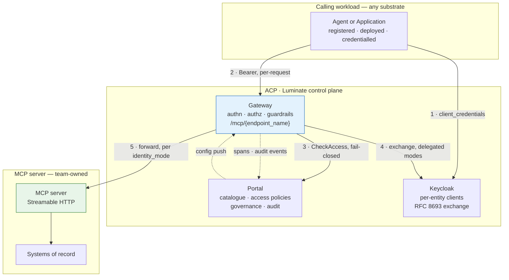

# Assurance — the ETAB submission and the ISRA control set

| Record | Identifier |
|---|---|
| Architecture governance (ATG) | **ATG0005648** |
| Security risk assessment (ISRA) | **26-1904** |

The control set below (C-1–C-25) and the residual risks (R-1–R-8) are the content submitted
against ISRA 26-1904. The scope those records cover is the substrate list in
[Hosting](hosting.md) — quoted verbatim under *What ETAB is being asked to approve* — so a
change to that list is a change to the assessed scope, not an editorial one.

This page exists so that a board submission and a security risk assessment can be produced from
the spec rather than reconstructed from the gateway source. It says three things: what the
architecture is, which decisions were taken and why, and which controls exist with what evidence.

## The architecture, as submitted

**The single assertion the architecture makes**: no caller reaches an MCP tool except through a
Luminate gateway, and every such call is authenticated, authorized against a central policy
decision, content-scanned and audited. Every control on this page either supports that assertion
or bounds what happens when it does not hold.

## Design decisions

| # | Decision | Rationale | Alternative rejected |
|---|---|---|---|
| **DD-1** | **The gateway is the only path to a tool.** An MCP backend is reachable from the gateway and from nothing else | Controls only exist on the path they sit on. A second path defeats authentication, authorization, guardrails and audit simultaneously | Publishing the server for direct use "for convenience" — creates an ungoverned path with no compensating control |
| **DD-2** | **The server, not the tool, is the unit of authorization** | It is what the platform enforces. Pretending otherwise would put a control in the ISRA that does not exist | Relying on `AccessPolicy.allowed_tool_ids` or `MCPTool.access_level` — both are inert at runtime |
| **DD-3** | **One server per trust boundary** — split read from write, and split classification tiers | Makes the platform's server-granular grant coincide with the intended privilege boundary. Cheap now, a migration later | A single large server with server-side authorization only — acceptable as MSR-16 but weaker: the control moves off the platform |
| **DD-4** | **`delegated_exchange` is the target identity mode**; `gateway_identity` requires a recorded rationale | The server can then authenticate the caller and enforce its own rules. `gateway_identity` makes network reachability the entire boundary | Leaving the estate default. All four dev servers are `gateway_identity` today, which is the state this decision changes |
| **DD-5** | **Third-party-fronted servers are not onboarded** until `injected_credential` or `external_exchange` is implemented | Both modes are enum-only; a server in either is served with **no credential**. Onboarding one would mean calling a third party unauthenticated | Injecting a shared static credential out-of-band — an ungoverned secret outside the platform's credential model |
| **DD-6** | **The catalogue's tool records are a release-time obligation** | There is no discovery on `origin/main`; the records are the only inventory an assessor can read, and a live server currently carries none | Treating the catalogue as authoritative — it would make the ISRA's inventory a fiction |
| **DD-7** | **Scanning gates ship enabled** on MCP server repositories | The library defaults are already `enforce = true`; the estate overrides them. An MCP server is not the workload to carry that forward | Following the existing ACP repositories' configuration |
| **DD-8** | **Evidence, not stage colour.** A control is met when its artefact is retrievable | The Checkmarx step reports success when no scan exists. A green pipeline is not an assessment | Accepting build status as evidence |
| **DD-9** | **Fail-closed availability is accepted.** The control plane is on the request path with no policy cache | A cached allow is an unrevoked allow. The correct posture for a governed egress path | A local policy cache with a TTL — improves availability, weakens revocation |
| **DD-10** | **Tool output is untrusted input** | It re-enters the model's context. Response guardrails plus a server-side output bound are the control | Trusting tool output because the tool is internal |

## Threat model — what an MCP server changes

An MCP server is not an ordinary internal API. It is invoked by a non-deterministic caller, with
arguments the caller composed, and its output re-enters that caller's reasoning.

| # | Threat | Where it bites | Control |
|---|---|---|---|
| **T1** | **Confused deputy** — an agent is induced to call a tool it is entitled to, for a purpose it is not | The grant is per server, so entitlement is coarse | DD-3 split · MSR-16 server-side authorization · MSR-27 classification |
| **T2** | **Excessive agency** — a tool added later is covered by an existing grant, with no approval | New tool, old policy | MSR-7 change control · MSR-6 catalogue diff at release |
| **T3** | **Prompt injection via tool output** — content returned by a tool instructs the model | Response path | MSR-18 bounded, non-instructional output · response guardrails · DD-10 |
| **T4** | **Tool poisoning** — a tool description written to steer model behaviour | Catalogue and `tools/list` | MSR-8 review of names and descriptions |
| **T5** | **Path bypass** — a workload calls the backend directly, skipping the gateway | Network | MSR-10 negative test · DD-1. Bypass emits **no** audit event, so absence of events is the detection signal |
| **T6** | **Credential leakage to a third party** — a platform-minted credential forwarded to an uncontrolled backend | `token_forward` mode | Enforced in the gateway: `platform_minted_not_forwardable`. Verified by negative test |
| **T7** | **Cross-environment token replay** — a staging credential spent against production | Delegated tokens | Audience is scoped to the **deployment**, not the catalogue entry. MSR-12 requires the server to check it |
| **T8** | **Silent unauthenticated serving** — a delegated endpoint degraded to gateway identity | Version skew, missing exchange config | The gateway **withholds** rather than downgrades; `effective_backend_auth` keys on the audience |
| **T9** | **Supply-chain compromise** — a dependency or image with a known vulnerability | Build | MSR-19 to MSR-23, with evidence per DD-8 |
| **T10** | **Data exfiltration through tool arguments** | Request path | Request-direction PII guardrails · MSR-27 · MSR-28 |
| **T11** | **Inventory drift** — the assessed tool set is not the served tool set | Catalogue | MSR-6 · DD-6 |
| **T12** | **Unbounded blast radius on withdrawal** — suspending a server takes down more than expected | Incident response | Suspension preview names the deployments and policies before commit |

## The ISRA control set

Each row is a control an assessor can test. **Type**: P = preventive, D = detective.
**Point** is where it is enforced.

| # | Control | Type | Point | Evidence | Owner |
|---|---|:---:|---|---|---|
| **C-1** | Caller authenticated before any MCP request is served | P | Gateway (JWKS / portal) | 401 on a negative test | Platform |
| **C-2** | Credential shape gated per endpoint mode | P | Gateway authn | 403 with the specific refusal reason | Platform |
| **C-3** | Central, fail-closed access decision on every request | P | Portal `CheckAccess` | Decision recorded per request; deny on portal outage | Platform |
| **C-4** | Grant is explicit — no implicit access to a server | P | `AccessPolicy` | The policy record | Platform admin |
| **C-5** | Tool-level restriction where privileges differ | P | Server-side (MSR-16) or split endpoints (MSR-15) | Architecture record; a negative test per tool | Team |
| **C-6** | Backend unreachable except from the gateway | P | NetworkPolicy / SG / private endpoint | Negative test from a non-gateway workload | Team |
| **C-7** | TLS on any hop leaving the pod network, with the correct trust chain | P | agentgateway TLS + merged CA bundle | Successful call; CA count in the gateway pod | Platform + Team |
| **C-8** | No platform-minted credential leaves the gateway | P | Gateway `_refuse_platform_minted` | 403 `platform_minted_not_forwardable` | Platform |
| **C-9** | Downstream token audienced to the deployment and validated by the server | P | Portal exchange + server validation | Refusal of a token minted for another deployment | Platform + Team |
| **C-10** | Delegated target withheld when it cannot be exchanged | P | Gateway translator | Gateway log; endpoint absent from config | Platform |
| **C-11** | Content control on request and response | P | Guardrails on `mcp_server` | Guardrail binding; a positive detection test | Platform admin |
| **C-12** | Tool output bounded and non-instructional | P | Server-side | Design review; response guardrail | Team |
| **C-13** | SAST performed and gated | P | Checkmarx | Scan id + gate evaluation on the build | Team |
| **C-14** | SCA performed and gated; SBOM retained | P | Snyk | `snyk-sbom.json`, `snyk-results.html` | Team |
| **C-15** | Static analysis gated | P | SonarQube | Project + quality gate status | Team |
| **C-16** | Image built by the pipeline, immutably referenced, non-root | P | Registry + manifest | Digest match; `runAsNonRoot` | Team |
| **C-17** | Secrets from Vault / Secrets Manager only | P | VSO / SM | Manifest review | Team |
| **C-18** | Tool inventory current and classified | D | Catalogue vs live `tools/list` | Release-time diff; classification per tool | Team |
| **C-19** | Tool contract changes are governed | P | Change process | Change record referencing the catalogue diff | Team |
| **C-20** | Every control-plane mutation audited, append-only | D | `audit_events` + DB triggers | The audit record; trigger presence | Platform |
| **C-21** | Every data-plane decision audited | D | `AccessProtocol.MCP` | Authorize + access events per call | Platform |
| **C-22** | Every served call attributable to caller, server and method | D | `x-luminate-*` headers → Langfuse | A trace showing all four | Platform |
| **C-23** | Withdrawal effective across every serving gateway | P | Status / policy / governance suspension | **Measured** propagation time per environment | Platform |
| **C-24** | Suspension radius shown before commit | P | `suspension-preview` | The recorded preview | Platform |
| **C-25** | Governance state recorded and moved only by guarded transition | P | Transition action; direct writes refused | State + reason; a refused direct write | Governance |

## Residual risks to declare

An assessment that does not name these is incomplete, because none is mitigated by a control above.

| # | Residual risk | Why it remains | Compensating position |
|---|---|---|---|
| **R-1** | **A grant covers every tool on the server, including tools added later** | Tool-granular authorization is not implemented in the platform | DD-3 split · MSR-16 · MSR-7 change control. Consortium ask raised |
| **R-2** | **The tool inventory is hand-maintained** | No discovery on `origin/main` | MSR-6 release-time diff. Consortium ask raised |
| **R-3** | **Prompt injection through tool output cannot be eliminated** | It is a property of putting model-readable content in a model's context | Response guardrails, bounded output, and least privilege on what the tool can do |
| **R-4** | **The platform never probes server health** | Not implemented | Hosting-platform probes + alerting on gateway 5xx per endpoint |
| **R-5** | **Availability is bounded by the control plane** | Deliberate: no policy cache, so a portal outage denies | Accepted per DD-9; gateway and portal redundancy |
| **R-6** | **No per-server call quota or spend budget** | Quota dimensions stop at requests and tokens; the gateway consumes none of them | Server-side rate limiting where a tool needs it |
| **R-7** | **Third-party-fronted servers cannot be onboarded with a credential** | `injected_credential` and `external_exchange` unimplemented | DD-5: not onboarded. Consortium ask raised |
| **R-8** | **The governance axis is inert** | Rulesets deployed, zero applicability rules — every server sits at `not_evaluated` | Tracked by `governance-intake`; do not present `governance_state` as an operating control yet |

## What ETAB is being asked to approve

1. **The pattern** — MCP servers are consumed only through a Luminate gateway, on the five
   substrates in [Hosting](hosting.md), with S4 excluded and S3 and S5 conditional.
2. **The conformance profile** — MSR-1 to MSR-30 as the bar for any MCP server that will be served,
   with the verification methods stated.
3. **The ten design decisions** — in particular DD-2 and DD-3, which concede that authorization is
   server-granular and make the endpoint boundary the compensating architecture.
4. **The eight residual risks** — accepted, with the consortium asks in
   [Gaps](gaps.md) as the path to closing R-1, R-2, R-4 and R-7.
