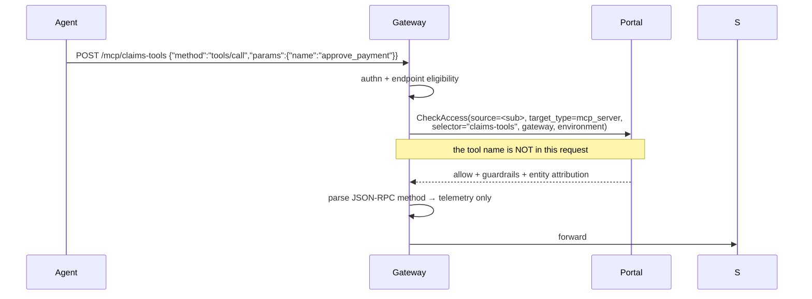
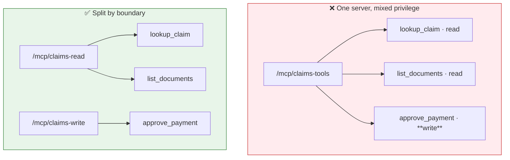

# Authorization — what is enforced, and what you must enforce

## What the platform decides

Every MCP request through the gateway makes a `CheckAccess` call to the portal. There is no local
policy cache, so the control plane is on the request path and a portal outage **denies**.

The decision input is the **endpoint name**, taken from the first path segment. The JSON-RPC method
is extracted afterwards, stamped onto the span as `x-luminate-mcp-method`, and used to type the
Langfuse observation — a `tools/call` becomes an `execute_tool` operation rather than a chat
generation. It is telemetry. It is never an input to the decision.

## The boundary, stated plainly

**An access policy on an MCP server grants every tool that server exposes, now and in future.**

Verified against `origin/main`:

| Claim | Evidence |
|---|---|
| No tool target type | `AccessPolicyTargetType` = `mcp_server`, `agent`, `model`, `location`, `environment`. None is a tool |
| `allowed_tool_ids` is inert | The column exists and is serialized; **no runtime consumer** — none in the gateway tree, none in the policy engine, none in any Rego package |
| The tool name is not in the decision | `AuthzRequest.selector` is the endpoint name; `_mcp_request_method` runs after `check_access` returns |
| `MCPTool.access_level` is documentation | `admin` / `read` / `write` is a catalogue label; nothing refuses a `write` tool to a read-only grant |

The [capability map](../../../../capability-map.md) currently marks **CAP-03 as ✅ Available**,
described as *"tools bound to agents rather than assumed"*. That over-states it. Server-granular
binding is real and works; tool-granular binding is modelled and not enforced. The correction is
D3 T25.

## The compensating controls

Two, in order of preference.

### MSR-15 · One server per trust boundary

Design the endpoint the way you would design a database role. If two tools would warrant different
grants, they belong behind different endpoint names.

Splitting costs one extra catalogue entry and one extra deployment row. It buys a real,
platform-enforced grant boundary. It is also reversible in a way that a shared endpoint is not:
once agents hold a grant on a mixed server, narrowing it is a migration.

Split on any of these axes:

- **Read versus write**, or read versus anything with a side effect
- **Data classification tier** — a tool reaching personal information does not share an endpoint
  with one reaching reference data
- **System of record** — a tool that writes to a policy admin system does not share an endpoint
  with a calculator
- **Blast radius** — anything you would want to withdraw independently in an incident

### MSR-16 · Server-side tool authorization

Where the split cannot be made, the server authorizes per tool from the identity it receives. This
is **only possible in `delegated_exchange` or `token_forward`** — a `gateway_identity` server has
no identity to authorize, which is the strongest practical argument against that mode for anything
with a write tool.

The server derives the caller from the validated token (`sub`, and `act` for a delegated call) and
applies its own rule. That rule is then a control the ISRA assesses on the server, not on ACP.

## Guardrails

Content control **does** apply to the MCP lane. `GuardrailTargetType` includes `mcp_server`
alongside `model` and `agent`.

| Dimension | Values |
|---|---|
| Type | `banned_words` · `pii_detection` · `model_armor` |
| Direction | `request` · `response` |
| Mode | `enforce` (acts) · `warn` (records only) |
| Action | `block` · `redact` |

Two applications matter for MCP specifically:

- **Request direction** — a tool argument carrying personal information that should not leave the
  boundary. Redaction here is the difference between a governed call and an exfiltration path.
- **Response direction** — tool output is model input on the next turn. This is where prompt
  injection through tool results is caught, and it is why MSR-18 pairs a response guardrail with a
  server-side output bound.

Guardrails are returned on the access decision and applied by the gateway, so they are configured
centrally and need no server-side change.

## Quotas do not apply

`matched_quota_ids` is computed on the decision and put on a span as a count. The gateway tree has
**zero** quota references, and the quota dimension enum stops at requests and tokens. There is no
per-server call budget and no spend dimension.

Do not present a quota as a control for an MCP server. If a tool needs rate limiting, the server
implements it.

## Failure modes

Read in order; the first three are indistinguishable from outside the gateway.

| Symptom | Cause | How to tell |
|---|---|---|
| **403** | Access policy denied | Gateway log: decision `deny`, reason `policy_denied` |
| **403** | Credential shape ineligible for this endpoint | Refusal reason `api_key_not_exchangeable`, `not_exchangeable` or `platform_minted_not_forwardable` |
| **403** | Portal unreachable — fail closed | Reason `portal_unreachable` |
| **401** | Authentication failed | Validator reason: signature, issuer, audience, expiry, or missing authorization claim |
| **404** on `/mcp/` bare | No endpoint named | There is one route per server; the bare prefix matches nothing |
| **404** on `/mcp/{name}` | The endpoint is not on this gateway, or its delegated target was **withheld** | Gateway log: `Withholding N delegated MCP target(s)` |
| **500 upstream service error** | The gateway could not complete the backend TLS handshake | agentgateway log: `invalid peer certificate: UnknownIssuer` |
| Endpoint silently absent from config | `stdio` transport, or empty `backend_endpoint` | The bundle's `skipped` list |

All of `401` and `403` render to the caller as
`{"error":"upstream authentication failed"}`. Nothing about that string implies your server was
reached — the sanitiser fires on the proxy flag, which is set before authentication.

## Audit

Both planes are recorded in the append-only audit trail, which is protected by database triggers
rather than convention.

| Plane | What is recorded |
|---|---|
| **Control plane** | Create, update and delete of a server record, with a field-level snapshot. `identity_mode` is in the snapshot deliberately — moving it changes who the downstream server sees calling it. `metadata` is deliberately excluded: it is free-form operator JSON landing in a store that cannot be redacted |
| **Data plane** | Access decisions under `AccessProtocol.MCP`, actor = the calling entity, target = the server |

The events come from the gateway's front door. A request sent straight to the agentgateway
listener, bypassing it, emits **neither** — which reads as a missing audit trail and is actually a
bypassed one. That is the argument for MSR-10 in a form an assessor recognises.
