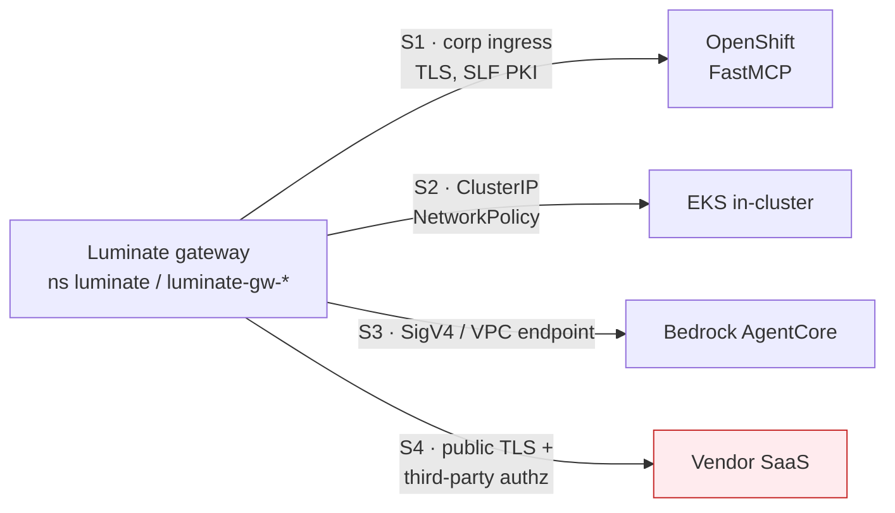

# Hosting — the five substrates

The platform requirement is the same on all four: **the gateway must be able to reach your server,
and nothing else should be able to.** What differs is how you achieve each half.

## S1 · OpenShift — the current majority

The shape in production today. `pharmacy-mcp-server` is registered against
`https://dev-corp-aws-ca1-k8s.sunlifecorp.com/dev-genai-pharmacymcp-ns/pharmacy-mcp-server/mcp`.

| Concern | Requirement |
|---|---|
| **Framework** | FastMCP or the official MCP SDK's HTTP server. Serve Streamable HTTP; bind `0.0.0.0` |
| **Path** | FastMCP serves at `/mcp` (Streamable HTTP) or `/sse`. The registered `backend_endpoint` **includes that path** |
| **Ingress** | Corporate OpenShift ingress. The route is a subpath — the server must not emit absolute self-links assuming its own hostname |
| **TLS** | **The load-bearing one.** Leaves under `*.sunlifecorp.com` are issued by `Sun Life Financial Issuing CA3`, which no public root store carries |
| **Container** | Non-root, `allowPrivilegeEscalation: false`, CPU + memory requests **and** limits |
| **Images** | Mirrored to Quay or ECR. There is no `docker.io` egress from Sun Life cluster pods |
| **Reachability control** | OpenShift NetworkPolicy plus route-level restriction. The ingress host is corporate-resolvable, so network control is not implied by the topology the way it is in S2 |

### The TLS trap, stated once

agentgateway resolves trust roots by **openssl-probe**, where `SSL_CERT_FILE` **replaces** the
system store rather than adding to it. Pointing the gateway at the Sun Life bundle alone would
trade public TLS (Bedrock) for internal TLS.

The correct wiring is a merge, and the chart distinguishes the two:

- **`gateway.caBundle` MERGES** — an init container concatenates the image's roots with the
  ConfigMap into `/etc/ssl/merged/ca-bundle.crt` and points `SSL_CERT_FILE` at the result.
- **`slf.caBundle` SUBSTITUTES** — correct for the backend, wrong for the gateway.

Symptom when it is missing: agentgateway logs `invalid peer certificate: UnknownIssuer` and the
caller sees **`500 upstream service error`**, which names neither TLS nor the certificate. Verify
with `grep -c BEGIN "$SSL_CERT_FILE"` inside the gateway pod — the count should exceed the image's
own root count.

The init container itself needs CPU and memory requests and limits, or Gatekeeper denies the
ReplicaSet while `rollout status` merely hangs on *"0 out of 1 new replicas have been updated"*.

## S2 · In-cluster on EKS

`claims-tools` and `underwriting-tools` run this way:
`http://claims-tools.luminate.svc.cluster.local:8000/mcp`.

| Concern | Requirement |
|---|---|
| **Address** | ClusterIP service DNS name, with port and path |
| **TLS** | Plain HTTP is acceptable **only** because the hop never leaves the pod network. That is a control, and MSR-10 requires it to be stated and enforced, not assumed |
| **Reachability control** | NetworkPolicy admitting **only** the gateway namespace. This is the entire boundary in `gateway_identity` mode |
| **Namespace** | If the server is not in the gateway's namespace, the policy must admit across namespaces explicitly |
| **DNS rebinding** | MCP SDK servers often ship DNS-rebinding protection that rejects unexpected `Host` headers. Configure it for the in-cluster service name the gateway dials |
| **Node scheduling** | Sun Life clusters require a region node selector and, on some node pools, a toleration. Without them the pod stays `Pending` |

**Do not treat "it is in-cluster" as the security argument on its own.** A namespace move, a second
caller, or a service mesh change turns an undefended plain-HTTP endpoint into an open one. The
NetworkPolicy is the control; write it down.

## S3 · Bedrock AgentCore

Two distinct things are called AgentCore in this context and they onboard differently.

| Variant | What it is | Onboarding |
|---|---|---|
| **MCP server on an AgentCore runtime** | Your MCP server hosted as an AgentCore runtime | Register the runtime's HTTPS endpoint as `backend_endpoint`; the gateway reaches it like any remote server |
| **AgentCore Gateway fronting other tools** | AWS's own MCP front end over Lambda / OpenAPI / Smithy targets | Register the AgentCore Gateway endpoint as the MCP server. Its own targets are outside ACP's view |

| Concern | Requirement |
|---|---|
| **Reachability** | The gateway must reach the AgentCore endpoint from the cluster. `us-east-1` has **no egress** from these clusters — a `us.*` regional endpoint is unusable; use `ca-central-1` |
| **TLS** | Public AWS certificates. This is exactly why the trust bundle must be merged and not substituted |
| **Credential** | AgentCore endpoints expect SigV4 or an inbound OAuth token. Luminate's outbound modes do **not** emit SigV4 for an MCP target — the exchange emits a bearer token. Where SigV4 is required, this is an open route decision, not a configuration |
| **Governed route** | Only `{gateway}/mcp/{endpoint_name}` is governed. A workload calling the runtime ARN directly is invisible to ACP — no policy, no audit event, no attribution |

The route decision — SigV4-direct versus through the gateway — is deliberately the same question
`integration-patterns` raises for agents, and should be answered once for both.

## S4 · Third-party / vendor-hosted — blocked today

A vendor MCP endpoint is fronted by the vendor's own authorization server, which cannot validate a
Luminate-issued token. Luminate names this case with two enum members and implements neither:

- `injected_credential` — *will* spend a stored per-deployment credential
- `external_exchange` — *will* run a second RFC 8693 exchange against the server's own
  authorization server

**Neither mechanism is implemented.** A server in either mode is served like `gateway_identity` —
**with no credential sent** — so the call arrives unauthenticated and the vendor rejects it, or
worse, does not.

The only mode that could reach such a server today is `token_forward`, and it applies only if the
vendor already trusts the *gateway's* issuer, which a third party by definition does not.

**Do not onboard S4 until one of the two mechanisms lands.** There is no local workaround; a shared
static credential injected by some other means would be an ungoverned secret outside the platform's
credential model.

Even once `injected_credential` lands, it covers only a vendor reached as a *service*. A vendor that
must be reached as the *individual user* — with that person's own three-legged OAuth token, as
per-user Atlassian, ServiceNow or Splunk access needs — waits on a separate consortium ask,
[ACPDIS-165](https://ai-consortium.atlassian.net/browse/ACPDIS-165) *Per-User Third-Party Connections*
([EACPP-1444](https://sunlife.atlassian.net/browse/EACPP-1444)).

## S5 · AWS Lambda — conditional

A Lambda can host an MCP server, but only behind something that gives it a stable HTTPS URL.
MCP is a remote HTTP protocol; a bare function is not addressable.

| Fronting | Verdict |
|---|---|
| **Function URL, `AuthType: NONE`** | ❌ Refused. Internet-reachable, so MSR-10 cannot be met — the backend would be reachable by more than the gateway |
| **Function URL, `AuthType: AWS_IAM`** | ❌ Not expressible. Requires SigV4, which the platform cannot emit — see below |
| **API Gateway, private, VPC endpoint + resource policy** | 🟡 The viable route. Satisfies MSR-10 by network, and the gateway presents a bearer or nothing |

| Concern | Requirement |
|---|---|
| **Transport** | Streamable HTTP. MCP permits a **stateless** server, so a Lambda that mints no `Mcp-Session-Id` is conformant — but it forfeits per-run correlation (MSR-29), because the MCP session is the gateway's preferred run unit on this lane |
| **SSE** | Avoid. API Gateway REST has a 29-second integration timeout, and the platform's own capture never buffers `text/event-stream`, so an SSE Lambda is classified status-only |
| **Cold start** | The portal token endpoint is rate-limited. A per-invocation token mint will pass in dev and throttle in production — cache in the execution context, not per handler call |
| **Reachability** | MSR-10 by resource policy and private endpoint. A public Function URL is the exact inverse of the requirement |
| **Build path** | Same JTE gates as every other substrate — a Lambda is not exempt from MSR-19 to MSR-23 |

## The constraint S3 and S5 share — AWS-native invoke auth is not expressible

Verified against `AI-Consortium/luminate` `origin/main` `1c4a00035` (2026-09-08): the MCP outbound
path emits exactly three backend-auth shapes — `token_exchange` (RFC 8693 bearer), `forward`
(passthrough of the caller's bearer), or `none`. A search for SigV4 or AWS auth across
`gateway/app/services` and `gateway/app/middleware` returns **zero**.

So any AWS target whose native invoke auth is **SigV4** — a Lambda Function URL with `AWS_IAM`,
or an AgentCore runtime expecting a signed request — cannot be reached with that auth. The
options are to front it with something that accepts a bearer, or to reach it as
`gateway_identity` over a network-restricted path and carry no caller identity at all.

This is one finding, not two. It is the same reason S3's governed-route question is open, and it
is recorded once in [Gaps](gaps.md) rather than duplicated per substrate.

## Substrate comparison

| | S1 OpenShift | S2 EKS in-cluster | S3 AgentCore | S4 Vendor | S5 Lambda |
|---|---|---|---|---|---|
| Live today | ✅ | ✅ | 🟡 | ❌ | ❌ none built |
| TLS to the backend | Required · SLF PKI | Optional (pod network) | Required · public CA | Required · public CA | Required · public CA |
| Reachability control | NetworkPolicy + route | NetworkPolicy | VPC endpoint / SG | Vendor-side allowlist | Private API GW + resource policy |
| Typical identity mode | `delegated_exchange` or `gateway_identity` | `gateway_identity` | `token_forward` or open | **none available** | `gateway_identity`, or bearer if the function validates one |
| Build path | JTE + Quay | JTE + ECR | JTE + ECR | Vendor's | JTE + ECR |
| Blocker | None | None | Route decision · SigV4 | Unimplemented modes | Needs a bearer-accepting front door · SigV4 |

## Common to all substrates

- **Egress from the gateway to your server must be permitted** in both directions of policy — the
  gateway's egress and your server's ingress.
- **Do not expose the server publicly** to serve a convenience client. The gateway is the governed
  path; a second, ungoverned path defeats every control on this page.
- **Deploy per environment.** One catalogue entry, one `Deployment` per gateway, the same
  `deployment_key`. The gateway is the failure domain and the kill boundary.
- **The platform does not probe you.** Readiness, restart and capacity are entirely the hosting
  platform's responsibility.
