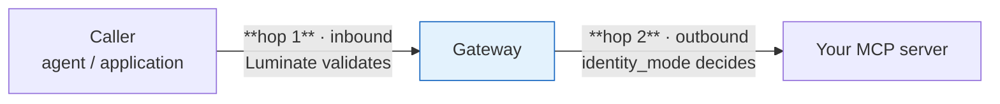
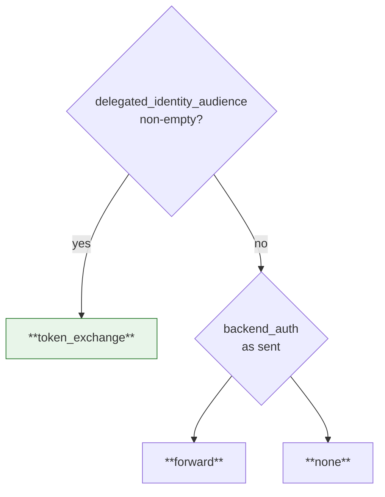
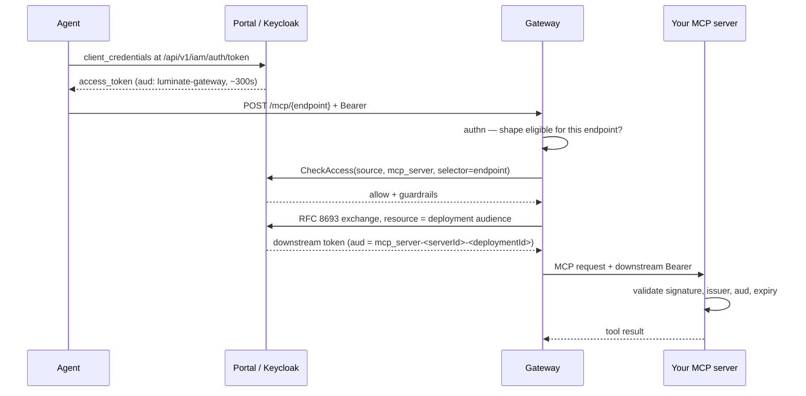

# Identity — what reaches your server, and what you validate

Two independent hops, and confusing them is the most common design error.



**Hop 1** is fixed by the platform — the caller authenticates to the gateway with one of four
credential shapes, and the gateway decides whether that shape is *eligible* for your endpoint.
**Hop 2** is your design decision — `identity_mode` on the catalogue record decides what, if
anything, your server receives.

## Hop 2 — the five outbound modes

| Mode | What your server receives | Implemented | You must validate |
|---|---|:---:|---|
| **`delegated_exchange`** *(default)* | A bearer token the gateway obtained by RFC 8693 exchange, minted for the **invoking caller** — user or machine — and audienced to **your deployment** | ✅ | Signature (portal JWKS), issuer, `aud` = your deployment audience, expiry |
| **`token_forward`** | The caller's **own validated JWT**, unchanged | ✅ | The same issuer the gateway trusts, plus your own claims checks |
| **`gateway_identity`** | **Nothing.** The gateway strips the caller's `Authorization` and `X-API-Key` before the backend call | ✅ | Nothing — you cannot. Network reachability is your only boundary |
| **`injected_credential`** | *Intended*: a stored per-deployment credential | ❌ | — served as `gateway_identity`, **no credential sent** |
| **`external_exchange`** | *Intended*: a token from your own authorization server via a second RFC 8693 exchange | ❌ | — served as `gateway_identity`, **no credential sent** |

The two unimplemented modes are the trap. Selecting one does **not** produce an error and does not
disable the server — it produces a server reached with no credential. The enum's own docstring
says so.

### The whole estate is on one mode

All four MCP servers registered in SLF dev are `gateway_identity`. None is on the platform default.
That makes network reachability the entire security boundary for every MCP tool call in the estate
today — which is why MSR-10 is mandatory and not merely recommended.

## How the mode is actually resolved

The gateway does not trust the mode field on its own. `effective_backend_auth` keys on the
**audience**:



A non-empty audience **always** wins. The reason is version skew: a portal build predating the
`backend_auth` field still sets the audience for a delegated server, so keying on the audience
means an old bundle can never silently degrade an exchange endpoint to unauthenticated serving.
Both the translator and the request-time middleware call the same resolver, so they can never
disagree.

### A delegated target that cannot be exchanged is withheld, not downgraded

If the gateway holds no token endpoint or client id, or the assignment names no downstream
audience, the target is **dropped from the config entirely** and the endpoint reports that it
cannot be served here. Serving it as the gateway's own identity would silently substitute the
gateway for the user — a widening of what the call may reach — so the platform refuses.

**Operationally**: an endpoint that "disappeared" after a gateway change is this, not a routing
fault. The gateway logs `Withholding N delegated MCP target(s)` with the reason.

## Hop 1 — which caller credentials your endpoint accepts

The gateway gates the *inbound* credential by the endpoint's **effective** mode. This is where a
403 that looks like a policy denial usually comes from.

| Your mode → | `token_exchange` | `forward` | `none` |
|---|:---:|:---:|:---:|
| **OIDC JWT** — machine (`client_credentials`) | ✅ | ✅ | ✅ |
| **OIDC JWT** — delegated, carries `act` | ✅ | ✅ | ✅ |
| **OIDC JWT** — plain user, no actor | ❌ `not_exchangeable` | ✅ | ✅ |
| **API key** — `X-API-Key` or `Bearer lum_…` | ❌ `api_key_not_exchangeable` | ❌ `platform_minted_not_forwardable` | ✅ |
| **Delegated token** — `Bearer lud_at_…` | ✅ | ❌ `platform_minted_not_forwardable` | ✅ |

Every ❌ is an **HTTP 403** and is indistinguishable from a policy denial from the outside.

Two rules explain the whole table:

- **`token_exchange` spends the caller's credential as the exchange subject.** Only something the
  exchange can spend qualifies — a delegated identity or an entity's own machine token. An API key
  is not an IdP token, so it cannot be a subject.
- **`forward` hands the caller's `Authorization` header to a backend the platform does not
  control.** A `lum_` API key and a `lud_at_` delegated token are both Luminate-issued and
  Luminate-validated: your server cannot check either, and either one replayed against the portal
  acts as the caller. Only an IdP-signed JWT is safe to forward, so the gateway refuses the rest
  rather than leaking them upstream.

And the corollary for `none`: an API key is admitted because **the gateway strips it** before the
backend call. Your server never sees it.

## The delegated exchange, end to end



### The audience names the deployment, not the catalogue entry

```text
aud = mcp_server-<server-uuid>-<deployment-uuid>
```

One catalogue entry can be deployed to several gateways and environments, each with its own backend
endpoint. A catalogue-scoped audience would mint one token that **every** one of those backends
accepts — a staging credential spendable against production. The deployment is the narrowest thing
with a single backend and its own discovery document, so it is the unit a token is pinned to.

Which gateway may perform the swap follows from the deployment, since a deployment belongs to
exactly one gateway. A gateway asking for a deployment it does not front is refused even though the
audience is real.

**Your server must check `aud` against its own deployment audience.** Accepting any
platform-issued token is the error this design exists to prevent.

### Discovery — RFC 9728

The gateway publishes protected-resource metadata for **delegated endpoints only**:

```text
GET {gateway}/.well-known/oauth-protected-resource/mcp/{endpoint_name}
```

```json
{
  "resource": "mcp_server-<server-uuid>-<deployment-uuid>",
  "resource_name": "…",
  "bearer_methods_supported": ["header"],
  "authorization_servers": ["<issuer>"]
}
```

- **Deliberately unauthenticated** — a discovery document a backend must fetch before it holds a
  validated token cannot itself require one.
- **404 for a non-delegated endpoint** is the intended answer, not a fault: the endpoint is served
  as the gateway's own identity, so there is no per-resource audience to publish, and claiming one
  would invite a backend to enforce a value it will never see.
- Cached for 300s, matching the portal's authorization-server metadata.

Build your token validation against this document rather than hard-coding an issuer.

## Keycloak specifics that bite

The IdP is **Keycloak**; the portal proxies the token exchange to it. Three properties have each
cost real diagnosis time.

| Property | Why it matters |
|---|---|
| **Every entity gets its own Keycloak client**, id `{resource_type}-{entity_uuid}-{gateway_uuid}` | Fixing one client's configuration fixes nothing else. Always confirm *which* deployment the caller uses before concluding |
| **The gateway audience rides a client scope**, `luminate-gateway-aud`, whose mapper emits `luminate-gateway` | Inspecting a client's own `protocolMappers` gives a false negative. Check `defaultClientScopes`, or just decode the token — `aud` is ground truth |
| **Access tokens are short** — `expires_in` is commonly ~300s, and the token endpoint is rate-limited | Cache the token in memory and refresh shortly before expiry. Minting per request passes in dev and throttles in production |

### One error string covers several causes

The gateway's error handler sanitises every proxy-route error, so `401` and `403` both render as
`{"error":"upstream authentication failed"}` — and it fires on the proxy flag, which is set *before*
authentication, so the gateway's own rejection is relabelled as "upstream". Nothing about the
string implies your server was reached.

Read the real cause from the gateway logs, not the response body:

| Code | Meaning |
|---|---|
| **401** | Authentication failed — bad, missing or expired credential |
| **403** | Either the access policy denied, **or** the credential shape is ineligible for this endpoint, **or** the portal was unreachable (fail-closed) |

## Choosing a mode

| If your server… | Choose |
|---|---|
| Behaves differently per calling user or per calling agent | `delegated_exchange` |
| Must enforce its own per-tool authorization (MSR-16) | `delegated_exchange` or `token_forward` |
| Already validates tokens from the same issuer as the gateway | `token_forward` |
| Serves public, read-only data with no per-caller behaviour | `gateway_identity` — **and** MSR-10 becomes the whole control |
| Is fronted by a third-party authorization server | **Do not onboard yet** — see [Hosting · S4](hosting.md) |

Record the rationale (MSR-9). `identity_mode` is in the server's audit snapshot precisely because
moving it changes who the downstream server sees calling it.
