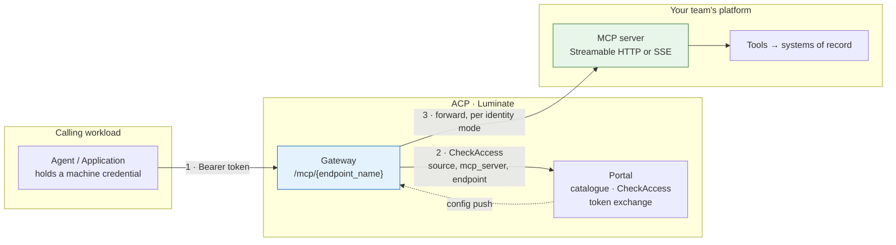
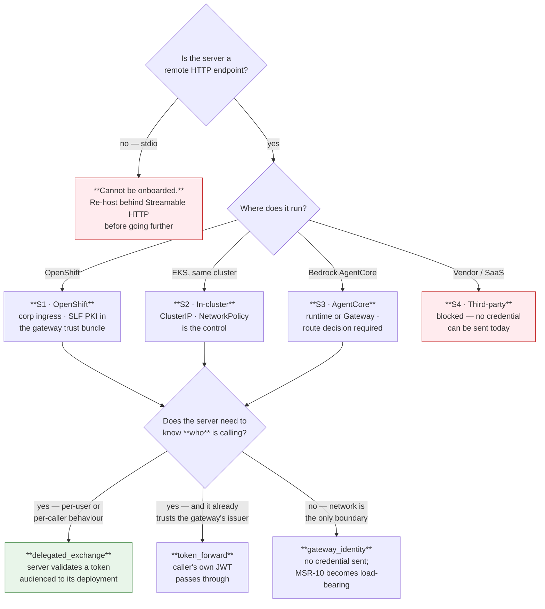
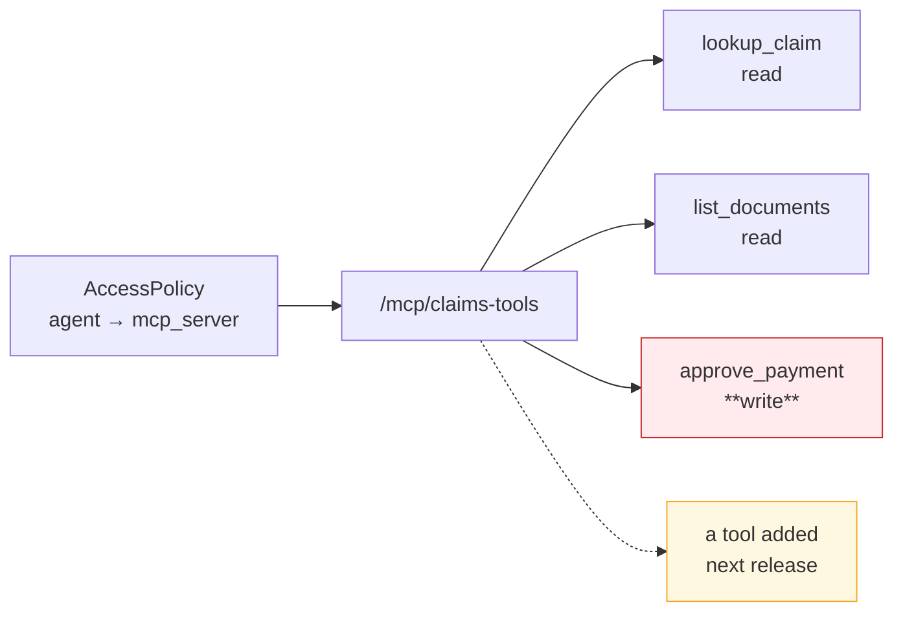

# D2 Design — The MCP Server Pattern

> **Gate**: D2 — Design | **Status**: Draft | **D1 Approved**: TBD
>
> `d2-design.md` beside this directory is **generated** from these pages by
> `scripts/assemble_d2_design.py` — edit the pages, not the generated file.

## The pattern in one picture

Whatever the substrate, an MCP server on ACP is the same shape: **a remote HTTP MCP endpoint that
is reachable only from a Luminate gateway, registered as a catalogue resource, deployed onto a
gateway under a single-segment endpoint name, and granted to callers by access policy.**

Steps 1 and 2 are identical for every server. **Step 3 is the whole design space** — what
credential, if any, reaches your server, and therefore what your server has to validate.

## Pick your shape

Three questions, answered in order. The first is disqualifying, the second decides your
requirements annex, the third decides what your server must implement.

## The catalogue of shapes

| # | Shape | Who it is for | Maturity |
|---|---|---|---|
| **S1** | **OpenShift-hosted** — FastMCP or equivalent behind corporate ingress | Teams already on OpenShift; the current majority | **Works today** — `pharmacy-mcp-server` is live on this shape |
| **S2** | **In-cluster on EKS** — ClusterIP service beside the gateway | Platform-owned and demo servers | **Works today** — `claims-tools`, `underwriting-tools` |
| **S3** | **Bedrock AgentCore** — an MCP server on an AgentCore runtime, or fronted by AgentCore Gateway | Teams on AWS with an AgentCore footprint | **Partial** — reachable, but the governed-route decision is open |
| **S4** | **Third-party / vendor-hosted** — an MCP endpoint fronted by someone else's authorization server | Any SaaS tool vendor | **Blocked** — `injected_credential` / `external_exchange` unimplemented |

Identity mode composes with all four. A vendor server can technically be reached as
`gateway_identity`, but that means calling a third party with no credential, which is why S4 is
marked blocked rather than merely awkward.

## What is true on every shape

These are the platform properties a team cannot change, and they drive most of the profile.

| Property | Consequence for the server |
|---|---|
| **One route per server.** The gateway emits `path_prefix = /{endpoint_name}` per deployment; the multiplexed `mcp:` shorthand is gone from `origin/main` | Your server owns its own path segment and is addressed at `{gateway}/mcp/{endpoint_name}` |
| **Authorization is per server.** `AuthzRequest.selector` is the endpoint name; the JSON-RPC method is parsed *after* the decision | A grant covers every tool you expose — [Authorization](authorization.md) |
| **The control plane is on the request path.** `CheckAccess` per request, no cache; portal unreachable → deny | Your availability is bounded by the portal's; there is no fail-open posture to rely on |
| **Configuration reaches gateways by push**, over a long-lived bidirectional stream | A registration or withdrawal propagates without a poll interval — but the actual latency must be measured |
| **The bundle is gateway-scoped, not caller-scoped** | Every deployment on a gateway is in that gateway's config; caller isolation is authorization, not routing |
| **The platform never probes your server** | Health, restarts and capacity are entirely yours — [Operations](operations.md) |
| **`stdio` is refused at bundle build**, silently, into the `skipped` list | A local-process server never becomes a served one |

## Reading order

| Page | Covers | Answers |
|---|---|---|
| [Registration](registration.md) | The catalogue model, what registration requires, the tool contract, lifecycle | *What do I have to declare?* |
| [Hosting](hosting.md) | S1–S5 substrates, reachability, TLS, network control | *What must my platform provide?* |
| [Identity](identity.md) | The five modes, the inbound eligibility matrix, RFC 9728 discovery | *What credential reaches me, and what do I validate?* |
| [Authorization](authorization.md) | Access policies, the server-granularity boundary, guardrails | *What is actually enforced, and what must I enforce?* |
| [Build pipeline](pipeline.md) | The JTE path, SonarQube / Snyk / Checkmarx, image provenance | *How do I build it so it will be accepted?* |
| [Operations](operations.md) | Audit, tracing, session correlation, kill switch, cost | *What is visible once it runs?* |
| [ETAB and ISRA](assurance.md) | The architecture to present and the control table to assess | *What do I take to the board?* |
| [Gaps](gaps.md) | What is blocked and the ask that unblocks it | *What am I accepting as residual?* |

## The rule that catches everyone

**The server is the unit of trust, not the tool.** Every tool behind one endpoint name shares one
access grant, one classification tier and one blast radius — and a tool added next release is
covered by a grant made last quarter.

Design the endpoint boundary the way you would design a database role.
