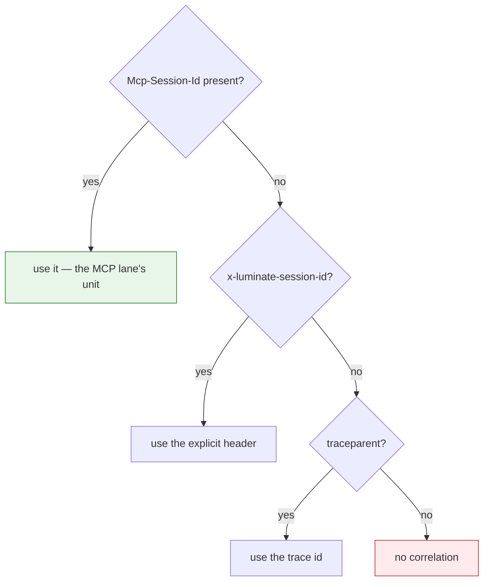

# Operations — what is visible once it runs

## Attribution — the headers the gateway injects

The gateway stamps a fixed set of `x-luminate-*` headers onto the forwarded request. They are what
make a served MCP call attributable in Langfuse and in the portal's usage queries.

| Header | Value |
|---|---|
| `x-luminate-target-type` | `mcp_server` |
| `x-luminate-target-id` | The catalogue primary key of the server |
| `x-luminate-mcp-method` | The JSON-RPC method — `tools/call`, `tools/list`, `initialize`, … |
| `x-luminate-genai-operation` | `execute_tool` for a `tools/call`; **absent** for anything else |
| `x-luminate-entity-id` / `-type` / `-name` | The calling entity |
| `x-luminate-principal-id` | The principal, mapped to the Langfuse user |
| `x-luminate-session-id` | The run-correlation unit |
| `x-luminate-project-id` | The owning project |

Two design points worth knowing:

- **`gen_ai.operation.name` decides how Langfuse types the observation.** A span typed as a chat
  operation is ingested as a **generation**, and every portal usage and cost query selects
  generations. Stamping a constant would file every MCP request among the calling agent's model
  calls, reporting zero tokens. So only `tools/call` is typed — a handshake or a listing is neither
  a model call nor a tool execution, and Langfuse's default span type describes it exactly.
- **The method is stamped only when it is unambiguous.** A body that is absent, undecodable, not
  JSON, not JSON-RPC 2.0, carrying no string `method`, or a batch array, stamps nothing rather than
  guessing. A consumer counting by method cannot distinguish a guess from a fact, so the platform
  declines to guess.

## Run correlation — `Mcp-Session-Id`

On the MCP lane the unit of a run is the **MCP session**, and it takes precedence over every other
signal.

The server mints the session id on `initialize` and the client returns it on subsequent requests —
so **propagating it correctly is the server's job**, and a server that drops it costs the platform
per-run correlation for every call it serves.

The value is sanitised to printable ASCII, length-capped, and namespaced
`{entity_type}:{entity_id}:{raw}` before it reaches Langfuse, because Langfuse session ids are
project-global and an un-namespaced `run-1` from two different agents would otherwise merge.

## Audit

| Plane | Events |
|---|---|
| Control plane | Create / update / delete of the server record, with a field-level snapshot including `identity_mode` |
| Data plane | Access decisions under `AccessProtocol.MCP`, actor = calling entity, target = server |

The audit store is append-only and enforced by database triggers, not convention — the mutation and
truncate refusals back the `audit_event_append_only` and `_no_truncate` triggers. Dropping those
functions would silently make the audit log mutable.

**Data-plane events come from the gateway's front door.** A call sent straight to the agentgateway
listener, bypassing it, emits neither an authorize nor an access event. An audit trail that looks
incomplete is usually a bypassed path, which is the operational form of the MSR-10 argument.

## Cost and usage

Per-server and per-method figures are queryable: the portal's metrics service filters MCP targets
by server id and selects `luminate_mcp_method = "tools/call"` as the one value representing work
the server actually did.

Two boundaries to state in an ISRA:

- **Only traffic through the governed front door is attributable.** Aggregate counts include
  ungoverned probes; per-server breakdowns do not, because they join on identifiers only the front
  door stamps. An org total legitimately exceeding the sum of per-server totals is that, not a
  broken aggregation.
- **The chargeback ledger has no run dimension.** It aggregates by usage date. "What did this run
  cost" is answerable only as a Langfuse session grouping, not from the finance-facing surface.

## Health — the platform does not check

There is **no MCP server health probing anywhere in the platform.** A search across the MCP
registry app and the gateway sync for health, probe or readiness returns zero. `MCPServer.status`
is an operator-set field; nothing moves it automatically.

| What this means | Consequence |
|---|---|
| A dead backend is discovered by a failing call | Alert on gateway 5xx per endpoint; do not wait for a user report |
| `status = active` says nothing about liveness | Do not present it as a health signal in an ISRA |
| Readiness, restarts and capacity are yours | MSR-26 puts the probe on the hosting platform |

## Withdrawal — the kill path

Three mechanisms, of increasing formality.

| Action | Effect | Speed |
|---|---|---|
| Set `status` to `inactive` | The server drops out of the next policy fact export and the next config bundle | Next config push |
| Delete the `AccessPolicy` | The specific caller loses access at the next `CheckAccess` | Immediate — there is no policy cache |
| `governance_state → suspended` | Governance halts the server; the cascade must be **previewed first**, and the preview names the deployments and access policies it will take down | Next config push |

Configuration reaches gateways over a **long-lived bidirectional push stream**, not a poll — so
propagation is fast. It is nonetheless a number that must be **measured per environment and
published**, never quoted. FR-10 and D3 T13 exist for that.

Removing the access policy is the fastest true kill for a single caller, because authorization is
evaluated per request with no cache. Withdrawing the server is the right action for an incident
affecting every caller.

## Runbook — diagnosing a failing MCP endpoint

Work in this order. Each step distinguishes causes the layer above cannot.

1. **Is the endpoint in the gateway's config at all?**
   A `stdio` transport or an empty `backend_endpoint` puts the deployment in the bundle's `skipped`
   list, silently. A delegated target the gateway cannot exchange for is **withheld**, logged as
   `Withholding N delegated MCP target(s)`.
2. **Is the caller's credential shape eligible for this endpoint?**
   Check the endpoint's effective mode against the eligibility matrix in
   [Identity](identity.md). An API key on a delegated endpoint is a 403 that reads exactly like a
   policy denial.
3. **Did the access policy allow?**
   Gateway log: decision and reason. `portal_unreachable` is a fail-closed deny, not a policy
   decision.
4. **Did the backend hop complete?**
   `500 upstream service error` with `invalid peer certificate: UnknownIssuer` is a trust-store
   problem, not an authentication one. Check the merged CA bundle in the gateway pod.
5. **Is the server itself healthy?**
   Only now. The platform never checked, so nothing upstream will have told you.

Never reason from the caller-facing body. `{"error":"upstream authentication failed"}` covers a
missing credential, a wrong audience, a policy denial and an unreachable portal, and the sanitiser
fires before authentication so it does not imply the upstream was reached.
