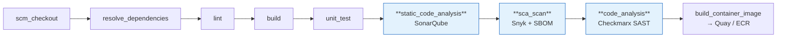

# Build pipeline — the approved path and the scanning gates

An MCP server executes tool code on behalf of an autonomous caller, over an internet-shaped
protocol, against a system of record. It is exactly the class of workload the Sun Life build
controls exist for. This page states the approved path and what each gate actually does — because
two of the three are commonly configured in a way that makes them report success without checking
anything.

## The approved path

Builds use the Jenkins **JTE** libraries in
[`CSDP/pipeline-libraries`](https://bitbucket.sunlifecorp.com/projects/CSDP/repos/pipeline-libraries/browse)
— 62 libraries covering language toolchains, scanning, registries and deployment. An MCP server
uses a small, fixed subset.

| Library | Purpose |
|---|---|
| `pod_template` | The Jenkins build agent |
| `git` | Checkout |
| `python` · `npm` · `maven` · `gradle` · `dotnet` | The language toolchain — dependencies, unit tests, artefacts |
| **`sonarqube`** | Static analysis + quality gate — step `static_code_analysis()` |
| **`snyk`** | Software composition analysis + SBOM — step `sca_scan()` |
| **`checkmarx`** | SAST gate — step `code_analysis()` |
| `quay` or `ecr` | Container image build and push |
| `artifactory` | Approved dependency source |



`Jenkinsfile` selects the steps; `pipeline_config.groovy` configures the libraries. Both live in
the MCP server's own repository.

## The gates, and what they really check

### SonarQube — `static_code_analysis()`

| Key | Type | Notes |
|---|---|---|
| `run_sonarqube_scan` | boolean | |
| `enforce_sonarqube_gate` | boolean | |
| `disable_gate_reason_sonarqube` | String | Required when disabled — make it an exception with an owner and an expiry, not a default |
| `scanner`, `scanner_parameters` | String | |
| `sonar_scanner_java_version` | String | |

Coverage reaches SonarQube through the language convention — `coverage.xml` for Python,
`coverage/lcov.info` for Node. Configure it or the gate assesses an untested project as clean.

### Snyk — `sca_scan()`

Library defaults, which are the right defaults:

| Default | Value |
|---|---|
| `RUN_SNYK_SCAN` | **`true`** |
| `ENFORCE_SNYK_GATE` | **`true`** |
| `SEVERITY_THRESHOLD` | **`high`** |
| SBOM artefact | `snyk-sbom.json` |
| Result artefacts | `snyk-results.html`, `snyk-sca-results.json` |

Configuration keys: `run_snyk_scan`, `enforce_snyk_gate`, `disable_gate_reason_snyk`,
`severity_threshold`, `artifactory_read_access_token_id`, `exclude`, `business_unit`,
`evaluate_against_branch`. The Python library adds `package_manager` and `python_command` so a
`uv` or Poetry project resolves correctly.

Two behaviours worth knowing:

- **`enforceSnykGate = true` forces `runSnykScan = true`.** You cannot enforce a gate on a scan
  that did not run.
- Where the repository has an **APM number** in its pipeline config, Snyk findings are tagged
  `apmNumber=<n>` — which is what makes them attributable to an application in the portfolio, and
  therefore what an ISRA can reference.

### Checkmarx — `code_analysis()` — read this one carefully

| Default | Value |
|---|---|
| `ENFORCE_CHECKMARX_GATE` | **`true`** |
| `BRANCHES_TO_SCAN` | **`["develop"]`** |
| Scan timeout | 900s |
| Gate-evaluation timeout | 900s |

**The step does not run a scan.** It resolves the repository's latest **merged pull request**,
looks up the scan Checkmarx already performed for that PR, waits for the scan and its gate
evaluation to complete, and reports the verdict. That means three ways to pass without being
scanned:

1. **No merged PR.** The step logs `New repository PR does not exist. Checkmarx scan is skipped.`
   and continues. A new repository is unscanned by construction.
2. **Branch mismatch.** The default `branches_to_scan` is `["develop"]`. A repository whose
   integration branch is `main` matches no pattern, so the whole stage is skipped unless it
   overrides.
3. **Gate disabled.** With `enforce_checkmarx_gate = false` the stage does nothing at all.

So a green Checkmarx stage is **not evidence**. MSR-20 requires the scan id and gate evaluation on
the build, which is what the step records when it genuinely ran.

## What the ACP estate does today, and why it must not be copied

Verified across `acp-agent-registry`, `acp-mcp-registry` and `agent-control-plane-ui`: all three
carry the same shape.

```groovy
snyk {
  sca_scan {
    run_snyk_scan = true
    enforce_snyk_gate = false
    disable_gate_reason_snyk = 'Snyk gate is disabled during initial CI setup for <repo>.'
  }
}
checkmarx {
  enforce_checkmarx_gate = false
  disable_gate_reason_checkmarx = 'Checkmarx gate is disabled until the issue with java.lang.Exception: Host name and enforceCheckmarxGate is set to true is resolved.'
}
```

The scans run; nothing fails on them. Both reasons describe setup-era workarounds that were never
revisited — the first says *"during initial CI setup"*, the second names a specific exception that
should be retested rather than carried forward.

**An MCP server repository ships with the gates on.** Where a gate genuinely cannot be enforced,
the `disable_gate_reason_*` string carries a named owner and a review date, and the exception is
recorded in the ISRA rather than in a Groovy literal.

## Reference `pipeline_config.groovy` — Python MCP server

```groovy
libraries {
  pod_template {
    use_existing_agent {
      agent_label = 'linux-jnlp-python-base'
    }
  }
  git
  python {
    run_unit_tests = true
    sca_scan {
      run_snyk_scan = true
      enforce_snyk_gate = true
      severity_threshold = 'high'
      package_manager = 'pip'
    }
  }
  sonarqube {
    run_sonarqube_scan = true
    enforce_sonarqube_gate = true
  }
  checkmarx {
    enforce_checkmarx_gate = true
    branches_to_scan = ['main', 'develop', 'release/.*']
  }
  ecr {
    build {
      build_container_image = true
    }
  }
}
```

`branches_to_scan` is the line most repositories need and most repositories omit.

## Image provenance and runtime hardening

| Requirement | Detail |
|---|---|
| **Built by the pipeline** | Not a laptop `docker build`. The image an MCP server serves from is the one the scanned commit produced |
| **Pushed to an approved registry** | Quay or ECR. There is **no `docker.io` egress from Sun Life cluster pods** — every base and runtime image must be mirrored first, and ECR repositories are not auto-created |
| **Immutable reference** | The deployment pins a digest or an immutable tag. Never `latest` |
| **Non-root** | A dedicated UID, `runAsNonRoot: true`, `allowPrivilegeEscalation: false` |
| **Resource requests *and* limits** | On **every** container including init containers — Gatekeeper denies the pod otherwise, and the denial appears only in `kubectl get events`, never in `rollout status` |
| **No secrets in the image** | Upstream credentials come from Vault via the Vault Secrets Operator, or AWS Secrets Manager |
| **Dependencies from Artifactory** | The approved source; `artifactory_read_access_token_id` wires it into the scan and the build |

## Reference `Dockerfile` shape

```dockerfile
FROM <approved-registry>/python:3.12-slim

WORKDIR /app
COPY requirements.txt .
RUN pip install --no-cache-dir -r requirements.txt

COPY server.py .

RUN useradd --uid 10001 --create-home mcp
USER 10001

EXPOSE 8000
CMD ["python", "server.py"]
```

The server binds `0.0.0.0` and serves Streamable HTTP; FastMCP exposes it at `/mcp`, which is the
path that must appear in the registered `backend_endpoint`.

## Evidence an assessor can retrieve

| Control | Evidence | Where |
|---|---|---|
| SAST performed | Checkmarx scan id + gate evaluation | Build log / Checkmarx project |
| SCA performed | `snyk-results.html`, `snyk-sca-results.json` | Build artefacts |
| SBOM produced | `snyk-sbom.json` | Build artefacts |
| Static analysis + coverage | SonarQube project and quality gate | SonarQube |
| Image provenance | Registry digest matches the deployed digest | Registry + deployment manifest |
| Dependency source | Artifactory token id in the pipeline config | Repository |

That table is the supply-chain block of the ISRA control set, and it is retrievable per build
rather than asserted.
