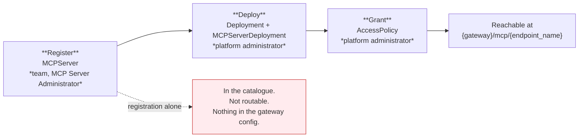
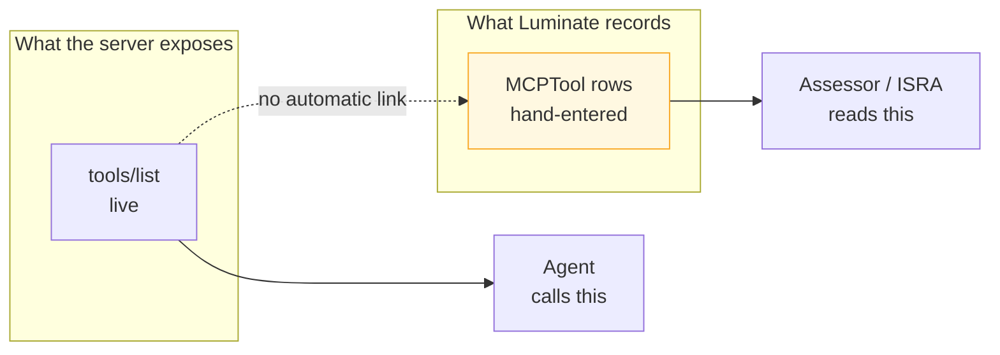

# Registration — the catalogue model and what you declare

## Two records, not one

Registering a server and making it reachable are separate acts, performed by different people.
This is the single most common source of "I registered it and nothing happened".

Registration is a **team** action — a holder of *MCP Server Administrator* on the project can do
it. Deployment and granting are **platform administrator** actions and cannot be delegated today.

## What registration requires

`POST /api/v1/catalog/mcp-servers`

| Field | Required | Notes |
|---|:---:|---|
| `key` | **yes** | Globally unique, validated, **permanent** |
| `name` | **yes** | Case-insensitively unique across the organisation |
| `transport` | **yes** | `http` (Streamable HTTP) · `sse` · `stdio` — see the warning below |
| `project` | **yes** | Sets ownership and the visibility scope; **permanent** |
| `identity_mode` | no | Defaults to `delegated_exchange`. **Decide it — MSR-9** |
| `status` | no | Defaults to `active`; `inactive` / `deprecated` / `unknown` |
| `version`, `description`, `documentation`, `tags`, `metadata`, `provider_id` | no | Populate them; they are what an assessor reads |
| `governance_state` | **write-refused** | Moves only through the transition action — a create or update carrying it is rejected outright |

### `stdio` registers and then silently does nothing

The catalogue accepts `stdio` because the transport is real MCP. The gateway bundle builder refuses
it — the deployment lands in the bundle's `skipped` list with
`stdio_transport_not_supported_for_remote_gateway`, no route is emitted, and **nothing surfaces in
the portal**. A server that speaks stdio must be re-hosted behind Streamable HTTP first.

## What deployment requires

Two rows, created by a platform administrator.

| Row | Fields | Constraint |
|---|---|---|
| `Deployment` | `resource_type = "mcp_server"`, `mcp_server`, `gateway`, `environment`, `location`, `project`, `deployment_key` | Unique on (`gateway`, `deployment_key`, `mcp_server`) |
| `MCPServerDeployment` | `endpoint_name`, `backend_endpoint` | One-to-one with the `Deployment`; both fields mandatory |

**`endpoint_name` is a single URL path segment and is read by two independent matchers**:
agentgateway routes on the path prefix `/{endpoint_name}`, and the gateway's own middleware derives
the endpoint's auth mode from the first segment of the request path. A value containing `/`, a dot
segment, or a character that percent-encodes differently on the two sides would let them disagree
about which server a request is for — so it is held to one URL-safe slug.

**`backend_endpoint` is the full URL including scheme and path.** A FastMCP server serves
Streamable HTTP at `/mcp` and SSE at `/sse`, so the value is `https://your-host/mcp`, not
`https://your-host`.

### Promotion across environments reuses the key

The same `deployment_key` is reused per gateway. That is what makes one catalogue entry a single
resource promoted through dev → sit → stage → prod, rather than four unrelated servers.

## The tool contract

`MCPTool`, `MCPResource` and `MCPPrompt` are catalogue records hanging off the server.

| Record | Fields |
|---|---|
| `MCPTool` | `name`, `description`, `input_schema`, `access_level` — `admin` / `read` / `write` |
| `MCPResource` | `uri`, `name`, `description`, `mime_type` |
| `MCPPrompt` | `name`, `description`, `input_schema` |

**These are entered by hand.** There is no discovery on `origin/main` — a search for
`last_discovery` across the backend returns zero, and a live production-path server in dev carries
zero tool records while its tools serve traffic. Discovery exists on an unmerged branch and must
not be assumed.

Three consequences, and they are the reason MSR-6 and MSR-7 exist:

- **The catalogue is a claim, not an inventory.** Verify it by diffing against the server's live
  `tools/list` at each release.
- **`access_level` is documentation.** It is not read by the gateway or the policy engine; nothing
  refuses a `write` tool to a read-only grant.
- **A new tool inherits every existing grant.** Because authorization is per server, adding a tool
  widens what every already-entitled caller can do, with no policy change and no approval. That is
  why adding or widening a tool is a governed change rather than a deploy.

## Governance lifecycle

The server record carries a **second axis** beside operational `status`: `governance_state`, moved
only by `POST /api/v1/catalog/mcp-servers/{id}/transition`.

| State | Meaning |
|---|---|
| `not_evaluated` | No ruleset generation has decided this server. The starting state. |
| `out_of_scope` | Assessed, and no rule matches. Distinguishable from never-assessed. |
| `in_scope_unassessed` | In scope; required evidence not yet complete |
| `assessed` | Evidence complete; awaiting verdict |
| `approved` | Verdict recorded |
| `suspended` | Governance has halted the server |
| `retired` | Decommissioned. **Terminal.** |

Three properties matter for assurance:

- **The permission is a governance permission, not a registry one.** The action lives on the
  server's own route but is authorized on the governance verb deliberately, so it is not handed to
  every holder of the registry's update permission.
- **Direct writes are refused.** A create or update payload carrying `governance_state` or
  `governance_state_reason` is rejected with a transition-required error rather than silently
  ignored — the caller is never told the state moved when it did not.
- **Suspension must be previewed.** `POST .../suspension-preview` returns the deployment ids and
  access policy ids the suspension would take down, and **records that it was shown**; the
  suspension gate later checks against that recorded preview.

Today, governance rulesets are deployed but inert — with zero applicability rules, every server
sits at `not_evaluated`. The axis exists and decides nothing until `governance-intake` populates
it.

## Who can do what

| Action | Role | Scope |
|---|---|---|
| Register / edit / delete a server | MCP Server Administrator | Project |
| View a server | MCP Server Viewer | Project |
| Review without editing | MCP Server Approver | Project |
| Move `governance_state` | Governance Administrator | Organization |
| Create the deployment | Platform administrator | Not delegable |
| Create the access policy | Platform administrator | Not delegable |

Registry visibility is filtered by materialised scope tokens, and it **fails closed** — a caller
with no effective scope sees an empty list rather than an error.
