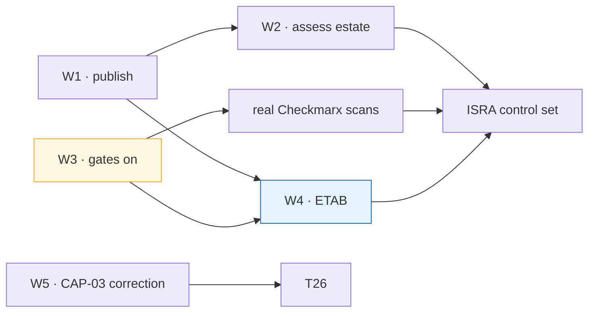

# MCP Server Patterns — D3: Implementation Plan

> **Gate**: D3 — Tasks | **Status**: Draft | **D2 Approved**: TBD
> **Epic**: [EACPP-1176](https://sunlife.atlassian.net/browse/EACPP-1176) · Board label `acp-product-team`

## Overview

Five workstreams. **W1** publishes the profile so teams can self-serve. **W2** brings the existing
four servers up to it — the estate is entirely on one identity mode nobody chose. **W3** closes the
two supply-chain gaps that are ours alone and most directly weaken an assurance submission.
**W4** takes the architecture through ETAB and produces the ISRA. **W5** raises what only the
consortium can fix.

W1 and W3 depend on nothing and should start together. W3 is the long pole for W4 — an ISRA cannot
claim SAST and SCA coverage the pipelines do not enforce.

## W1 · Publish the pattern

| Task | Description | Depends |
|---|---|---|
| **T1** | Publish the **conformance profile (MSR-1 to MSR-30)** and the substrate decision tree into [`luminate-user-guides`](https://bitbucket.sunlifecorp.com/projects/EDAEACP/repos/luminate-user-guides/browse), as the page a team is sent to *before* it builds. (FR-1) | — |
| **T2** | Publish the **substrate annex** — one page each for OpenShift, EKS in-cluster, Bedrock AgentCore, third-party and AWS Lambda — stating reachability, TLS, network control and build path. (FR-7) | T1 |
| **T3** | Publish the **identity-mode matrix**: the five outbound modes, what each sends, and the inbound credential eligibility each implies — including that two modes are enum-only and send nothing. (FR-2) | T1 |
| **T4** | Publish the **MCP failure-mode table**: the 403 refusal reasons, the withheld-endpoint case, the silent `stdio` skip, and the `500 upstream service error` that is really a trust-store problem. (FR-8) | T1 |
| **T5** | Document **RFC 9728 discovery** — `{gateway}/.well-known/oauth-protected-resource/mcp/{endpoint_name}`, unauthenticated by design, 404 for a non-delegated endpoint. (FR-9) | T1 |
| **T6** | Build the **reference MCP server**: FastMCP service, Dockerfile satisfying MSR-23/24, `Jenkinsfile` + `pipeline_config.groovy` with the gates **on**, and a deployment manifest with NetworkPolicy and probes. (FR-6) | T1 |
| **T7** | Point the **onboarding specs** (`gbd`, `mdx`, `aims`, `orcc`, `waldo`, `nova`, `ai-ready-data`) at this profile and reconcile any that assumed tool-level authorization. | T1 |

## W2 · Bring the existing estate up to the profile

Four servers are registered in SLF dev. All four are `gateway_identity`; two are reached over plain
in-cluster HTTP; one carries zero tool records while serving traffic.

| Task | Description | Depends |
|---|---|---|
| **T8** | **Assess each of the four** against MSR-1 to MSR-30 and record the result: `claims-tools`, `underwriting-tools`, `pharmacy-mcp-server`, `claims-tools-bedrock` (deprecated — confirm it can be retired). | T1 |
| **T9** | **Decide and record an identity mode per server** with a rationale (MSR-9). `pharmacy-mcp-server` is the priority — it is the one on a real corporate-ingress path and the one most likely to need per-caller behaviour. | T8 |
| **T10** | **Evidence the network control** for every server (MSR-10): prove by negative test that the backend is unreachable from a non-gateway workload, and commit the NetworkPolicy that makes it so. | T8 |
| **T11** | **Populate the tool records** for `pharmacy-mcp-server` and verify the other three against live `tools/list` (MSR-6). Establish the release-time diff as a standing obligation. | T8 |
| **T12** | **Review each server's tool set against MSR-15** and split any that mixes read with write, or mixes classification tiers. Record the outcome even where no split is needed. | T11 |
| **T13** | **Measure kill-switch propagation** per environment — withdraw a test server, time the interval until the last gateway stops serving it, publish the number. (FR-10, G-4) | — |
| **T14** | **Make non-conformance queryable** (FR-3): a standing query for servers on `gateway_identity`, with zero tool records, with an `http://` backend, or at `governance_state = not_evaluated`. | T8 |

## W3 · Close the supply-chain gaps that are ours

Neither needs a consortium change. Both are currently the weakest part of any assurance
submission.

| Task | Description | Depends |
|---|---|---|
| **T15** | **Turn the scanning gates on** for every MCP server repository: `enforce_snyk_gate = true`, `enforce_sonarqube_gate = true`, `enforce_checkmarx_gate = true`, `severity_threshold` no weaker than `high`. (MSR-20 to MSR-22, G-6) | — |
| **T16** | **Set `branches_to_scan` explicitly** on every MCP server repository. The library default is `["develop"]`; a repository on `main` matches nothing and the stage is skipped entirely. (MSR-20, G-7) | — |
| **T17** | **Establish the Checkmarx project and PR scanning** for each MCP server repository, and verify a real scan id and gate evaluation appear on a build — a green stage is not evidence. (MSR-20, G-7, DD-8) | T16 |
| **T18** | **Retest the two inherited gate exceptions.** Both `disable_gate_reason_*` strings across the ACP estate describe setup-era workarounds; re-test, remove them, or convert each into an exception with a named owner and a review date. (G-6) | T15 |
| **T19** | **Retain SBOM and scan artefacts** per build (`snyk-sbom.json`, `snyk-results.html`) and confirm they are retrievable for the assurance evidence table. Wire the APM number so findings are attributable. (MSR-21) | T15 |
| **T20** | **Verify image provenance end to end**: the deployed digest matches the registry digest produced by the scanned commit, and the manifest pins a digest rather than `latest`. (MSR-23) | T15 |

## W4 · Assurance

| Task | Description | Depends |
|---|---|---|
| **T21** | **Prepare the ETAB submission** from [`d2-design/assurance.md`](d2-design/assurance.md): the architecture, the ten design decisions, the threat model and the eight residual risks. | T1, T15 |
| **T22** | **Produce the ISRA control set** — controls C-1 to C-25 with evidence collected for at least one server on each live substrate, so the substrate-level rows are reusable. | T10, T17, T21 |
| **T23** | **Take the residual risks through acceptance.** R-1 (a grant covers every tool) and R-3 (prompt injection through tool output) are the two that need an explicit decision rather than a mitigation. | T21 |
| **T24** | **Record the AgentCore route decision** — governed `{gateway}/mcp/{endpoint}` versus SigV4-direct to the runtime ARN — jointly with the same question in `integration-patterns` T5. (G-10) | T21 |

## W5 · Corrections and consortium asks

| Task | Description | Depends |
|---|---|---|
| **T25** | **Correct CAP-03 in the capability map.** It is marked ✅ Available with *"tools bound to agents rather than assumed"*; tool-granular binding is modelled and not enforced. Server-granular binding is confirmed available. (FR-5, G-1) | — |
| **T26** | **State the authorization boundary in the product surface** — the portal's access-policy screen should say that a grant covers every tool the server exposes, and should not present `allowed_tool_ids` as a control until it has a runtime consumer. (FR-4, G-1) | T25 |
| **T27** | Raise the **tool-granular authorization** ask: a tool target type (or a load-bearing `allowed_tool_ids`) and the JSON-RPC method carried into `AuthzRequest`. (G-1) | T25 |
| **T28** | Raise the **tool discovery** ask: land discovery with a recorded timestamp, status and error so catalogue staleness is visible. (G-2) | — |
| **T29** | Raise the **third-party identity mode** ask: implement `injected_credential` — the smaller of the two, and the one that serves the common SaaS case. (G-3) A shared credential does not reach a vendor as the individual user; that case is raised separately as [ACPDIS-165](https://ai-consortium.atlassian.net/browse/ACPDIS-165) ([EACPP-1444](https://sunlife.atlassian.net/browse/EACPP-1444)). | — |
| **T30** | Raise the **kill switch** ask: a first-class stop with an audited event, rather than a status edit whose effect is inferred from the next config push. (G-4) | T13 |
| **T31** | Raise the **health probing** ask: a periodic backend probe that moves `status` and surfaces in the portal. (G-5) | — |
| **T32** | Raise the **quota enforcement** ask: make quotas enforced at the gateway with an MCP-call dimension. Today `matched_quota_ids` is telemetry only. (G-8) | — |

## Sequencing

**W3 is the critical path into W4.** T15 to T17 have no dependencies and no external blockers, and
without them the ISRA cannot claim SAST and SCA coverage. Start them the same day as T1.

**W5's consortium asks are long-lead** and should be raised in parallel rather than sequenced
behind the assurance work — none of them blocks it, because each already has a stated compensating
control.

## Definition of done

- [ ] A team can determine, from one published page, everything its MCP server must satisfy
- [ ] All four existing servers are assessed, and each has a recorded identity-mode rationale and an
      evidenced network control
- [ ] Every MCP server repository enforces SonarQube, Snyk and Checkmarx, with retrievable evidence
      per build
- [ ] Kill-switch propagation is measured and published per environment
- [ ] The ETAB submission is accepted and the ISRA control set is signed
- [ ] CAP-03 in the capability map reflects what is enforced
- [ ] Every gap in [`d2-design/gaps.md`](d2-design/gaps.md) is either closed or raised against a
      named owner

## Jira ticket map

> Created 2026-09-03 under [EACPP-1176](https://sunlife.atlassian.net/browse/EACPP-1176) by
> `scripts/create_jira_from_spec.py`, which is idempotent by task id. The 26 `Blocks` links
> implied by the *Depends* column were created with them.
>
> The keys live here rather than as a Jira column in the task table above, on purpose: a Jira
> column makes the generator treat every row as uncached and rewrite the description of every
> existing ticket on the next run.

| Task | Jira Key | Status |
|------|----------|--------|
| T1 | [EACPP-1254](https://sunlife.atlassian.net/browse/EACPP-1254) | Funnel |
| T2 | [EACPP-1255](https://sunlife.atlassian.net/browse/EACPP-1255) | Funnel |
| T3 | [EACPP-1256](https://sunlife.atlassian.net/browse/EACPP-1256) | Funnel |
| T4 | [EACPP-1257](https://sunlife.atlassian.net/browse/EACPP-1257) | Funnel |
| T5 | [EACPP-1258](https://sunlife.atlassian.net/browse/EACPP-1258) | Funnel |
| T6 | [EACPP-1259](https://sunlife.atlassian.net/browse/EACPP-1259) | Funnel |
| T7 | [EACPP-1260](https://sunlife.atlassian.net/browse/EACPP-1260) | Funnel |
| T8 | [EACPP-1261](https://sunlife.atlassian.net/browse/EACPP-1261) | Funnel |
| T9 | [EACPP-1262](https://sunlife.atlassian.net/browse/EACPP-1262) | Funnel |
| T10 | [EACPP-1263](https://sunlife.atlassian.net/browse/EACPP-1263) | Funnel |
| T11 | [EACPP-1264](https://sunlife.atlassian.net/browse/EACPP-1264) | Funnel |
| T12 | [EACPP-1265](https://sunlife.atlassian.net/browse/EACPP-1265) | Funnel |
| T13 | [EACPP-1266](https://sunlife.atlassian.net/browse/EACPP-1266) | Funnel |
| T14 | [EACPP-1267](https://sunlife.atlassian.net/browse/EACPP-1267) | Funnel |
| T15 | [EACPP-1268](https://sunlife.atlassian.net/browse/EACPP-1268) | Funnel |
| T16 | [EACPP-1269](https://sunlife.atlassian.net/browse/EACPP-1269) | Funnel |
| T17 | [EACPP-1270](https://sunlife.atlassian.net/browse/EACPP-1270) | Funnel |
| T18 | [EACPP-1271](https://sunlife.atlassian.net/browse/EACPP-1271) | Funnel |
| T19 | [EACPP-1272](https://sunlife.atlassian.net/browse/EACPP-1272) | Funnel |
| T20 | [EACPP-1273](https://sunlife.atlassian.net/browse/EACPP-1273) | Funnel |
| T21 | [EACPP-1274](https://sunlife.atlassian.net/browse/EACPP-1274) | Funnel |
| T22 | [EACPP-1275](https://sunlife.atlassian.net/browse/EACPP-1275) | Funnel |
| T23 | [EACPP-1276](https://sunlife.atlassian.net/browse/EACPP-1276) | Funnel |
| T24 | [EACPP-1277](https://sunlife.atlassian.net/browse/EACPP-1277) | Funnel |
| T25 | [EACPP-1278](https://sunlife.atlassian.net/browse/EACPP-1278) | Funnel |
| T26 | [EACPP-1279](https://sunlife.atlassian.net/browse/EACPP-1279) | Funnel |
| T27 | [EACPP-1280](https://sunlife.atlassian.net/browse/EACPP-1280) | Funnel |
| T28 | [EACPP-1281](https://sunlife.atlassian.net/browse/EACPP-1281) | Funnel |
| T29 | [EACPP-1282](https://sunlife.atlassian.net/browse/EACPP-1282) | Funnel |
| T30 | [EACPP-1283](https://sunlife.atlassian.net/browse/EACPP-1283) | Funnel |
| T31 | [EACPP-1284](https://sunlife.atlassian.net/browse/EACPP-1284) | Funnel |
| T32 | [EACPP-1285](https://sunlife.atlassian.net/browse/EACPP-1285) | Funnel |
