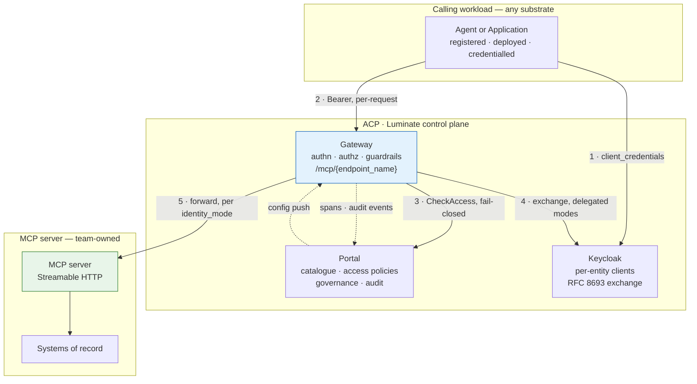

# Design Pattern: Governed MCP Server Access via Luminate Gateway

**Document status:** Draft
**Pattern owner:** Seth Chalmers
**Approvers:** [EA | Security | Platform ]
**Assurance records:** ATG0005648 (architecture) · ISRA 26-1904 (security)
**Version:** 1.0
**Last updated:** September 01, 2026
**Review cadence:** Semi-annual, and on any change to the gateway's authorization or identity model
**Primary audience:** Enterprise architects, solution architects, engineering, security, operations
**Pattern category:** Integration / Security
**Cloud scope:** [Multi-cloud / substrate-neutral]
**Technology neutrality:** Preferred — MCP, OAuth 2.0, RFC 8693 and RFC 9728 are open standards; the gateway and control plane are Luminate-specific

---

## 1. Executive Summary
This pattern governs how any calling workload reaches a Model Context Protocol (MCP) server. It addresses three key observations: what the
architecture is, which decisions were taken and why, and which controls exist with what evidence.

The architecture makes a single assertion: no caller reaches an MCP tool except through a Luminate
gateway, and every such call is authenticated, authorized against a central policy decision,
content-scanned and audited. Every control in this pattern either supports that assertion or bounds
what happens when it does not hold.

An MCP server is not an ordinary internal API. It is invoked by a non-deterministic caller, with
arguments the caller composed, and its output re-enters that caller's reasoning. The pattern
therefore treats the gateway as the only path to a tool, the server (not the tool) as the unit of
authorization, and tool output as untrusted input.

> **Governing principle:** No caller reaches an MCP tool except through a Luminate gateway, and every
> such call is authenticated, authorized against a central fail-closed policy decision, content-scanned
> and audited.

## 2. Business Context and Outcomes
### 2.1 Business capability supported
**Capability:** Governed agentic tool access — the secure, authorized, and audited consumption of
enterprise tools and systems of record by AI agents and applications through the Model Context
Protocol (MCP).

The Model Context Protocol is an open standard that gives AI applications a uniform way to reach
external data sources, tools, and workflows. It is the
connective tissue of Sun Life's Agentic Control Plane (ACP / Luminate), where agents, gateways, MCP
servers, and models must authenticate to one another to do useful work. This pattern supports that
capability by ensuring the connection is not merely possible but governed: every agent-to-tool call
traverses the Luminate gateway and is authenticated, authorized against a central fail-closed policy
decision, content-scanned, and audited.

The capability serves three enterprise domains:

| Domain | What the capability enables | Governance need it satisfies |
|---|---|---|
| Agentic AI enablement | Agents and applications invoke internal MCP tools to read from and act on systems of record, extending what an agent can safely do beyond its own model context | A single governed egress path so non-deterministic callers cannot reach a tool off-platform (DD-1) |
| Security and risk assurance | Tool access is authenticated, authorized, scanned, and fully attributable to caller, server, and method | Board (ETAB) submission and security risk assessment (ISRA) produced from this specification rather than reconstructed from gateway source |
| Platform and integration standardization | A reusable, substrate-neutral onboarding path for any team publishing an MCP server behind the gateway | One server per trust boundary aligns the platform's server-granular grant with the intended privilege boundary (DD-3) |

**Business value:** MCP reduces the time and complexity of connecting AI agents to enterprise data and
actions, while this pattern converts that connectivity into a controlled, evidence-backed capability —
letting Sun Life expand agentic use cases without expanding ungoverned access to systems of record.

## 3. Problem Statement and Intent
### 3.1 Problem
Controls only exist on the path they sit on. An MCP server exposed on a second, direct path defeats
authentication, authorization, guardrails and audit simultaneously. Because an MCP server is invoked
by a non-deterministic caller with caller-composed arguments, and its output re-enters the caller's
reasoning, it introduces threats an ordinary internal API does not: confused-deputy and excessive-agency
on coarse per-server grants, prompt injection and tool poisoning via tool output, path bypass that
emits no audit event, credential leakage to third parties, cross-environment token replay, and
inventory drift between the assessed and served tool sets.

### 3.2 Pattern intent
Standardize a single governed path: MCP servers are consumed only through a Luminate gateway, where
each request is authenticated, credential-shape-gated per endpoint mode, authorized against a central
fail-closed access decision, content-scanned on request and response, and fully audited. Authorization
is server-granular; the endpoint boundary (one server per trust boundary) is the compensating
architecture.

### 3.3 Non-goals
- Tool-granular authorization is not implemented by the platform (see R-1); this pattern does not claim it.
- Third-party-fronted servers are not onboarded until `injected_credential` or `external_exchange`
  is implemented (DD-5).
- The S4 substrate is deferred (per Hosting).
- The governance axis is not presented as an operating control (rulesets deployed, zero applicability
  rules — R-8).

## 4. Pattern Summary
| Attribute | Description |
|---|---|
| Pattern name | Governed MCP Server Access via Luminate Gateway |
| Pattern type | Governed integration / egress control |
| Primary runtime/orchestrator | Luminate control plane — Portal, Keycloak, Gateway |
| Reliability model | Fail-closed on the request path; no policy cache; suspension/withdrawal with pre-commit radius preview (DD-9, C-23, C-24) |
| Security model | Per-request Bearer authn; credential-shape gating per identity mode; central `CheckAccess`; RFC 8693 token exchange; guardrails on request and response; append-only audit |
| Best suited for | MCP tool access from agents/applications requiring authenticated, authorized, audited, content-scanned egress |
| Not suited for | Third-party-fronted servers pending `injected_credential`/`external_exchange`; tool-granular authorization needs (see §5.2) |
| Maturity | Validated — four dev servers exist; all currently `gateway_identity` (target is `delegated_exchange`) |

## 5. Applicability
### 5.1 Good fit
| Use case | Why fit |
|---|---|
| Agent/application calling internal MCP tools that must be authenticated, authorized, scanned and audited | The gateway is the single governed path and enforces all four controls (DD-1) |
| Servers where read and write, or classification tiers, can be split | One server per trust boundary aligns the platform's server-granular grant with the privilege boundary (DD-3) |

### 5.2 Poor fit
| Use case | Why not fit |
|---|---|
| Third-party-fronted servers needing an injected/exchanged credential | `injected_credential` and `external_exchange` are enum-only/unimplemented; a server in either is served with no credential (DD-5, R-7) |
| Vendor SaaS that must be reached as the individual user (per-user three-legged OAuth) | Neither identity mode carries a person's own vendor token; `injected_credential` is one shared credential per deployment. Raised as consortium idea ACPDIS-165 (DD-5, R-7) |
| Workloads requiring per-tool authorization enforced by the platform | Tool-granular authorization is not implemented; a grant covers every tool on the server, including tools added later (R-1) |
| Workloads depending on the governance axis as an operating control | Zero applicability rules; every server sits at `not_evaluated` (R-8) |

### 5.3 Hosting substrates in and out of scope

**This approval is scoped to the substrates marked in scope.** A hosting shape not listed here has
not been assessed and is not covered.

| # | Substrate | In scope | Basis |
|---|---|:---:|---|
| **S1** | OpenShift / corporate ingress | ✅ | Live today. Requires the Sun Life issuing CA in the gateway's **merged** trust bundle |
| **S2** | AWS EKS, in-cluster | ✅ | Live today. Plain HTTP acceptable only because the hop stays in the pod network, and only with the NetworkPolicy stated as the control |
| **S3** | Amazon Bedrock AgentCore | 🟡 Conditional | Reachable, but the governed-route decision is open and SigV4 targets are not expressible |
| **S4** | Vendor / third-party hosted | ❌ Excluded | The platform cannot send a credential a third-party authorization server would accept. Onboarding one means calling it unauthenticated (DD-5, R-7) |
| **S5** | AWS Lambda | 🟡 Conditional | Only behind a private API Gateway that accepts a bearer. A public Function URL fails the reachability control; an `AWS_IAM` Function URL needs SigV4 |

**One constraint spans S3 and S5.** The MCP outbound path emits only an RFC 8693 bearer, a
passthrough of the caller's bearer, or nothing — there is no SigV4. Any AWS target whose native
invoke auth is SigV4 must either be fronted by something that accepts a bearer, or be reached as
the gateway's own identity over a network-restricted path, carrying no caller identity.

## 6. Reference Architecture
### 6.1 Architecture diagram

### 6.2 Logical layers
| Layer | Responsibility |
|---|---|
| Calling workload (any substrate) | Registered, deployed, credentialled agent or application that requests a tool |
| Control plane — Portal | Catalogue, access policies, governance, audit; central `CheckAccess` decision; config push to gateway |
| Control plane — Keycloak | Per-entity clients; `client_credentials`; RFC 8693 token exchange for delegated modes |
| Control plane — Gateway | Authn, authz, guardrails; forwards per `identity_mode`; emits spans and audit events |
| Team-owned MCP server | Streamable HTTP server exposing tools; reaches systems of record |

## 7. Core Design Decisions
| # | Decision | Rationale | Alternative rejected |
|---|---|---|---|
| **DD-1** | **The gateway is the only path to a tool.** An MCP backend is reachable from the gateway and from nothing else | Controls only exist on the path they sit on. A second path defeats authentication, authorization, guardrails and audit simultaneously | Publishing the server for direct use "for convenience" — creates an ungoverned path with no compensating control |
| **DD-2** | **The server, not the tool, is the unit of authorization** | It is what the platform enforces. Pretending otherwise would put a control in the ISRA that does not exist | Relying on `AccessPolicy.allowed_tool_ids` or `MCPTool.access_level` — both are inert at runtime |
| **DD-3** | **One server per trust boundary** — split read from write, and split classification tiers | Makes the platform's server-granular grant coincide with the intended privilege boundary. Cheap now, a migration later | A single large server with server-side authorization only — acceptable as MSR-16 but weaker: the control moves off the platform |
| **DD-4** | **`delegated_exchange` is the target identity mode**; `gateway_identity` requires a recorded rationale | The server can then authenticate the caller and enforce its own rules. `gateway_identity` makes network reachability the entire boundary | Leaving the estate default. All four dev servers are `gateway_identity` today, which is the state this decision changes |
| **DD-5** | **Third-party-fronted servers are not onboarded** until `injected_credential` or `external_exchange` is implemented | Both modes are enum-only; a server in either is served with **no credential**. Onboarding one would mean calling a third party unauthenticated | Injecting a shared static credential out-of-band — an ungoverned secret outside the platform's credential model |
| **DD-6** | **The catalogue's tool records are a release-time obligation** | There is no discovery on `origin/main`; the records are the only inventory an assessor can read, and a live server currently carries none | Treating the catalogue as authoritative — it would make the ISRA's inventory a fiction |
| **DD-7** | **Scanning gates ship enabled** on MCP server repositories | The library defaults are already `enforce = true`; the estate overrides them. An MCP server is not the workload to carry that forward | Following the existing ACP repositories' configuration |
| **DD-8** | **Evidence, not stage colour.** A control is met when its artefact is retrievable | The Checkmarx step reports success when no scan exists. A green pipeline is not an assessment | Accepting build status as evidence |
| **DD-9** | **Fail-closed availability is accepted.** The control plane is on the request path with no policy cache | A cached allow is an unrevoked allow. The correct posture for a governed egress path | A local policy cache with a TTL — improves availability, weakens revocation |
| **DD-10** | **Tool output is untrusted input** | It re-enters the model's context. Response guardrails plus a server-side output bound are the control | Trusting tool output because the tool is internal |

## 8. Component Model
### 8.1 Component catalog
| Component | Purpose | Failure mode | Scaling model |
|---|---|---|---|
| Portal | Catalogue, access policies, governance, audit; central `CheckAccess` | Outage denies (fail-closed, DD-9/R-5) | [GAP: scaling model not specified — input needed] |
| Keycloak | Per-entity clients; `client_credentials`; RFC 8693 exchange | Exchange unavailable → delegated target withheld (C-10) | [GAP: scaling model not specified — input needed] |
| Gateway | Authn, authz, guardrails; forward per `identity_mode`; audit/spans | Withholds rather than downgrades on skew (T8) | [GAP: scaling model not specified — input needed] |
| MCP server (team-owned) | Streamable HTTP; exposes tools; reaches systems of record | Platform never probes server health (R-4) | [GAP: scaling model not specified — input needed] |

### 8.2 Interaction contracts
| Interface | Protocol | Contract | Versioning |
|---|---|---|---|
| Workload → Keycloak | OAuth `client_credentials` | Per-entity client credential | [GAP: not specified — input needed] |
| Workload → Gateway | HTTP Bearer, per-request | `/mcp/{endpoint_name}` | [GAP: not specified — input needed] |
| Gateway → Portal | `CheckAccess` (fail-closed) | Per-request access decision | [GAP: not specified — input needed] |
| Gateway → Keycloak | RFC 8693 token exchange | Delegated identity modes; audience scoped to deployment | [GAP: not specified — input needed] |
| Gateway → MCP server | Streamable HTTP | Forward per `identity_mode` | [GAP: not specified — input needed] |

## 9. Non-Functional Requirements (NFR)
| NFR | Target | Validation method |
|---|---|---|
| Availability | The control plane is on the request path — every call makes a `CheckAccess` RPC with no local cache, so a portal outage denies rather than fails open | Deliberate posture, not a defect. Portal and gateway redundancy; stated as a residual in the ISRA |
| Latency | Gateway overhead per MCP call: authentication, the authorization RPC, guardrail evaluation, forward | Measured and published per environment. Not yet baselined |
| Isolation | No MCP backend reachable from outside its serving gateway | Negative test from a non-gateway workload, per server |
| Credential containment | No platform-minted credential (`lum_` API key, `lud_at_` delegated token) leaves the gateway to a third-party backend | Enforced in the gateway; verified by negative test returning 403 `platform_minted_not_forwardable` |
| Attributability | Every served request attributable to caller, server, endpoint and JSON-RPC method | A trace carrying all four; 100% of requests through the gateway |
| Auditability | Every control-plane mutation and every data-plane access decision recorded in the append-only trail | Authorize + access event pair per call; database-enforced immutability |
| Supply chain | Every served image traceable to a pipeline build with SAST, SCA and SonarQube evidence | Scan id, SBOM and quality gate retrievable per build |
| Recoverability | Withdrawing a server takes effect across every serving gateway | **Measured**, never quoted. Target under 60s; propagation is a push stream, not a poll |

Throughput, RTO and RPO are not set at the pattern level: an MCP server's capacity and
recovery targets follow the system of record its tools reach, and are set per server
rather than inherited from this pattern.

## 10. Security and Compliance Baseline
### 10.1 Identity and access model
| Identity type | Scope | Least-privilege guidance |
|---|---|---|
| `client_credentials` (workload → Keycloak) | Per-entity client | Per-entity clients only |
| Bearer token (workload → gateway) | Per-request | Presented on every request; authenticated before any MCP request is served (C-1) |
| `delegated_exchange` (target mode) | Deployment-audienced downstream token | Target mode; server authenticates caller and enforces own rules (DD-4) |
| `gateway_identity` | Network reachability is the boundary | Requires a recorded rationale (DD-4) |
| `injected_credential` / `external_exchange` | Third-party-fronted | Unimplemented; not onboarded (DD-5) |

### 10.2 Control baseline
| Control ID | Standard/Policy | Requirement | Applies when | Evidence artifact |
|---|---|---|---|---|
| C-1 | [ISRA — NEEDS INPUT] | Caller authenticated before any MCP request is served | Every request | 401 on a negative test |
| C-2 | [ISRA] | Credential shape gated per endpoint mode | Every request | 403 with the specific refusal reason |
| C-3 | [ISRA] | Central, fail-closed access decision on every request | Every request | Decision recorded per request; deny on portal outage |
| C-4 | [ISRA] | Grant is explicit — no implicit access to a server | Every grant | The `AccessPolicy` record |
| C-5 | [ISRA] | Tool-level restriction where privileges differ | Privileges differ | Architecture record; a negative test per tool |
| C-6 | [ISRA] | Backend unreachable except from the gateway | Always | Negative test from a non-gateway workload |
| C-7 | [ISRA] | TLS on any hop leaving the pod network, correct trust chain | Hop leaves pod network | Successful call; CA count in the gateway pod |
| C-8 | [ISRA] | No platform-minted credential leaves the gateway | `token_forward` | 403 `platform_minted_not_forwardable` |
| C-9 | [ISRA] | Downstream token audienced to deployment and validated by server | Delegated modes | Refusal of a token minted for another deployment |
| C-10 | [ISRA] | Delegated target withheld when it cannot be exchanged | Exchange unavailable | Gateway log; endpoint absent from config |
| C-11 | [ISRA] | Content control on request and response | Every request/response | Guardrail binding; a positive detection test |
| C-12 | [ISRA] | Tool output bounded and non-instructional | Every response | Design review; response guardrail |
| C-13 | [ISRA] | SAST performed and gated | Build | Checkmarx scan id + gate evaluation |
| C-14 | [ISRA] | SCA performed and gated; SBOM retained | Build | `snyk-sbom.json`, `snyk-results.html` |
| C-15 | [ISRA] | Static analysis gated | Build | SonarQube project + quality gate status |
| C-16 | [ISRA] | Image built by pipeline, immutably referenced, non-root | Build/deploy | Digest match; `runAsNonRoot` |
| C-17 | [ISRA] | Secrets from Vault / Secrets Manager only | Deploy | Manifest review |
| C-18 | [ISRA] | Tool inventory current and classified | Release | Release-time diff; classification per tool |
| C-19 | [ISRA] | Tool contract changes are governed | Change | Change record referencing the catalogue diff |
| C-20 | [ISRA] | Every control-plane mutation audited, append-only | Always | Audit record; DB trigger presence |
| C-21 | [ISRA] | Every data-plane decision audited | Every call | Authorize + access events per call |
| C-22 | [ISRA] | Every served call attributable to caller, server and method | Every call | A Langfuse trace showing all four |
| C-23 | [ISRA] | Withdrawal effective across every serving gateway | Withdrawal | Measured propagation time per environment |
| C-24 | [ISRA] | Suspension radius shown before commit | Suspension | The recorded `suspension-preview` |
| C-25 | [ISRA] | Governance state moved only by guarded transition | State change | State + reason; a refused direct write |

### 10.3 Threat model
An MCP server is not an ordinary internal API. It is invoked by a non-deterministic caller, with
arguments the caller composed, and its output re-enters that caller's reasoning.

| # | Threat | Where it bites | Control |
|---|---|---|---|
| **T1** | **Confused deputy** — an agent is induced to call a tool it is entitled to, for a purpose it is not | The grant is per server, so entitlement is coarse | DD-3 split · MSR-16 server-side authorization · MSR-27 classification |
| **T2** | **Excessive agency** — a tool added later is covered by an existing grant, with no approval | New tool, old policy | MSR-7 change control · MSR-6 catalogue diff at release |
| **T3** | **Prompt injection via tool output** — content returned by a tool instructs the model | Response path | MSR-18 bounded, non-instructional output · response guardrails · DD-10 |
| **T4** | **Tool poisoning** — a tool description written to steer model behaviour | Catalogue and `tools/list` | MSR-8 review of names and descriptions |
| **T5** | **Path bypass** — a workload calls the backend directly, skipping the gateway | Network | MSR-10 negative test · DD-1. Bypass emits **no** audit event, so absence of events is the detection signal |
| **T6** | **Credential leakage to a third party** — a platform-minted credential forwarded to an uncontrolled backend | `token_forward` mode | Enforced in the gateway: `platform_minted_not_forwardable`. Verified by negative test |
| **T7** | **Cross-environment token replay** — a staging credential spent against production | Delegated tokens | Audience is scoped to the **deployment**, not the catalogue entry. MSR-12 requires the server to check it |
| **T8** | **Silent unauthenticated serving** — a delegated endpoint degraded to gateway identity | Version skew, missing exchange config | The gateway **withholds** rather than downgrades; `effective_backend_auth` keys on the audience |
| **T9** | **Supply-chain compromise** — a dependency or image with a known vulnerability | Build | MSR-19 to MSR-23, with evidence per DD-8 |
| **T10** | **Data exfiltration through tool arguments** | Request path | Request-direction PII guardrails · MSR-27 · MSR-28 |
| **T11** | **Inventory drift** — the assessed tool set is not the served tool set | Catalogue | MSR-6 · DD-6 |
| **T12** | **Unbounded blast radius on withdrawal** — suspending a server takes down more than expected | Incident response | Suspension preview names the deployments and policies before commit |

## 11. Data and State Architecture
### 11.1 Data classification and boundaries
| Data class | Allowed | Boundary rules | Retention |
|---|---:|---|---|
| Tool inventory + classification per tool | Yes | Catalogue current and classified; release-time diff (C-18, DD-6) | [GAP: retention not specified — input needed] |
| Request/response content (potential PII) | Conditional | Content control on request and response; request-direction PII guardrails (C-11, T10) | [GAP: retention not specified — input needed] |
| Audit events | Yes | Append-only; DB triggers (C-20, C-21) | [GAP: retention not specified — input needed] |
| Classification tiers | Yes | One server per classification tier (DD-3, MSR-27) | [GAP: retention not specified — input needed] |

### 11.2 State management
| State type | Storage | Consistency | TTL/retention |
|---|---|---|---|
| Access decision | Portal `CheckAccess` (no cache) | Fail-closed, no policy cache (DD-9) | No cache — decided per request |
| Downstream token | Keycloak exchange | Audience scoped to the deployment | [GAP: TTL not specified — input needed] |
| Audit events | `audit_events` + `AccessProtocol.MCP` | Append-only | [GAP: retention not specified — input needed] |

## 12. Reliability and Resilience Patterns
| Pattern | Trigger | Behavior | Recovery |
|---|---|---|---|
| Fail-closed access | Portal outage / unavailable decision | Deny; no cached allow (DD-9) | Gateway and portal redundancy (R-5) |
| Delegated target withhold | Exchange config missing / version skew | Gateway withholds rather than downgrades (C-10, T8) | Restore exchange config; `effective_backend_auth` keyed on audience |
| Withdrawal / suspension | Server withdrawn or suspended | Effective across every serving gateway; radius shown before commit (C-23, C-24, T12) | Measured propagation time per environment |
| Local policy cache | — | Explicitly rejected — a cached allow is an unrevoked allow (DD-9) | N/A |

## 13. Observability and Audit
### 13.1 Minimum telemetry
| Signal | Required fields | Retention |
|---|---|---|
| Control-plane audit | Every control-plane mutation, append-only (`audit_events` + DB triggers) | [GAP: retention not specified — input needed] |
| Data-plane audit | Authorize + access events per call (`AccessProtocol.MCP`) | [GAP: retention not specified — input needed] |
| Traces | Caller, server and method per call (`x-luminate-*` headers → Langfuse) | [GAP: retention not specified — input needed] |
| Spans / audit events | Emitted gateway → Portal | [GAP: retention not specified — input needed] |

### 13.2 Alerts and SLOs
| Alert | Threshold | On-call action |
|---|---|---|
| Gateway 5xx per endpoint | [GAP: threshold not specified — input needed] | Hosting-platform probes + alerting (compensates R-4) |
| Path bypass | Absence of audit events for a served backend (T5) | Investigate direct-path access |
| [GAP: formal SLOs not specified — input needed] | | |

## 14. Deployment and Environment Strategy
### 14.1 IaC scope
Scanning gates ship enabled on MCP server repositories (DD-7). Images are built by the pipeline,
immutably referenced and non-root (C-16); secrets come from Vault / Secrets Manager only (C-17).
[GAP: full IaC scope statement not specified — input needed]
### 14.2 Environments
| Environment | Purpose | Entry criteria |
|---|---|---|
| Dev | Current estate — four servers, all `gateway_identity` (DD-4) | [GAP: not specified — input needed] |
| Test/Staging | Token audience scoped to deployment; replay into prod refused (T7) | [GAP: not specified — input needed] |
| Prod | Governed serving | [GAP: not specified — input needed] |

### 14.3 Release and rollback
| Phase | Change scope | Rollback strategy |
|---|---|---|
| Release | Tool inventory diff obligation; contract changes governed (DD-6, C-18, C-19) | Change record referencing catalogue diff |
| Withdrawal | Suspend server | Suspension preview names deployments/policies before commit (C-24) |

## 15. Operations and Support Model
### 15.1 Ownership (RACI)
| Role | Responsible | Accountable | Consulted | Informed |
|---|---|---|---|---|
| Platform | Gateway/Portal/Keycloak controls (C-1–C-3, C-8–C-11, C-20–C-24) | [NEEDS INPUT] | [NEEDS INPUT] | [NEEDS INPUT] |
| Team | Server-side controls, build/supply-chain, inventory (C-5–C-7, C-12–C-19) | [NEEDS INPUT] | [NEEDS INPUT] | [NEEDS INPUT] |
| Platform admin | Access policy and guardrail binding (C-4, C-11) | [NEEDS INPUT] | [NEEDS INPUT] | [NEEDS INPUT] |
| Governance | Governance state transitions (C-25) | [NEEDS INPUT] | [NEEDS INPUT] | [NEEDS INPUT] |

### 15.2 Runbook topics
- Incident response — path bypass detection (absence of audit events, T5)
- Server withdrawal / suspension with pre-commit radius preview (C-24, T12)
- Server health — hosting-platform probes + alerting on gateway 5xx (R-4)
- [GAP: DR failover/failback, capacity management not specified — input needed]

## 16. Cost Model and FinOps
| Cost driver | Unit economics | Optimization lever |
|---|---|---|
| [GAP: no cost drivers/unit economics in source — input needed] | | Note: no per-server call quota or spend budget; quota dimensions stop at requests and tokens (R-6) |

## 17. Risks, Assumptions, Constraints, Decisions
### 17.1 Risks
| Risk | Impact | Mitigation | Owner |
|---|---|---|---|
| R-1 Grant covers every tool, including tools added later | Coarse authorization | DD-3 split · MSR-16 · MSR-7; consortium ask raised | Platform/Team |
| R-2 Tool inventory hand-maintained | Inventory drift | MSR-6 release-time diff; consortium ask raised | Team |
| R-3 Prompt injection via tool output cannot be eliminated | Model manipulation | Response guardrails, bounded output, least privilege | Team |
| R-4 Platform never probes server health | Undetected outage | Hosting-platform probes + alerting on gateway 5xx | Team |
| R-5 Availability bounded by the control plane | Portal outage denies | Accepted per DD-9; gateway/portal redundancy | Platform |
| R-6 No per-server call quota or spend budget | Cost/abuse exposure | Server-side rate limiting where needed | Team |
| R-7 Third-party-fronted servers cannot be onboarded with a credential | Coverage gap | DD-5: not onboarded; consortium ask raised | Platform |
| R-8 Governance axis is inert | State not an operating control | Tracked by `governance-intake`; do not present `governance_state` as a control yet | Governance |

### 17.2 Assumptions and constraints
- No tool discovery on `origin/main`; the catalogue records are the only inventory an assessor can read (DD-6).
- `injected_credential` and `external_exchange` are enum-only / unimplemented (DD-5).
- All four current dev servers are `gateway_identity`; `delegated_exchange` is the target (DD-4).
- Evidence, not stage colour: a control is met only when its artefact is retrievable (DD-8).

### 17.3 ADR references
- DD-1 … DD-10 design decisions (see assurance.md "Design decisions"). [Map to formal ADR IDs — NEEDS INPUT]

## 18. Anti-Patterns
| Anti-pattern | Why problematic | Preferred approach |
|---|---|---|
| Publishing the server for direct use "for convenience" | Creates an ungoverned path with no compensating control | Gateway is the only path (DD-1) |
| Relying on `AccessPolicy.allowed_tool_ids` / `MCPTool.access_level` | Both are inert at runtime | Server is the unit of authorization (DD-2) |
| A single large server with server-side authorization only | Control moves off the platform | One server per trust boundary (DD-3) |
| Injecting a shared static credential out-of-band | An ungoverned secret outside the platform's credential model | Do not onboard until modes exist (DD-5) |
| Treating the catalogue as authoritative | Makes the ISRA inventory a fiction | Release-time obligation + diff (DD-6) |
| Accepting build status as evidence | A green pipeline is not an assessment | Evidence, not stage colour (DD-8) |
| A local policy cache with a TTL | A cached allow is an unrevoked allow | Fail-closed, no cache (DD-9) |
| Trusting tool output because the tool is internal | Output re-enters the model context | Treat tool output as untrusted input (DD-10) |

## 19. Decision Matrix
| Question | Recommendation |
|---|---|
| Do read and write, or classification tiers, differ? | Split into one server per trust boundary (DD-3) |
| Which identity mode? | Target `delegated_exchange`; `gateway_identity` only with recorded rationale (DD-4) |
| Backend fronts a third party? | Do not onboard until `injected_credential`/`external_exchange` exists (DD-5) |
| Is a green build sufficient evidence? | No — a control is met only when its artefact is retrievable (DD-8) |
| Add a policy cache to improve availability? | No — accept fail-closed (DD-9) |

## 20. Implementation Checklist
### 20.1 Architecture
- [ ] Gateway is the only network path to the backend (C-6, DD-1)
- [ ] One server per trust boundary — read/write and classification split (DD-3)
### 20.2 Security
- [ ] Caller authenticated before serving; credential shape gated per mode (C-1, C-2)
- [ ] Central fail-closed access decision on every request; explicit grant (C-3, C-4)
- [ ] TLS with correct trust chain on hops leaving the pod network (C-7)
- [ ] No platform-minted credential leaves the gateway (C-8)
- [ ] Downstream token audienced to deployment and validated by the server (C-9)
- [ ] Guardrails on request and response; output bounded and non-instructional (C-11, C-12)
- [ ] [GAP: MSR-1…MSR-30 conformance items not in this source — pull from conformance profile]
### 20.3 Reliability
- [ ] Delegated target withheld when it cannot be exchanged (C-10)
- [ ] Withdrawal propagation measured; suspension radius previewed (C-23, C-24)
### 20.4 Operations
- [ ] Server health probes + alerting on gateway 5xx per endpoint (R-4)
- [ ] Every call attributable to caller, server and method (C-22)
### 20.5 Compliance/Audit
- [ ] SAST, SCA (+SBOM), static analysis gated with retrievable evidence (C-13–C-15, DD-8)
- [ ] Image pipeline-built, immutable, non-root; secrets from Vault/SM (C-16, C-17)
- [ ] Tool inventory current, classified, and diffed at release (C-18, C-19)
- [ ] Control-plane and data-plane decisions audited, append-only (C-20, C-21)
- [ ] Governance state moved only by guarded transition (C-25)

## 22. Source References

Every claim in this document is traceable to a named source at a named revision. Nothing
here is inferred from a design document.

**Primary source — the spec this pattern was derived from**
- `acp-product-specs` / `specs/pattern/mcp-server-patterns/` (D0–D3), Jira [EACPP-1176](https://sunlife.atlassian.net/browse/EACPP-1176)
- Section numbering below maps to that spec: MSR-1–MSR-30 (conformance profile, D1), DD-1–DD-10, T1–T12 (threat model), C-1–C-25 (ISRA control set) and R-1–R-8 (residual risks) all live in `d2-design/assurance.md`; G-1–G-11 in `d2-design/gaps.md`

**Implementation ground truth**
- `AI-Consortium/luminate` @ `origin/main` `10d6ee89` (2026-09-01) — catalogue model, the five identity modes, gateway config translation, request-time credential gating
- SLF dev Luminate estate, queried 2026-09-01 — the four registered MCP servers and their configuration
- `CSDP/pipeline-libraries` (Bitbucket), read 2026-09-01 — the JTE `sonarqube`, `snyk` and `checkmarx` libraries, their steps and gate defaults

**Standards**
- Model Context Protocol specification — transports, JSON-RPC method set, session semantics
- RFC 8693 — OAuth 2.0 Token Exchange (the delegated-identity hop)
- RFC 9728 — OAuth 2.0 Protected Resource Metadata (`/.well-known/oauth-protected-resource/mcp/{endpoint}`)

**Sun Life internal**
- `docs/templates/pattern.md` — the design-pattern template this document follows
- `docs/capability-map.md` — CAP-03, CAP-07, CAP-08 and CAP-24, and the CAP-03 correction this pattern raises
- OSFI E-23 (model inventory and change control); OSFI B-13 Principle 15 (least privilege) and Principle 17 (incident response)
