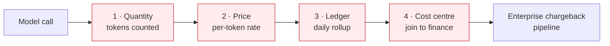

# D0 — Discovery

> **Gate**: D0 | **Status**: Draft | **Epic**: [EACPP-1320](https://sunlife.atlassian.net/browse/EACPP-1320)

## What this spec is for

Two inference topologies are in demand at once, and the choice between them is unmade. It is also
load-bearing in a way that is easy to miss: **it decides whether chargeback keeps working.**

[`integration-patterns`](../../platform/integration-patterns/d2-design/inference.md) already catalogues the two
shapes as they stand today. Its D3 leaves the decision open in terms:

> **T16** — **Decide and record whether centralized is offered**, and to whom. It is the only
> pattern that serves a workload with no AWS account, and it is the one that puts model spend on
> the platform's budget.

**This spec is the artifact that discharges T16.** It takes centralized inference as the target
state — the only shape that serves a workload with no cloud account, the shape that makes inference
commercially negotiable, and the shape that keeps the provider replaceable — and specifies what must
be true for it to be approvable.

> **Where current state belongs.** This D0 records the platform as it stands, because that is what a
> discovery gate is for. **[D2](d2-design/index.md) describes the target state only**; the delta
> between the two, with the work to close it, is [D3](d3-tasks.md). Approving the pattern and
> scheduling the work are separate decisions, and mixing them into the design is how a target state
> gets negotiated down to what already exists.

---

## Where ground truth comes from

Every platform claim below is pinned. Nothing is quoted from a capability map or a design document
without being checked against code, a ticket, or the running estate.

| Source | Revision / date | Used for |
|---|---|---|
| `AI-Consortium/luminate` | `origin/main` @ **`654c31991`**, 2026-09-14 | Catalogue, metrics, quotas, policy, gateway tracing |
| `EDAEACP/acp-product-specs` | `origin/main` @ `5371bb44` | Sibling specs, the T16 gate |
| Live dev estate | queried **2026-09-14** via the `luminate-backend` pod | What is actually registered and populated |
| Jira EACPP | 2026-09-14 | Sun Life epics and the in-flight inference work |
| Jira AIC (consortium) | 2026-09-14 | The enforcement and attribution roadmap |
| `anthropic-client-acp-integration` D0 + discovery transcript | PR #47 | The demand signal and the cost requirement, verbatim |

> **A note on one re-verification.** My own earlier reading of this platform (2026-08-30) recorded
> "no aggregated billing ledger". That was true when written and is **no longer true** — see
> [The gate has half-lifted](#the-gate-has-half-lifted). Verdicts about a platform under active
> development expire; this spec re-checked every one rather than inheriting it.

---

## The demand, in the stakeholders' own words

From the Anthropic client discovery session ([PR #47 references](https://bitbucket.sunlifecorp.com/projects/EDAEACP/repos/acp-product-specs/pull-requests/47/overview)).
These are quoted rather than paraphrased because the requirement is financial and the wording matters.

**The topology problem, stated by the business:**

> One of the plans was we'll just set up loads of workload accounts... **There's too much technical
> debt and it's just loads of workload accounts, so it doesn't make any sense.** So then... one
> workload account for each region and we'll just route everybody through that one workload account.
> — Justin Collery

**The requirement that follows from it:**

> The sort of secondary requirements then revolve around there has to be a **chargeback model**. So
> if all of this goes to one workload account, then there has to be a chargeback model to basically
> send those bills back to the right place. — Justin Collery

> **I don't have a bias as to which way**, but there has to be a way that the people in my team,
> that their usage gets billed to my team. — Justin Collery

> So we need to know **how many tokens people have used** in order to do the chargeback.
> — Justin Collery

**What finance already has, and why it constrains the design:**

> There is already pipelines in place for chargebacks [that] go through AWS workload accounts, and
> all you need to do is **piggyback on one of those existing chargeback mechanisms**... the
> **workload accounts go to a cost center. So it's by workload accounts now.** — Robert Chin

> [Keep] that **single view** in terms of... you can go in and see what your cost center spend is on
> AWS Services. — Robert Chin

**The trade, named in the room:**

> [Use an] individual workload account, like happens today, because that makes the **chargeback
> cleaner, but things messier on the control plane side**. — Seth Chalmers

> This is a good use case for the **centralized inference**... **not delegating to different
> workload accounts**... and we just do like **per project per user kind of attribution within the
> ACP level**, and then a phased approach. — Seth Chalmers

**Scope markers**: access "should be controlled by **AD group**"; the cost in question is
"**token costs**", not AWS account costs; the provider is "**always Bedrock Direct, for now**";
target **31 October**, dev first; LVT 4; no PII in the first wave.

---

## The finding that shapes the whole spec

Read those quotes together and the architecture writes itself.

**Chargeback works today because inference is distributed.** The AWS workload account *is* the
attribution mechanism — AWS bills per account, and the enterprise pipeline maps account to cost
centre. Nobody built that for AI; it is inherited, and it is free.

**Centralizing inference removes exactly that boundary.** One account for everyone means the
existing pipeline can no longer attribute: every team's spend lands in a single account and arrives
at finance as one undifferentiated bill.

So the trade is not "centralized is simpler". It is:

| | Distributed (consumer-account) | Centralized (ACP account) |
|---|---|---|
| Control plane | Sprawls — an account and a gateway per team | **One policy point, one catalogue, one audit** |
| Chargeback | **Free** — AWS and the existing pipeline do it | **Must be built** — ACP becomes the attribution authority |
| Serves a workload with no AWS account | **No** — nothing to assume into | **Yes** — the only option |
| Onboarding cost to the consumer | An AWS account and a Service Catalog launch | Nothing |

**Centralization moves the attribution burden from AWS onto ACP.** That is the whole of it, and
everything this spec specifies follows from taking that burden seriously rather than discovering it
after the first invoice.

---

## The gate has half-lifted

`integration-patterns` records the gate on centralized inference as two conditions:

> **Which is the gate on centralized.** Consumer-account needs none of it, because AWS bills the
> consumer directly. **Centralized cannot be offered fairly until the ledger and a spend dimension
> exist.**

That page was written **2026-08-26**. One of the two conditions has since been met.

| Condition | Status at `654c31991` | Evidence |
|---|---|---|
| An aggregated billing ledger | **Now exists** | `ProjectUsageDaily` landed **2026-08-27** (`5b43d1e94`, ACP-577 "Project chargeback: daily usage ledger, rollup workflow, report API and UI"), extended 2026-09-08 (`1c4a00035`, AIC-525) |
| A spend dimension | **Still absent** | `QuotaDimension` = `REQUESTS`, `TOKENS` only; docstring: "`spend`, `concurrency`, and `error_rate` land additively in later phases" |

The ledger landed **one day after** that page was written. This is not an error in the sibling spec;
it is a platform moving faster than a document. It does change the answer, though: **the blocker on
centralized inference is now narrower than recorded** — attribution is buildable today, enforcement
is not.

---

## What the platform actually provides

Verified at `654c31991`.

### Attribution — more is built than the capability map credits

`ProjectUsageDaily` is a worker-materialized ledger, one row per UTC day per
**`(project, entity, user, model, provider)`** combination, carrying `input_cost`, `output_cost`,
`total_cost` (`Decimal(20,10)`) and `currency`.

**`cost_centre` is a first-class column**, and deliberately a snapshot:

> Snapshot of `Project.cost_centre` as it stood when the day was rolled up.

That is the right shape for finance — a re-org reassigns a project's cost centre without
retroactively rewriting last quarter's ledger. The module states the reasoning plainly:

> `cost_centre` sits beside the project because it is the same dimension in the **finance system's
> own coding**.

The report surface is `/api/v1/chargeback/{rows,summary,export}`, export being a streaming CSV whose
columns are `usage_date, project_id, project_name, cost_centre, user_id, email, entity_type,
entity_id, entity, provider, model, prompt_tokens, completion_tokens, total_tokens, cost, currency`.

It also models unbilled spend as a first-class, *selectable* bucket:

> `UNATTRIBUTED_TOKEN` — a sentinel is required because a UUID list cannot express "no project", and
> the bucket has to be *selectable* rather than merely present — an operator chasing unbilled spend
> needs to filter down to exactly it.

**This is the shape Justin asked for**, at the grain he asked for it. What remains is not design; it
is the four breaks below, plus the hand-off to the enterprise pipeline.

### Model access governance — real, and already in use

| Dimension | Mechanism |
|---|---|
| Who may call | `AccessPolicySourceType` = `mcp_server`, `agent`, **`user`**, **`user_group`**, `all_users`, `application`, `location`, `environment` |
| What may be called | `AccessPolicyTargetType` = `mcp_server`, `agent`, **`model`**, `location`, `environment` |
| In which region | `ModelOffering` identity is **`(model, provider, region)`**, enforced by the `unique_offering_per_region` DB constraint; region is "the geographic region the gateway routes to (e.g. `us-east-1`)" |
| For which project | `AccessPolicy` carries materialized-path scope tokens `<scope_type>:<id>` for the owning project |

**`user_group` is the AD-group hook** the business asked for. It exists. It is unused — see below.

### Budgets and enforcement — modelled, never enforced

Re-verified rather than inherited, because this is the kind of verdict that expires:

- `QuotaDimension` = `REQUESTS`, `TOKENS`. **A dollar budget cannot be expressed.**
- `quotas.rego` is **257 lines** and the only `deny` / `limit` / `exceed` / comparison hit in it is a
  **comment**. It emits `matched_quota_ids` and `matched_quota_offerings` onto the *allow* branches.
- `matched_quota_ids` has **no production consumer** — every reference outside the rego is a test.
- The gateway contains exactly one occurrence of the word "quota", in a docstring, which states the
  position precisely: *"target-side guardrails and quotas resolve from the selector portal-side"*.
- The word "budget" appears 79 times in the quota code and refers throughout to **approval-routing
  vocabulary** (`quota.source_budget` as a mutation class), not to money.

AIC-20 states the same thing from the other side: **"Nothing enforces a limit on the inference path
today. Limits are Quota rows: the AccessPolicy rate-limit columns were dropped in migration 0009."**

---

## The live dev estate

Queried 2026-09-14 through the `luminate-backend` pod. This is the part that cannot be learned from
reading code, and it changes the conclusion.

| Object | Count | What it tells us |
|---|---|---|
| `Model` | 7 | A working catalogue |
| `Provider` | 2 | Bedrock-centric, as stated |
| `ModelDeployment` | 5 | Models are reachable |
| `AccessPolicy` | 30 | Governance is live |
| — by target | **`model` 19**, `mcp_server` 8, `agent` 3 | **Model access governance is the most-used policy type in the estate** |
| — by source | `agent` 21, `application` 8, `environment` 1 | **Zero `user` and zero `user_group` policies** |
| `Quota` | 7 (`tokens` 3, `requests` 4) | Authored, and — per above — never enforced |
| **`PricingCatalogEntry`** | **0** | **No price is loaded for any model** |
| **`ProjectUsageDaily`** | **0** | **The ledger has never been populated** |
| `Project.cost_centre` | **empty on all 8 projects** | **The join to finance is unpopulated everywhere** |

Two observations worth carrying forward:

1. **Model governance is the busiest thing in the policy store** — 19 of 30 policies. The mechanism
   the business wants is not speculative; it is the thing most in use.
2. **The AD-group route is modelled and untested.** `user_group` is a valid source type and no policy
   uses it. The first Anthropic-style onboarding will be the first exercise of that path, which is a
   schedule risk, not a design risk.

> **Method note.** The deployed dev image lags `main`: it carries `ModelProviderOffering` and
> `OfferingAccountBinding` where `main` has `ModelOffering` keyed `(model, provider, region)`. Any
> live query must introspect before it selects, or it fails on a class that does not exist yet. A
> reading taken only from `main` would have described a schema the estate does not run.

---

## The attribution chain, and its four breaks

Centralized inference requires that a token consumed by a person is billed to that person's cost
centre. That is a chain, and **every link is currently broken in dev**. Each is independently
verifiable, which is what makes them preconditions rather than worries.

### Break 1 — quantity: cache tokens are never counted

`gateway/app/services/tracing.py` maps exactly three usage numbers to Langfuse:
`gen_ai.usage.completion_tokens`, `gen_ai.usage.prompt_tokens`, `llm.usage.total_tokens`.
**There is no cache dimension.**

AIC-679 (In Progress) measured the consequence live against Anthropic on 2026-09-01:

> A turn Anthropic billed as **14 input tokens plus a 4,377-token cache read** is reported to
> Langfuse as **14 input tokens**. The cached 4,377 appear nowhere — not as tokens, not as cost. At
> Anthropic's cache-read rate of 0.1× input, that turn's true cost is about 452 input-token-
> equivalents and we record 14, **roughly 3% of actual**.

The sharpest form of this: **the pricing catalogue already carries `cache_read_input_token_cost` and
`cache_creation_input_token_cost`** (with large-context variants, mapped from LiteLLM). So the
platform knows *the price of a cache read* and never learns *how many there were*. The price exists;
the quantity does not.

This lands hardest on precisely the workload driving the demand. Claude Code is prompt-cache heavy,
so the teams using it most would be under-billed most — an error that is not just large but
**systematically unfair between teams**, which is worse for a chargeback model than a uniform error.

### Break 2 — price: no pricing rows are loaded

`PricingCatalogEntry` has **0 rows in dev**. Cost is quantity × price; with no price, cost is zero
regardless of how well tokens are counted. Fixing Break 1 alone changes nothing.

### Break 3 — ledger: never populated

`ProjectUsageDaily` has **0 rows in dev**. The table, the rollup workflow, the report API and the UI
all exist upstream. None of it has been exercised here.

### Break 4 — cost centre: unpopulated on every project

`Project.cost_centre` is blank on all 8 dev projects. It is the only field that joins ACP to the
finance system's own coding, and it is empty.

**All four must close.** Closing any three produces a report that is confidently wrong, which is more
dangerous than no report — a number that reaches finance acquires authority it has not earned.

---

## Capability assessment

| Need | Platform position | Verdict |
|---|---|---|
| Route inference centrally | Gateway is the only path; Bedrock is a provider | ✅ Available |
| Attribute per user / project / model / provider | `ProjectUsageDaily` at exactly that grain | ✅ Available, unpopulated here |
| Carry a cost centre | First-class snapshot column | ✅ Available, unpopulated here |
| Count tokens accurately | Three usage numbers, no cache dimension | ❌ **Broken — AIC-679** |
| Price a call | Catalogue exists with cache pricing columns; 0 rows loaded | ⚠️ Available, not loaded |
| Report to finance | `/api/v1/chargeback/{rows,summary,export}` streaming CSV | ✅ Available |
| Hand off to the enterprise pipeline | No integration | ❌ **Not built — Sun Life's to build** |
| Limit spend in dollars | Dimension enum stops at requests/tokens | ❌ **Not expressible** |
| Enforce any limit | Quotas match and report; never deny | ❌ **Not enforced — AIC-20** |
| Govern agent → model | `target_type=model`, 19 live policies | ✅ In use |
| Govern user / AD group → model | `source_type=user_group` exists | ⚠️ Modelled, **zero policies** |
| Scope a model to a region | `(model, provider, region)` + DB constraint | ✅ Available |
| Scope a model to a project | Materialized-path scope tokens | ✅ Available |
| Cost per run / session | `UsageSession` counts sessions, carries **no tokens and no cost** | ❌ Not available |

---

## Strategic conclusions

**SC-1 — Centralized inference should be the target state, for three reasons.** It is the only
topology that serves a workload with no cloud account. It presents a **single measured enterprise
demand** to a provider, which is the precondition for committed-spend agreements and negotiated
inference deals — unavailable in the distributed shape at any level of effort. And it keeps the
**provider replaceable**, because a workload names a model rather than a provider. The engineering
is modest; the attribution work is the programme.

**SC-2 — The gate recorded in `integration-patterns` is narrower than stated, and should be
restated.** The ledger exists. The remaining platform dependency is enforcement, not attribution.
That sibling spec should be updated rather than left to contradict this one.

**SC-3 — Attribution must be proven before it is promised.** Four independent checks, each
verifiable. The pattern states them as preconditions with verification methods so that "centralized
is ready" is a query, not an opinion. An aggregated bill that cannot be decomposed is a liability,
not leverage.

**SC-4 — Feed the existing pipeline; do not compete with it.** Finance already has cost-centre
reporting and a single view. ACP should supply the attribution the cloud account boundary used to
supply, in the same coding, into the same pipeline.

**SC-5 — Measurement integrity is a control, not a defect.** A metering path that under-counts
cache-heavy traffic will be withdrawn the first time a team audits its bill — and because the error
falls unevenly across teams, it cross-subsidises rather than merely under-recovers. Complete
token-dimension capture belongs in the control set.

**SC-6 — Budget enforcement is a consortium dependency, and the design should specify it rather than
work around it.** The target state is a spend budget refused at the call. That requires both a spend
dimension and an enforcement mechanism, and they must land together — either alone leaves the
business owner's commitment unmet. Specify the target and track the dependency; do not design the
pattern down to what exists.

**SC-7 — The directory-group path is on the critical path and untested.** The mechanism exists with
zero live policies, and the first onboarding depends on it. Exercise it early rather than during a
cutover.

**SC-8 — Distributed inference remains supported, but it is a trade, not a default.** Teams with a
cloud account are well served by it and need none of this machinery — at the cost of forfeiting
aggregate volume and hard-wiring the provider. The pattern should keep it and name the trade.

---

## Open questions for D1

- [ ] Which enterprise pipeline receives the ACP attribution, in what format, and on what cadence?
- [ ] Is a project the right billing unit, or does a cost centre need to span projects?
- [ ] Who owns loading and maintaining the pricing catalogue, and how is drift against the provider's
      real rate card detected?
- [ ] What is the accepted variance between the ACP figure and the AWS bill before it is a defect?
- [ ] Does centralized inference require the SCP lift on the ACP account, or a gateway hosted where
      the deny does not apply?
- [ ] What is the interim spend control while enforcement does not exist?
- [ ] Is per-user email in a finance report acceptable under Law 25 / PIPEDA, with what retention?
