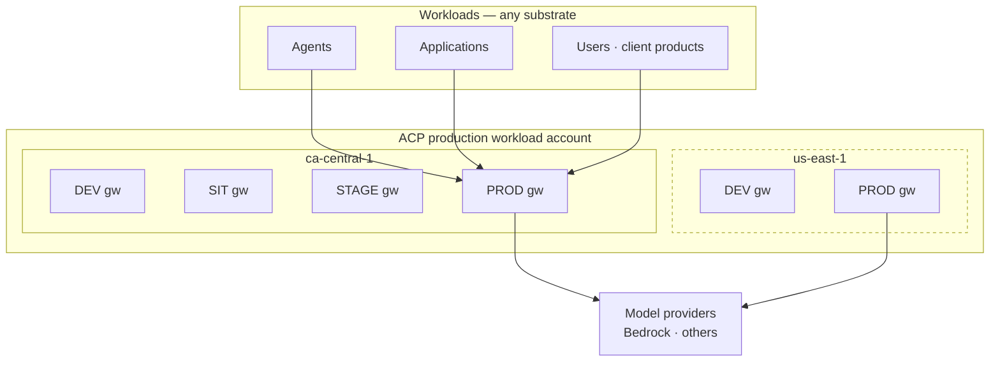
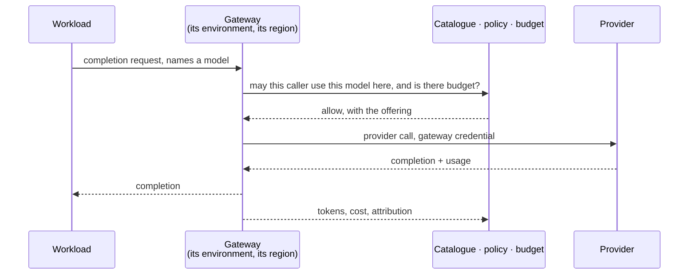
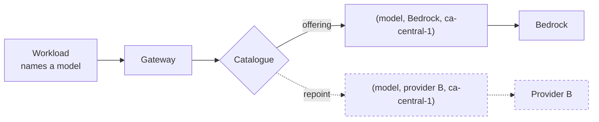
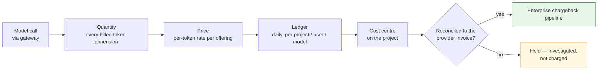
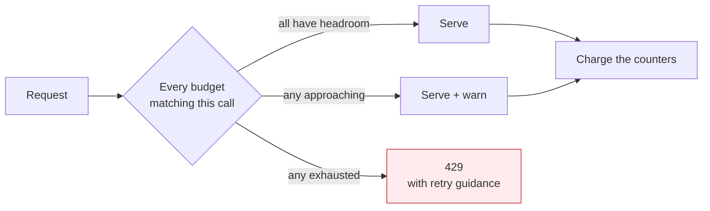
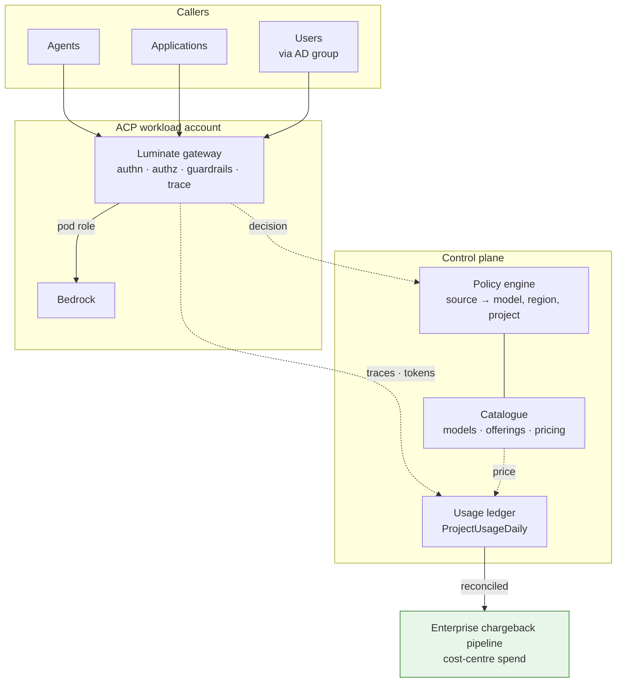

<!-- GENERATED FILE — do not edit directly.
     Source: d2-design/ pages. Regenerate with scripts/assemble_d2_design.py -->

# D2 — Design

> **Gate**: D2 | **Status**: Draft | **Epic**: [EACPP-1320](https://sunlife.atlassian.net/browse/EACPP-1320)

The design is split by the question it answers. Read [Topology](d2-design/topology.md) first — every other page
depends on which shape is chosen.

| Page | Answers |
|---|---|
| [Topology](d2-design/topology.md) | Where the call executes, and why centralized is the target |
| [Provider portability](d2-design/provider-portability.md) | Changing provider without changing a workload |
| [Attribution](d2-design/attribution.md) | Who pays, and how the number reaches finance |
| [Budgets](d2-design/budgets.md) | How spend is limited, and what a business owner is promised |
| [Model access](d2-design/model-access.md) | Who may call which model, in which region, for which project |
| [Operations](d2-design/operations.md) | Running it — reconciliation, review, incident response |
| [Assurance](d2-design/assurance.md) | The ETAB architecture, design decisions, threats and the ISRA control set |
| [Dependencies](d2-design/gaps.md) | What the target state requires from the platform, and who owns each |

## The design in one paragraph

Inference executes **in the ACP production workload account, through the gateway serving the
workload's environment and region** — one gateway per environment per region, per
`gateway-environment-strategy` DD-3. The workload names a model and holds no provider credential;
which provider serves it, in which account and which region, are platform decisions resolved through
the catalogue. That indirection is the point: it is what lets Sun Life present **aggregate volume**
to a provider and what makes the **provider replaceable** without touching a single workload.
Aggregating the bill is only safe if it stays decomposable, so attribution runs to a daily ledger at
`(project, entity, user, model, provider)` grain carrying a **cost centre**, reconciled against the
provider invoice before anything is charged, and delivered into the enterprise chargeback pipeline
finance already runs. Spend is bounded by **budgets enforced at the call** — soft-warn, then
hard-cap — bound to a project, team, entity or user, and kept distinct from both the access decision
and the kill path. Model access is a default-deny grant binding a source to a model, scoped by
project and region.

## What is decided here

- **Centralized inference is the target state** — the only shape serving a workload with no cloud
  account, and the one that makes inference commercially negotiable and provider-portable. This
  discharges [`integration-patterns`](../../../platform/integration-patterns/d3-tasks.md) **T16**.
- **Attribution is a precondition of the offer**, not a follow-up — an aggregated bill that cannot
  be decomposed is a liability rather than leverage.
- **The project is the billing unit**; directory groups govern access, projects govern billing.
- **Spend is refused, not reported** — budgets enforce at the call.
- ACP **feeds** the enterprise chargeback pipeline; it does not build a competing finance surface.
- Distributed execution **remains supported** for teams that already have a cloud account.

---

# Topology — centralized inference

Inference executes **in the ACP production workload account, through the gateway serving the
workload's environment and region.** That is the pattern. This page says what that means, why it is
the target, and what it buys beyond the obvious.

## The shape

Gateways are centralized and platform-owned: **one per workload environment, per region**, as
specified in [`gateway-environment-strategy`](../../../platform/gateway-environment-strategy/d2-design.md) DD-3.
Inference follows the gateway.



**An environment spans regions; a gateway does not.** A second region adds gateways, not another set
of environments. The workload reaches the gateway for its own environment and region; that gateway
holds the provider credential and makes the call.

| Property | Position |
|---|---|
| Where inference executes | The ACP production workload account |
| Which gateway serves it | The one for the workload's environment and region |
| Who holds the provider credential | The gateway. Never the workload |
| Who the provider bills | ACP — recovered through [attribution](d2-design/attribution.md) |
| What the consumer needs | Nothing: no cloud account, no provider credential, no gateway of their own |
| Region | An attribute of the gateway and the offering, and a residency decision |

## Why centralized is the target

The obvious reason is reach: **it is the only shape that serves a workload with no cloud account** —
an agent on OpenShift, a desktop client product, an Office add-in. Those workloads have nothing to
assume into, and they are a growing share of demand.

The two better reasons are commercial.

### It makes inference a negotiable position

When every team calls the provider from its own account, the enterprise has no aggregate volume — it
has fifty small ones. Centralizing the call path means **Sun Life presents a single, measured demand
to a provider**, which is the precondition for committed-spend agreements, negotiated rates and
enterprise inference deals. That is worth more than the engineering simplification, and it is
unavailable in the distributed shape at any level of effort.

The attribution chain is what makes it safe: aggregate the *spend* without losing *who spent it*. A
single bill the platform cannot decompose is not leverage, it is a liability.

### It makes the provider replaceable

Workloads call the gateway, not a provider. The model a workload names resolves through the
catalogue to an offering — a `(model, provider, region)` slot — so **changing which provider serves
a model is a catalogue change, not a change to any workload.**

Bedrock is the provider today. The pattern does not assume it is the provider tomorrow. Adding a
second provider, moving a model between providers, or serving the same model from different
providers in different regions are all catalogue operations, and no consuming team is involved in
any of them.

That optionality exists *only because* the call path is centralized. A team calling a provider
endpoint from its own account has hard-wired that provider into its workload, and switching then
costs a migration per team.

**What makes that claim real rather than asserted — the wire format, capability parity, behavioural
evaluation and cost re-measurement — is specified in [Provider portability](d2-design/provider-portability.md),
along with what honestly does not port.**

**The two reasons compound.** Provider portability gives a commercial negotiation its credibility,
and aggregated volume makes the negotiation worth having.

## What the consumer sees



The workload names a model and receives a completion. It does not know which provider served it,
which account paid for it, or which region it executed in. All three are platform decisions —
recorded, governable, and changeable without the workload changing.

## Region and residency

Region is a first-class axis, not a deployment detail. The offering is identified by
`(model, provider, region)` and the gateway carries its location, so **where a call executes is a
recorded decision rather than an inherited one**.

Centralization moves that decision to ACP. In a distributed shape the consuming team's own account
and region carried the residency posture; here the platform chooses on the consumer's behalf, which
makes it accountable for the choice. MIR-30 requires the region and its residency rationale to be
recorded at onboarding.

Because an environment spans regions, the same workload environment can be served in `ca-central-1`
and `us-east-1` with different offerings and different residency positions, without forking the
control plane.

## Distributed inference

A team with its own cloud account can have the gateway assume a role into that account, so the call
executes there and the provider bills them directly. It remains supported, and it is the right
answer where a team already has an account and wants its model spend on its own bill with no
intermediary.

It is **not** the target shape, for the reasons above: it forfeits aggregate volume, it hard-wires
the provider per team, and it scales by adding accounts and trust relationships. The mechanism is
specified in [`integration-patterns`](../../../platform/integration-patterns/d2-design/inference.md) and is not
restated here.

## The non-pattern

A workload calling a provider's API directly, bypassing the gateway, is not a third topology — it is
the absence of one. **ACP sees nothing**: no access decision, no guardrail, no trace, no token
accounting, no budget, no kill switch and no cost record. Its only signature is the *absence* of
audit events, which is why MIR-1 is a requirement rather than a recommendation, and why the
onboarding check is that expected traffic *appears* rather than that no errors occur.

---

# Provider portability — changing provider without changing a workload

"The provider is replaceable" is a claim, not an architecture. This page says what makes it true,
what quietly makes it false, and what genuinely does not port.

## The indirection

A workload names a **model**. It does not name a provider, an endpoint, a region or an account.



An **offering** is the slot `(model, provider, region)`. Swapping provider means pointing the model
at a different offering. **No workload changes, no credential moves, no redeploy.**

That is the mechanism. Everything below is what has to be true for the mechanism to be safe to use.

## What makes a swap actually possible

Four properties, and a swap is only as portable as the weakest of them.

### 1 · One wire format at the gateway

The gateway presents a single request and response format to every caller, regardless of what the
provider underneath speaks. Providers differ in message shape, tool-call encoding, streaming
framing and error taxonomy; **absorbing that difference is the gateway's job, and it is what stops
the difference reaching a workload.**

A workload that bypasses this — calling a provider SDK directly, or depending on a provider's native
response envelope — has opted out of portability regardless of what the catalogue says.

### 2 · Declared capability parity

A swap must not silently drop a capability a workload depends on. Each offering declares what it
supports, and the ones that actually break things are:

| Capability | What breaks if it differs |
|---|---|
| **Context window** | Requests that fit today fail after the swap |
| **Tool / function calling** | Agents stop being able to act |
| **Structured output** | Downstream parsing fails |
| **Streaming** | Interactive workloads degrade or hang |
| **Vision / multimodal input** | Requests are rejected |
| **Prompt caching** | Cost and latency change sharply, and the *cost* change may be the larger surprise |

**A swap to an offering that does not meet the declared needs of its callers is refused rather than
attempted.** That check is the difference between a governed swap and an outage.

### 3 · Evaluated behavioural equivalence

This is the property most "provider-agnostic" claims skip, and it is the one that bites.

**The same prompt against a different model returns different output.** Not worse necessarily —
different. Tone, format adherence, refusal behaviour, tool-selection tendencies and failure modes all
shift. A workload tuned against one model has, in effect, been fitted to it.

So a provider swap that also changes the model is a **model change**, and it goes through
evaluation before cutover, not after. Portability of *infrastructure* is free; equivalence of
*behaviour* has to be demonstrated.

### 4 · Re-measured cost

Pricing is per offering, and providers price different dimensions at different rates — cached reads
in particular. **The cost of a model is a property of the offering, not of the model.** A swap
therefore re-prices the workload, and the new cost is measured rather than assumed. Where a swap is
motivated by cost, that measurement is the whole point of it.

## What a swap looks like

Five shapes, in increasing order of confidence required:

| Mode | Use |
|---|---|
| **Shadow** | Mirror a share of traffic to a candidate offering, compare output and cost, change nothing for callers |
| **Progressive** | Move a share of live traffic, watch quality and cost, increase or roll back |
| **Per-region** | Serve the same model from different providers in different regions — residency or availability driven |
| **Full repoint** | Move all traffic for a model to another offering |
| **Failover** | Automatic substitution when a provider is unavailable, within declared capability parity |

**Rollback must be as cheap as the swap**, which it is when the swap is a repoint: the previous
offering still exists and is pointed back to. Anything that makes rollback expensive — a data
migration, a prompt rewrite, a workload redeploy — means the swap was not a repoint and should be
treated as a change programme instead.

## What does not port, honestly

Provider portability is not model portability, and conflating them is how a team gets a surprise.

| Situation | Portable? |
|---|---|
| A model hosted by several providers, moved between them | **Yes** — a repoint |
| The same provider, a different region | **Yes** — a repoint |
| A model exclusive to one provider | **No.** Leaving that provider means choosing a *different model*, with evaluation |
| A provider-hosted fine-tune or custom model | **No.** The weights live with the provider |
| A workload depending on a provider-specific feature directly | **No**, until that dependency is removed |

**Say which case you are in before promising a timeline.** The first two are configuration. The last
three are projects, and the difference is not visible from the catalogue.

## Why this is worth the constraint

Two returns, and they compound with the [commercial position](d2-design/topology.md):

- **Negotiating leverage is only real if the alternative is executable.** A provider knows whether
  its customer can actually leave. Portability that has been exercised — even once, even in
  shadow — is a materially different negotiating position from portability that is merely asserted.
- **Concentration risk becomes manageable.** A provider outage, a regional withdrawal, a contractual
  or licensing change, or a model deprecation becomes a repoint rather than an emergency.

Neither is available to a workload calling a provider endpoint directly. That workload has embedded
the provider in itself, and the cost of changing is a migration per team rather than a catalogue
operation.

## The obligation this places on the platform

Portability is a property the platform maintains, not one it has once:

- Offerings carry declared capabilities, and the declarations are kept true.
- At least one model has a **credible alternate offering**, so the path is exercised rather than
  theoretical.
- The swap path is **rehearsed** — in shadow if not in anger — because an untested failover is a
  belief, not a control.
- Provider onboarding is a platform change: credentials, capability declarations, pricing and a
  data-handling position, all before a single workload is pointed at it.

**A provider change is a governed event, not a config tweak.** The contractual and data-handling
posture differs per provider, so the swap carries a review even when the technical change is a
single repoint.

---

# Attribution — who pays

Centralized inference aggregates the bill. Attribution is what keeps it decomposable — **aggregate
the spend without losing who spent it.**

## The obligation

In a distributed shape the cloud account boundary does the attribution: the provider bills per
account and the enterprise pipeline maps account to cost centre. Centralizing removes that boundary,
so **ACP is the attribution authority** and supplies, in the finance system's own coding, what the
account boundary used to supply.

It delivers into the pipeline finance already runs, not a new surface beside it. The single view of
cost-centre spend is preserved; inference simply appears in it.

## The chain



Five links and a gate. The gate is not decoration: **a figure that reaches finance acquires
authority**, and the cheapest moment to catch a wrong one is before the charge, not after a team
disputes it.

## The grain

One row per UTC day per **`(project, entity, user, model, provider)`**, carrying input, output and
total cost as a decimal with an explicit currency, and the **cost centre** alongside.

| Dimension | Answers |
|---|---|
| `project` + `cost_centre` | Who is billed |
| `user` | Who within that cost centre — the drill-down, not the billing unit |
| `entity` | Which agent or application made the call |
| `model` + `provider` | What was used, and from whom |
| `usage_date` | Which period, in UTC |

That grain answers the questions the business actually asks — *"ten people in this team used it, and
here is what they spent"* — without a join to anything outside the ledger.

**Every token dimension the provider bills is captured**, including cache reads and cache writes.
Modern models price several dimensions at different rates, and a metering path that records only
prompt and completion tokens systematically under-bills whichever teams use caching most. MIR-8 and
MIR-17 make completeness a requirement and inter-team bias a defect, because an error that varies by
team does not merely under-recover — it **cross-subsidises one team at another's expense**, which is
the failure that gets a chargeback model withdrawn.

## Billing unit: the project

**The project is the billing unit and the cost centre is its attribute.** Projects already scope
policy and usage, so no new construct is introduced, and the recurring reconciliation work scales
with the number of cost centres rather than with headcount.

**The cost centre is snapshotted onto each ledger row at rollup**, not joined at read time. Cost
centres get reassigned; a project moving between them must not retroactively restate a closed
period. Snapshotting means history stays true to what was agreed when it was billed.

### Access and billing are separate authorities

| Question | Authority |
|---|---|
| May this person call this model? | Their **directory group** |
| Who pays for it? | Their **project**, which carries the cost centre |

Using directory groups for both creates two sources of truth for "who pays", with no tiebreak when a
person's group and project disagree. Keeping them separate means each mechanism answers one question
and every answer has one owner.

## Unattributed spend

Spend whose principal does not resolve to a project lands in an **unattributed** bucket that is
deliberately *selectable* rather than merely present — an operator chasing unbilled cost needs to
filter down to exactly it.

Centralization is what makes this bucket matter: in a distributed shape the account attributed
everything by construction. Here it is a **reported service level with an agreed ceiling**
(MIR-12, NFR-4), because a rising unattributed share is the leading indicator that onboarding has
outrun cost-centre discipline.

## Reconciliation and the charge gate

Per period, the ACP ledger total is compared to the provider invoice for the inference account.

| Step | Detail |
|---|---|
| Compare | ACP total vs provider invoice, per model |
| Tolerance | Agreed per model; inside it is noted, outside it is investigated |
| Gate | **No charge is raised from an unreconciled period** |
| Trend | The variance itself is tracked — a stable small gap is a different signal from a growing one |

MIR-13 and MIR-14 exist because an internal figure and a provider invoice will differ, and the
difference must be understood before anyone is charged. When a period fails, the correct response is
to hold and investigate: correcting a charge after a business unit has booked it costs more
credibility than the delay does, and the second correction is never believed.

## What this enables commercially

Attribution is usually justified defensively — recovering cost. It is also what makes the
[commercial position](d2-design/topology.md) real:

- **A committed-spend agreement needs a defensible forecast.** The ledger's daily, per-model history
  is that forecast.
- **A negotiated rate needs to be verifiable.** Reconciliation against the provider invoice is how a
  discount is confirmed rather than assumed.
- **Moving a model between providers needs a before-and-after.** Per-offering cost makes that a
  measurement rather than an argument.

An aggregated bill that cannot be decomposed gives none of these. The chain is what turns
centralization from a cost-consolidation exercise into leverage.

---

# Budgets — limiting what can be spent

A budget is a limit on consumption, bound to whoever is accountable for it, **enforced on the
inference path** so that exceeding it is refused rather than reported afterwards.

## The model

A budget binds a **source** to a **limit** over a **period**, in a **dimension**.

| Element | Values |
|---|---|
| Source | A project, a team or directory group, an agent or application, or an individual user |
| Dimension | **Spend** (the money limit), tokens, or requests |
| Period | A rolling or calendar window |
| Response | **Soft-warn** on approach, **hard-cap** on breach |

Spend is the dimension that matters to a business owner, and it is the one a token limit cannot
substitute for: token price varies by model and by token dimension — a frontier-model output token
and a cached-read token differ by orders of magnitude — so **a token cap bounds a quantity whose
price it does not know.** Token and request limits remain useful for shaping load; only a spend
limit bounds cost.

## Enforcement



**Every budget matching a call must have headroom for the call to proceed**, and the counters commit
together. A call attributable to a user inside a team inside a project is bound by all three; the
tightest one governs. Partial commitment — charging one counter and not another — would let the
limits disagree about what has been spent.

The refusal carries **retry guidance the caller can act on**, because an agent that receives an
opaque refusal will simply retry immediately and convert a budget breach into a load problem.

**Token charging is two-stage.** A request reserves against its estimated cost and settles against
the actual usage once the provider responds, because the real token count is not known until then. A
reservation that is never settled is released rather than left to strand headroom.

## Where budgets sit relative to access

Access and budget are different questions asked in order:

1. **May this caller use this model here?** — the [access policy](d2-design/model-access.md). A denial here is
   a governance failure.
2. **Is there budget for it?** — the budget. A denial here is a financial limit being observed.

Keeping them distinct matters operationally: the response to the first is to review a grant; the
response to the second is to raise a limit or accept the stop. Conflating them produces the familiar
failure where someone is granted more access to solve what was actually a spend problem.

## Ownership and change

A budget has an **owner** — the person accountable for the cost centre it protects — and changing
one is a governed action, approved by that owner and audited. Raising one caller's limit must not
silently raise anyone else's, which is why budgets bind to selectors rather than to a global pool.

A budget whose access path is removed **retires itself**: if nobody can reach the target any more,
a limit protecting it is stale configuration that will later confuse whoever inherits it.

## Relationship to the spend control hierarchy

Budgets are the *preventive* control. They are not the only one, and the pattern does not pretend
they cover every case:

| Control | Type | Stops |
|---|---|---|
| **Budget** | Preventive | Spend beyond an agreed limit, at the call |
| Access revocation | Preventive, absolute | The workload entirely — the kill path (MIR-24) |
| Provider/account limits | Preventive, coarse | Catastrophic runaway below the platform |
| Chargeback review | Detective | Patterns a limit would not catch — drift, misuse, surprise |
| Spend-anomaly detection | Detective | A sharp change inside an unexhausted budget |

**A budget is not a substitute for the kill path.** Stopping a compromised or misbehaving workload
is an access action, not a financial one, and MIR-24 keeps that distinction because the failure mode
they address is different: a budget stops overspending, revocation stops the workload.

## What a business owner is told

Precision here is a control in itself. The commitment is:

- **Spend above your limit is refused**, not reported after the fact.
- **You are warned before you get there**, with enough margin to act.
- **Your limit is yours** — raising someone else's does not consume it.
- **A refusal is visible** to the caller and in the report, so a stopped workload is diagnosable
  rather than mysterious.

MIR-20 requires that whatever is stated to a business owner matches what the platform enforces for
their workload in their environment. A budget that is configured but not in force is worse than none,
because it converts an explicit risk into an assumed protection.

---

# Model access — who may call which model, where, and for what

The governance question asked directly: *what agents can call what models, what models are available
in what regions, what models can be used per project.* This page answers all three.

## The mechanism

A grant is an `AccessPolicy` binding a **source** to a **target**, scoped to a project.

| Axis | Values |
|---|---|
| **Source** — who may call | `agent`, `application`, **`user`**, **`user_group`**, `mcp_server`, `all_users`, `location`, `environment` |
| **Target** — what may be called | **`model`**, `agent`, `mcp_server`, `location`, `environment` |
| **Region** | Carried by the offering: identity is `(model, provider, region)`, enforced by the `unique_offering_per_region` DB constraint |
| **Project** | Materialized-path scope tokens `<scope_type>:<id>` on the policy |

Default is deny: a caller reaches only the models a policy names.

## Design positions

### Grant to the smallest true thing (MIR-28)

Sources are ordered by how much they over-grant:

```
user_group  ⊂  application / agent  ⊂  all_users
```

- **An agent or application** is the right source when the caller is a system. The grant then
  describes a capability of that system, and survives staff changes.
- **A user group** is the right source when the caller is a person. Membership changes with the
  directory; access follows without a policy edit. This is why human access is granted through
  groups rather than to individuals — a joiner or leaver is a directory event, not a policy change.
- **`all_users`** should not appear on a model target. It is convenient during a pilot and it is
  indistinguishable, afterwards, from having no policy at all.

### Human access flows through the group, billing flows through the project

Stated here as well as in [Attribution](d2-design/attribution.md) because it is the single place these two
governance axes are most often conflated:

| Question | Authority |
|---|---|
| May this person call this model? | Their **directory group** |
| Who pays for it? | Their **project**, which carries the cost centre |

Using directory groups for both creates two sources of truth for "who pays", with no tiebreak when
they disagree. Keeping them separate means each mechanism answers one question, and every answer has
one owner.

### Region is a residency decision, recorded (MIR-30)

With distributed inference, the consumer's own account and region carry the residency posture.
**Centralized routing means ACP chooses the region on the consumer's behalf**, which makes it a
decision ACP is accountable for.

The offering's `region` names where the call goes, and the gateway serving a workload is itself
per-environment and per-region. MIR-30 requires the region and its residency rationale to be
recorded at onboarding rather than inferred later from a trace.

### Project scoping (MIR-31)

A model restricted to particular work is scoped by the policy's project tokens. This is the right
lever for *"what models can be used per project"*, and it composes with region: a model may be
available in one region for one project and nowhere else.

### Approval status governs availability (MIR-32)

A model that is not approved for a data classification must not be reachable by a workload handling
that data. This is where model governance meets the risk assessment, and it is the reason the
catalogue and the policy store cannot be allowed to drift apart — a model withdrawn from approval
but left reachable is an open path with a closed record.

### Withdrawal is governed (MIR-33)

Removing a model is a caller-affecting change. It needs a migration path and a notification, not a
silent catalogue edit. Callers fail closed, which is correct and also indistinguishable from an
outage if nobody was told.

## What centralization changes here

Less than might be expected, which is the good news of this page.

| | Distributed | Centralized |
|---|---|---|
| Who decides which models exist | Partly the consumer's account | **ACP, entirely** |
| Who decides the region | The consumer | **ACP, on their behalf** |
| Policy mechanism | Same | Same |
| Catalogue | Same | Same |

Centralization concentrates the **decisions**, not the mechanism. The catalogue and policy model do
not change; what changes is that ACP now owns choices — which models, in which regions — that were
previously distributed along with the accounts. That is an accountability shift, and MIR-30 and
MIR-32 exist to make it a recorded one.

## Review

MIR-34 asks for a periodic review in which **a grant with no traffic in the period is challenged**.
The usage ledger makes this cheap: join live policies against `ProjectUsageDaily` and the grants
nobody used are immediately visible. Unused grants are the ordinary way an access model decays, and
this is the one place where the cost work pays a governance dividend rather than the other way
round.

---

# Operations — running centralized inference

What has to happen on a cadence, by whom, for the pattern to keep being true after go-live.

## The operational surface

Centralized inference adds three recurring obligations that distributed inference does not have,
because in the distributed shape AWS performs all three implicitly.

| Obligation | Cadence | Owner | Fails how |
|---|---|---|---|
| **Rollup health** — the ledger is materialized for every day | Daily | ACP Platform | Silently. A missing day is an unbilled day and the report still renders |
| **Reconciliation** — ACP total vs provider invoice | Per period, before any charge | ACP Product + Finance | Loudly, if anyone looks. This is the control that catches metering drift |
| **Unattributed review** — spend in the null-project bucket | Per period | ACP Product | Silently. It accumulates as platform cost |

## Rollup health

The ledger is worker-materialized, not queried live. That is the right design — it makes the report
fast and the period stable — and it introduces a failure mode the live-query design does not have:
**a day that never rolled up is indistinguishable, in the report, from a day with no usage.**

The check is therefore not "did the report render" but "is there a row for every day that had
traffic".

## Reconciliation

Specified in [Attribution](d2-design/attribution.md); the operational point is that it **gates charging**
(MIR-14). An unreconciled period produces showback, not a charge.

Worth protecting against a predictable pressure: when a period fails reconciliation, the tempting
response is to charge anyway and correct later. Correcting a charge after a business unit has
booked it costs more credibility than the delay does, and the second correction is never believed.

## Unattributed spend

The null-project bucket is selectable by design. In the distributed shape it barely exists — AWS
attributes everything to an account. **Centralization is what makes it grow**: any call whose
principal does not resolve to a project lands there, and the platform absorbs it.

Treat the unattributed share as a **service level** (NFR-4) with an agreed ceiling, not as a
curiosity. A rising share is the leading indicator that onboarding has outrun the cost-centre
discipline.

## Access review

Per MIR-34, joined against the usage ledger: grants with no traffic in the period are challenged.
Cheap to run once the ledger is populated, and the natural place to catch a pilot's `all_users`
policy that was never removed.

## Incident response

| Situation | Response |
|---|---|
| A workload is misbehaving or compromised | **Revoke the grant or the credential.** A budget bounds spend, not damage |
| Spend approaching a limit | The soft-warn fires before the cap; raise the limit deliberately or let it stop |
| Metering found wrong for a model | Stop charging for it, restate the affected periods, fix the metering, re-reconcile before resuming |
| A model must be withdrawn urgently | Remove the grant first (immediate), then the catalogue entry; notify callers, who will otherwise see it as an outage |
| Rollup stalled | Backfill before the period closes; a late rollup is recoverable, a missed period is a restatement |

## What makes this sustainable

The operational load is dominated by **reconciliation and unattributed review**, and both scale with
the number of *cost centres*, not the number of calls. That is the argument for keeping the project
as the billing unit: it bounds the recurring work to something that grows slowly, where a per-user
or per-AD-group billing model would grow with headcount.

---

# Assurance — the ETAB submission and the ISRA control set

| Record | Identifier |
|---|---|
| Architecture governance (ATG) | **[ATG0005693](https://sunlife.service-now.com/nav_to.do?uri=x_sulfc_atg_request.do?sys_id=9f3f3f0acf978314a77ab1ad5d851c38)** |
| Security risk assessment (ISRA) | **[26-1978](https://sunlife.service-now.com/nav_to.do?uri=x_sulfc_vendor_ass_vendor_assessment.do?sys_id=61de005ecf9f8314a77ab1ad5d851c20)** |

The control set below (C-1–C-32) and the residual risks (R-1–R-11) are the content submitted
against ISRA 26-1978. The scope those records cover is **centralized inference as specified in
[Topology](d2-design/topology.md)** — inference executing in the ACP production workload account through the
per-environment, per-region gateway — so a change to that topology is a change to the assessed
scope, not an editorial one.

This page exists so a board submission and a risk assessment can be produced from the spec rather
than reconstructed from the gateway source and a finance conversation. It says four things: what the
architecture is, which decisions were taken and why, which risks centralizing inference introduces,
and which controls exist with what evidence.

---

## The architecture



**The property that matters for assurance**: the gateway is the only path, so the control plane sees
every governed call. The corollary is the exposure — a call that bypasses the gateway is invisible,
and its only signature is the *absence* of a record.

---

## Design decisions

| # | Decision | Why | What it concedes |
|---|---|---|---|
| **DD-1** | **Centralized inference is the target state, offered conditionally** | It is the only shape serving a workload with no AWS account, and the consortium's direction | It moves attribution from AWS onto ACP; that burden is this spec |
| **DD-2** | **Distributed inference remains supported and preferred where the team has an AWS account** | Costs land where incurred, with no attribution machinery | Two supported shapes, and a decision to make per onboarding |
| **DD-3** | **Attribution is a precondition of the offer, not a follow-up** | Three of four links working produces a confidently wrong bill | Slower to offer centralized; the alternative is restating charges |
| **DD-4** | **The project is the billing unit; the cost centre is its attribute** | Projects already scope policy and usage; the cost centre is the finance system's own coding | A person's spend is attributed via their project, not directly |
| **DD-5** | **AD groups govern access; projects govern billing** | Using groups for both creates two authorities for "who pays" with no tiebreak | Two mechanisms to maintain, each with one job |
| **DD-6** | **`cost_centre` is snapshotted onto the ledger row, not joined at read time** | A re-org must not retroactively restate a closed period | A project's history spans cost centres; reports must not assume one |
| **DD-7** | **No charge is raised from an unreconciled period** | A figure reaching finance acquires authority it may not have earned | Charging lags usage by the reconciliation cycle |
| **DD-8** | **Systematic inter-team metering bias is a defect, not a tolerance** | An error that varies by team cross-subsidises one at another's expense | Higher bar than an aggregate-accuracy target |
| **DD-9** | **Spend is limited by an enforced budget, refused at the call** | A limit reported after the fact is not a control; the business owner's commitment is that overspend is refused | Every matching budget must have headroom, so a call can be refused by a limit its caller did not set |
| **DD-10** | **The stop path is credential and policy revocation, not a budget** | A budget stops overspending; revocation stops the workload. They address different failures | Blunt by design — it is an access action, and it stops good traffic with bad |
| **DD-11** | **ACP feeds the existing enterprise pipeline rather than building a finance surface** | Finance has a single view of cost-centre spend and keeps it | ACP must conform to the pipeline's coding and cadence |
| **DD-12** | **Region is an offering attribute and a recorded residency decision** | Centralized routing means ACP chooses the region on the consumer's behalf | ACP becomes accountable for a residency choice it previously inherited |
| **DD-13** | **Unattributed spend is a reported service level with a ceiling** | Centralization is what makes the bucket grow | Someone must own the number and act on the trend |
| **DD-14** | **Budget denial returns actionable retry guidance** | An agent given an opaque refusal retries immediately and turns a budget breach into a load problem | The response reveals that a limit exists, which is acceptable to the caller's own principal |
| **DD-15** | **A workload names a model; the provider is resolved through the catalogue** | Provider portability is only real if nothing in a workload encodes the provider. A swap is then a repoint, and rollback costs the same | The gateway must absorb every provider's wire-format differences, which is real ongoing engineering |
| **DD-16** | **A swap is refused unless the target offering meets its callers' declared capability needs** | A silent capability drop — context window, tool calling, structured output — becomes a runtime outage, not a degradation | Capability declarations must be maintained accurately, and a stale declaration is worse than none |

---

## Threat and risk model — what centralizing inference changes

Centralization is not risk-neutral. It concentrates a previously distributed function, which
improves some properties and degrades others. Both directions are listed, because a submission that
only lists improvements is not a risk assessment.

| # | Risk | Where it bites | Control |
|---|---|---|---|
| **T1** | **Mis-attribution** — spend billed to the wrong cost centre | Any broken link in the chain | C-1…C-6 · **Residual R-1** |
| **T2** | **Systematic under-billing of cache-heavy callers** — the metering path omits cache tokens, so some teams are cross-subsidised | Gateway metering | C-2, C-7, C-8 · **Residual R-2** |
| **T3** | **Silent rollup failure** — a day never materializes and reads as a day with no usage | Worker | C-9, C-10 |
| **T4** | **Unbounded platform absorption** — unattributed spend accumulates on ACP's budget | Onboarding discipline | C-11, C-12 · **Residual R-3** |
| **T5** | **Spend runs beyond what the business agreed** | Inference path | C-13, C-14, C-15 · **Residual R-4** |
| **T6** | **Blast radius of one account** — a credential or misconfiguration in the centralized account affects every tenant, where distributed confined it to one | ACP account | C-16, C-17 · **Residual R-5** |
| **T7** | **Employee spend data exposure** — per-user spend joined to email, readable org-wide by an Administrator-role holder | Chargeback surface | C-18, C-19, C-20 · **Residual R-6** |
| **T8** | **Over-broad model grant** — `all_users` or a stale grant leaves a model reachable | Policy store | C-21, C-22, C-23 |
| **T9** | **Residency breach** — a call routes to a region the data may not enter, chosen by ACP rather than the consumer | Offering | C-24 · DD-12 |
| **T10** | **Ungoverned bypass** — a workload with its own AWS account calls Bedrock directly | Outside the gateway | C-25, C-26 · **Residual R-7** |
| **T11** | **Approval drift** — a model withdrawn from approval remains reachable | Catalogue vs policy | C-23, C-27 |
| **T12** | **Pricing drift** — a stale rate card produces a wrong bill silently | Pricing catalogue | C-28 · **Residual R-8** |
| **T13** | **Directory-group resolution failure** — access via an untested `user_group` path behaves unexpectedly | Policy engine | C-21 · **Residual R-9** |
| **T14** | **Availability concentration** — the centralized path is a single dependency for every tenant's inference | Gateway + account | C-16 · **Residual R-10** |
| **T15** | **A provider swap degrades a workload silently** — capability dropped, or behaviour changed, without the caller knowing | Catalogue | C-29, C-30, C-31 · **Residual R-11** |
| **T16** | **Provider concentration** — no executable alternative, so an outage, withdrawal or contract change becomes an emergency | Platform | C-32 · **Residual R-11** |

**What centralization improves**, for balance: one policy point rather than one per account; one
audit trail; one catalogue, so an unapproved model cannot be reachable in an account nobody is
watching; and a kill path that works for every tenant at once. T6 and T14 are the price of exactly
those properties.

---

## Control set

| # | Control | Type | Evidence |
|---|---|---|---|
| **C-1** | Every model call traverses the gateway (MIR-1) | Preventive | Absence of direct Bedrock grants; traces present |
| **C-2** | Token quantity captured across every billed dimension (MIR-8) | Preventive | Reconciliation of a cache-heavy call to the provider usage block |
| **C-3** | Every reachable model carries a per-token price (MIR-9) | Preventive | Priced-model count equals reachable-model count |
| **C-4** | Usage materialized to the ledger at stated grain (MIR-10) | Detective | Ledger non-empty; totals reconcile to the trace store |
| **C-5** | Every spending project carries a cost centre (MIR-11) | Preventive | No project with usage has an empty `cost_centre` |
| **C-6** | Cost centre snapshotted at rollup (DD-6) | Preventive | Ledger column; migration |
| **C-7** | Per-model metering error measured before offer (MIR-16) | Detective | Recorded reconciliation sample per model |
| **C-8** | Inter-team bias assessed, not just aggregate error (MIR-17) | Detective | Error distribution across workloads |
| **C-9** | Rollup completeness monitored (NFR-2) | Detective | A row exists for every day with traffic |
| **C-10** | Backfill before period close | Corrective | Backfill record |
| **C-11** | Unattributed spend reported with a ceiling (MIR-12) | Detective | `unattributed` share against the agreed ceiling |
| **C-12** | Onboarding requires a project and cost centre before traffic | Preventive | Onboarding checklist |
| **C-13** | Enforced budgets refuse spend beyond an agreed limit (MIR-20, MIR-21) | Preventive | A call exceeding a budget returns 429; counter state visible |
| **C-14** | Provider and account-side limits bound catastrophic runaway below the platform (MIR-22) | Preventive | Provider/account limit configuration |
| **C-15** | Revocation drilled as the stop path (MIR-24) | Corrective | Drill record |
| **C-16** | Gateway availability and failure posture | Preventive | Fail-closed on policy decision |
| **C-17** | Least privilege on the centralized inference role | Preventive | Role policy review |
| **C-18** | Non-admin chargeback access restricted to own rows | Preventive | `restrict_to_user_id`; `restricted_to_own_usage` on the response |
| **C-19** | Org-wide spend visibility limited to an authorized role | Preventive | Role membership review — see R-6 |
| **C-20** | Purpose and retention stated for per-user spend data | Preventive | Privacy record |
| **C-21** | Model access is an explicit grant, default-deny (MIR-27) | Preventive | Policy records; negative test |
| **C-22** | Grants use the smallest true source; no `all_users` on models (MIR-28) | Preventive | Policy source audit |
| **C-23** | Periodic grant review against usage (MIR-34) | Detective | Review record joining policies to the ledger |
| **C-24** | Region recorded as a residency decision at onboarding (MIR-30) | Preventive | Offering region; onboarding record |
| **C-25** | Direct-to-provider calls are not granted | Preventive | IAM policy review |
| **C-26** | Absence-of-traffic monitoring for onboarded workloads | Detective | Expected vs observed traces |
| **C-27** | Model approval status governs reachability (MIR-32) | Preventive | Catalogue and policy consistency check |
| **C-28** | Pricing drift detection (MIR-18) | Detective | Catalogue source and refresh date; scheduled check |
| **C-29** | Offerings declare capabilities, and a swap failing to meet callers' needs is refused (MIR-37) | Preventive | Capability declarations; a deficient swap is refused in test |
| **C-30** | A model-changing swap is evaluated before cutover (MIR-38) | Preventive | Evaluation record comparing candidate to incumbent |
| **C-31** | Cost re-measured after a swap (MIR-39) | Detective | Pre/post cost comparison for the same workload |
| **C-32** | An alternate offering exists and the swap path is rehearsed (MIR-41) | Corrective | Shadow or progressive swap record |

---

## Residual risks

| # | Risk | Why it remains | Accepted posture |
|---|---|---|---|
| **R-1** | Mis-attribution remains possible where a principal does not resolve to a project | Not every caller shape maps cleanly | Bounded and reported via the unattributed ceiling (C-11) |
| **R-2** | **Metering completeness depends on the provider reporting every billed dimension** | A provider that adds a new priced token dimension is not obliged to tell us first | Detected by reconciliation (C-7) and by per-model error distribution (C-8); a new dimension appears as a widening variance before it appears as a wrong bill |
| **R-3** | Unattributed spend lands on the platform budget | Some residue is unavoidable at onboarding boundaries | Ceiling agreed; trend monitored (C-11) |
| **R-4** | **A budget bounds spend but not damage** | A workload can do harm well inside its limit | Budgets are a financial control only; the kill path (C-15) and access governance carry the rest |
| **R-5** | Concentration risk — one account serves every tenant | Inherent to centralization | Accepted as the price of a single control plane; least privilege and fail-closed compensate |
| **R-6** | **Org-wide per-user spend, joined to email, is readable by every Administrator-role holder** | Upstream decision AIC-582 (2026-09-01), confirmed intended: the widening "opened per-user AI spend joined to the caller's `email`... from superusers to every Administrator-role holder. That is attributable personal data about employees" | **Requires a Sun Life decision**: the size of the Administrator population here, and whether employee spend joined to email is acceptable under Law 25 / PIPEDA with a stated purpose and retention. The viewset also sits in the RBAC `_PENDING_MIGRATION` backlog with authorization deferred |
| **R-7** | A workload with its own AWS account can bypass the gateway | ACP cannot prevent what it cannot see | Detected by absence (C-26); addressed by IAM discipline, not by the gateway |
| **R-8** | Pricing may drift from the provider's real rate card | Rate cards change outside ACP | Detected by C-28 and caught by reconciliation (C-7) |
| **R-9** | The `user_group` path is untested — zero live policies use it | Mechanism exists, practice does not | Exercised early in D3 rather than during a cutover |
| **R-10** | Centralized inference is a single dependency for every tenant | Inherent to the topology | Accepted; distributed remains available for teams with an account |
| **R-11** | **Not everything ports.** A provider-exclusive model, a provider-hosted fine-tune, or a workload depending on a provider-specific feature cannot be moved by a repoint | Inherent — provider portability is not model portability | Which case a workload is in is recorded at onboarding, so a swap timeline is never promised against a case that is a project rather than a configuration change |

---

## What ETAB is being asked to approve

1. **The pattern** — inference executes in the **ACP production workload account**, through the
   gateway serving the workload's environment and region, with the workload holding no provider
   credential. Distributed execution in a consumer's own account remains supported where that team
   already has one.
2. **The decision** that **centralized inference is the target state** — discharging
   `integration-patterns` **T16** — on the grounds that it is the only shape serving a workload with
   no cloud account, and that it is what makes aggregate volume negotiable and the provider
   replaceable.
3. **The attribution model** — the project as billing unit, the cost centre as its attribute, the
   snapshot-at-rollup rule (DD-6), the reconciliation gate before charging (DD-7), and the hand-off
   into the existing enterprise pipeline rather than a new finance surface.
4. **The budget model** — spend, token and request limits bound to project, team, entity or user,
   enforced at the call with soft-warn and hard-cap (DD-9), and held distinct from the access
   decision and from the kill path (DD-10).
5. **The provider-portability model** — a workload names a model and the catalogue resolves the
   provider (DD-15), with a swap refused unless the target offering meets its callers' declared
   capability needs (DD-16). This is what makes an alternative to any single provider executable
   rather than theoretical.
6. **The sixteen design decisions**, in particular DD-3 (attribution is a precondition of the
   offer), DD-5 (groups govern access, projects govern billing), DD-7 (no charge from an
   unreconciled period) and DD-9 (spend is refused, not reported).
7. **The eleven residual risks** — in particular **R-5** (concentration: one account and one gateway
   tier serve every tenant in a region), **R-6** (employee spend data audience) and **R-11** (not
   everything ports — a provider-exclusive model or a provider-hosted fine-tune is a project, not a
   repoint), which are the three the board should weigh rather than nod through.

> **What approval of this pattern is not.** It is not approval of a charge run. MIR-14 makes a
> reconciled period the gate on charging, and the first invoice should be preceded by evidence that
> the reconciliation passed. The delta between this target state and the platform as it stands is
> tracked in [D3](../d3-tasks.md); none of it changes what is described here, and all of it is
> verifiable before the pattern is used in earnest.

---

# Gaps — what the target state requires from the platform

The pattern is the destination. This page names the capabilities it rests on and who owns each, so
that approving the pattern is not mistaken for assuming the platform already delivers every part of
it. The measured delta between here and now, with the work to close it, is [D3](../d3-tasks.md).

Split by owner, because the two halves move through different forums and at different speeds. A
dependency Sun Life can satisfy is a plan; one only the consortium can satisfy is an ask, and
conflating them produces a roadmap nobody can execute.

---

## Consortium — capabilities Luminate must provide

### D-1 · Budget enforcement on the inference path · **Critical**

The pattern's spend control is preventive: a call is refused when a matching budget is exhausted.
That requires a counter store, an atomic check that commits every matched counter together, window
strategies, a two-stage token charge that reserves then settles, a defined failure posture when the
counter store is unavailable, and a throttle response carrying retry guidance.

**Owner**: consortium — **AIC-20** (the enforcement mechanism), **AIC-43** (authoring, approval,
matching, retirement), **AIC-831** (the budget construct itself).

**Sun Life contribution**: **EACPP-834** — a generic `economics` app contributing rollups per
agent/model/tenant/team, budget definitions with soft-warn and hard-cap enforcement, chargeback and
showback reporting, spend-anomaly detection, and quota governance surfaced into the gateway policy
bundle. Sun Life is the member with the immediate chargeback requirement and the cost-centre
discipline to model it against, which makes it the natural contributor.

### D-2 · Spend as a first-class limit dimension · **Critical**

A budget must be expressible in money, not only in tokens or requests. Token price varies by model
and by token dimension, so a token cap bounds a quantity whose price it does not know.

**Owner**: consortium, with EACPP-834 as the contribution route.

> **D-1 and D-2 must land together.** A spend dimension without enforcement is telemetry;
> enforcement without a spend dimension can only cap tokens. Either alone leaves the business
> owner's commitment in [Budgets](d2-design/budgets.md) unmet.

### D-3 · Complete token metering, including cache dimensions · **Critical**

Every token dimension the provider bills must reach the metering path. Cache reads and cache writes
are priced differently from ordinary input, and a path that records only prompt and completion
tokens under-bills cache-heavy callers specifically — which is a fairness failure, not just an
accuracy one.

**Owner**: consortium — **AIC-679**.

### D-4 · Per-run cost attribution · Medium

The ledger aggregates by UTC day, which is the right grain for finance. Answering *"what did this
run cost"* needs cost at session grain, which the session record does not currently carry.

**Owner**: consortium. **Interim**: MIR-15 — callers supply a session identifier so the correlation
exists in traces even where the ledger cannot aggregate it.

### D-5 · Scoped authorization for the cost surface · Medium

The chargeback surface exposes per-user spend joined to employee email. It needs a scoped
permission rather than a broad administrative one, so the audience is a deliberate grant.

**Owner**: consortium for the permission; **Sun Life for the decision** on the acceptable audience —
see residual **R-6** in [Assurance](d2-design/assurance.md).

---

## Sun Life — what we own

### D-6 · Inference reachable from the ACP account, per region · **Critical**

Centralized inference requires the provider to be invocable from the ACP production workload
account, in each region a gateway serves. Where an organisation-level control prevents that, lifting
it is a governance decision rather than a configuration change — and the decision must be taken per
region, because the gateway topology is per environment per region.

### D-7 · A priced catalogue, kept current · **Critical**

Every reachable model carries a per-token price for every billed dimension, with a named source and
a refresh date. Provider rate cards change; a stale price produces a wrong bill silently, so drift
detection is part of the dependency, not an enhancement to it.

### D-8 · Cost-centre discipline · **Critical**

Every project that can incur inference spend carries a cost centre in the finance system's own
coding, validated at project creation rather than asserted by convention. It is the single field
joining ACP to finance.

### D-9 · The hand-off to the enterprise chargeback pipeline · **Critical**

The pipeline consumes cost-centre-coded spend and gives finance its single view. ACP must deliver
into it: the receiving interface, the format, the cadence and the finance owner.

**This is the dependency the consortium will not close.** The upstream attribution work is explicit
that chargeback and invoicing are out of its scope, so the pipeline integration is Sun Life's by
construction, not by omission.

### D-10 · The reconciliation practice · **Critical**

A per-period comparison of the ACP figure against the provider invoice, an agreed per-model
tolerance, and the charge gate in front of it. Without this there is no basis for the rule that an
unreconciled period is not charged.

### D-11 · Directory-group integration for human access · Medium

Human access is granted through directory groups, which requires group resolution, group-to-policy
mapping, and defined behaviour when membership changes mid-session.

### D-12 · Residency positions per region · Medium

Each region a gateway serves needs a recorded residency position, because centralized routing means
ACP chooses the region on the consumer's behalf.

---

## Summary

| # | Dependency | Owner | Criticality |
|---|---|---|---|
| **D-1** | Budget enforcement on the inference path | Consortium (AIC-20/43/831) + EACPP-834 | **Critical** |
| **D-2** | Spend as a limit dimension | Consortium + EACPP-834 | **Critical** |
| **D-3** | Complete token metering, cache included | Consortium (AIC-679) | **Critical** |
| **D-4** | Per-run cost attribution | Consortium | Medium |
| **D-5** | Scoped authorization for the cost surface | Consortium **+ SLF decision** | Medium |
| **D-6** | Inference reachable from the ACP account, per region | **Sun Life** | **Critical** |
| **D-7** | A priced catalogue, kept current | **Sun Life** | **Critical** |
| **D-8** | Cost-centre discipline | **Sun Life** | **Critical** |
| **D-9** | Hand-off to the enterprise pipeline | **Sun Life** | **Critical** |
| **D-10** | Reconciliation practice and charge gate | **Sun Life** | **Critical** |
| **D-11** | Directory-group integration | **Sun Life** | Medium |
| **D-12** | Residency positions per region | **Sun Life** | Medium |

**Seven of twelve are Sun Life's, and five of the seven are critical.** The attribution half of this
pattern is almost entirely ours to deliver; what we genuinely need from the consortium is
**enforcement** (D-1, D-2) and **metering completeness** (D-3). That distribution is worth stating
plainly, because the instinct with a consortium platform is to assume the platform will bring the
capability — and here, for the part that matters most commercially, it will not.
