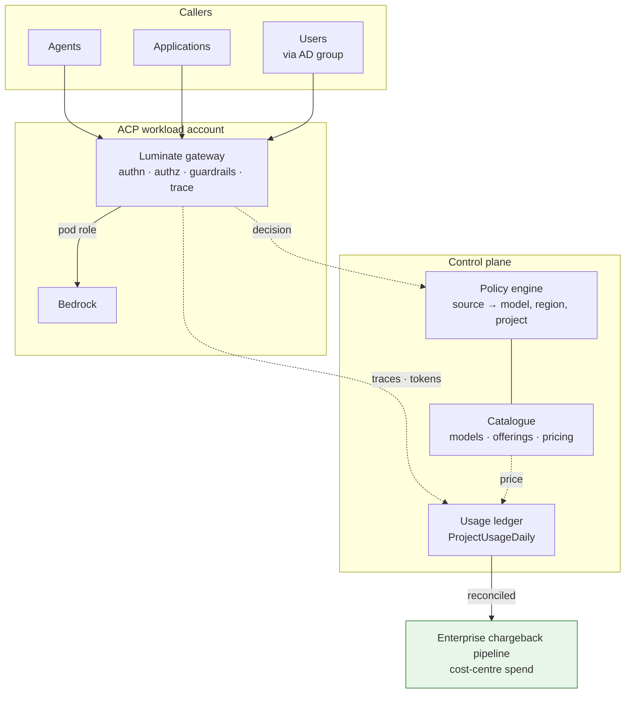

# Assurance — the ETAB submission and the ISRA control set

| Record | Identifier |
|---|---|
| Architecture governance (ATG) | **[ATG0005693](https://sunlife.service-now.com/nav_to.do?uri=x_sulfc_atg_request.do?sys_id=9f3f3f0acf978314a77ab1ad5d851c38)** |
| Security risk assessment (ISRA) | **[26-1978](https://sunlife.service-now.com/nav_to.do?uri=x_sulfc_vendor_ass_vendor_assessment.do?sys_id=61de005ecf9f8314a77ab1ad5d851c20)** |

The control set below (C-1–C-32) and the residual risks (R-1–R-11) are the content submitted
against ISRA 26-1978. The scope those records cover is **centralized inference as specified in
[Topology](topology.md)** — inference executing in the ACP production workload account through the
per-environment, per-region gateway — so a change to that topology is a change to the assessed
scope, not an editorial one.

This page exists so a board submission and a risk assessment can be produced from the spec rather
than reconstructed from the gateway source and a finance conversation. It says four things: what the
architecture is, which decisions were taken and why, which risks centralizing inference introduces,
and which controls exist with what evidence.

---

## The architecture

**The property that matters for assurance**: the gateway is the only path, so the control plane sees
every governed call. The corollary is the exposure — a call that bypasses the gateway is invisible,
and its only signature is the *absence* of a record.

---

## Design decisions

| # | Decision | Why | What it concedes |
|---|---|---|---|
| **DD-1** | **Centralized inference is the target state, offered conditionally** | It is the only shape serving a workload with no AWS account, and the consortium's direction | It moves attribution from AWS onto ACP; that burden is this spec |
| **DD-2** | **Distributed inference remains supported and preferred where the team has an AWS account** | Costs land where incurred, with no attribution machinery | Two supported shapes, and a decision to make per onboarding |
| **DD-3** | **Attribution is a precondition of the offer, not a follow-up** | Three of four links working produces a confidently wrong bill | Slower to offer centralized; the alternative is restating charges |
| **DD-4** | **The project is the billing unit; the cost centre is its attribute** | Projects already scope policy and usage; the cost centre is the finance system's own coding | A person's spend is attributed via their project, not directly |
| **DD-5** | **AD groups govern access; projects govern billing** | Using groups for both creates two authorities for "who pays" with no tiebreak | Two mechanisms to maintain, each with one job |
| **DD-6** | **`cost_centre` is snapshotted onto the ledger row, not joined at read time** | A re-org must not retroactively restate a closed period | A project's history spans cost centres; reports must not assume one |
| **DD-7** | **No charge is raised from an unreconciled period** | A figure reaching finance acquires authority it may not have earned | Charging lags usage by the reconciliation cycle |
| **DD-8** | **Systematic inter-team metering bias is a defect, not a tolerance** | An error that varies by team cross-subsidises one at another's expense | Higher bar than an aggregate-accuracy target |
| **DD-9** | **Spend is limited by an enforced budget, refused at the call** | A limit reported after the fact is not a control; the business owner's commitment is that overspend is refused | Every matching budget must have headroom, so a call can be refused by a limit its caller did not set |
| **DD-10** | **The stop path is credential and policy revocation, not a budget** | A budget stops overspending; revocation stops the workload. They address different failures | Blunt by design — it is an access action, and it stops good traffic with bad |
| **DD-11** | **ACP feeds the existing enterprise pipeline rather than building a finance surface** | Finance has a single view of cost-centre spend and keeps it | ACP must conform to the pipeline's coding and cadence |
| **DD-12** | **Region is an offering attribute and a recorded residency decision** | Centralized routing means ACP chooses the region on the consumer's behalf | ACP becomes accountable for a residency choice it previously inherited |
| **DD-13** | **Unattributed spend is a reported service level with a ceiling** | Centralization is what makes the bucket grow | Someone must own the number and act on the trend |
| **DD-14** | **Budget denial returns actionable retry guidance** | An agent given an opaque refusal retries immediately and turns a budget breach into a load problem | The response reveals that a limit exists, which is acceptable to the caller's own principal |
| **DD-15** | **A workload names a model; the provider is resolved through the catalogue** | Provider portability is only real if nothing in a workload encodes the provider. A swap is then a repoint, and rollback costs the same | The gateway must absorb every provider's wire-format differences, which is real ongoing engineering |
| **DD-16** | **A swap is refused unless the target offering meets its callers' declared capability needs** | A silent capability drop — context window, tool calling, structured output — becomes a runtime outage, not a degradation | Capability declarations must be maintained accurately, and a stale declaration is worse than none |

---

## Threat and risk model — what centralizing inference changes

Centralization is not risk-neutral. It concentrates a previously distributed function, which
improves some properties and degrades others. Both directions are listed, because a submission that
only lists improvements is not a risk assessment.

| # | Risk | Where it bites | Control |
|---|---|---|---|
| **T1** | **Mis-attribution** — spend billed to the wrong cost centre | Any broken link in the chain | C-1…C-6 · **Residual R-1** |
| **T2** | **Systematic under-billing of cache-heavy callers** — the metering path omits cache tokens, so some teams are cross-subsidised | Gateway metering | C-2, C-7, C-8 · **Residual R-2** |
| **T3** | **Silent rollup failure** — a day never materializes and reads as a day with no usage | Worker | C-9, C-10 |
| **T4** | **Unbounded platform absorption** — unattributed spend accumulates on ACP's budget | Onboarding discipline | C-11, C-12 · **Residual R-3** |
| **T5** | **Spend runs beyond what the business agreed** | Inference path | C-13, C-14, C-15 · **Residual R-4** |
| **T6** | **Blast radius of one account** — a credential or misconfiguration in the centralized account affects every tenant, where distributed confined it to one | ACP account | C-16, C-17 · **Residual R-5** |
| **T7** | **Employee spend data exposure** — per-user spend joined to email, readable org-wide by an Administrator-role holder | Chargeback surface | C-18, C-19, C-20 · **Residual R-6** |
| **T8** | **Over-broad model grant** — `all_users` or a stale grant leaves a model reachable | Policy store | C-21, C-22, C-23 |
| **T9** | **Residency breach** — a call routes to a region the data may not enter, chosen by ACP rather than the consumer | Offering | C-24 · DD-12 |
| **T10** | **Ungoverned bypass** — a workload with its own AWS account calls Bedrock directly | Outside the gateway | C-25, C-26 · **Residual R-7** |
| **T11** | **Approval drift** — a model withdrawn from approval remains reachable | Catalogue vs policy | C-23, C-27 |
| **T12** | **Pricing drift** — a stale rate card produces a wrong bill silently | Pricing catalogue | C-28 · **Residual R-8** |
| **T13** | **Directory-group resolution failure** — access via an untested `user_group` path behaves unexpectedly | Policy engine | C-21 · **Residual R-9** |
| **T14** | **Availability concentration** — the centralized path is a single dependency for every tenant's inference | Gateway + account | C-16 · **Residual R-10** |
| **T15** | **A provider swap degrades a workload silently** — capability dropped, or behaviour changed, without the caller knowing | Catalogue | C-29, C-30, C-31 · **Residual R-11** |
| **T16** | **Provider concentration** — no executable alternative, so an outage, withdrawal or contract change becomes an emergency | Platform | C-32 · **Residual R-11** |

**What centralization improves**, for balance: one policy point rather than one per account; one
audit trail; one catalogue, so an unapproved model cannot be reachable in an account nobody is
watching; and a kill path that works for every tenant at once. T6 and T14 are the price of exactly
those properties.

---

## Control set

| # | Control | Type | Evidence |
|---|---|---|---|
| **C-1** | Every model call traverses the gateway (MIR-1) | Preventive | Absence of direct Bedrock grants; traces present |
| **C-2** | Token quantity captured across every billed dimension (MIR-8) | Preventive | Reconciliation of a cache-heavy call to the provider usage block |
| **C-3** | Every reachable model carries a per-token price (MIR-9) | Preventive | Priced-model count equals reachable-model count |
| **C-4** | Usage materialized to the ledger at stated grain (MIR-10) | Detective | Ledger non-empty; totals reconcile to the trace store |
| **C-5** | Every spending project carries a cost centre (MIR-11) | Preventive | No project with usage has an empty `cost_centre` |
| **C-6** | Cost centre snapshotted at rollup (DD-6) | Preventive | Ledger column; migration |
| **C-7** | Per-model metering error measured before offer (MIR-16) | Detective | Recorded reconciliation sample per model |
| **C-8** | Inter-team bias assessed, not just aggregate error (MIR-17) | Detective | Error distribution across workloads |
| **C-9** | Rollup completeness monitored (NFR-2) | Detective | A row exists for every day with traffic |
| **C-10** | Backfill before period close | Corrective | Backfill record |
| **C-11** | Unattributed spend reported with a ceiling (MIR-12) | Detective | `unattributed` share against the agreed ceiling |
| **C-12** | Onboarding requires a project and cost centre before traffic | Preventive | Onboarding checklist |
| **C-13** | Enforced budgets refuse spend beyond an agreed limit (MIR-20, MIR-21) | Preventive | A call exceeding a budget returns 429; counter state visible |
| **C-14** | Provider and account-side limits bound catastrophic runaway below the platform (MIR-22) | Preventive | Provider/account limit configuration |
| **C-15** | Revocation drilled as the stop path (MIR-24) | Corrective | Drill record |
| **C-16** | Gateway availability and failure posture | Preventive | Fail-closed on policy decision |
| **C-17** | Least privilege on the centralized inference role | Preventive | Role policy review |
| **C-18** | Non-admin chargeback access restricted to own rows | Preventive | `restrict_to_user_id`; `restricted_to_own_usage` on the response |
| **C-19** | Org-wide spend visibility limited to an authorized role | Preventive | Role membership review — see R-6 |
| **C-20** | Purpose and retention stated for per-user spend data | Preventive | Privacy record |
| **C-21** | Model access is an explicit grant, default-deny (MIR-27) | Preventive | Policy records; negative test |
| **C-22** | Grants use the smallest true source; no `all_users` on models (MIR-28) | Preventive | Policy source audit |
| **C-23** | Periodic grant review against usage (MIR-34) | Detective | Review record joining policies to the ledger |
| **C-24** | Region recorded as a residency decision at onboarding (MIR-30) | Preventive | Offering region; onboarding record |
| **C-25** | Direct-to-provider calls are not granted | Preventive | IAM policy review |
| **C-26** | Absence-of-traffic monitoring for onboarded workloads | Detective | Expected vs observed traces |
| **C-27** | Model approval status governs reachability (MIR-32) | Preventive | Catalogue and policy consistency check |
| **C-28** | Pricing drift detection (MIR-18) | Detective | Catalogue source and refresh date; scheduled check |
| **C-29** | Offerings declare capabilities, and a swap failing to meet callers' needs is refused (MIR-37) | Preventive | Capability declarations; a deficient swap is refused in test |
| **C-30** | A model-changing swap is evaluated before cutover (MIR-38) | Preventive | Evaluation record comparing candidate to incumbent |
| **C-31** | Cost re-measured after a swap (MIR-39) | Detective | Pre/post cost comparison for the same workload |
| **C-32** | An alternate offering exists and the swap path is rehearsed (MIR-41) | Corrective | Shadow or progressive swap record |

---

## Residual risks

| # | Risk | Why it remains | Accepted posture |
|---|---|---|---|
| **R-1** | Mis-attribution remains possible where a principal does not resolve to a project | Not every caller shape maps cleanly | Bounded and reported via the unattributed ceiling (C-11) |
| **R-2** | **Metering completeness depends on the provider reporting every billed dimension** | A provider that adds a new priced token dimension is not obliged to tell us first | Detected by reconciliation (C-7) and by per-model error distribution (C-8); a new dimension appears as a widening variance before it appears as a wrong bill |
| **R-3** | Unattributed spend lands on the platform budget | Some residue is unavoidable at onboarding boundaries | Ceiling agreed; trend monitored (C-11) |
| **R-4** | **A budget bounds spend but not damage** | A workload can do harm well inside its limit | Budgets are a financial control only; the kill path (C-15) and access governance carry the rest |
| **R-5** | Concentration risk — one account serves every tenant | Inherent to centralization | Accepted as the price of a single control plane; least privilege and fail-closed compensate |
| **R-6** | **Org-wide per-user spend, joined to email, is readable by every Administrator-role holder** | Upstream decision AIC-582 (2026-09-01), confirmed intended: the widening "opened per-user AI spend joined to the caller's `email`... from superusers to every Administrator-role holder. That is attributable personal data about employees" | **Requires a Sun Life decision**: the size of the Administrator population here, and whether employee spend joined to email is acceptable under Law 25 / PIPEDA with a stated purpose and retention. The viewset also sits in the RBAC `_PENDING_MIGRATION` backlog with authorization deferred |
| **R-7** | A workload with its own AWS account can bypass the gateway | ACP cannot prevent what it cannot see | Detected by absence (C-26); addressed by IAM discipline, not by the gateway |
| **R-8** | Pricing may drift from the provider's real rate card | Rate cards change outside ACP | Detected by C-28 and caught by reconciliation (C-7) |
| **R-9** | The `user_group` path is untested — zero live policies use it | Mechanism exists, practice does not | Exercised early in D3 rather than during a cutover |
| **R-10** | Centralized inference is a single dependency for every tenant | Inherent to the topology | Accepted; distributed remains available for teams with an account |
| **R-11** | **Not everything ports.** A provider-exclusive model, a provider-hosted fine-tune, or a workload depending on a provider-specific feature cannot be moved by a repoint | Inherent — provider portability is not model portability | Which case a workload is in is recorded at onboarding, so a swap timeline is never promised against a case that is a project rather than a configuration change |

---

## What ETAB is being asked to approve

1. **The pattern** — inference executes in the **ACP production workload account**, through the
   gateway serving the workload's environment and region, with the workload holding no provider
   credential. Distributed execution in a consumer's own account remains supported where that team
   already has one.
2. **The decision** that **centralized inference is the target state** — discharging
   `integration-patterns` **T16** — on the grounds that it is the only shape serving a workload with
   no cloud account, and that it is what makes aggregate volume negotiable and the provider
   replaceable.
3. **The attribution model** — the project as billing unit, the cost centre as its attribute, the
   snapshot-at-rollup rule (DD-6), the reconciliation gate before charging (DD-7), and the hand-off
   into the existing enterprise pipeline rather than a new finance surface.
4. **The budget model** — spend, token and request limits bound to project, team, entity or user,
   enforced at the call with soft-warn and hard-cap (DD-9), and held distinct from the access
   decision and from the kill path (DD-10).
5. **The provider-portability model** — a workload names a model and the catalogue resolves the
   provider (DD-15), with a swap refused unless the target offering meets its callers' declared
   capability needs (DD-16). This is what makes an alternative to any single provider executable
   rather than theoretical.
6. **The sixteen design decisions**, in particular DD-3 (attribution is a precondition of the
   offer), DD-5 (groups govern access, projects govern billing), DD-7 (no charge from an
   unreconciled period) and DD-9 (spend is refused, not reported).
7. **The eleven residual risks** — in particular **R-5** (concentration: one account and one gateway
   tier serve every tenant in a region), **R-6** (employee spend data audience) and **R-11** (not
   everything ports — a provider-exclusive model or a provider-hosted fine-tune is a project, not a
   repoint), which are the three the board should weigh rather than nod through.

> **What approval of this pattern is not.** It is not approval of a charge run. MIR-14 makes a
> reconciled period the gate on charging, and the first invoice should be preceded by evidence that
> the reconciliation passed. The delta between this target state and the platform as it stands is
> tracked in [D3](../d3-tasks.md); none of it changes what is described here, and all of it is
> verifiable before the pattern is used in earnest.
