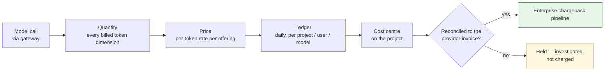

# Attribution — who pays

Centralized inference aggregates the bill. Attribution is what keeps it decomposable — **aggregate
the spend without losing who spent it.**

## The obligation

In a distributed shape the cloud account boundary does the attribution: the provider bills per
account and the enterprise pipeline maps account to cost centre. Centralizing removes that boundary,
so **ACP is the attribution authority** and supplies, in the finance system's own coding, what the
account boundary used to supply.

It delivers into the pipeline finance already runs, not a new surface beside it. The single view of
cost-centre spend is preserved; inference simply appears in it.

## The chain

Five links and a gate. The gate is not decoration: **a figure that reaches finance acquires
authority**, and the cheapest moment to catch a wrong one is before the charge, not after a team
disputes it.

## The grain

One row per UTC day per **`(project, entity, user, model, provider)`**, carrying input, output and
total cost as a decimal with an explicit currency, and the **cost centre** alongside.

| Dimension | Answers |
|---|---|
| `project` + `cost_centre` | Who is billed |
| `user` | Who within that cost centre — the drill-down, not the billing unit |
| `entity` | Which agent or application made the call |
| `model` + `provider` | What was used, and from whom |
| `usage_date` | Which period, in UTC |

That grain answers the questions the business actually asks — *"ten people in this team used it, and
here is what they spent"* — without a join to anything outside the ledger.

**Every token dimension the provider bills is captured**, including cache reads and cache writes.
Modern models price several dimensions at different rates, and a metering path that records only
prompt and completion tokens systematically under-bills whichever teams use caching most. MIR-8 and
MIR-17 make completeness a requirement and inter-team bias a defect, because an error that varies by
team does not merely under-recover — it **cross-subsidises one team at another's expense**, which is
the failure that gets a chargeback model withdrawn.

## Billing unit: the project

**The project is the billing unit and the cost centre is its attribute.** Projects already scope
policy and usage, so no new construct is introduced, and the recurring reconciliation work scales
with the number of cost centres rather than with headcount.

**The cost centre is snapshotted onto each ledger row at rollup**, not joined at read time. Cost
centres get reassigned; a project moving between them must not retroactively restate a closed
period. Snapshotting means history stays true to what was agreed when it was billed.

### Access and billing are separate authorities

| Question | Authority |
|---|---|
| May this person call this model? | Their **directory group** |
| Who pays for it? | Their **project**, which carries the cost centre |

Using directory groups for both creates two sources of truth for "who pays", with no tiebreak when a
person's group and project disagree. Keeping them separate means each mechanism answers one question
and every answer has one owner.

## Unattributed spend

Spend whose principal does not resolve to a project lands in an **unattributed** bucket that is
deliberately *selectable* rather than merely present — an operator chasing unbilled cost needs to
filter down to exactly it.

Centralization is what makes this bucket matter: in a distributed shape the account attributed
everything by construction. Here it is a **reported service level with an agreed ceiling**
(MIR-12, NFR-4), because a rising unattributed share is the leading indicator that onboarding has
outrun cost-centre discipline.

## Reconciliation and the charge gate

Per period, the ACP ledger total is compared to the provider invoice for the inference account.

| Step | Detail |
|---|---|
| Compare | ACP total vs provider invoice, per model |
| Tolerance | Agreed per model; inside it is noted, outside it is investigated |
| Gate | **No charge is raised from an unreconciled period** |
| Trend | The variance itself is tracked — a stable small gap is a different signal from a growing one |

MIR-13 and MIR-14 exist because an internal figure and a provider invoice will differ, and the
difference must be understood before anyone is charged. When a period fails, the correct response is
to hold and investigate: correcting a charge after a business unit has booked it costs more
credibility than the delay does, and the second correction is never believed.

## What this enables commercially

Attribution is usually justified defensively — recovering cost. It is also what makes the
[commercial position](topology.md) real:

- **A committed-spend agreement needs a defensible forecast.** The ledger's daily, per-model history
  is that forecast.
- **A negotiated rate needs to be verifiable.** Reconciliation against the provider invoice is how a
  discount is confirmed rather than assumed.
- **Moving a model between providers needs a before-and-after.** Per-offering cost makes that a
  measurement rather than an argument.

An aggregated bill that cannot be decomposed gives none of these. The chain is what turns
centralization from a cost-consolidation exercise into leverage.
