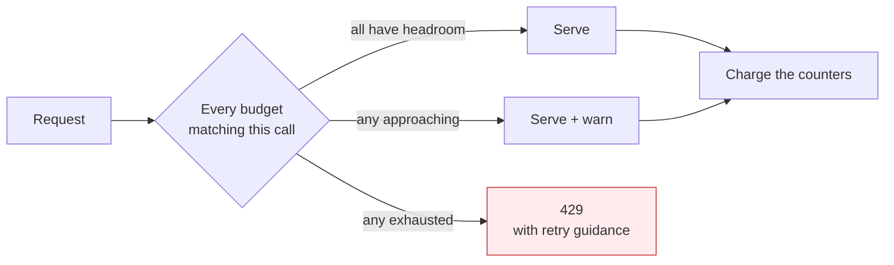

# Budgets — limiting what can be spent

A budget is a limit on consumption, bound to whoever is accountable for it, **enforced on the
inference path** so that exceeding it is refused rather than reported afterwards.

## The model

A budget binds a **source** to a **limit** over a **period**, in a **dimension**.

| Element | Values |
|---|---|
| Source | A project, a team or directory group, an agent or application, or an individual user |
| Dimension | **Spend** (the money limit), tokens, or requests |
| Period | A rolling or calendar window |
| Response | **Soft-warn** on approach, **hard-cap** on breach |

Spend is the dimension that matters to a business owner, and it is the one a token limit cannot
substitute for: token price varies by model and by token dimension — a frontier-model output token
and a cached-read token differ by orders of magnitude — so **a token cap bounds a quantity whose
price it does not know.** Token and request limits remain useful for shaping load; only a spend
limit bounds cost.

## Enforcement

**Every budget matching a call must have headroom for the call to proceed**, and the counters commit
together. A call attributable to a user inside a team inside a project is bound by all three; the
tightest one governs. Partial commitment — charging one counter and not another — would let the
limits disagree about what has been spent.

The refusal carries **retry guidance the caller can act on**, because an agent that receives an
opaque refusal will simply retry immediately and convert a budget breach into a load problem.

**Token charging is two-stage.** A request reserves against its estimated cost and settles against
the actual usage once the provider responds, because the real token count is not known until then. A
reservation that is never settled is released rather than left to strand headroom.

## Where budgets sit relative to access

Access and budget are different questions asked in order:

1. **May this caller use this model here?** — the [access policy](model-access.md). A denial here is
   a governance failure.
2. **Is there budget for it?** — the budget. A denial here is a financial limit being observed.

Keeping them distinct matters operationally: the response to the first is to review a grant; the
response to the second is to raise a limit or accept the stop. Conflating them produces the familiar
failure where someone is granted more access to solve what was actually a spend problem.

## Ownership and change

A budget has an **owner** — the person accountable for the cost centre it protects — and changing
one is a governed action, approved by that owner and audited. Raising one caller's limit must not
silently raise anyone else's, which is why budgets bind to selectors rather than to a global pool.

A budget whose access path is removed **retires itself**: if nobody can reach the target any more,
a limit protecting it is stale configuration that will later confuse whoever inherits it.

## Relationship to the spend control hierarchy

Budgets are the *preventive* control. They are not the only one, and the pattern does not pretend
they cover every case:

| Control | Type | Stops |
|---|---|---|
| **Budget** | Preventive | Spend beyond an agreed limit, at the call |
| Access revocation | Preventive, absolute | The workload entirely — the kill path (MIR-24) |
| Provider/account limits | Preventive, coarse | Catastrophic runaway below the platform |
| Chargeback review | Detective | Patterns a limit would not catch — drift, misuse, surprise |
| Spend-anomaly detection | Detective | A sharp change inside an unexhausted budget |

**A budget is not a substitute for the kill path.** Stopping a compromised or misbehaving workload
is an access action, not a financial one, and MIR-24 keeps that distinction because the failure mode
they address is different: a budget stops overspending, revocation stops the workload.

## What a business owner is told

Precision here is a control in itself. The commitment is:

- **Spend above your limit is refused**, not reported after the fact.
- **You are warned before you get there**, with enough margin to act.
- **Your limit is yours** — raising someone else's does not consume it.
- **A refusal is visible** to the caller and in the report, so a stopped workload is diagnosable
  rather than mysterious.

MIR-20 requires that whatever is stated to a business owner matches what the platform enforces for
their workload in their environment. A budget that is configured but not in force is worse than none,
because it converts an explicit risk into an assumed protection.
