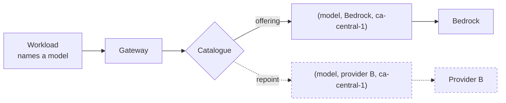

# Provider portability — changing provider without changing a workload

"The provider is replaceable" is a claim, not an architecture. This page says what makes it true,
what quietly makes it false, and what genuinely does not port.

## The indirection

A workload names a **model**. It does not name a provider, an endpoint, a region or an account.

An **offering** is the slot `(model, provider, region)`. Swapping provider means pointing the model
at a different offering. **No workload changes, no credential moves, no redeploy.**

That is the mechanism. Everything below is what has to be true for the mechanism to be safe to use.

## What makes a swap actually possible

Four properties, and a swap is only as portable as the weakest of them.

### 1 · One wire format at the gateway

The gateway presents a single request and response format to every caller, regardless of what the
provider underneath speaks. Providers differ in message shape, tool-call encoding, streaming
framing and error taxonomy; **absorbing that difference is the gateway's job, and it is what stops
the difference reaching a workload.**

A workload that bypasses this — calling a provider SDK directly, or depending on a provider's native
response envelope — has opted out of portability regardless of what the catalogue says.

### 2 · Declared capability parity

A swap must not silently drop a capability a workload depends on. Each offering declares what it
supports, and the ones that actually break things are:

| Capability | What breaks if it differs |
|---|---|
| **Context window** | Requests that fit today fail after the swap |
| **Tool / function calling** | Agents stop being able to act |
| **Structured output** | Downstream parsing fails |
| **Streaming** | Interactive workloads degrade or hang |
| **Vision / multimodal input** | Requests are rejected |
| **Prompt caching** | Cost and latency change sharply, and the *cost* change may be the larger surprise |

**A swap to an offering that does not meet the declared needs of its callers is refused rather than
attempted.** That check is the difference between a governed swap and an outage.

### 3 · Evaluated behavioural equivalence

This is the property most "provider-agnostic" claims skip, and it is the one that bites.

**The same prompt against a different model returns different output.** Not worse necessarily —
different. Tone, format adherence, refusal behaviour, tool-selection tendencies and failure modes all
shift. A workload tuned against one model has, in effect, been fitted to it.

So a provider swap that also changes the model is a **model change**, and it goes through
evaluation before cutover, not after. Portability of *infrastructure* is free; equivalence of
*behaviour* has to be demonstrated.

### 4 · Re-measured cost

Pricing is per offering, and providers price different dimensions at different rates — cached reads
in particular. **The cost of a model is a property of the offering, not of the model.** A swap
therefore re-prices the workload, and the new cost is measured rather than assumed. Where a swap is
motivated by cost, that measurement is the whole point of it.

## What a swap looks like

Five shapes, in increasing order of confidence required:

| Mode | Use |
|---|---|
| **Shadow** | Mirror a share of traffic to a candidate offering, compare output and cost, change nothing for callers |
| **Progressive** | Move a share of live traffic, watch quality and cost, increase or roll back |
| **Per-region** | Serve the same model from different providers in different regions — residency or availability driven |
| **Full repoint** | Move all traffic for a model to another offering |
| **Failover** | Automatic substitution when a provider is unavailable, within declared capability parity |

**Rollback must be as cheap as the swap**, which it is when the swap is a repoint: the previous
offering still exists and is pointed back to. Anything that makes rollback expensive — a data
migration, a prompt rewrite, a workload redeploy — means the swap was not a repoint and should be
treated as a change programme instead.

## What does not port, honestly

Provider portability is not model portability, and conflating them is how a team gets a surprise.

| Situation | Portable? |
|---|---|
| A model hosted by several providers, moved between them | **Yes** — a repoint |
| The same provider, a different region | **Yes** — a repoint |
| A model exclusive to one provider | **No.** Leaving that provider means choosing a *different model*, with evaluation |
| A provider-hosted fine-tune or custom model | **No.** The weights live with the provider |
| A workload depending on a provider-specific feature directly | **No**, until that dependency is removed |

**Say which case you are in before promising a timeline.** The first two are configuration. The last
three are projects, and the difference is not visible from the catalogue.

## Why this is worth the constraint

Two returns, and they compound with the [commercial position](topology.md):

- **Negotiating leverage is only real if the alternative is executable.** A provider knows whether
  its customer can actually leave. Portability that has been exercised — even once, even in
  shadow — is a materially different negotiating position from portability that is merely asserted.
- **Concentration risk becomes manageable.** A provider outage, a regional withdrawal, a contractual
  or licensing change, or a model deprecation becomes a repoint rather than an emergency.

Neither is available to a workload calling a provider endpoint directly. That workload has embedded
the provider in itself, and the cost of changing is a migration per team rather than a catalogue
operation.

## The obligation this places on the platform

Portability is a property the platform maintains, not one it has once:

- Offerings carry declared capabilities, and the declarations are kept true.
- At least one model has a **credible alternate offering**, so the path is exercised rather than
  theoretical.
- The swap path is **rehearsed** — in shadow if not in anger — because an untested failover is a
  belief, not a control.
- Provider onboarding is a platform change: credentials, capability declarations, pricing and a
  data-handling position, all before a single workload is pointed at it.

**A provider change is a governed event, not a config tweak.** The contractual and data-handling
posture differs per provider, so the swap carries a review even when the technical change is a
single repoint.
