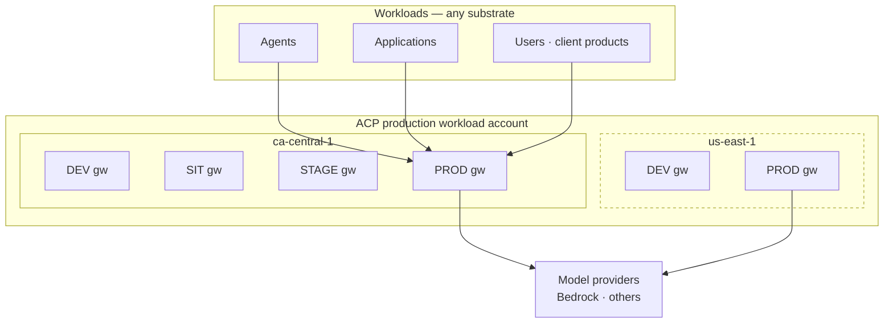
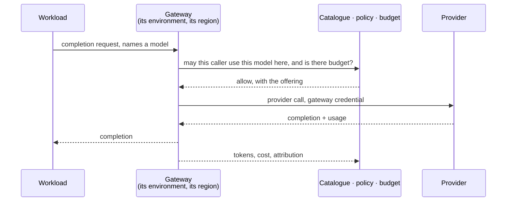

# Topology — centralized inference

Inference executes **in the ACP production workload account, through the gateway serving the
workload's environment and region.** That is the pattern. This page says what that means, why it is
the target, and what it buys beyond the obvious.

## The shape

Gateways are centralized and platform-owned: **one per workload environment, per region**, as
specified in [`gateway-environment-strategy`](../../../platform/gateway-environment-strategy/d2-design.md) DD-3.
Inference follows the gateway.

**An environment spans regions; a gateway does not.** A second region adds gateways, not another set
of environments. The workload reaches the gateway for its own environment and region; that gateway
holds the provider credential and makes the call.

| Property | Position |
|---|---|
| Where inference executes | The ACP production workload account |
| Which gateway serves it | The one for the workload's environment and region |
| Who holds the provider credential | The gateway. Never the workload |
| Who the provider bills | ACP — recovered through [attribution](attribution.md) |
| What the consumer needs | Nothing: no cloud account, no provider credential, no gateway of their own |
| Region | An attribute of the gateway and the offering, and a residency decision |

## Why centralized is the target

The obvious reason is reach: **it is the only shape that serves a workload with no cloud account** —
an agent on OpenShift, a desktop client product, an Office add-in. Those workloads have nothing to
assume into, and they are a growing share of demand.

The two better reasons are commercial.

### It makes inference a negotiable position

When every team calls the provider from its own account, the enterprise has no aggregate volume — it
has fifty small ones. Centralizing the call path means **Sun Life presents a single, measured demand
to a provider**, which is the precondition for committed-spend agreements, negotiated rates and
enterprise inference deals. That is worth more than the engineering simplification, and it is
unavailable in the distributed shape at any level of effort.

The attribution chain is what makes it safe: aggregate the *spend* without losing *who spent it*. A
single bill the platform cannot decompose is not leverage, it is a liability.

### It makes the provider replaceable

Workloads call the gateway, not a provider. The model a workload names resolves through the
catalogue to an offering — a `(model, provider, region)` slot — so **changing which provider serves
a model is a catalogue change, not a change to any workload.**

Bedrock is the provider today. The pattern does not assume it is the provider tomorrow. Adding a
second provider, moving a model between providers, or serving the same model from different
providers in different regions are all catalogue operations, and no consuming team is involved in
any of them.

That optionality exists *only because* the call path is centralized. A team calling a provider
endpoint from its own account has hard-wired that provider into its workload, and switching then
costs a migration per team.

**What makes that claim real rather than asserted — the wire format, capability parity, behavioural
evaluation and cost re-measurement — is specified in [Provider portability](provider-portability.md),
along with what honestly does not port.**

**The two reasons compound.** Provider portability gives a commercial negotiation its credibility,
and aggregated volume makes the negotiation worth having.

## What the consumer sees

The workload names a model and receives a completion. It does not know which provider served it,
which account paid for it, or which region it executed in. All three are platform decisions —
recorded, governable, and changeable without the workload changing.

## Region and residency

Region is a first-class axis, not a deployment detail. The offering is identified by
`(model, provider, region)` and the gateway carries its location, so **where a call executes is a
recorded decision rather than an inherited one**.

Centralization moves that decision to ACP. In a distributed shape the consuming team's own account
and region carried the residency posture; here the platform chooses on the consumer's behalf, which
makes it accountable for the choice. MIR-30 requires the region and its residency rationale to be
recorded at onboarding.

Because an environment spans regions, the same workload environment can be served in `ca-central-1`
and `us-east-1` with different offerings and different residency positions, without forking the
control plane.

## Distributed inference

A team with its own cloud account can have the gateway assume a role into that account, so the call
executes there and the provider bills them directly. It remains supported, and it is the right
answer where a team already has an account and wants its model spend on its own bill with no
intermediary.

It is **not** the target shape, for the reasons above: it forfeits aggregate volume, it hard-wires
the provider per team, and it scales by adding accounts and trust relationships. The mechanism is
specified in [`integration-patterns`](../../../platform/integration-patterns/d2-design/inference.md) and is not
restated here.

## The non-pattern

A workload calling a provider's API directly, bypassing the gateway, is not a third topology — it is
the absence of one. **ACP sees nothing**: no access decision, no guardrail, no trace, no token
accounting, no budget, no kill switch and no cost record. Its only signature is the *absence* of
audit events, which is why MIR-1 is a requirement rather than a recommendation, and why the
onboarding check is that expected traffic *appears* rather than that no errors occur.
