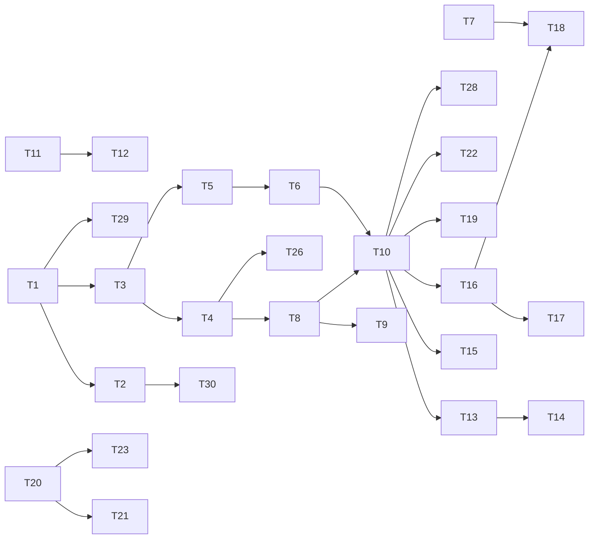

# D3 — Tasks

> **Gate**: D3 | **Status**: Draft | **Epic**: [EACPP-1320](https://sunlife.atlassian.net/browse/EACPP-1320)

**This is the delta.** [D2](d2-design/index.md) describes the target state; this page is the work to
reach it from where the platform stands today, measured 2026-09-14 and evidenced in
[D0](d0-discovery.md). Nothing here changes the design \u2014 it closes the distance to it.

Eight workstreams. The ordering is not arbitrary: **W3 gates the offer**, because the pattern's
central claim is that attribution is a precondition rather than a follow-up.

> **Jira tasks are deliberately not created yet.** The spec is unreviewed; creating tickets now would
> put thirty rows on the board for a design nobody has agreed.

### Where the platform stands today

| Target-state capability | Current position | Closed by |
|---|---|---|
| Every billed token dimension metered | Prompt, completion and total only \u2014 no cache dimension | T7 |
| Every reachable model priced | Pricing catalogue unpopulated | T8, T9 |
| Daily usage ledger | Built upstream, never materialized here | T10 |
| Cost centre on every spending project | Unpopulated on every project | T11, T12 |
| Enforced spend budgets | Limits are authored and reported; nothing denies | T20, T21, T22 |
| Hand-off to the enterprise pipeline | Not built \u2014 and out of the consortium's scope | T13, T14 |
| Reconciliation and charge gate | No practice established | T16, T17 |
| Human access via directory group | Mechanism present, no policy uses it | T24 |
| Provider reachable from the ACP account | Blocked by an organisation-level control | T3, T4 |
| Offerings declare their capabilities | Not modelled | T31 |
| A credible alternate provider offering | Single provider (Bedrock) | T33, T34 |

---

## W1 — Record the decision

| # | Task | Depends |
|---|---|---|
| **T1** | **Record that centralized inference is the target state**, and the population it is offered to, discharging [`integration-patterns`](../../platform/integration-patterns/d3-tasks.md) **T16 (EACPP-1128)**. The decision is conditional on W2; say so in the record. (FR-2) | — |
| **T2** | **Publish the topology decision rule** — AWS account → distributed; no account → centralized; account sprawl as a stated business reason → centralized. One page a team is pointed at before it designs. (FR-1) | T1 |

## W2 — Make centralized reachable

| # | Task | Depends |
|---|---|---|
| **T3** | **Settle the Bedrock SCP position for the ACP account.** Either lift the organisation-level deny for the inference account or host the gateway where it does not apply. A governance conversation with a recorded outcome, not a configuration change. (D-6) | T1 |
| **T4** | **Enable the inference account per region**, consistent with the "one workload account per region" intent, and pin the offerings' `region` to it. (MIR-7, MIR-30) | T3 |
| **T5** | **Add the local-Bedrock mode to the gateway values** — `gateway.aws` currently assumes the role chain. Note `values-prod.yaml` has no `gateway.aws` block at all. Coordinate with `integration-patterns` T15. | T3 |
| **T6** | **Verify centralized end to end** for a workload with no AWS account, routing a governed completion. Coordinate with `integration-patterns` T17. | T5 |

## W3 — Close the attribution chain

**This workstream is the gate.** T7–T12 are MIR-8 to MIR-11.

| # | Task | Depends |
|---|---|---|
| **T7** | **Get cache tokens into the metering path.** Track AIC-679 and verify against a real Claude turn: a call with a known cache read must arrive with the cache dimension recorded. Until this passes, centralized traffic is showback only. (D-3, MIR-8) | — |
| **T8** | **Load the pricing catalogue** for every reachable model, including cache-read and cache-write rates. Currently 0 rows. (D-7, MIR-9) | T4 |
| **T9** | **Own pricing freshness** — name the source, record a refresh date per entry, and schedule a drift check. (D-7, MIR-18) | T8 |
| **T10** | **Populate and monitor the usage ledger.** Run the rollup, confirm a row exists for every day with traffic, and alert on a missing day — a day that never rolled up reads as a day with no usage. (D-7, MIR-10, NFR-2) | T6, T8 |
| **T11** | **Require a cost centre on every project** that can incur spend; make it a validation at project creation rather than a convention. (D-8, MIR-11) | — |
| **T12** | **Backfill cost centres** on the existing projects — currently empty on all of them. (D-8) | T11 |

## W4 — Hand off to finance

| # | Task | Depends |
|---|---|---|
| **T13** | **Agree the receiving interface with the enterprise chargeback pipeline** — format, coding, cadence, and the finance owner. Discovery named the Finance Expense Management team as the route in. Piggyback the existing mechanism; do not build a finance surface. (D-9, FR-7, DD-11) | T10 |
| **T14** | **Deliver a first period of attributed spend** into the pipeline as showback, and confirm it lands in the same single view as AWS service spend. (D-9) | T13, T10 |
| **T15** | **Decide the chargeback report audience.** Org-wide per-user spend joined to email is readable by every Administrator-role holder (AIC-582). Establish how many people that is here, state purpose and retention, and record a Law 25 / PIPEDA position. (D-5, R-6, MIR-7 NFR) | T10 |

## W5 — Reconciliation and charging

| # | Task | Depends |
|---|---|---|
| **T16** | **Establish the reconciliation practice** — ACP ledger total against the AWS/Bedrock invoice, per period, per model, with an agreed tolerance. (D-10, MIR-13) | T10 |
| **T17** | **Implement the charge gate**: no charge is raised from an unreconciled period. Showback until it passes. (MIR-14, DD-7) | T16 |
| **T18** | **Measure metering error per model and its distribution across workloads**, not just the aggregate. An error that varies by team cross-subsidises one at another's expense. (MIR-16, MIR-17, DD-8) | T7, T16 |
| **T19** | **Set and monitor the unattributed ceiling.** Report the null-project share each period and act on the trend. (MIR-12, DD-13, NFR-4) | T10 |

## W6 — Budgets and enforcement

| # | Task | Depends |
|---|---|---|
| **T20** | **Raise the enforcement ask with the consortium** — AIC-20 (mechanism), AIC-43 (governance), AIC-831 (the budget construct). Note in every forum that a spend dimension without enforcement is still telemetry, and enforcement without a spend dimension can only cap tokens: **they must land together.** (D-1, D-2, FR-13) | — |
| **T21** | **Progress EACPP-834** — the `economics` app contribution, currently in Funnel. Sun Life is the member with the immediate chargeback requirement, which makes it the natural contributor. (D-2) | T20 |
| **T22** | **Stand up the interim spend control**: a periodic chargeback review with a named owner and a stated response, plus whatever account-side limits AWS offers. Drill revocation as the stop path. (MIR-21, MIR-22, MIR-24) | T10 |
| **T23** | **Raise the per-run cost ask.** The ledger aggregates by day and `UsageSession` carries no cost, so per-run spend cannot be answered from the finance surface. (D-4) | T20 |

## W7 — Model access governance

| # | Task | Depends |
|---|---|---|
| **T24** | **Exercise the user-group path early.** Zero live policies use `source_type=user_group` and the business requirement is AD-group access. Test directory resolution, group-to-policy mapping, and mid-session membership change — before a cutover, not during one. (D-11, MIR-29) | — |
| **T25** | **Audit model grants**: no `all_users` on a model target, and every grant sourced from the smallest true thing. (MIR-28, C-22) | — |
| **T26** | **Record region and residency at onboarding** for every offering. Centralized routing means ACP chooses the region on the consumer's behalf. (MIR-30, DD-12) | T4 |
| **T27** | **Reconcile approval status against reachability** — a model withdrawn from approval must not remain reachable. (MIR-32, C-27) | — |
| **T28** | **Establish the grant review**, joining live policies against the usage ledger so grants with no traffic are challenged. (MIR-34, C-23) | T10 |

## W8 — Keep the specs consistent
| # | Task | Depends |
|---|---|---|
| **T29** | **Update [`integration-patterns`](../../platform/integration-patterns/d2-design/inference.md)**: the ledger it records as missing landed 2026-08-27, one day after that page was written, so its stated gate — *"the ledger and a spend dimension"* — is now half-lifted. Restate it as enforcement-only. (D-12, FR-14) | T1 |
| **T30** | **Point the onboarding specs at this pattern** rather than letting each re-derive the inference and cost design — starting with `anthropic-client-acp-integration`, whose D0 raised the chargeback requirement that produced this spec. | T2 |

## W9 — Keep the provider replaceable

| # | Task | Depends |
|---|---|---|
| **T31** | **Add capability declarations to offerings** — context window, tool calling, structured output, streaming, multimodal input, prompt caching — and enforce that a swap failing to meet its callers' declared needs is **refused rather than attempted**. (MIR-37, DD-16) | T8 |
| **T32** | **Audit workloads for provider coupling**: a provider SDK, a provider endpoint, or a dependency on a provider-native response shape means that workload has opted out of portability whatever the catalogue says. Record each workload's case — **repoint, or project**. (MIR-35, R-11) | T2 |
| **T33** | **Stand up a credible alternate offering** for at least one model, so the swap path is real rather than theoretical. (MIR-41) | T8, T31 |
| **T34** | **Rehearse the swap** in shadow: mirror a share of traffic to the alternate, compare output and cost, and confirm rollback is a repoint. An untested failover is a belief, not a control. (MIR-38, MIR-39, MIR-40, MIR-41) | T33, T10 |
| **T35** | **Define provider onboarding as a governed change** — credentials, capability declarations, pricing and a data-handling position recorded before any workload is pointed at a new provider. (MIR-42) | T31 |

---

## Dependency shape

**T7 and T10 are the two that matter.** T7 (cache tokens) gates *charging*; T10 (a populated,
monitored ledger) gates almost everything downstream. Neither is on the critical path of the other,
so they should run in parallel.

---

## Exit criteria

- [ ] The centralized-inference decision is recorded, with its population and its conditions (T1)
- [ ] `integration-patterns` T16 is closed against that record
- [ ] Bedrock is reachable from the inference account, per region (T3, T4)
- [ ] A governed completion is verified end to end for a workload with no AWS account (T6)
- [ ] Cache tokens are captured and reconcile to the provider's usage block (T7)
- [ ] Every reachable model is priced, with a source and a refresh date (T8, T9)
- [ ] The ledger is populated, monitored, and has a row for every day with traffic (T10)
- [ ] Every spending project carries a cost centre, enforced at creation (T11, T12)
- [ ] A period of attributed spend has reached the enterprise pipeline as showback (T14)
- [ ] Reconciliation runs per period and the charge gate is in force (T16, T17)
- [ ] Metering error is measured per model **and across workloads** (T18)
- [ ] The unattributed ceiling is set and monitored (T19)
- [ ] The interim spend control has a named owner and a drilled stop path (T22)
- [ ] The user-group access path has been exercised (T24)
- [ ] No `all_users` grant exists on a model target (T25)
- [ ] The enforcement ask is raised and EACPP-834 has moved (T20, T21)
- [ ] The report audience decision and privacy position are recorded (T15)
- [ ] Offerings declare capabilities and a deficient swap is refused (T31)
- [ ] Every workload's portability case is recorded — repoint or project (T32)
- [ ] An alternate offering exists and the swap path has been rehearsed (T33, T34)
