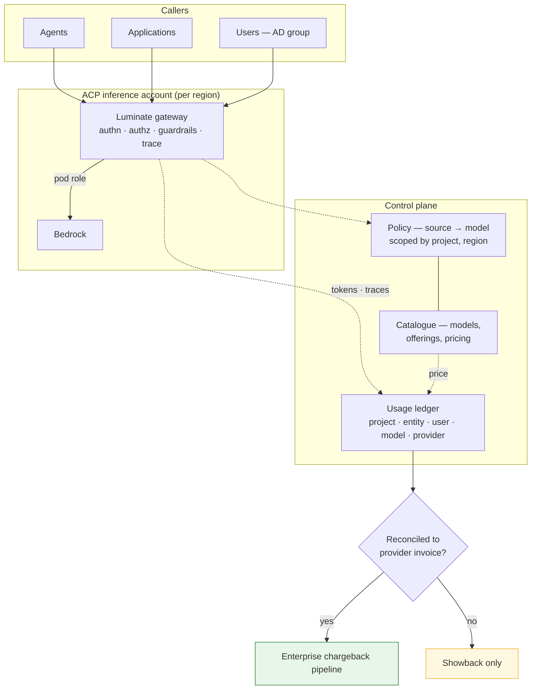

# Design Pattern: Governed Model Inference — Centralized Execution, Attribution and Access Control

**Document status:** Draft
**Pattern owner:** Sun Life ACP Product Team (EDAE)
**Approvers:** EA | Security Architecture | Platform | Finance | Operations
**Assurance records:** [ATG0005693](https://sunlife.service-now.com/nav_to.do?uri=x_sulfc_atg_request.do?sys_id=9f3f3f0acf978314a77ab1ad5d851c38) (architecture) · [ISRA 26-1978](https://sunlife.service-now.com/nav_to.do?uri=x_sulfc_vendor_ass_vendor_assessment.do?sys_id=61de005ecf9f8314a77ab1ad5d851c20) (security)
**Version:** 0.1
**Last updated:** 2026-09-14
**Review cadence:** Quarterly, and on any change to the attribution chain or the enforcement position
**Primary audience:** Enterprise architects, solution architects, engineering, security, finance, operations
**Pattern category:** AI/ML
**Cloud scope:** AWS | On-prem (OpenShift) | Hybrid
**Technology neutrality:** Preferred — the governance model is provider-neutral; the current provider is Bedrock and the attribution chain is specific to Luminate

---

## 1. Executive Summary

A model call on ACP / Luminate executes **in the ACP production workload account, through the
gateway serving the calling workload's environment and region.** The workload names a model and
holds no provider credential; which provider serves it, in which account and which region, are
platform decisions resolved through the catalogue.

**Centralized inference is the target state.** The obvious reason is reach — it is the only shape
that serves a workload with no cloud account, which is a growing share of demand. The two better
reasons are commercial:

- **It makes inference negotiable.** Fifty teams calling a provider from fifty accounts is fifty
  small volumes. One call path is a single, measured enterprise demand — the precondition for
  committed-spend agreements, negotiated rates and inference deals.
- **It makes the provider replaceable.** Workloads call the gateway and name a *model*, never a
  provider, so moving a model between providers is a **repoint of a catalogue entry** rather than a
  migration per team. Bedrock is the provider today; the pattern does not assume it is the provider
  tomorrow. The gateway absorbs each provider's wire-format differences, offerings declare their
  capabilities so a swap cannot silently drop one, and rollback costs the same as the swap.

Aggregating the bill is only safe if it stays decomposable. In a distributed shape the cloud account
boundary attributes spend for free; centralizing removes that boundary, so **ACP becomes the
attribution authority**: a daily ledger at `(project, entity, user, model, provider)` grain carrying
a cost centre, reconciled against the provider invoice before anything is charged, delivered into
the enterprise chargeback pipeline finance already runs. A single bill the platform cannot decompose
is not leverage — it is a liability.

Spend is bounded by **budgets enforced at the call** — soft-warn, then hard-cap — bound to a project,
team, entity or user, and held distinct from both the access decision and the kill path. Model
access is a default-deny grant binding a source to a model, scoped by project and region.

## 2. Business Context and Outcomes

| Outcome | How this pattern delivers it |
|---|---|
| **Inference becomes commercially negotiable** | One measured enterprise demand instead of many small ones — the basis for committed-spend agreements and negotiated rates |
| **The provider stays replaceable** | Workloads call the gateway; a provider change is a catalogue operation, not a per-team migration |
| Teams without a cloud account can use approved models | Centralized execution is the only topology that serves them |
| Model spend returns to the team that incurred it | The attribution chain, delivered into the existing enterprise pipeline |
| Finance keeps one view of cost-centre spend | ACP feeds that pipeline rather than building a competing surface |
| Spend stays within what the business agreed | Budgets enforced at the call, bound to the accountable owner |
| Model access is governed once | Policy targets a model; sources are agents, applications, users or directory groups |
| Residency is a decision, not an accident | Region is an attribute of the gateway and the offering, recorded at onboarding |

The demand is concrete: the Anthropic client product onboarding needs centralized inference with
per-team cost recovery, with a stated business target of 31 October and dev first.

## 3. Problem Statement and Intent

Seven onboarding use cases are waiting on a decision that has been open since 2026-08-26:
`integration-patterns` **T16** — *"decide and record whether centralized is offered, and to whom."*

The decision has not been made because its consequence is under-appreciated. Centralized inference
looks like the simpler architecture — no role chain, no ExternalId lifecycle, no per-consumer AWS
account — and it is, in every respect except the one that matters: **it removes the mechanism that
attributes spend.**

**Intent**: record the decision, specify what must be true for it to be honest, and say clearly which
of those things are not true yet.

## 4. Pattern Summary

| Aspect | Position |
|---|---|
| Execution | The ACP production workload account, through the gateway for the workload's environment and region |
| Credential | The gateway holds it; the workload never does |
| Provider | Resolved through the catalogue — replaceable without touching a workload |
| Provider swap | A **repoint** of the `(model, provider, region)` offering. Shadow, progressive, per-region, full or failover; rollback as cheap as the swap |
| Billing unit | The **project**, carrying a **cost centre** in the finance system's own coding |
| Attribution grain | `(project, entity, user, model, provider)` per UTC day |
| Charging gate | No charge from an unreconciled period |
| Spend control | **Enforced budgets** — spend, token or request; soft-warn then hard-cap |
| Access control | Default-deny; policy binds a source to a model, scoped by project and region |
| Human access | Directory **groups**, not individual users |
| Kill path | Credential and policy revocation — an access action, not a financial one |

## 5. Applicability

### 5.1 Use this pattern when

- A workload needs a model — this is the default path for model access on ACP
- The workload has **no cloud account** of its own: an agent on OpenShift, a desktop client product,
  an Office add-in
- Model access must be governed by agent, application or directory group
- Inference spend must return to a cost centre
- The enterprise wants aggregate volume it can negotiate against, or optionality on the provider

### 5.2 Do not use this pattern when

| Situation | Why, and what instead |
|---|---|
| The team has its own cloud account and wants model spend on its own bill with no intermediary | Distributed execution attributes spend directly. It is supported, and it forfeits aggregate volume and provider portability — a deliberate trade, not a default |
| The workload must reach a model the catalogue does not carry | Onboard the model first. An ungoverned direct call is not a shortcut, it is an exception to the pattern |
| Data residency forbids every region a gateway serves | Add a gateway and an offering in a permitted region; do not route around the constraint |
| The requirement is intelligent routing, semantic caching or cost-aware model selection | Out of scope here — those are optimisations over a governed path (EACPP-20), and the governance question is settled first |

## 6. Reference Architecture



The gateway is the only path, so the control plane sees every governed call. The corollary is the
principal exposure: a call that bypasses the gateway is invisible and its only signature is the
absence of a record.

## 7. Core Design Principles

1. **Attribution is a precondition, not a follow-up.** Three working links produce a confidently
   wrong bill.
2. **Feed the pipeline finance already uses.** Do not build a second finance surface.
3. **Groups govern access; projects govern billing.** One authority per question.
4. **Snapshot the cost centre at rollup.** A re-org must not restate a closed period.
5. **Never claim a control that does not run.** Quotas do not deny; say so.
6. **A biased error is worse than a large one.** An error that varies by team cross-subsidises.
7. **Unattributed spend is a measured service level**, not a rounding difference.
8. **Region is a decision ACP now owns**, because centralization takes it from the consumer.

## 8. Component Model

| Component | Responsibility | Owner |
|---|---|---|
| Luminate gateway | Authn, authz, guardrails, provider call, token capture | Consortium |
| Policy engine | Source → model decisions, scoped by project and region | Consortium |
| Catalogue | Models, offerings `(model, provider, region)`, declared capabilities, pricing | Consortium / ACP data |
| Usage ledger (`ProjectUsageDaily`) | Daily rollup at stated grain, with cost centre snapshot | Consortium |
| Chargeback report | Rows, summary, streaming CSV export | Consortium |
| **Reconciliation control** | ACP total vs provider invoice; the charge gate | **Sun Life** |
| **Pipeline hand-off** | Delivery into the enterprise chargeback pipeline | **Sun Life** |
| **Cost-centre discipline** | Every spending project coded | **Sun Life** |

## 9. Non-Functional Requirements (NFR)

| # | Requirement | Target |
|---|---|---|
| NFR-1 | Governance latency on the inference path | Within the gateway's existing budget; attribution is asynchronous |
| NFR-2 | Ledger freshness | Rollup complete within one day of the usage date |
| NFR-3 | Reconciliation variance | Within an agreed per-model tolerance |
| NFR-4 | Attribution completeness | Unattributed share below an agreed ceiling |
| NFR-5 | Availability | Inherits the gateway posture; fail-closed on a policy decision |
| NFR-6 | Report access control | Org-wide per-user spend restricted to an explicitly authorized role |
| NFR-7 | Personal data | Minimum necessary; purpose and retention stated |
| NFR-8 | Catalogue accuracy | No reachable model unpriced; every price carries a source and refresh date |
| NFR-9 | Auditability | Every call produces an audit event and a trace attributable to a principal |

## 10. Security and Compliance Baseline

**Access.** Default-deny. A caller reaches only the models a policy names. Sources are the smallest
true thing — an agent, an application, or a directory group — and `all_users` does not belong on a
model target. Human access flows through directory groups so that joining or leaving a team changes
access without a policy edit.

**Spend.** Bounded by **budgets enforced at the call**. A budget binds a source — project, team,
entity or user — to a limit over a period, in spend, tokens or requests. Every budget matching a
call must have headroom for it to proceed; the tightest governs. Approach produces a **soft-warn**,
breach a **hard-cap** with actionable retry guidance. A budget has a named owner and changing one is
approved and audited. **The kill path is separate**: stopping a compromised or misbehaving workload
is credential and policy revocation, because a budget bounds spend and not damage. What is stated to
a business owner must equal what is enforced for their workload in their environment.

**Personal data.** The chargeback surface joins per-user spend to employee email. Non-admin callers
are restricted to their own rows, but org-wide visibility extends to every Administrator-role
holder — a widening decided and confirmed upstream (AIC-582, 2026-09-01) and inherited here. The
size of that population at Sun Life, and the Law 25 / PIPEDA position on employee spend data with a
stated purpose and retention, is a **decision this pattern requires and does not take**.

**Residency.** Centralized routing means ACP selects the region on the consumer's behalf. The
offering's region names it and the residency rationale is recorded at onboarding.

**Model approval.** A model not approved for a data classification must not be reachable by a
workload handling it; catalogue and policy must not drift apart.

## 11. Data and State Architecture

| Store | Contents | Grain | Notes |
|---|---|---|---|
| Trace store | Spans, token counts, session correlation | Per call | Source for the rollup; the only place per-run cost can be derived |
| `ProjectUsageDaily` | Tokens and cost | `(project, entity, user, model, provider)` per UTC day | `cost_centre` **snapshotted at rollup**; `Decimal(20,10)` with explicit `currency` |
| Pricing catalogue | Per-token rates, including cache-read and cache-write | Per offering | Carries a source and refresh date |
| Policy store | Grants | Source → target, scoped | Materialized-path project scope tokens |

**The snapshot rule is load-bearing.** Cost centres get reassigned; joining at read time would
retroactively restate closed periods.

**Unattributed spend** is modelled as a selectable bucket rather than an absence, so it can be chased.

## 12. Reliability and Resilience Patterns

| Concern | Position |
|---|---|
| Policy decision unavailable | Fail-closed. Availability is traded for immediate revocation |
| Rollup fails for a day | **Silent** — a missing day reads as a day with no usage. Detect by completeness, not by report success; backfill before period close |
| Provider unavailable | Caller-visible; retry and fallback are workload concerns, not governance ones |
| Concentration | One account serves every tenant. Accepted as the price of a single control plane; distributed remains available |

## 13. Observability and Audit

Every governed call produces an audit event and a trace attributable to a principal. Token counts
ride the trace and are rolled into the ledger.

**Metering completeness is a control, not a detail.** Every token dimension the provider bills is
captured — including cache reads and cache writes, which modern models price differently from
ordinary input. A path recording only prompt and completion tokens under-bills cache-heavy callers
specifically, and an error that varies by team **cross-subsidises one team at another's expense**,
which is the failure that gets a chargeback model withdrawn. Per-model metering error is measured,
and its distribution across workloads is measured with it.

Run-level correlation is caller-supplied via a session header.

## 14. Deployment and Environment Strategy

**One gateway per workload environment, per region**, platform-owned, in the ACP production workload
account — per [`gateway-environment-strategy`](../../platform/gateway-environment-strategy/d2-design.md) DD-3.
An environment spans regions; a gateway does not, so a second region adds gateways rather than a
second set of environments. Inference follows the gateway, and offerings are pinned to the region
their gateway serves.

**The provider must be invocable from the ACP production workload account, in each region a gateway
serves.** Where an organisation-level control prevents that, lifting it is a governance decision
taken per region rather than a configuration change — and it is a precondition of serving that
region centrally, not a detail to discover afterwards.

Environments follow the platform's promotion path; the attribution preconditions are verified per
environment, because a populated ledger in dev says nothing about prod.

## 15. Operations and Support Model

| Obligation | Cadence | Owner |
|---|---|---|
| Rollup completeness | Daily | ACP Platform |
| Reconciliation to the provider invoice | Per period, before any charge | ACP Product + Finance |
| Unattributed spend review | Per period | ACP Product |
| Interim spend review | Per period | Named owner |
| Grant review against usage | Per cycle | ACP Product |

**Incident**: a runaway workload is stopped by revoking its grant or credential — there is no budget
to trip. Metering found wrong for a model stops charging for it, restates the affected periods and
re-reconciles before resuming.

## 16. Cost Model and FinOps

The cost being governed is **token cost**, not AWS account cost.

```
cost = Σ (tokens_dimension × price_dimension)   per (project, entity, user, model, provider, day)
```

Attribution reaches finance as cost-centre-coded spend through the existing pipeline, so the single
view of cost-centre spend is preserved.

**The grain is what makes it useful commercially.** Daily per-model history is the forecast a
committed-spend agreement needs; reconciliation against the provider invoice is how a negotiated
rate is confirmed rather than assumed; and per-offering cost makes moving a model between providers
a measurement rather than an argument. An aggregated bill that cannot be decomposed gives none of
these.

Per-run cost is a trace-store query rather than a ledger field, because the ledger's grain is the
UTC day — the right grain for a finance period, the wrong one for a single execution.

## 17. Risks, Assumptions, Constraints, Decisions

### 17.1 Risks

| Risk | Impact | Mitigation | Owner |
|---|---|---|---|
| Cache-heavy callers under-billed, cross-subsidised by others | High | Charging gated on cache-token capture; error measured across workloads, not just in aggregate | ACP Product |
| Spend runs away with no preventive control | High | Detective review with a named owner; revocation drilled; enforcement raised with the consortium | ACP Product |
| Unattributed spend accumulates on the platform budget | Medium | Reported as a service level with a ceiling | ACP Product |
| Rollup fails silently and a period is under-billed | Medium | Completeness monitoring, not report-success monitoring | Platform |
| Employee spend data visible to too broad an audience | Medium | Audience decision, purpose and retention recorded | Security + Privacy |
| Concentration of every tenant's inference in one account | Medium | Least privilege, fail-closed; distributed remains available | Platform |
| Directory-group access path untested | Medium | Exercised before a cutover, not during one | ACP Product |
| Pricing drifts from the provider rate card | Medium | Source and refresh date per entry; reconciliation catches the rest | ACP Product |

### 17.2 Assumptions and constraints

- The gateway is on the request path for every governed call; there is no policy cache and no
  fail-open posture.
- One gateway serves one workload environment in one region; an environment spans regions, a gateway
  does not.
- The usage ledger aggregates by UTC day and cannot be re-bucketed into another zone, so per-run
  cost is a trace query rather than a finance figure.
- The provider must be invocable from the ACP production workload account in each region served.
- The enterprise chargeback pipeline consumes cost-centre-coded spend and is the single view to
  preserve.
- The consortium's attribution scope **excludes chargeback and invoicing**; that half is Sun Life's.
- Token price varies by model and by token dimension, so only a spend limit bounds cost.

### 17.3 ADR references

- ADR — Centralized inference is the target state, for reach, aggregate volume and provider
  portability
- ADR — A workload names a model; the provider is resolved through the catalogue
- ADR — A swap is refused unless the target offering meets its callers' declared capability needs
- ADR — The project is the billing unit and the cost centre is its attribute
- ADR — Directory groups govern access; projects govern billing
- ADR — The cost centre is snapshotted at rollup, not joined at read time
- ADR — No charge is raised from an unreconciled period
- ADR — Spend is refused at the call, not reported afterwards
- ADR — The kill path is revocation, not a budget
- ADR — Systematic inter-team metering bias is a defect, not a tolerance

## 18. Anti-Patterns

| Anti-pattern | Why it fails | Instead |
|---|---|---|
| Calling a provider API directly from a workload | Invisible to ACP: no decision, no guardrail, no budget, no token accounting, no kill switch | Route through the gateway |
| Centralizing inference and adding attribution later | The account boundary that attributed spend is already gone; the aggregated bill arrives first | Attribution is a precondition of the offer |
| Charging from an unreconciled period | A wrong number reaching finance gets paid; correcting it costs more than the delay | Hold and investigate |
| Using a token limit as a spend cap | Token price varies by model and dimension, so it bounds a quantity whose price it does not know | Set a spend budget |
| Using a budget as the kill switch | A budget bounds spend, not damage — a workload can do harm well inside its limit | Revoke the grant or credential |
| Mapping directory groups to cost centres for billing | Two authorities for "who pays", with no tiebreak when they disagree | Groups for access, projects for billing |
| Joining the cost centre at read time | A re-org retroactively restates closed periods | Snapshot at rollup |
| `all_users` on a model target | Indistinguishable from having no policy | Grant to the smallest true source |
| Treating a rendering report as a working one | A day that never rolled up reads as a day with no usage | Monitor completeness, not report success |
| Building a new finance surface | Finance has a single view and wants to keep it | Feed the existing pipeline |
| Hard-wiring a provider into a workload | Forfeits portability and makes a provider change a per-team migration | Name a model; let the catalogue resolve the provider |

## 19. Decision Matrix

| Question | Answer |
|---|---|
| **How does my workload reach a model?** | Through the gateway for your environment and region. You name a model; you hold no provider credential |
| **My team has its own cloud account — must I centralize?** | No, distributed execution is supported. It attributes spend directly, and it forfeits aggregate volume and provider portability |
| **Can I have a hard spend cap?** | **Yes.** A spend budget bound to your project, team or users, refused at the call, with a warning before the cap |
| **How do I stop a runaway workload?** | Revoke its grant or credential. A budget bounds spend, not damage |
| **Who gets billed for my team's usage?** | The cost centre on the project the usage is attributed to |
| **Can I see per-user spend?** | Yes, as a drill-down within a cost centre, subject to the report audience decision |
| **What did this single run cost?** | A trace query — the ledger's grain is the UTC day, which is the finance period, not the execution |
| **Which region will my calls go to?** | The region of the gateway and offering serving you, recorded at onboarding as a residency decision |
| **How is human access granted?** | Through a directory group, not per user |
| **Can we change model provider later?** | **Yes — a repoint of the offering.** No workload changes. Shadow or progressive first; rollback costs the same |
| **What if a provider goes down?** | Failover to an alternate offering, within declared capability parity |
| **Does every model port?** | **No.** A provider-exclusive model or a provider-hosted fine-tune is a *different model* elsewhere, so it needs evaluation — that is a project, not a repoint |

## 20. Implementation Checklist

**Serve**
- [ ] A gateway exists for the workload's environment and region
- [ ] The provider is invocable from the ACP production workload account in that region
- [ ] Region and residency position recorded for that gateway

**Attribute**
- [ ] Every billed token dimension captured, cache reads and writes included
- [ ] Every reachable model priced, with a source and a refresh date
- [ ] Ledger materialized daily, with completeness monitoring
- [ ] Cost centre validated at project creation

**Charge**
- [ ] Receiving interface agreed with the enterprise pipeline
- [ ] Reconciliation running against the provider invoice, with an agreed tolerance
- [ ] Charge gate in force — no charge from an unreconciled period
- [ ] Unattributed ceiling set and monitored

**Limit**
- [ ] A spend budget exists for the workload, bound to its accountable owner
- [ ] Soft-warn verified to fire ahead of the cap
- [ ] The stated limit equals the enforced limit
- [ ] Revocation drilled as the kill path, separate from the budget

**Govern**
- [ ] Human access granted through a directory group
- [ ] No `all_users` grant on a model target
- [ ] Approval status reconciled against reachability
- [ ] Grant review joined to the usage ledger
- [ ] Report audience and privacy position recorded

**Stay portable**
- [ ] Workloads name a model only — no provider SDK, endpoint or native response dependency
- [ ] Every offering declares its capabilities, and the declarations are kept true
- [ ] At least one model has a credible alternate offering
- [ ] The swap path rehearsed, in shadow if not in anger
- [ ] Each workload's portability case recorded: repoint, or project

## 21. Reference Implementation (Optional)

No reference implementation yet. The first will be the Anthropic client product onboarding
(`anthropic-client-acp-integration`), which raised the chargeback requirement this pattern answers
and which exercises both the centralized topology and the directory-group access path.

## 22. Source References

- **Assurance records** — [ATG0005693](https://sunlife.service-now.com/nav_to.do?uri=x_sulfc_atg_request.do?sys_id=9f3f3f0acf978314a77ab1ad5d851c38) (architecture governance) ·
  [ISRA 26-1978](https://sunlife.service-now.com/nav_to.do?uri=x_sulfc_vendor_ass_vendor_assessment.do?sys_id=61de005ecf9f8314a77ab1ad5d851c20) (security risk assessment). The control table and residual risks in
  [`d2-design/assurance.md`](d2-design/assurance.md) are the content submitted against both.
- `AI-Consortium/luminate` — `origin/main` @ `654c31991`, 2026-09-14. Catalogue, metrics, quotas,
  policy and gateway tracing claims are verified against this revision.
- Live dev estate — queried 2026-09-14 through the `luminate-backend` pod: 19 of 30 policies target a
  model; zero use a user group; `PricingCatalogEntry` and `ProjectUsageDaily` both at zero rows;
  every project's `cost_centre` empty.
- [`integration-patterns`](../../platform/integration-patterns/d2-design/inference.md) (EACPP-1112) — the two
  topologies as they stand today, the Service Catalog product, the role chain and the SCP position.
  **T16 is the decision this pattern discharges.**
- [`gateway-environment-strategy`](../../platform/gateway-environment-strategy/d0-discovery.md) (EACPP-1089) —
  gateway and environment topology.
- `agent-patterns` (EACPP-1290, PR #35 — not yet on `main`) and
  [`mcp-server-patterns`](../mcp-server-patterns/pattern.md) (EACPP-1176) — the sibling lane patterns.
- `anthropic-client-acp-integration` (PR #47) — the demand signal and the discovery transcript from
  which the chargeback requirement is quoted.
- Consortium roadmap — AIC-20 (enforce quotas at the gateway), AIC-43 (model and govern quotas),
  AIC-831 (budget management), AIC-59 (attribute usage and cost, chargeback excluded), AIC-679
  (prompt-cache tokens under-costed), AIC-582 (the per-user spend audience decision).
- Sun Life roadmap — EACPP-834 (inference economics contribution), EACPP-20 (inference economics and
  intelligent routing).
