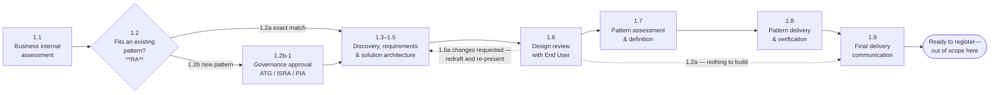
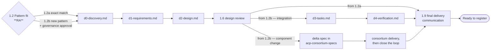

<!-- GENERATED FILE — do not edit directly.
     Source: d2-design/ pages. Regenerate with scripts/assemble_d2_design.py -->

# ACP Customer Journey, Phase 1 — D2: Design

> **Gate**: D2 — Design | **Status**: Draft | **Epic**: [EACPP-1134](https://sunlife.atlassian.net/browse/EACPP-1134)
> Source of truth for the flow: `customer-journey.mmd`.

## What this design is

The **interaction model for ACP intake** — who is involved at each step, what each party is
accountable for, what artefact each step produces, and where the flow branches. It answers the
two questions set out in D0.

**Scope: Phase 1 only**, steps 1.1 to 1.9. The journey ends when a use case is specified, its
pattern ruled on, any new pattern built and verified, and the outcome communicated — the point at
which it is ready to register an agent. Registration, runtime and governance need their own spec
(D0 OQ-2).

This is a process design. There is no API surface, no data schema and no deployment. The
"components" are teams and artefacts; the "interfaces" are hand-offs.

## Actors

| Code | Actor | Role in Phase 1 |
|------|-------|-----------------|
| EU | End User (business group / use-case owner) | Owns the business case; presents it and confirms capability requirements |
| ACP | ACP Product Team | Facilitates discovery, authors D0–D2, drives the journey, communicates the outcome |
| ACP EA | ACP Enterprise Architect | Defines and approves a new pattern; names the delivery owner |
| CT | Consortium Team | Alternate delivery owner for new platform patterns (Luminate-side change) |
| RA | Regional (BG) Architect | Business-internal assessment; **screens the applicable pattern shapes and rules fit (1.2)**; obtains governance approval where a new pattern is needed |
| DA | Domain Architects | Domain architecture guidance; supports new-pattern definition |

Six actors, not seven. The Forward Deployed Engineering Team was removed from Phase 1 in D2 review
— see DD-9.

### RA and DA are dedicated, not pooled

RA and DA are not a shared pool that any engagement draws from at random — each covers a fixed set
of regions or domains, and an engagement is routed to whichever one owns the ground it touches.

| RA region |
|---|
| CAN |
| US |
| ASIA |
| SLF |
| CORP |
| DBTS |

| DA domain |
|---|
| Security / Incident |
| Integration |
| Cloud / Container |
| Observability |

A use case may need more than one DA if its design touches more than one domain — an agent that
calls a new external system, runs in a new container platform and needs new monitoring engages
Integration, Cloud / Container and Observability. Which named individual holds a given region or
domain is a Backstage-group lookup, not something this spec hard-codes (D0 R-8).

These are **engagement roles, not Luminate portal roles**. The portal's personas — Builder, Project
Owner, Platform Administrator, Viewer — are a separate vocabulary defined in `luminate-user-guides`,
and a use-case owner will hold one of those *after* Phase 1, not during it.

GbyD and MRM sit outside these six. They supply the entry prerequisites ACP checks before 1.1 —
presence only, never approval (DD-19) — and neither their risk triage nor their model-risk assessment
is an ACP step. Ongoing model-risk governance is out of scope, and the `governance-intake` risk
triage is a future ACP capability rather than a step in this journey (DD-10).

## Design overview



At **1.2**, the RA screens the applicable shapes in `integration-patterns` and, for agent solutions,
the complete applicable set in [`agent-patterns`](../../../pattern/agent-patterns/d2-design.md). The RA records
the selected shape(s) and any open SUB-E/SUB-I criteria; an open or unexercised criterion alone is
not a refusal or a new-pattern finding, and the use case need not fit every shape. The fork decides
whether the engagement runs the short path
(specify, review, communicate) or the long one (specify, review, define the pattern, build it,
communicate). Everything between 1.3 and 1.6 is identical on both.

### Step intent

| Step | Intent | Primary driver | Exit artefact |
|------|--------|----------------|---------------|
| 1.1 | Business-internal architecture assessment | RA | Regional guidance |
| 1.2 | **Screen applicable catalogue shapes and rule fit**; where none fits, initiate governance approval before specification starts and confirm it before 1.8 | **RA** | Pattern-fit finding with shapes considered, selected shape(s), evidence and open criteria (1.2a / 1.2b) + approval request/status reference |
| 1.3 | Qualify the use case against the capability map | ACP | `d0-discovery.md` |
| 1.4 | Capture requirements | ACP | `d1-requirements.md` |
| 1.5 | Design the solution | ACP | `d2-design.md` |
| 1.6 | Review the solution design with the End User | ACP + EU | Confirmed `d2-design.md` |
| 1.7 | Define the new pattern and name its delivery owner (reached only from 1.2b) | ACP EA | Pattern definition + named delivery owner |
| 1.8 | Deliver the new pattern — ACP builds an integration, or the consortium takes a component change (reached only from 1.7) | ACP **or** CT | `d3-tasks.md` + `d4-verification.md`, or a delta spec and the close-the-loop record |
| 1.9 | Communicate final delivery and readiness to every party | ACP | Closing communication |

The engagement's own artefacts use the **same filenames as every other spec in this repo** —
`d0-discovery.md` through `d4-verification.md`. See DD-2.

---

# The journey — steps 1.1 to 1.9

The authoritative sequence is `customer-journey.mmd`. The block below is **generated from it** by
`scripts/sync_mermaid_embeds.py` and must never be edited in place; CI fails the build if the two
disagree.

<!-- BEGIN GENERATED: journey (source: ../customer-journey.mmd) -->
```mermaid
sequenceDiagram
    participant EU as End User [EU]
    participant ACP as ACP Product Team [ACP]
    participant EA as ACP Enterprise Architect [ACP EA]
    participant CT as Consortium Team [CT]
    participant RA as Regional BG Architects [RA]
    participant DA as Domain Architects [DA]

    Note over EU,DA: Phase 1 - Awareness, Education & Intake

    Note over EU,ACP: Entry gate before Phase 1 - the business provides a completed GbyD GenAI Risk Triage Form and a ready MRM MBCT ID. ACP manually verifies both prerequisites and records the verification; ACP does not perform risk triage or model-risk assessment.

    EU->>ACP: [EU] Submit completed GbyD GenAI Risk Triage Form and ready MRM MBCT ID
    ACP->>ACP: [ACP] Manually verify prerequisites and record verification

    alt Entry prerequisites verified
        ACP-->>EU: [ACP] Confirm onboarding may start
    else Entry prerequisite missing
        ACP-->>EU: [ACP] Pause onboarding pending the missing prerequisite
    end

    EU->>RA: [EU] 1.1 Engage Regional BG Architect for Business Internal Assessment
    RA-->>EU: [RA] Architecture Guidance and Recommendations

    RA->>RA: [RA] 1.2 Assess Fit Against the Pattern Catalogues

    Note over RA,EA: The RA consults integration-patterns and, for agent solutions, the agent-patterns shape catalogue. Screen Agent vs Application, egress vs ingress, and applicable substrates against SUB-E/SUB-I. S1-S4 are examples, not a closed list. Record open criteria; an open or unexercised criterion is not by itself a refusal or a new-pattern finding.

    alt Phase 1.2a - Exact Match to an Existing Pattern

        RA-->>ACP: [RA] 1.2a-1 Confirm Fit to Existing Pattern Shape(s) - No New Pattern Required

        Note over RA,ACP: The engagement runs 1.3 to 1.6 and closes at 1.9. Phases 1.7 and 1.8 are skipped entirely - there is no pattern to assess and nothing to build.

    else Phase 1.2b - New Pattern Required

        RA->>RA: [RA] 1.2b-1 Initiate Governance Approval for the New Pattern (ATG / ISRA / PIA as applicable)
        RA-->>ACP: [RA] 1.2b-2 Confirm New Pattern Required and Approval Request Initiated

        Note over RA,ACP: The long-lead approval may complete after discovery and design start. The engagement may proceed through 1.3-1.7, but approval must be confirmed before 1.8 implementation or upstream delivery. A conditional approval returns to 1.2b-1 for rework; outright refusal is out of scope and tracked as D0 R-9.

    end

    par 1.3 ACP Awareness & Discovery Session
        ACP->>EU: [ACP] ACP Overview & Mandatory Baseline Capability Review (Capability Map, Section 3)
        ACP->>EU: [ACP] Facilitate Use Case Discovery
        EU-->>ACP: [EU] Present Business Use Case & Requirements
    and Regional and Domain Architecture Assessment
        ACP->>RA: [ACP] Engage Regional BG Architect for Assessment
        RA-->>ACP: [RA] Align on Business Use Case & Requirements
        ACP->>DA: [ACP] Consult Domain Architects on the Domains the Use Case Touches
        DA-->>ACP: [DA] Provide Early Domain Architecture Input
    end

    Note over EU,ACP: Output = d0-discovery.md<br/>- Business objectives<br/>- Capability requirements<br/>- Architecture considerations<br/>- Gap assessment

    ACP->>ACP: [ACP] 1.4 Generate Requirements Specification

    Note over ACP: Output = d1-requirements.md<br/>- Functional requirements<br/>- Non-functional requirements<br/>- User stories<br/>- Acceptance criteria<br/>- Governance requirements

    ACP->>ACP: [ACP] 1.5 Create Solution Architecture

    Note over ACP: Output = d2-design.md<br/>- Solution architecture<br/>- ACP pattern selection<br/>- Integration design<br/>- Security and governance controls<br/>- Deployment approach<br/>- Open questions and assumptions

    ACP->>EU: [ACP] 1.6 Present Solution Architecture for Design Review

    alt Phase 1.6a - Changes Requested

        EU-->>ACP: [EU] 1.6a-1 Request Changes
        ACP->>ACP: [ACP] 1.6a-2 Revise d2-design.md and Return to 1.5

        Note over ACP,EU: The design returns to 1.5, is redrafted, and is re-presented at 1.6. It does not proceed until the end user confirms alignment.

    else Phase 1.6b - Design Confirmed

        EU-->>ACP: [EU] 1.6b-1 Confirm Design Alignment

        Note over ACP,EU: Output = Reviewed d2-design.md<br/>- End user confirms the solution meets the business need<br/>- Ready for pattern assessment, or for closing communication on an exact-match engagement

    end

    alt New Pattern Required - from 1.2b

        ACP->>EA: [ACP] 1.7 Architecture Review and Pattern Assessment

        Note over ACP,EA: Existing-versus-new was already ruled by the Regional Architect at 1.2. 1.7 defines the new pattern and names its delivery owner; it is not a second fit decision and it has no reject outcome.

        ACP->>EA: [ACP] 1.7-1 Submit d2-design.md for Review
        EA->>DA: [ACP EA] 1.7-2 Engage Domain Architects for Architecture Review
        DA-->>EA: [DA] 1.7-3 Provide Domain Architecture Guidance
        EA->>RA: [ACP EA] 1.7-4 Consult the Regional Architect on the 1.2b Finding
        RA-->>EA: [RA] 1.7-5 Confirm Regional Context
        EA-->>ACP: [ACP EA] 1.7-6 Provide Architecture Assessment and Pattern Recommendation
        EA->>EA: [ACP EA] 1.7-7 Define the New Pattern
        DA-->>EA: [DA] 1.7-8 Support New Pattern Definition
        EA-->>ACP: [ACP EA] 1.7-9 Confirm New Pattern and Delivery Owner

        RA-->>ACP: [RA] 1.7-10 Confirm Platform Governance Approval Status

        Note over RA,ACP: 1.8 cannot start until the required PIA / ISRA / ATG approval is confirmed. If approval is still pending, the engagement pauses before implementation or consortium delivery; discovery and design may proceed before this gate.

        Note over ACP,CT: Delivery owner follows the delineation rule.<br/>Yes = Component Change (Consortium).<br/>No = Integration Pattern (ACP).

        alt Phase 1.8a - Integration Pattern, ACP Product Team Delivers

            ACP->>ACP: [ACP] 1.8a-1 Create d3-tasks.md

            Note over ACP: Output = d3-tasks.md<br/>- Epics and User Stories<br/>- Implementation Tasks<br/>- Dependencies<br/>- Delivery Plan

            ACP->>ACP: [ACP] 1.8a-2 Implement and Deploy New Pattern

            ACP->>ACP: [ACP] 1.8a-3 Create d4-verification.md

            Note over ACP: Output = d4-verification.md<br/>- Test Results<br/>- Validation Evidence<br/>- Architecture Verification<br/>- Deployment Verification

            ACP->>EA: [ACP] 1.8a-4 Update Request Status: New Pattern Ready

            opt Integration Turns Out to Require a Luminate Change
                ACP->>ACP: [ACP] 1.8a-5 Re-classify as Component Change and Re-enter Consortium Track
            end

        else Phase 1.8b - Component Change, Consortium Delivers

            ACP->>ACP: [ACP] 1.8b-1 Register Ask on Sun Life Board Linked to the Spec Epic
            ACP->>ACP: [ACP] 1.8b-2 Write Delta Spec in acp-consortium-specs

            Note over ACP,CT: Output = Delta Spec<br/>- What Luminate Does Today<br/>- What Is Missing<br/>- What Should Change<br/>- What the Sun Life MVP Already Proved

            ACP->>CT: [ACP] 1.8b-3 Raise Through Consortium Idea Stewards
            CT->>CT: [CT] 1.8b-4 Prioritise, Vote and Deliver Upstream
            CT-->>ACP: [CT] 1.8b-5 Accepted Work Lands Upstream

            ACP->>ACP: [ACP] 1.8b-6 Re-verify and Update Capability Map
            ACP->>ACP: [ACP] 1.8b-7 Close Sun Life Ticket Referencing Consortium Ticket
            ACP->>EA: [ACP] 1.8b-8 Update Request Status: New Pattern Ready

            Note over ACP,CT: ACP confirms hand-back and readiness.

            opt Ask Not Yet Accepted or Still Upstream
                ACP->>EU: [ACP] Provide a Documented Temporary Interim Measure
            end

        end

    else Exact Match - from 1.2a

        Note over ACP,EA: No new pattern is required, so 1.7 and 1.8 are skipped entirely. The engagement goes straight from the confirmed design to the closing communication.

    end

    ACP->>EU: [ACP] 1.9 Communicate Final Delivery and Readiness to Register

    Note over EU,DA: 1.9 also informs ACP EA, CT, RA and DA. It is the only step at which the End User is contacted during and after delivery, and ACP is both responsible and accountable for it.

    Note over EU,DA: Phase 1 Complete - Use Case Ready to Register an Agent
```
<!-- END GENERATED: journey -->

## Reading it

- **1.2 is the fork the whole journey turns on**, and the **Regional Architect** owns it — not the
  ACP Enterprise Architect. An exact match (1.2a) runs 1.3–1.6 and closes at 1.9. Anything else
  (1.2b) needs the applicable governance approval request initiated before specification starts;
  approval is confirmed before 1.8, and the path adds 1.7 and 1.8 (DD-17).
- **`par` at 1.3** — the ACP discovery session, the regional architecture assessment and the
  domain-architect consultation run in parallel, not in sequence. A common misreading is that RA
  engagement waits for ACP.
- **There is no go/no-go step after 1.3.** A business group that has entered the journey has already
  decided to onboard, so the diagram does not model a proceed decision (DD-14).
- **1.6 is a design review with the End User**, run immediately after `d2-design.md` is drafted. The
  business group confirms the solution meets its need, or asks for changes, while the design is
  still cheap to change (DD-15).
- **1.6a is the only loop in Phase 1.** Requested changes return the design to 1.5 to be redrafted
  and re-presented at 1.6, so the loop can run more than once. It is a rework path, not an exit —
  the engagement does not terminate.
- **1.7 is not a second fit decision.** Existing-versus-new was ruled at 1.2. 1.7 defines the new
  pattern, engages the Domain Architects, and names the delivery owner. It has no reject outcome
  (DD-11).
- **1.7 and 1.8 are reached only from 1.2b.** An exact match closes no capability gap, so there is
  nothing to assess and nothing to build.
- **The `Note over` blocks** name the artefact each step produces. They are the same list as the
  artefact model, kept in the diagram so the flow is readable on its own.
- **1.9 is the only step that contacts the End User during or after delivery.** EU is deliberately
  not informed step-by-step through 1.8; the closing communication carries the outcome to every
  party at once (DD-18).

---

# Interaction points and responsibilities

## Interaction points

Each row is a hand-off — a point where work crosses a team boundary and can therefore stall. These
are the rows to quote when a customer asks "who do I talk to, and when".

| # | Step | From → To | Trigger | Hand-off content | Response expected |
|---|------|----------|---------|------------------|-------------------|
| IP-0 | Entry gate | EU → ACP | Business requests ACP onboarding on any platform instance (Luminate DEV or PROD) | Completed GbyD GenAI Risk Triage Form and ready MRM MBCT ID | Presence confirmed and recorded — not approved. Onboarding starts, or pauses until the missing prerequisite arrives (DD-19) |
| IP-1 | 1.1 | EU → RA | Business group forms an AI idea | Business context | Regional architecture guidance |
| IP-2 | 1.2 | RA → ACP | Regional assessment complete | **Pattern-fit finding** — catalogues and applicable shapes considered, selected shape(s), fit evidence and open criteria; exact match (1.2a) or new pattern required (1.2b) | ACP opens the engagement on the corresponding path |
| IP-3 | 1.2b | RA → platform governance | A new pattern is required | Pattern intent and regional context | Approval request initiated — ATG / ISRA / PIA as applicable; a long-lead request may remain pending through discovery and design |
| IP-4 | 1.3 | ACP ↔ EU | Discovery session booked | Capability map walkthrough; use case presented | Confirmed capability requirements and `d0-discovery.md` |
| IP-5 | 1.3 | ACP ↔ RA | Runs parallel with IP-4 | Use case & requirements | Regional alignment |
| IP-6 | 1.3 | ACP ↔ DA | Runs parallel with IP-4 | The domains the use case touches | Early domain architecture input |
| IP-7 | 1.6 | ACP ↔ EU | `d2-design.md` drafted | Solution architecture presented for review | Confirmed design alignment, or requested changes |
| IP-8 | 1.7 | ACP → ACP EA | Design confirmed on a 1.2b engagement | Solution architecture + the 1.2b finding | Pattern definition and a named delivery owner |
| IP-9 | 1.7 | ACP EA → DA | Review opened | Architecture for domain review | Domain guidance |
| IP-10 | 1.7 | ACP EA → RA | Pattern definition underway | The pattern as drafted | Confirmation of regional context |
| IP-11 | 1.7 | ACP EA → ACP | Pattern defined | Pattern + **named delivery owner** | ACP or CT accepts delivery |
| IP-12 | 1.7 | RA → ACP | Pattern defined and 1.8 about to open | Status of the PIA / ISRA / ATG approval initiated at 1.2b-1 | ACP confirms approval before starting 1.8; delivery does not begin while it is pending |
| IP-13 | 1.8 | ACP → CT | The ask is classified a component change | Delta spec in `acp-consortium-specs` + a consortium idea | Prioritisation and a vote, then upstream delivery — not guaranteed, and not on ACP's timeline |
| IP-14 | 1.8 | CT → ACP | Accepted work lands upstream | The delivered capability in Luminate | ACP re-verifies, updates the capability map, closes the Sun Life ticket (DD-12) |
| IP-15 | 1.9 | ACP → EU, ACP EA, CT, RA, DA | The engagement reaches readiness on either path | Outcome, what was delivered, and that the use case is ready to register | Acknowledgement; the engagement closes (DD-18) |

IP-3, IP-8 through IP-14 are reachable only from **1.2b**. On an exact-match engagement the journey
runs IP-0, IP-1, IP-2, IP-4 to IP-7 and IP-15 — eight hand-offs rather than sixteen.

## Responsibility model

R = responsible, A = accountable, C = consulted, I = informed. **C/I** means the role is consulted on
part of a step and informed on the rest — at 1.1, 1.2 and 1.3 the ACP Enterprise Architect is
consulted on the architectural question and informed of the outcome.

| Step | EU | ACP | ACP EA | CT | RA | DA |
|------|----|-----|--------|----|----|----|
| Entry gate — prerequisite verification | **R** | **R/A** | – | – | – | – |
| 1.1 Business internal assessment | **A** | I | C/I | – | **R** | – |
| 1.2 Pattern-fit decision + governance approval | – | I | C/I | – | **R/A** | – |
| 1.3 Discovery & capability review | C | **R/A** | C/I | – | C | C |
| 1.4 `d1-requirements.md` | C | **R/A** | I | – | I | I |
| 1.5 `d2-design.md` | C | **R/A** | C | – | I | I |
| 1.6 Design review with End User | **R** | **R/A** | I | – | I | – |
| 1.7 Pattern assessment & definition | I | **R** | **A** | – | C | C |
| 1.8 Pattern delivery (integration track) | – | **R/A** | C | – | I | I |
| 1.8 Pattern delivery (consortium track) | – | **A** | C | **R** | I | I |
| 1.8 Consortium hand-back & re-verification | – | **R/A** | C | C | I | I |
| 1.9 Final delivery communication | I | **R/A** | I | I | I | I |

Three accountabilities are load-bearing and each is easy to misread.

**The Regional Architect owns 1.2** — the decision on whether the solution fits an existing pattern,
and the governance approval that follows when it does not. This is the only step where RA is
accountable, and it is the step that determines the shape of everything after it (DD-17).

**The ACP Enterprise Architect owns 1.7**, the definition of a new pattern and the naming of its
delivery owner — ACP cannot self-assign a new pattern. But the EA no longer rules existing-versus-new;
that moved to 1.2.

**On the consortium track the A stays with the ACP Product Team** even though the Consortium does the
building. ACP holds the Sun Life ticket, writes the delta spec and performs the close-the-loop
re-verification (DD-12), so it is the only party that can say the use case's requirement was met.

**The End User is not informed through 1.8.** That is deliberate, not an oversight: delivery runs on
the consortium's or ACP's timeline, and step-by-step updates invite the reading that the business
group has a decision to make. 1.9 carries the outcome to every party at once (DD-18).

The entry gate is a control before Phase 1, not a numbered journey step, and ACP checks that the two
prerequisites are present rather than approving them (DD-19). The six Phase 1 actors must confirm
their own rows before D2 sign-off (NFR-3); the record below tracks who has.

## Confirmation record

NFR-3 requires each actor to confirm its own rows, recorded with a name and a date. This is that
record, and `reviewers` in `spec.yaml` carries the same names at D2 sign-off.

| Actor | Confirmed by | Date | Scope |
|-------|--------------|------|-------|
| ACP EA | _to record_ | 2026-09-04 | Own rows; DD-17, DD-18 |
| RA | _to record_ | 2026-09-04 | Own rows; DD-17 |
| DA | _to record_ | 2026-09-04 | Own rows |
| ACP | _to record_ | — | Own rows |
| EU | — | — | **Outstanding** — rows are ACP's proposal |
| CT | — | — | **Outstanding** — rows are ACP's proposal |

A name here is the role holder at the time of confirmation. A change of individual does not
invalidate a confirmation already given, which is why the journey itself references roles rather
than people (D0 R-8).

---

# Artefact model



| Artefact | Produced in | Author | Contents |
|----------|-------------|--------|----------|
| Entry prerequisite verification record | Before 1.1 | ACP | Presence of the completed GbyD GenAI Risk Triage Form and ready MRM MBCT ID, verification date, verifier, and result |
| Pattern-fit finding + approval request/status reference | 1.2 and 1.7 | RA | Catalogues and applicable shapes considered, selected shape(s), fit evidence and open criteria; exact match or new pattern required; where new, the applicable governance approval is initiated before specification starts and confirmed before 1.8 |
| `d0-discovery.md` | 1.3 | ACP | Business objectives, capability requirements, architecture considerations, gap assessment |
| `d1-requirements.md` | 1.4 | ACP | Functional + non-functional requirements, user stories, acceptance criteria, governance requirements |
| `d2-design.md` | 1.5 | ACP | Solution architecture, ACP pattern selection, integration design, security & governance controls, deployment approach, open questions |
| `d3-tasks.md` | 1.8a, integration track only | ACP | Epics, user stories, implementation tasks, dependencies, delivery plan |
| `d4-verification.md` | 1.8a, integration track only | ACP | Test results, validation evidence, architecture verification, deployment verification |
| Sun Life Jira issue and delta spec in `acp-consortium-specs` | 1.8b, component-change track only | ACP | The EACPP record linked to the onboarding epic, plus what Luminate does today, what is missing, what should change, and what the Sun Life MVP already proved |
| Consortium delivery and ACP close-the-loop record | 1.8b, component-change track only | Consortium delivers; ACP records closure | Consortium ticket reference, upstream delivery, ACP re-verification, affected capability-map update, and closure of the Sun Life ticket |
| Closing communication | 1.9 | ACP | The outcome, what was delivered, and confirmation the use case is ready to register |

The consortium rows are the ones most often missed. On the **component-change** track ACP does not
write `d3-tasks.md` or `d4-verification.md` — it registers the ask on the Sun Life board, writes the
delta spec, and records the close-the-loop work after consortium delivery (DD-4).

**An exact-match engagement produces `d0` to `d2` and nothing further** — no `d3-tasks.md`, no
`d4-verification.md`, no delta spec. There is no pattern to build, so the specification artefacts
and the closing communication are the whole output.

This is the **same D0→D4 gate model**, with the same filenames, that the ACP Product Team uses for
its own component specs — see DD-2. A large D2 may be split into a `d2-design/` directory and
assembled with `scripts/assemble_d2_design.py`, exactly as this spec is.

## Where the engagement's artefacts live

Each engagement gets its own `spec_type: onboarding` directory under `specs/`, with a `spec.yaml`
and a Jira epic (FR-11). That is what puts it in `specs/README.md` and the O7 report. The journey
you are reading is the template; `aims-acp-integration`, `orcc-acp-integration`,
`mdx-acp-integration` and `waldo-acp-integration` are instances of it.

---

# Design decisions

## DD-1 — One sequence, two readings

The same steps answer both the customer question ("how do I get onboarded") and the internal
question ("how do we build ACP capability"). Steps 1.1–1.6 and 1.9 are the customer path; 1.7–1.8
are the build path, and an exact-match engagement never enters them. Splitting them into two
documents was rejected: they share the pattern-fit decision at 1.2, and two documents would diverge
at exactly the point that matters. **Effort S / Risk Low.**

## DD-2 — Use-case onboarding runs on the D0→D4 gate model, unmodified

A use case is captured with the same artefacts, and the **same filenames**, as an ACP component
spec. An onboarding engagement is therefore reviewable through the existing PR + gate process,
appears in `specs/README.md`, and maps to a Jira epic without a second mechanism.

Naming the D2 artefact anything other than `d2-design.md` was rejected: a private vocabulary would
break `validate_specs.py`, `assemble_d2_design.py` and `generate_spec_index.py`, all of which key
off the standard names, and would make an engagement's artefacts unreadable to anyone who works on
component specs. Cost: business stakeholders see engineering vocabulary. Mitigation is the artefact
table, which states each file's contents in plain terms. **Effort S / Risk Low.**

## DD-3 — The pattern decision is a hard gate before any build

Nothing is implemented until the pattern question has been ruled and a delivery owner named. The
ruling now happens twice, at two different grains: the **Regional Architect** decides fit at 1.2
(DD-17), and the **ACP Enterprise Architect** defines the pattern and names its owner at 1.7. This
prevents ACP building a bespoke integration that duplicates an approved pattern, and prevents both
ACP and the Consortium believing the other is delivering.

**Effort M / Risk Medium.** Moving the fit decision to 1.2 removes the latency this decision used to
carry for obvious existing-pattern cases — they no longer reach the Enterprise Architect at all,
which is what DQ-1 asked for. The residual risk moves with it: a wrong call at 1.2 now sends an
engagement down the short path with no later checkpoint to catch it (DQ-9).

## DD-4 — Delivery owner follows the delineation rule, and the two tracks are not symmetric

The owner is not the ACP EA's preference. It is a **classification**, and the authoritative test
lives in `docs/process/capability-gap-escalation.md` §1: does closing this require **Luminate itself
to behave differently**? Yes makes it a component change and it goes to the consortium; no means it
is about reaching a Sun Life system, which is integration and the harness absorbs it. This journey
applies that rule rather than restating it.

An earlier draft modelled the two branches as symmetric, with the Consortium producing `d3-tasks.md`
and `d4-verification.md` exactly as ACP does. That was wrong. The escalation process describes two
different shapes of work:

| | Integration — Sun Life track | Component change — consortium track |
|---|---|---|
| Delivered by | ACP, through the harness or a platform team | The consortium, upstream |
| ACP produces | `d3-tasks.md`, `d4-verification.md` | A **delta spec** in `acp-consortium-specs` |
| Enters through | The normal D0–D3 product process | The **idea backlog** — prioritised, then voted |
| Timeline | ACP controls it | Not ACP's, and acceptance is not guaranteed |
| Ends with | "New pattern ready" | Close the loop — DD-12 |

So the consortium branch produces no `d3-tasks.md` of ACP's making. What ACP owes upstream is the
delta spec: what Luminate does today, what is missing, what should change, and what the Sun Life MVP
already proved.

Two refinements come from the same source and are drawn in the journey. **A shared ask splits**
rather than picking a side — audit forwarding is the standing example, where emitting the events is
a component change and shipping them into Sun Life's tenant is integration. And **reclassification
is normal**: an integration ask that turns out to need Luminate to change re-enters the consortium
track at step 1, which is usually the point at which the harness boundary gets sharper.

**Effort M / Risk Medium** — the residual risk is timeline rather than ownership, which DD-13
absorbs.

## DD-5 — The spec stops at pattern readiness, and says so

Registration, runtime operation and governance were drafted and cut. Phase 1 is a coherent unit — it
ends when a use case is specified and its pattern verified — and it is the part the ACP Product Team
controls end to end.

The ground past the boundary is **not** all unwritten, which narrows what the follow-on spec has to
cover:

| After Phase 1 | Already covered by |
|---|---|
| Which button, which field, to register an agent, model or MCP server | `luminate-user-guides` — `building/` |
| Access grants, deployment to a gateway, credential issue | `luminate-user-guides` — `administration/` |
| Register → deploy → credential → store → exchange → invoke → observe | `integration-patterns` — adoption |
| Identity, invocation and inference patterns | `integration-patterns` |
| Agent vs Application, egress/ingress, hosting shapes and the SUB-E/SUB-I conformance criteria | [`agent-patterns`](../../../pattern/agent-patterns/d2-design.md) |
| Risk classification, validation gates, PIA/ISRA/ATG | `governance-intake` |

What genuinely has no owner is **runtime governance and change management** — what happens when a
registered agent changes materially, and who re-runs which gate. **Effort S / Risk Medium.**

## DD-6 — The `.mmd` file is the source; the spec embeds a generated copy

The diagram lives in `customer-journey.mmd`. `d2-design/journey.md` carries a copy between
`BEGIN/END GENERATED` markers so the spec renders standalone in MkDocs and Confluence.

Editing the copy in place is the drift failure this guards against, so the guard is mechanical
rather than a convention: `scripts/sync_mermaid_embeds.py` rewrites the block from source, and
`--check` in CI fails the build when the two disagree. **Effort S / Risk Low.**

**The Miro board the journey started in is retired** (D0 R-7). Keeping it as a stakeholder-facing
view was considered and rejected: a hand-maintained board is a second editable copy, and the moment
the two disagree the "official" journey depends on who you ask — which is the exact failure the
generated embed was built to remove. A board cannot be CI-checked, so nothing would catch the drift.

The `.mmd` is therefore the only editable artefact, maintained by the **ACP Product Team**. If a
presentation view is wanted later, it is *rendered* from the `.mmd`, never redrawn.

## DD-7 — Step numbers are internal; the phase name is the customer-facing unit

Customers are told they are in ACP intake, not that they are at step 1.7-3. Step numbers serve the
ACP Product Team's own tracking and will renumber as the process changes — as they have three times
already: when FDES was removed (1.4–1.7 became 1.3–1.6), when the design review was added and
pattern rejection withdrawn (1.1–1.6 became 1.1–1.7), and now when the Regional Architect's
pattern-fit decision and the final delivery communication were added (1.1–1.7 became 1.1–1.9).
**Effort S / Risk Low.**

## DD-8 — 1.2 rules against written catalogues, not recollection

"Existing pattern" is only meaningful if the set of patterns is written down. The
`integration-patterns` spec remains the catalogue for identity, invocation and inference, plus the
adoption path a team walks. For an agent solution, the RA also screens the complete set of
applicable shapes in [`agent-patterns`](../../../pattern/agent-patterns/d2-design.md): first Agent vs
Application, then egress-only vs ingress, and then the applicable hosting shapes. S1-S4 are
specified examples, not a closed list; any other substrate is assessed against SUB-E/SUB-I.

The finding records the shapes considered, the shape or shapes selected, the evidence for fit, and
any open criteria. The use case must fit an applicable shape, not every shape in the catalogue.
An open or unexercised substrate criterion is not by itself a refusal or a reason to invent a new
pattern; record its impact and decide whether the documented shape still meets the use case's need.
1.2a means an existing documented shape is suitable without defining a new pattern; 1.2b means no
existing shape meets the need and a new pattern is required. The two catalogues are complementary,
not substitutes for one another.

The alternative, leaving "existing" to the reviewer's judgement, was rejected because it makes the
gate unauditable and makes SC-3 unmeasurable: you cannot record that a pattern was selected if there
is no list to select from. **Effort S / Risk Low** — both catalogues are themselves specs in review
(`integration-patterns` and `agent-patterns` are both at D3, draft), so the three move together, and
both must be current and usable by the Regional Architects without the authors in the room.

**Moving the decision to the Regional Architect at 1.2 sharpens this dependency rather than easing
it.** The catalogue is now consulted by six regional architects rather than one enterprise
architect, so both catalogues have to be readable and current without the authors in the room
(DD-17).

## DD-9 — **Withdrawn.** FDES is not a Phase 1 actor

An earlier draft placed the **Forward Deployed Engineering Team** in the journey as optional
development support: an engagement decision at 1.3 and a hand-back at 1.8, with the engagement
criteria left open as CG-3.

D2 review removed it. Whether ACP draws on FDES capacity is a resourcing question inside the ACP
Product Team, not a hand-off in the customer's journey, and drawing it as a branch implied a
decision the business group participates in. It also carried an open gap (CG-3) into a diagram that
is otherwise decided, and it was the only step whose sole outcome was "nothing changes".

FDES is therefore not an actor, has no step, and appears in no interaction point or RACI row. The
accountability that mattered is unchanged and now unconditional: **the ACP Product Team owns the
outcome of every engagement**, whoever it borrows hands from. CG-3 is closed as no longer
applicable. **Effort S / Risk Low.**

## DD-10 — Governance approval is a precondition to implementation; PIA/ISRA/ATG attaches to the pattern

The entry gate that checks the business holds a completed GbyD GenAI Risk Triage Form and a ready
MRM MBCT ID is owned by **DD-19**. What follows here is the separate question of governance
*approval*.

`governance-intake` (EACPP-877) defines a second intake — a form feeding risk triage, producing a
band that drives validation requirements and gated deployment, with PIA/ISRA/ATG routed to
ServiceNow. Wiring it into this journey was considered and deliberately deferred.

Two different things were being conflated, and separating them is what makes both tractable:

- **Use-case governance is a precondition of entry.** A business group arriving at 1.3 is expected
  to hold the governance approvals its use case requires. Phase 1 neither runs risk triage nor gates
  on it.
- **Platform governance attaches to a new pattern, and is initiated before specification starts.**
  Where 1.2 finds that no existing pattern fits, the Regional Architect initiates PIA / ISRA / ATG
  approval at **1.2b-1**, before discovery begins. A long-lead approval may complete after discovery
  and design start, but ACP confirms it before 1.8 implementation or upstream delivery. It is a gate
  before delivery, not a reason to block discovery while the request is being assessed.

This also disposes of DQ-4: PIA/ISRA/ATG is platform governance attached to a new pattern, and it is
the only governance step Phase 1 contains.

**The approval request moved earlier in D2 review.** It previously sat inside the Enterprise
Architect's assessment, after the design was drawn. Placing the request at 1.2b means the long-lead
process starts before discovery, while the approval confirmation remains a delivery gate after the
design and pattern definition are ready. This lets 1.3-1.7 proceed without allowing implementation
or upstream delivery to start before approval.

`governance-intake` becomes part of the ACP product later, and when it does this journey gains a
triage step rather than a second intake. Modelling one now would document a process no team runs.
**Effort S / Risk Medium** — the residual risk is a use case arriving without the approvals it was
assumed to hold, which the 1.3 discovery session has to surface.

**What 1.2b-1 does not define is its own refusal — and Phase 1 now assumes it does not need to.**
PIA/ISRA/ATG can in principle be declined, or granted with conditions, and an earlier draft tracked
that as **CG-5**, an undefined outcome blocking SC-4. **Resolved as an assumption, not a design
change**: for Phase 1, governance approval for a new pattern is assumed to be eventually granted —
outright refusal is treated as out of scope for this journey, on the same basis the platform
governance owners already apply to other mandatory obligations. A conditional approval is not a
refusal and stays drawn: the Regional Architect reworks the pattern intent against the stated
conditions and resubmits at 1.2b-1. Discovery and design may continue, but the 1.8 gate remains
closed until approval is confirmed. CG-5 is closed on that basis; the residual risk — that the
assumption is wrong and a use case is
refused outright with no drawn recovery — is carried as **R-9** in D0, not as an open process gap,
because no journey step is missing, only a possible-but-unmodelled real-world outcome.

## DD-11 — **Withdrawn.** Pattern rejection is not a Phase 1 step

An earlier draft gave Domain Architects a rejection outcome at 1.5c: a proposed new pattern could be
turned down with a rationale, returning the use case to the discovery session for rework.

D2 review removed it. The pattern question now yields exactly two outcomes — the design matches an
existing pattern (1.2a), or a new pattern is required (1.2b) — and a new-pattern finding always
proceeds to definition at 1.7 and build at 1.8. There is no decision step in which the Regional
Architect, the Domain Architects or the Enterprise Architect reject a use case's proposed pattern
outright.

**Rejection was never the right model, because the pattern question classifies rather than judges.**
The question is *which* pattern this design needs — one that already exists, or one that has to be
built. Both answers are outcomes; neither is a refusal. "Reject" presumes a third answer, *no
pattern*, and there is no such thing: a design that fits nothing existing is precisely the
definition of a new pattern, which is a build instruction, not a rebuttal. The diagram notes at 1.2
and 1.7 carry this reading and are the authoritative statement of it.

This argument is unaffected by the decision moving from the Enterprise Architect to the Regional
Architect (DD-17). It is a property of the question, not of who answers it.

An earlier version of this decision argued instead that the design review superseded the rejection
branch. **That argument does not hold and has been withdrawn.** 1.6 is the End User confirming
*business fit* — does this solve my problem. The withdrawn 1.5c was a Domain Architect objecting on
*architecture*. A business group cannot catch an architectural objection, so the two are not
substitutes and the design review never absorbed its purpose. What removes the rejection outcome is
the classification argument above, not the review that precedes it.

CG-1 is closed as no longer applicable — there is no rejection outcome left to define recovery
behaviour for. **Effort S / Risk Low.**

## DD-12 — The Consortium hand-back is the escalation process's close-the-loop step

CG-2 asked what returns an externally delivered pattern to ACP, and who confirms it. The answer
already existed in `docs/process/capability-gap-escalation.md` §3 step 5; it simply was not drawn in
the journey. Inventing a bespoke hand-back here was rejected, because a second route would diverge
from the one the repository already documents for consortium work.

When the consortium delivers, the hand-back is:

1. **The accepted work lands upstream** in Luminate, on the consortium's timeline rather than the
   engagement's.
2. **ACP re-verifies it and updates the capability map.** A capability moving from ⚠️ or ❌ to ✅ is
   the observable evidence that the work landed.
3. **ACP closes the Sun Life ticket referencing the consortium ticket**, so one ask does not carry
   two open statuses in the delivery view.
4. **ACP updates the request status to "new pattern ready"** — the same terminal step as the
   integration branch, which is where the two tracks converge even though their work differs.

**The ACP Product Team confirms it, not the Consortium.** The team that owns the use case owns the
verification, because it is the only party that can say whether the delivered capability satisfies
the requirement that raised it. Self-certification by the delivering team would leave the use case
without a check. Work performed elsewhere still returns to ACP, and ownership never transfers with
it. **Effort S / Risk Low.**

## DD-13 — A use case waiting on a consortium ask ships a documented interim measure

A consortium ask is prioritised and then voted, so it does not return on the engagement's timeline
and it may not be accepted at all. The use case neither waits indefinitely nor gets the gap absorbed
into the harness to hit a date — `docs/process/capability-gap-escalation.md` names that absorption as
an anti-pattern, because it is how Sun Life quietly forks away from the product.

What ships instead is an interim measure that is **explicitly temporary**, recorded in the
engagement's own D1 gap register together with the condition that removes it. That is the same
mechanism the capability gaps in this spec already use, so it needs no new machinery.

**Effort S / Risk Medium** — the risk is an interim measure quietly becoming permanent, which is
precisely what the recorded removal condition exists to prevent.

## DD-14 — Entering the journey is the decision; there is no separate go/no-go step

An earlier draft drew a proceed decision after discovery, branching into "continue specification
development" or "end engagement". D2 review removed both the decision message and the branch.

A business group that has asked for a discovery session has already decided it wants to onboard, so
the branch modelled a choice that was made before step 1.1. Drawing it invited the reading that ACP
qualifies the use case in or out at 1.3, which is not what happens: 1.3 walks the capability map and
produces `d0-discovery.md`. **By default every engagement proceeds.**

The consequence, now that pattern rejection is also withdrawn (DD-11), is that Phase 1 models no
negative or exit outcome at all. Every engagement that enters at 1.1 proceeds through the 1.2
pattern-fit decision and the 1.6 design review to a closing communication at 1.9. A use case that
turns out to be unsuitable is still handled, but as a conversation between ACP and the business
group, recorded in `d0-discovery.md`, not as a drawn path. **Effort S / Risk Low** — the residual
risk is a use case being carried further than it should be, which the 1.2 fit decision and the 1.6
design review both catch.

## DD-15 — A design review with the End User runs before the pattern is defined

Step 1.6 puts `d2-design.md` in front of the End User immediately after 1.5. The business group
confirms the solution meets its need — or asks for changes — while the design is still cheap to
change, rather than finding out at 1.7 that the architecture assumed something the business group
never agreed to. On an exact-match engagement it is the last substantive step before the closing
communication.

This review is about **business fit** — the End User confirming the solution solves the problem they
brought. It is deliberately not an architecture check, and it does not stand in for one: the
withdrawn 1.5c rejection outcome was a Domain Architect objecting on architectural grounds, which a
business group is not positioned to raise. That outcome was removed on its own merits (DD-11), not
because the design review replaced it. **Effort S / Risk Low.**

## DD-16 — This journey is the First Wave model: interim, high-touch, ACP-led

Phase 1 as specified is deliberately high-touch — every hand-off in the interaction model routes
through the ACP Product Team, and every step is scheduled rather than self-served. That is a
statement about where ACP is today, not a target architecture: this is the **First Wave** of
onboarding, run this way because the ACP Product Team is still small, patterns are still few, and
each early engagement is establishing precedent the later ones will reuse.

**Target state is fully self-serve.** The End User will engage their Regional Architect directly,
and the RA — not the ACP Product Team — will own and drive the ACP onboarding engagement end to
end. That end state is known; the timeline and the mechanism that gets there are not, and this spec
does not attempt to design them prematurely (DQ-7).

Modelling the target state now was considered and rejected: a self-serve flow has different actors,
different artefacts and a different accountability model (RA-accountable rather than ACP-accountable
at 1.6), and drawing it before a single engagement has completed First Wave would be speculative
rather than reviewable. This journey documents First Wave as it runs today; a later revision
documents the transition once enough engagements have completed to know what repeats and what
doesn't. **Effort S / Risk Medium** — the risk is First Wave quietly becoming permanent because no
step forces the transition; mitigated by naming the target state here so it stays on record.

## DD-17 — The Regional Architect rules pattern fit, at 1.2, before specification starts

Confirmed in review with ACP EA, RA and DA representatives. The decision on whether a use case's
solution fits an existing pattern moves **out** of the Enterprise Architect's assessment and **in**
to a step of its own at 1.2, owned by the **Regional Architect** — the only step in Phase 1 where RA
is accountable.

Three things follow, and they are the substance of this restructure:

1. **An exact match (1.2a) never reaches the Enterprise Architect.** It runs 1.3–1.6 and closes at
   1.9. Phases 1.7 and 1.8 are skipped entirely. This is the fast path DQ-1 asked for, which is now
   resolved.
2. **A new pattern (1.2b) obtains its governance approval first**, before discovery begins, rather
   than midway through the Enterprise Architect's assessment (DD-10).
3. **The Enterprise Architect's step becomes definition, not classification.** 1.7 defines the
   pattern and names its delivery owner. It is not a second fit decision and cannot reverse 1.2.

**Why the RA and not the EA.** The Regional Architect already performs the business-internal
assessment at 1.1 and holds the regional context the decision needs. Asking the Enterprise Architect
to rule fit meant every engagement — including the obvious ones — queued behind a single person, and
the latency was recorded as a risk from the first draft (D0 R-4).

**What it costs.** Fit is now judged by six regional architects rather than one enterprise architect,
against a catalogue that must therefore be readable without its author present (DD-8). A wrong call
at 1.2 sends an engagement down the short path with no later checkpoint to catch it — nothing
between 1.3 and 1.6 re-tests the finding. Whether that needs a checkpoint is **DQ-9**.
**Effort M / Risk Medium.**

## DD-18 — Delivery is communicated once, at 1.9, not narrated throughout

Also confirmed in the same review. The End User is **not** informed step-by-step through 1.8 — the
RACI shows EU absent from all three delivery rows — and instead receives a single closing
communication at 1.9, which also informs ACP EA, CT, RA and DA. ACP is both responsible and
accountable for it.

The reasoning is that delivery runs on ACP's or the Consortium's timeline, not the engagement's
(DD-4), and a consortium ask may not be accepted at all (DD-13). Narrating that to a business group
invites the reading that it has a decision to make at each turn, when it does not. What the business
group needs is the outcome and the confirmation it can now register — which is exactly what 1.9
carries.

This also gives Phase 1 a defined terminal step on **both** paths. Previously an exact-match
engagement simply stopped after the pattern decision, with no step that told anyone it had finished.
**Effort S / Risk Low** — the residual risk is silence during a long 1.8, which the interim-measure
mechanism in DD-13 partly covers.

## DD-19 — Entry prerequisites are checked before 1.1, as presence rather than approval

The business supplies two prerequisites before the journey starts: a completed **GenAI Risk Triage
Form** from Governance by Design (GbyD) and a ready **MBCT ID** from Model Risk Management (MRM).
The ACP Product Team checks that both are present, records the result, and onboarding begins. This
applies to any ACP platform instance — Luminate DEV as much as PROD.

**What the check is, and is not.** ACP confirms the two artefacts exist. It does not approve them,
re-run the triage behind them, or form a view on the risk they carry — those judgements belong to
GbyD and MRM, and neither team becomes a Phase 1 actor because ACP reads their output. Modelling
the check as an ACP approval was rejected: it would imply a second risk opinion the team is not
qualified to give and nobody asked for.

**Why it is a gate and not a step.** It is a precondition on entry rather than work the journey
performs, so it carries no step number and cannot renumber 1.1–1.9 (DD-7). It appears as **IP-0** in
the interaction register and as its own row in the responsibility model, because it crosses a team
boundary and someone must be accountable for it — but it sits outside the numbered sequence.

**The one case where onboarding does not start.** If either prerequisite is missing, onboarding
pauses until it arrives. This is expected to be rare — most use cases already hold both by the time
they approach ACP — and it is a pause, not a termination: nothing is rejected, and the engagement
begins as soon as the missing artefact is supplied. It is nonetheless the only point in this
document where work does not proceed, which is why it is drawn in the failure-and-exit table rather
than left implicit. **Effort S / Risk Low.**

---

# Gaps, exits and open questions

## Failure and exit paths

| Path | Where | Behaviour |
|------|-------|-----------|
| Entry prerequisite missing | Entry gate, before 1.1 | Onboarding pauses until the completed GbyD form and ready MRM MBCT ID are supplied. Rare in practice — most use cases already hold both — and a pause rather than a termination (DD-19) |
| Exact match to an existing pattern | 1.2a | 1.7 and 1.8 are skipped entirely — no pattern to define and nothing to build. The engagement runs 1.3–1.6 and closes at 1.9 |
| End user requests changes | 1.6a | The design returns to 1.5, is redrafted and re-presented at 1.6, so the loop may run more than once |

None of these rows is a rejection. **The entry gate is the only point at which work does not
proceed**, and even there it pauses rather than ends: ACP checks that the two prerequisites are
present, not whether it agrees with them, and onboarding starts as soon as a missing one is supplied
(DD-19). **1.2a is the short path**, not an exit — it still produces `d0` to `d2`
and still closes at 1.9; **1.6a is the only loop in Phase 1**, a rework path that keeps an
unconfirmed design from going further. Once past the entry gate, Phase 1 has no path that terminates
an engagement: the
go/no-go step after discovery was removed (DD-14), and pattern rejection was withdrawn (DD-11) — the
pattern question at 1.2 always ends in either an exact match or a build. The two delivery tracks at
1.8 do different work — integration is built by ACP, while a component change goes upstream as a
delta spec and a consortium idea (DD-4) — but they converge on the same closing communication,
because ACP closes the loop either way (DD-12, DD-18). The gap register in D1 is the single record;
where a gap is open the diagram carries it as a note rather than implying a route through it.

## Relationship to neighbouring specs

| Spec | Relationship |
|------|--------------|
| `integration-patterns` | The identity, invocation and inference catalogue plus the adoption path; one input to the 1.2 ruling (DD-8) |
| [`agent-patterns`](../../../pattern/agent-patterns/d2-design.md) | The agent/application distinction, egress/ingress shapes, hosting catalogue and SUB-E/SUB-I criteria screened at 1.2 (DD-8) |
| `governance-intake` | Risk classification, validation gates and PIA/ISRA/ATG routing. **Deliberately not wired into this journey** — a future ACP capability, see DD-10 |
| `luminate-user-guides` | Portal click-paths from registration onward. This spec owns *who you talk to and in what order*; the guides own *which button* |
| `engineer-onboarding` | Onboarding for ACP engineers, not for use cases. Distinct journey, same gate model |

## Traceability

| Question this spec must answer | Answered by |
|-------------------------------|-------------|
| "What is the process to be onboarded to ACP?" | Step table and journey diagram — as far as pattern readiness |
| "Who do I talk to, and when?" | Interaction points |
| "What will you ask me to produce?" | Artefact model |
| "Who decides whether my solution needs a new pattern?" | The **Regional Architect**, at 1.2 — DD-17 |
| "What is the process to build ACP?" | Steps 1.7–1.8, DD-3, DD-4 |
| "Who builds a new pattern — ACP or the Consortium?" | DD-4, applying the delineation rule in `docs/process/capability-gap-escalation.md` §1 |
| "How does an externally delivered pattern come back?" | DD-12 — the close-the-loop hand-back, confirmed by ACP |
| "What happens while a consortium ask is pending?" | DD-13 — a documented, explicitly temporary interim measure |
| "What counts as an existing agent pattern?" | DD-8 — the applicable shapes in [`agent-patterns`](../../../pattern/agent-patterns/d2-design.md), assessed alongside `integration-patterns` |
| "How will I know it is finished?" | 1.9, the closing communication — DD-18 |
| "How long does this take?" | **Not answered** — no durations or SLAs. CG-4 |
| "What happens after I am ready to register?" | Partly — DD-5 names the specs that cover it. Runtime governance and change management remain unowned (D0 OQ-2) |

## Open questions

Gaps in the process itself are tracked once, in the D1 gap register. One is open and does not block
sign-off here: **CG-4** (per-step durations), carrying an interim measure in D1. **CG-5** — 1.2b-1
having no defined outcome when governance approval is refused — is closed: Phase 1 now assumes
governance approval for a new pattern is eventually granted, so SC-4 is asserted at zero (DD-10).
The residual risk that the assumption is wrong is carried as D0 R-9, not as a process gap.

**DQ-9 is a different kind of item and is not counted against SC-4.** CG-5 was an *undefined
outcome* — no drawn behaviour for a refusal. DQ-9 asks whether an already-*defined* behaviour is
sufficient: nothing between 1.3 and 1.6 re-tests the 1.2 fit finding, which is a stated property of
the journey, not a gap in it. Whether that needs a checkpoint is a correctness question for the
Enterprise Architect and Regional Architect to weigh, not a missing outcome. Scoping questions are
in D0. Design-level questions specific to this document:

| ID | Question | Owner |
|----|----------|-------|
| DQ-1 | **Resolved.** An exact-match engagement takes the short path: the Regional Architect confirms fit at 1.2a and the engagement skips 1.7 and 1.8 entirely, never reaching the Enterprise Architect (DD-17) | ACP EA |
| DQ-2 | **Resolved.** `scripts/sync_mermaid_embeds.py` regenerates the embed and `--check` enforces it in CI | ACP |
| DQ-3 | **Resolved.** The mandatory baseline link resolves to the capability map, §3 | ACP |
| DQ-4 | **Resolved.** `governance-intake` is out of scope for now: GbyD risk triage and MRM model-risk assessment occur before entry, ACP manually verifies their outputs, and platform PIA/ISRA/ATG approval is how a new pattern is authorised at 1.2b-1 — see DD-10 | ACP |
| DQ-5 | Do the six engagement actors need mapping to Luminate portal personas for the hand-off into registration? | ACP |
| DQ-6 | **Resolved.** 1.7 and 1.8 are reached only from 1.2b. An exact match closes no capability gap, so there is nothing to assess and nothing to build | ACP |
| DQ-7 | When and how does the journey move from the First Wave (ACP-led, high-touch) model to the target self-serve, RA-led model? | ACP EA |
| DQ-8 | **Resolved.** 1.2b-1 initiates the applicable PIA / ISRA / ATG approval before discovery. Discovery and design may proceed while the approval is long-lead; ACP confirms approval before 1.8 implementation or upstream delivery. The applicable governance route remains determined by platform governance | ACP EA + platform governance |
| DQ-9 | Nothing between 1.3 and 1.6 re-tests the 1.2 fit finding. Does a wrong exact-match call need a checkpoint, or is the 1.6 design review sufficient? | ACP EA + RA |

## D2 exit criteria

- [x] CG-1 closed — pattern rejection was withdrawn from the journey; there is no rejection outcome left to define recovery behaviour for (DD-11)
- [x] CG-2 resolved — the Consortium hands back to ACP for re-verification (DD-12)
- [x] CG-3 closed — FDES removed from Phase 1, so no engagement criteria are needed (DD-9)
- [x] CG-5 closed — governance approval for a new pattern is assumed eventually granted; residual risk carried as D0 R-9 (DD-10)
- [x] Entry prerequisites recorded as a gate before 1.1 — presence checked by ACP, not approved, with IP-0 and a responsibility-model row (DD-19)
- [x] ACP EA, RA and DA have confirmed their responsibility-model rows (review of 2026-09-04, DD-17 and DD-18)
- [ ] EU and CT have confirmed their responsibility-model rows
- [ ] Confirmation record completed with a name against every actor (NFR-3)
- [ ] Readability reviewed by the ACP Product Owner
- [ ] Published to Confluence and `confluence_page` recorded in `spec.yaml` (NFR-5)
- [x] D0 OQ-1 answered — `platform` spec, registered in `spec.yaml`
- [x] Embedded diagram reconciled with `customer-journey.mmd` and regeneration automated (DQ-2)
- [x] Step 1.2 names the catalogues it rules against — `integration-patterns` and `agent-patterns` (DD-8)
- [x] DQ-1 answered — an exact match takes the short path and skips 1.7 and 1.8 (DD-17)
- [x] DQ-4 answered — `governance-intake` is deliberately out of scope for now (DD-10)
- [x] DQ-8 answered — 1.2b-1 initiates the applicable governance approval; discovery and design may proceed, but ACP confirms approval before 1.8 implementation or upstream delivery
