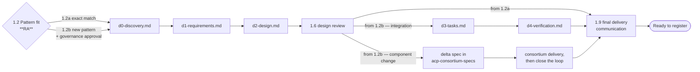

# Artefact model

| Artefact | Produced in | Author | Contents |
|----------|-------------|--------|----------|
| Entry prerequisite verification record | Before 1.1 | ACP | Presence of the completed GbyD GenAI Risk Triage Form and ready MRM MBCT ID, verification date, verifier, and result |
| Pattern-fit finding + approval request/status reference | 1.2 and 1.7 | RA | Catalogues and applicable shapes considered, selected shape(s), fit evidence and open criteria; exact match or new pattern required; where new, the applicable governance approval is initiated before specification starts and confirmed before 1.8 |
| `d0-discovery.md` | 1.3 | ACP | Business objectives, capability requirements, architecture considerations, gap assessment |
| `d1-requirements.md` | 1.4 | ACP | Functional + non-functional requirements, user stories, acceptance criteria, governance requirements |
| `d2-design.md` | 1.5 | ACP | Solution architecture, ACP pattern selection, integration design, security & governance controls, deployment approach, open questions |
| `d3-tasks.md` | 1.8a, integration track only | ACP | Epics, user stories, implementation tasks, dependencies, delivery plan |
| `d4-verification.md` | 1.8a, integration track only | ACP | Test results, validation evidence, architecture verification, deployment verification |
| Sun Life Jira issue and delta spec in `acp-consortium-specs` | 1.8b, component-change track only | ACP | The EACPP record linked to the onboarding epic, plus what Luminate does today, what is missing, what should change, and what the Sun Life MVP already proved |
| Consortium delivery and ACP close-the-loop record | 1.8b, component-change track only | Consortium delivers; ACP records closure | Consortium ticket reference, upstream delivery, ACP re-verification, affected capability-map update, and closure of the Sun Life ticket |
| Closing communication | 1.9 | ACP | The outcome, what was delivered, and confirmation the use case is ready to register |

The consortium rows are the ones most often missed. On the **component-change** track ACP does not
write `d3-tasks.md` or `d4-verification.md` — it registers the ask on the Sun Life board, writes the
delta spec, and records the close-the-loop work after consortium delivery (DD-4).

**An exact-match engagement produces `d0` to `d2` and nothing further** — no `d3-tasks.md`, no
`d4-verification.md`, no delta spec. There is no pattern to build, so the specification artefacts
and the closing communication are the whole output.

This is the **same D0→D4 gate model**, with the same filenames, that the ACP Product Team uses for
its own component specs — see DD-2. A large D2 may be split into a `d2-design/` directory and
assembled with `scripts/assemble_d2_design.py`, exactly as this spec is.

## Where the engagement's artefacts live

Each engagement gets its own `spec_type: onboarding` directory under `specs/`, with a `spec.yaml`
and a Jira epic (FR-11). That is what puts it in `specs/README.md` and the O7 report. The journey
you are reading is the template; `aims-acp-integration`, `orcc-acp-integration`,
`mdx-acp-integration` and `waldo-acp-integration` are instances of it.
