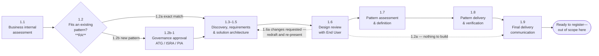

# ACP Customer Journey, Phase 1 — D2: Design

> **Gate**: D2 — Design | **Status**: Draft | **Epic**: [EACPP-1134](https://sunlife.atlassian.net/browse/EACPP-1134)
> Source of truth for the flow: `customer-journey.mmd`.

## What this design is

The **interaction model for ACP intake** — who is involved at each step, what each party is
accountable for, what artefact each step produces, and where the flow branches. It answers the
two questions set out in D0.

**Scope: Phase 1 only**, steps 1.1 to 1.9. The journey ends when a use case is specified, its
pattern ruled on, any new pattern built and verified, and the outcome communicated — the point at
which it is ready to register an agent. Registration, runtime and governance need their own spec
(D0 OQ-2).

This is a process design. There is no API surface, no data schema and no deployment. The
"components" are teams and artefacts; the "interfaces" are hand-offs.

## Actors

| Code | Actor | Role in Phase 1 |
|------|-------|-----------------|
| EU | End User (business group / use-case owner) | Owns the business case; presents it and confirms capability requirements |
| ACP | ACP Product Team | Facilitates discovery, authors D0–D2, drives the journey, communicates the outcome |
| ACP EA | ACP Enterprise Architect | Defines and approves a new pattern; names the delivery owner |
| CT | Consortium Team | Alternate delivery owner for new platform patterns (Luminate-side change) |
| RA | Regional (BG) Architect | Business-internal assessment; **screens the applicable pattern shapes and rules fit (1.2)**; obtains governance approval where a new pattern is needed |
| DA | Domain Architects | Domain architecture guidance; supports new-pattern definition |

Six actors, not seven. The Forward Deployed Engineering Team was removed from Phase 1 in D2 review
— see DD-9.

### RA and DA are dedicated, not pooled

RA and DA are not a shared pool that any engagement draws from at random — each covers a fixed set
of regions or domains, and an engagement is routed to whichever one owns the ground it touches.

| RA region |
|---|
| CAN |
| US |
| ASIA |
| SLF |
| CORP |
| DBTS |

| DA domain |
|---|
| Security / Incident |
| Integration |
| Cloud / Container |
| Observability |

A use case may need more than one DA if its design touches more than one domain — an agent that
calls a new external system, runs in a new container platform and needs new monitoring engages
Integration, Cloud / Container and Observability. Which named individual holds a given region or
domain is a Backstage-group lookup, not something this spec hard-codes (D0 R-8).

These are **engagement roles, not Luminate portal roles**. The portal's personas — Builder, Project
Owner, Platform Administrator, Viewer — are a separate vocabulary defined in `luminate-user-guides`,
and a use-case owner will hold one of those *after* Phase 1, not during it.

GbyD and MRM sit outside these six. They supply the entry prerequisites ACP checks before 1.1 —
presence only, never approval (DD-19) — and neither their risk triage nor their model-risk assessment
is an ACP step. Ongoing model-risk governance is out of scope, and the `governance-intake` risk
triage is a future ACP capability rather than a step in this journey (DD-10).

## Design overview

At **1.2**, the RA screens the applicable shapes in `integration-patterns` and, for agent solutions,
the complete applicable set in [`agent-patterns`](../../../pattern/agent-patterns/d2-design.md). The RA records
the selected shape(s) and any open SUB-E/SUB-I criteria; an open or unexercised criterion alone is
not a refusal or a new-pattern finding, and the use case need not fit every shape. The fork decides
whether the engagement runs the short path
(specify, review, communicate) or the long one (specify, review, define the pattern, build it,
communicate). Everything between 1.3 and 1.6 is identical on both.

### Step intent

| Step | Intent | Primary driver | Exit artefact |
|------|--------|----------------|---------------|
| 1.1 | Business-internal architecture assessment | RA | Regional guidance |
| 1.2 | **Screen applicable catalogue shapes and rule fit**; where none fits, initiate governance approval before specification starts and confirm it before 1.8 | **RA** | Pattern-fit finding with shapes considered, selected shape(s), evidence and open criteria (1.2a / 1.2b) + approval request/status reference |
| 1.3 | Qualify the use case against the capability map | ACP | `d0-discovery.md` |
| 1.4 | Capture requirements | ACP | `d1-requirements.md` |
| 1.5 | Design the solution | ACP | `d2-design.md` |
| 1.6 | Review the solution design with the End User | ACP + EU | Confirmed `d2-design.md` |
| 1.7 | Define the new pattern and name its delivery owner (reached only from 1.2b) | ACP EA | Pattern definition + named delivery owner |
| 1.8 | Deliver the new pattern — ACP builds an integration, or the consortium takes a component change (reached only from 1.7) | ACP **or** CT | `d3-tasks.md` + `d4-verification.md`, or a delta spec and the close-the-loop record |
| 1.9 | Communicate final delivery and readiness to every party | ACP | Closing communication |

The engagement's own artefacts use the **same filenames as every other spec in this repo** —
`d0-discovery.md` through `d4-verification.md`. See DD-2.
