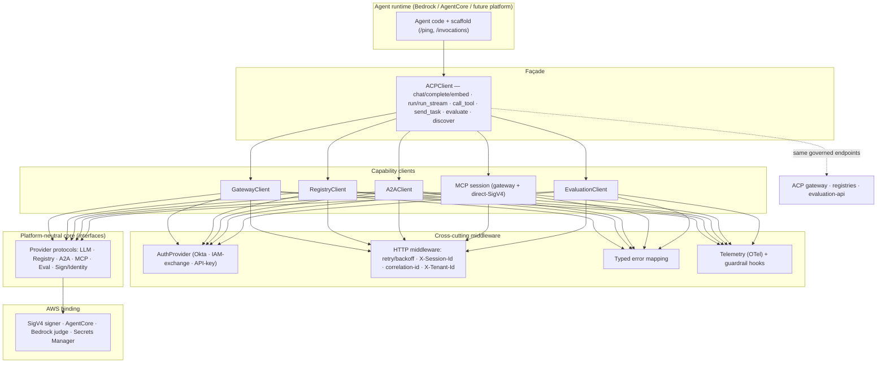
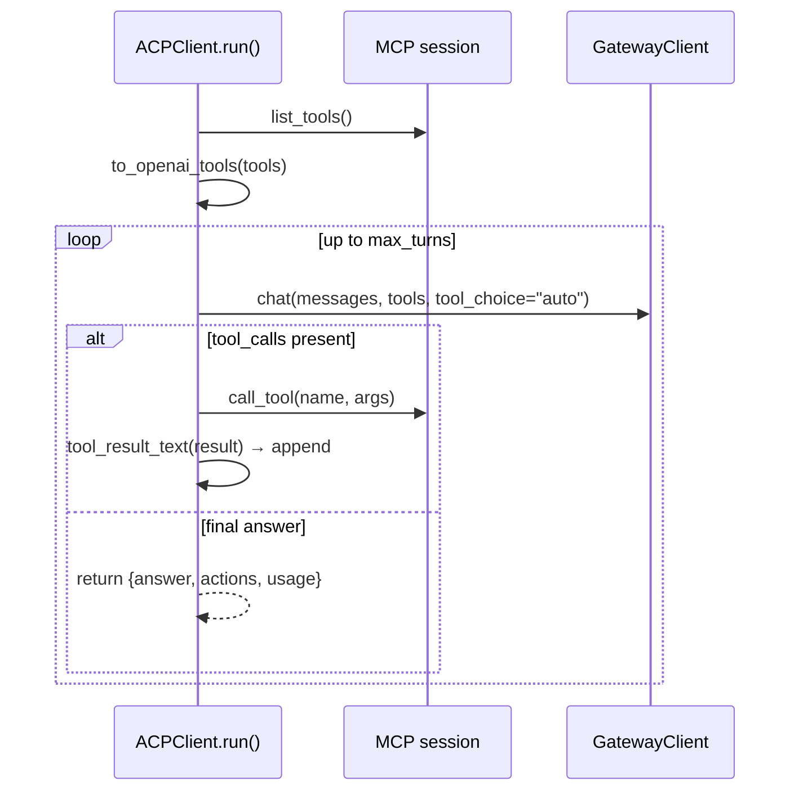
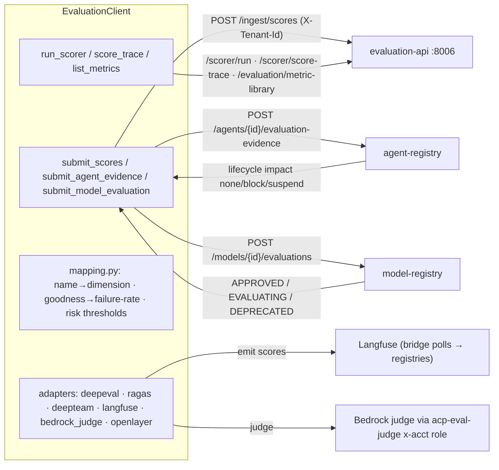

# ACP AWS Harness SDK — D2: Design

> **Gate**: D2 — Design | **Status**: Draft | **Epic**: [EACPP-791](https://sunlife.atlassian.net/browse/EACPP-791)
> **Depends on**: [D1 Requirements](d1-requirements.md) · Related: [EACPP-707](https://sunlife.atlassian.net/browse/EACPP-707) (Luminate integration), [EACPP-211](https://sunlife.atlassian.net/browse/EACPP-211) (AI Gateway)

## Scope

This design turns the [D1 roadmap requirements](d1-requirements.md#roadmap-requirements-future-deliveries--v080)
into an implementable architecture for the `acp-harness-sdk` **beyond v0.7.0**. It covers six
capability tracks — **G**ergonomics/agentic, **A**uth, **E**valuation, **O**bservability, multi-**P**latform,
and **S**treaming — layered on top of the shipped v0.7.0 clients without breaking them.

**Design invariant (from D1 NFR-7):** the SDK is a *convenience and standardization* layer, never a
bypass. All policy, routing, guardrail, rate-limit, token-exchange, and evaluation-governance authority
remains **server-side** in the ACP gateway, registries, and evaluation service. Every capability below
either (a) calls an existing governed endpoint, or (b) runs client-side computation whose result is
still submitted to a governed endpoint for the authoritative decision.

### In scope

- Layered SDK architecture: transport middleware, typed errors, unified `ACPClient` façade
- Evaluation subsystem (`EvaluationClient` + evaluator adapters + engine protocol reuse)
- Observability (OTel) and client-side guardrail hooks
- Platform-neutral core split + AWS binding (the abstraction that makes Luminate/EACPP-707 clean)
- SSE streaming design (production-ready against the existing AgentGateway; WebSocket deferred to future phase)
- Auth provider extensions (IAM token-exchange, API-key, tenant propagation)
- Agentic runtime pull-ups from `acp-agentcore-sample` (loop, MCP↔OpenAI adapters, scaffold, deploy helper)

### Out of scope

- Server-side implementation of any governed endpoint (owned by gateway / registries / evaluation-api)
- The Luminate-specific bindings themselves (owned by [EACPP-707](https://sunlife.atlassian.net/browse/EACPP-707); this spec provides the abstraction they plug into)
- Production WS-listener implementation in the gateway (owned by the AI Gateway epic EACPP-211 — required only for the deferred WebSocket phase, not for Track S SSE streaming)

---

## Current-State Cross-Reference

> Based on a code audit of `acp-harness-sdk` v0.7.0 and `acp-agentcore-sample` as of 2026-07-24.

| Capability | Current state (v0.7.0) | D3 action |
|------------|------------------------|-----------|
| Config (`ACPSettings`) | ✅ env-driven, dev-EKS defaults | Extend with tenant, telemetry, eval URLs (T8, T11, T16) |
| LLM egress (`GatewayClient`) | ✅ `chat`/`complete`/`list_models` + attribution header | Wrap in façade + middleware; add SSE streaming (T3, T21); add `embed()` (T28) |
| **Embeddings** (`GatewayClient.embed()`) | ❌ none | New `embed()` method + `EmbeddingResult` (T28) |
| Registration (`RegistryClient`) | ✅ self-register, register/bind, list | Add discovery + tenant (T19, T8) |
| Auth (`OktaAuthProvider`) | ✅ Okta client-credentials + Secrets Manager | Add IAM-exchange + API-key providers (T9, T10) |
| A2A (`A2AClient`) | ✅ `invoke_runtime` (SigV4) + `invoke_gateway` | Add SSE task streaming (T22) |
| MCP egress (`gateway_mcp_session`) | ✅ gateway path | Add direct-SigV4 client (T5); MCP SSE already handled by `mcp` lib |
| Agentic loop | ❌ hand-rolled in sample (`run_governed_turn`) | Absorb into SDK (T4) |
| MCP↔OpenAI adapters | ❌ hand-rolled in sample | Absorb (T4) |
| AgentCore HTTP scaffold + deploy | ❌ hand-rolled in sample | Absorb (T6) |
| Typed errors | ❌ raw `httpx.raise_for_status()` | New hierarchy (T1) |
| Retry / session / correlation | ⚠️ only single 401 refresh in registry | New middleware (T2) |
| Unified façade | ❌ five separate clients | `ACPClient` (T3) |
| **Evaluation** | ❌ none (removed from sample) | New `EvaluationClient` + adapters (T11–T15) |
| **Observability (OTel)** | ❌ docs-only | Telemetry middleware (T16) |
| **Guardrail hooks** | ❌ none | Pre-flight hooks (T17) |
| **Platform abstraction** | ❌ AWS-only | Core split + AWS binding (T18) |
| Version hygiene | ⚠️ `version.py` 0.3.2 vs CHANGELOG 0.7.0 | Fix + release automation (T7) |

---

## Layered Architecture



**Package shape (target).** Keep the minimal-footprint NFR: heavy deps stay behind extras.

```
acp_harness_sdk/
  __init__.py            # public surface (adds ACPClient, EvaluationClient, errors, adapters)
  config.py              # ACPSettings (+ tenant_id, telemetry, evaluation_url)
  client.py              # ACPClient façade
  errors.py              # ACPError hierarchy (NEW)
  _http.py               # retry/backoff + session + correlation middleware (NEW)
  gateway.py             # GatewayClient (+ stream()/stream_sync() SSE — Track S, + embed() — T28)
  registry.py            # RegistryClient (+ discover_* — Track P)
  a2a.py                 # A2AClient (+ send_task_stream() SSE — Track S)
  mcp_gateway.py         # gateway MCP session (SSE via mcp library — no change for Track S)
  mcp_direct.py          # direct-SigV4 MCP client (NEW, pull-up)
  agentic.py             # run()/run_stream() + to_openai_tools/tool_result_text (NEW, pull-up)
  runtime.py             # AgentCore /ping+/invocations scaffold + deploy helper (NEW, pull-up)
  telemetry.py           # OTel middleware + guardrail hooks (NEW; [otel] extra)
  auth/
    __init__.py          # AuthProvider protocol
    okta.py              # OktaAuthProvider (existing)
    iam.py               # IamTokenExchangeProvider (NEW)
    apikey.py            # ApiKeyAuthProvider (NEW)
  evaluation/
    client.py            # EvaluationClient (NEW)
    adapters/            # deepeval, ragas, deepteam, langfuse, bedrock_judge, openlayer
    mapping.py           # score-name→dimension + polarity + risk thresholds (mirror server 1.1.0)
  core/
    protocols.py         # platform-neutral provider protocols (NEW, Track P)
    aws.py               # AWS binding (SigV4/AgentCore/Bedrock) (NEW, Track P)
```

---

## Track G — Ergonomics & Agentic Runtime

### G1 Typed error hierarchy (T1)

A single root with governance-meaningful subclasses, mapped from HTTP status + gateway close frames.
Mirrors the server exception codes so callers can branch on outcome, not transport.

```python
class ACPError(Exception):
    error_code: str            # e.g. "ACP-2004"
    correlation_id: str | None
    reason: str | None

class ValidationError(ACPError): ...          # 422
class AuthenticationError(ACPError): ...       # 401
class PolicyDeniedError(ACPError): ...         # 403 policy
class GuardrailBlockedError(ACPError): ...     # 403/close-frame guardrail
class RateLimitedError(ACPError): ...          # 429 (+ retry_after)
class KillSwitchActiveError(ACPError): ...     # 423
class AdapterError(ACPError): ...              # 5xx upstream
class StreamDisconnectedError(ACPError): ...   # WS drop (Track S)
```

Mapping table lives in `errors.py`; each client's response handler calls `raise_for_acp(resp)` instead
of `resp.raise_for_status()`. The `error_code`/`reason`/correlation id are read from the ACP error body
(`{error_code, message, correlation_id}`) when present, else synthesized from status.

### G2 Transport middleware (T2)

An `httpx` event-hook / transport wrapper shared by all clients:
- **Retry/backoff** on `429`/`503` honouring `Retry-After` (bounded exponential, jittered, cap N).
- **Idempotency**: only retry idempotent verbs; POSTs retried only when an `Idempotency-Key`/`run_id` is present.
- **`X-Session-Id`**: stable per-`ACPClient` session; **correlation id** per call (propagated to telemetry).
- Composes with the single existing 401-refresh (which moves from `registry.py` into the middleware).

### G3 Unified `ACPClient` façade (T3)

Composes the capability clients behind one object sharing settings, auth, middleware, and telemetry.
Pure delegation — no independent policy. Methods: `chat/complete`, `embed`, `run/run_stream`,
`call_tool`, `send_task` (A2A), `evaluate`, `discover_*`, `list_models`, `register`/`self_register`.

### G4 Governed agentic loop + MCP↔OpenAI adapters (T4)

Absorb `run_governed_turn` from the sample as `ACPClient.run()` / `run_stream()`:



`to_openai_tools()` and `tool_result_text()` become supported SDK helpers. Turn cap + usage accounting
preserved. `run_stream()` yields incremental events (aligns with Track S `ChatChunk`).

### G5 Direct-SigV4 MCP client (T5)

Package the sample's `mcp_session` + `_SigV4HttpxAuth` + `runtime_endpoint` as a supported
`mcp_direct_session(...)` at parity with `gateway_mcp_session` — for runtimes that must reach the
AgentCore MCP runtime directly. Same attribution + URL-injection guards.

### G6 AgentCore scaffold + deploy helper (T6)

- `runtime.create_agentcore_app(handler)` → Starlette app exposing `GET /ping` + `POST /invocations` on `:8080`.
- `runtime.deploy(...)` → ECR ARM64 build/push (scan-on-push) + `create/update_agent_runtime` (VPC network mode), env-driven. Behind `[aws]` extra.

### G7 Version hygiene (T7)

Make `version.py` the single source of truth wired to the release tag; fix the 0.3.2↔0.7.0 skew; add a CI check that fails when `version.py`, CHANGELOG top entry, and the git tag diverge.

### G8 Embeddings support (T28)

Add `GatewayClient.embed()` so any caller (agent, Lambda, BFF, or client application) can generate
text embeddings through the governed gateway using models like Amazon Titan Embed.

```python
class EmbeddingResult:
    embeddings: list[list[float]]   # one vector per input string
    model: str
    usage: dict                     # {prompt_tokens, total_tokens}
    raw: dict                       # full OpenAI-shaped response

class GatewayClient:
    def embed(self, input: str | list[str], *, model: str | None = None,
              extra_body: dict | None = None) -> EmbeddingResult: ...
```

Implementation reuses `_post()` (same HTTP client, auth headers, attribution, typed error mapping)
targeting `POST {gateway_llm_url}/v1/embeddings`. The `/v1/embeddings` path shares the same LLM
listener, authentication, authorization, guardrails, and attribution as `/v1/chat/completions` — no
gateway change or additional configuration is needed. Verified working against the existing
AgentGateway with `anthropic.claude-3-haiku` replaced by `amazon.titan-embed-text-v2:0` on the
Luminate dev gateway (`POST /llm/v1/embeddings`).

`ACPSettings` gains `embedding_model: str | None` (env `ACP_EMBEDDING_MODEL_ID`, no default). If
neither `model=` argument nor `embedding_model` setting is provided, `embed()` raises `ValueError`
before the network call — unlike chat completions, there is no safe default for an embedding model.

---

## Track A — Authentication

> **Amendment (6 October 2026, Luminate audit).** Luminate reads no `X-Tenant-Id`; tenancy comes from
> the credential. T8 is re-scoped to send `x-luminate-session-id` (the SDK's `x-session-id` is ignored)
> and `traceparent`. `IamTokenExchangeProvider` (T9) is blocked: Luminate has no AWS IAM exchange (PA-2).
> `ApiKeyAuthProvider` (T10) shipped. New: user-delegated `DelegatedTokenProvider` (T30). See
> [D3 audit](d3-tasks.md#luminate-applicability-audit-2026-10-06).

`AuthProvider` becomes a protocol (`get_token()` / header contribution). Providers:

| Provider | Mechanism | Notes |
|----------|-----------|-------|
| `OktaAuthProvider` (existing) | `client_secret_post` client-credentials | unchanged |
| `IamTokenExchangeProvider` (T9) | AWS SigV4 identity → ACP token (RFC 8693 style) via gateway exchange endpoint | for workloads with an execution role; no secret to manage |
| `ApiKeyAuthProvider` (T10) | static API key header per ACP contract | simplest onboarding |

`X-Tenant-Id` (T8) is resolved from settings/JWT and injected by the middleware on **every** governed
call (registries, eval ingest, telemetry) — required by the eval ingest path.

---

## Track E — Evaluation Integration

> **Amendment (6 October 2026, Luminate audit).** The endpoints below (`evaluation-api :8006`,
> `/ingest/scores`, registry evidence routes, `/scorer/*`, `/metric-library`) are internal ACP and do
> not exist on Luminate. On Luminate: write evidence with `POST /api/v1/governance/evidence/`, read
> metric bars from `GET /api/v1/governance/resources/{type}/{id}/evaluation/`, and read the outcome
> from `…/resources/{type}/{id}/` and `/verdict/`. The scorer runs locally. Judge calls go through the
> Luminate gateway, not the `acp-eval-judge` role. Openlayer is dropped. Machine auth for these
> endpoints is a platform ask (PA-1). The design below is kept for history; T11–T15 and T24–T26 follow
> the [D3 audit](d3-tasks.md#luminate-applicability-audit-2026-10-06).

> The SDK does **not** own evaluation truth. The registries own the canonical record; `evaluation-api`
> (port 8006) is the producer/bridge. The SDK gives agent runtimes a typed, multi-framework way to
> *submit* and *run* evaluations against those governed contracts, and surfaces the resulting
> governance outcome (it never enacts demotion/suspend itself).

### Component design



### Interfaces (T11–T13)

```python
class EvaluationClient:
    def submit_scores(self, scores: list[Score], *, risk_tier="MEDIUM",
                      tenant_id=None) -> IngestResult          # POST /ingest/scores
    def submit_agent_evidence(self, agent_id, *, suite, scores,
                              evidence_url=None, run_id=None) -> AgentGovernanceOutcome
    def submit_model_evaluation(self, model_id, *, evaluator,
                                quality_score, safety_score, latency_score,
                                cost_score, overall_score, threshold=0.7) -> ModelGovernanceOutcome
    def run_scorer(self, *, target_type, target_id, trace_id,
                   metrics, risk_tier="MEDIUM") -> ScorerRunResult   # POST /scorer/run
    def score_trace(self, trace_id, *, target_type, target_id) -> ScorerRunResult
    def list_metrics(self) -> list[MetricInfo]                 # GET /evaluation/metric-library
```

- `mapping.py` mirrors the server's schema `1.1.0`: `MODEL_SCORE_MAP` / `AGENT_SCORE_MAP`, risk-tier
  thresholds (`CRITICAL 0.85 … LOW 0.60`), and the **goodness→failure-rate** polarity conversion
  (`1 - g`, clamped) so safety gates cannot invert. Unmapped names are surfaced, never fail the batch.
- `EvalContext` (`production_monitoring | focused_evaluation | ab_experiment | regression_test`) and
  idempotent `run_id`/trace-id are first-class (T13).
- **Governance outcome surfacing** (T12): responses parse the registry's resulting lifecycle impact
  (agent `none|block|suspend`; model `APPROVED|EVALUATING|DEPRECATED`) and return it to the caller.

### Framework adapters (T14 OSS, T15 managed)

Reuse the acp-core `EvaluationEngine` protocol (`run` + `parse_webhook`, `EvaluationRequest/Result/Score`).

| Adapter | Track | Integration |
|---------|-------|-------------|
| `deepeval` | E-OSS | map DeepEval metric results → ACP scores; `[deepeval]` extra |
| `ragas` | E-OSS | RAG triad; `[ragas]` extra |
| `deepteam` | E-OSS | red-team (offline batch) → safety metrics (`prompt_injection`, `jailbreak`, `pii_leakage`, `toxicity`, `bias`) |
| `langfuse` | E-managed | `create_score(trace_id, name, value, comment)` + `model:`/`agent:`/`tenant:` metadata convention; bridge forwards |
| `bedrock_judge` | E-managed | LLM-as-judge via cross-account `acp-eval-judge` role (ExternalId, `{"score","reason"}`), **already provisioned** by acp-aws-service-catalog |
| `openlayer` | E-managed | forward results via `/ingest/scores` (server HMAC webhook remains authoritative for SaaS push) |

Missing extras raise a clear `RuntimeError` naming the exact extra.

---

## Track O — Observability & Guardrails

> **Amendment (6 October 2026, Luminate audit).** There is no `/telemetry/ingest` on Luminate. The
> gateway exports traces to Langfuse and extracts the caller's W3C `traceparent`, so T16 injects
> `traceparent` and exports client spans to the team's own collector. Luminate guardrails block with
> **422** `guardrail_violation` and fail closed with **503** `guardrail_unavailable`, not 403. T17 maps
> both to `GuardrailBlockedError`. See [D3 audit](d3-tasks.md#luminate-applicability-audit-2026-10-06).

- **OTel middleware (T16):** every governed call opens a span (`agent_id`, correlation id, session id,
  endpoint, outcome) and records latency/usage metrics; OTLP export targets the ACP `/telemetry/ingest`
  plane. Behind an `[otel]` extra — no hard OTel dependency in the core; off by default, sampling configurable.
- **Guardrail pre-flight hooks (T17):** optional input/output callables run around egress (parallel-friendly,
  matching the OpenAI/Anthropic "screen in parallel" pattern). A tripwire raises `GuardrailBlockedError`
  *before* the call; a gateway guardrail close-frame/`403` raises the **same** typed error with reason +
  correlation id. The gateway remains the authority — client hooks are fail-fast convenience only.

---

## Track P — Multi-Platform Abstraction

> **Amendment (6 October 2026, Luminate audit).** EACPP-707 shipped the Luminate binding in v0.11.0
> (`ACP_TARGET=luminate`), so T18 now makes Luminate the default and deprecates `internal`. It does not
> build a new abstraction layer. Discovery (T19) uses the Luminate catalog and MCP `tools/list`, because
> `GET /llm/v1/models` is not filtered to the caller (EACPP-1136, PA-3). See
> [D3 audit](d3-tasks.md#luminate-applicability-audit-2026-10-06).

The `core/protocols.py` layer expresses LLM egress, registration, MCP, A2A, evaluation, telemetry, and
signing/identity as **provider-agnostic interfaces**; `core/aws.py` is the AWS binding (SigV4, AgentCore,
Bedrock judge, Secrets Manager). The consumer-facing façade is unchanged regardless of binding
(Liskov-substitutable providers).

> **Relationship to Luminate (EACPP-707).** EACPP-707 currently adds Luminate support ad-hoc via a
> `target=luminate` enum + `LuminateAuthProvider` + repointed Gateway/Registry clients. This track
> provides the **clean seam** those bindings should plug into: once the provider protocols land (T18),
> the Luminate work becomes "add a `luminate` binding" rather than branching each client. T18 therefore
> **relates to / enables** EACPP-707 and is coordinated with the Consortium Engineering board — it does
> **not** duplicate the 9 Luminate tasks (EACPP-708…716).

- **Discovery (T19):** `discover_tools()/discover_models()/discover_agents()` over the governed registry/
  gateway reads (clearance-filtered server-side).
- **Framework adapters (T20):** `ACPToolProvider` (Strands), `ACPChatModel` / `ACPToolkit` (LangChain/
  LangGraph) so ACP-governed LLM + tools drop into those frameworks with attribution intact.

---

## Track S — Streaming (SSE — production-ready today)

> **Amendment (6 October 2026, Luminate audit).** On Luminate the A2A route is `/a2a/{endpoint_name}`
> on the gateway, and it needs a bearer credential. Today `A2AClient.invoke_gateway` sends neither, so
> T22 depends on the new T29. See [D3 audit](d3-tasks.md#luminate-applicability-audit-2026-10-06).

> **Amendment (September 2026).** The EACPP-812 implementation review (PR #5) found that no gateway
> endpoint implements the bespoke WebSocket frame protocol the SDK targeted, and that the upstream
> Realtime (WebSocket) route type does not support prompt guards, prompt enrichment, or request-body
> rate limiting — a governance regression. Bidirectional WebSocket streaming is deferred to a future
> phase; SSE is the v0.8.0 transport. See D1 *Planned — Streaming* for the full rationale.

SSE streaming across LLM and A2A as specified in D1 US-14→18 / FR-7. The existing gateway is
**AgentGateway OSS (Rust)**, which already serves `POST /v1/chat/completions` with `stream=true` over
HTTP/SSE with **full policy enforcement** (prompt guards, JWT auth, rate limiting). No gateway change
is required — T21/T22 can be built and tested against the current gateway today.

| Path | SDK method | Wire | Governance |
|------|-----------|------|------------|
| LLM | `GatewayClient.stream()` / `stream_sync()` | `POST /v1/chat/completions` `stream=true` → SSE `chat.completion.chunk` | Full — prompt guards, rate limiting, guardrails |
| A2A | `A2AClient.send_task_stream()` | A2A `message/stream` → SSE | Full — attribution header, JWT auth |
| MCP | `gateway_mcp_session()` (existing) | MCP Streamable HTTP (SSE internally) | Full — no change from v0.7.0 |

Design choices:
- **Sync + async** — SSE works over standard HTTP; both `httpx.AsyncClient` and `httpx.Client` are
  supported. No new client dependency (`websockets`) is needed; the `[ws]` extra is dropped.
- **Auth on every request** — bearer token and attribution header are standard HTTP headers on each
  streaming request. No handshake-only auth limitation.
- **Tool-call continuation** — each turn is a separate HTTP `stream()` request with tool results
  appended to messages. No persistent connection to manage.
- **Typed errors** — `StreamDisconnectedError` on connection drop; `GuardrailBlockedError` /
  `PolicyDeniedError` / `RateLimitedError` on non-2xx or mid-stream error events.
- **Deterministic cleanup** — HTTP responses close on context-manager exit or `response.close()`.

**Deferred: bidirectional WebSocket.** The original WS design (duplex LLM session, A2A channel,
MCP-over-WS) is preserved in version control and gated on: (1) a concrete bidirectional use case,
(2) a dedicated WS protocol D1/D2 spec, (3) a governance exception sign-off, and (4) gateway WS
listener deployment (EACPP-211). If a consuming app needs a WebSocket toward its own clients, the
recommended pattern is to terminate the socket at the app/BFF edge and relay SSE deltas onto it.

---

## Service Catalog Alignment

> **Amendment (6 October 2026, Luminate audit).** T23 is recommended for cancellation. A governed
> judge sends its LLM calls through the Luminate gateway, so a workload does not need `acp-eval-judge`
> to call Bedrock directly.

The consumer-account roles the harness's governed paths rely on — `acp-gateway-xaccount`,
`acp-eval-judge` (Bedrock LLM-as-judge, ExternalId `acp-eval-judge-t1k-dev`), `acp-agent-discovery`,
`acp-bedrock-agent-exec` — are **already deployed** by
[`acp-aws-service-catalog`](https://bitbucket.sunlifecorp.com/projects/T1KACP/repos/acp-aws-service-catalog/browse)
(`templates/acp-cross-account-roles.yaml`). No new catalog role is required for the roadmap. **T23** is a
**verification** task: confirm the `acp-eval-judge` role's trust/permissions are sufficient if an agent
runtime runs OSS evaluators *in-workload* that call Bedrock-as-judge directly (vs. server-side eval-api);
extend the template only if a gap is found.

---

## Cross-Cutting NFRs (carried from D1)

- Minimal core deps (`httpx`, `pydantic`, `pydantic-settings`); everything heavy behind extras
  (`aws`, `mcp`, `otel`, `deepeval`, `ragas`, `deepteam`, `langfuse`). No `[ws]` extra needed —
  SSE streaming uses `httpx` natively.
- `py.typed`, mypy-clean, ruff-clean, ~100% unit coverage (httpx `MockTransport`).
- No secrets/tokens in logs or exceptions. TLS verify default-on. Context-manager resource hygiene.
- Governance server-side; SDK adds no bypass.

---

## Traceability

| D1 requirement | Design section | D3 task |
|----------------|----------------|---------|
| FR-19 façade | Track G / G3 | T3 |
| FR-20 typed errors | Track G / G1 | T1 |
| FR-21 retry+session+corr | Track G / G2 | T2 |
| FR-22 agentic loop + adapters + direct MCP | Track G / G4, G5 | T4, T5 |
| FR-23 scaffold + deploy | Track G / G6 | T6 |
| FR-24 IAM-exchange + API-key | Track A | T9, T10 |
| (tenant) | Track A | T8 |
| FR-8/9/13 submit/evidence/context | Track E interfaces | T11, T12, T13 |
| FR-10 scorer + catalog | Track E interfaces | T13 |
| FR-11 OSS adapters | Track E adapters | T14 |
| FR-12 managed evaluators | Track E adapters | T15 |
| FR-14 OTel | Track O | T16 |
| FR-15 guardrail hooks | Track O | T17 |
| FR-16 platform-neutral core | Track P | T18 |
| FR-17 discovery | Track P | T19 |
| FR-18 framework adapters | Track P | T20 |
| FR-7 streaming | Track S | T21, T22 |
| (catalog verify) | Service Catalog Alignment | T23 |
| (version hygiene) | Track G / G7 | T7 |
| US-4A / FR-1 embeddings | Track G / G8 | T28 |

---

## References

- [D1 Requirements](d1-requirements.md) · [D0 Discovery](d0-discovery.md)
- Source repo: [`acp-harness-sdk`](https://bitbucket.sunlifecorp.com/projects/EDAEACP/repos/acp-harness-sdk/browse) (v0.7.0)
- Sample: [`acp-agentcore-sample`](https://bitbucket.sunlifecorp.com/projects/T1KACP/repos/acp-agentcore-sample/browse)
- Evaluation service: [`acp-evaluation`](https://bitbucket.sunlifecorp.com/projects/T1KACP/repos/acp-evaluation/browse) (v0.16.0)
- Luminate integration: [aws-harness-integration spec](../../integration/aws-harness-integration/d0-discovery.md) · [EACPP-707](https://sunlife.atlassian.net/browse/EACPP-707)
- Service catalog: [`acp-aws-service-catalog`](https://bitbucket.sunlifecorp.com/projects/T1KACP/repos/acp-aws-service-catalog/browse)
