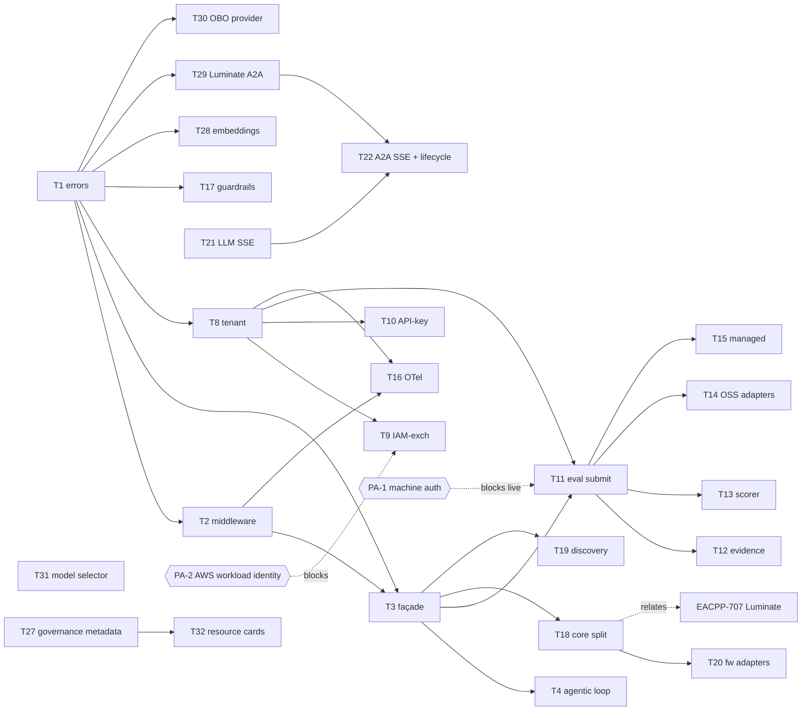

# ACP AWS Harness SDK — D3: Implementation Plan

> **Gate**: D3 — Tasks | **Status**: Draft | **Epic**: [EACPP-791](https://sunlife.atlassian.net/browse/EACPP-791)
> **Board**: EACPP Product Team Epic Board (label `acp-product-team`) · **D2**: [d2-design.md](d2-design.md) · **D1**: [d1-requirements.md](d1-requirements.md)

> **Luminate applicability audit, 6 October 2026.** We re-checked every open task against Luminate
> `origin/main` `777706119`, the SLF dev install (`sha-093285b`) and SDK `v0.16.0` (`d84337c`).
> Twelve tasks were re-scoped because the endpoints they named belong to the retired internal ACP
> (`/ingest/scores`, `/telemetry/ingest`, `X-Tenant-Id`, the `acp-eval-judge` direct path). Four new
> tasks (T29–T32) cover Luminate capabilities the plan did not have. Every task now has to ship an
> `acp-samples` example. See [Luminate Applicability Audit](#luminate-applicability-audit-2026-10-06).

## Scope

This plan turns the [D2 design](d2-design.md) into sprint-ready work for the `acp-harness-sdk`
enhancement roadmap (beyond v0.7.0). It delivers six capability tracks — Ergonomics/Agentic (**G**),
Auth (**A**), Evaluation (**E**), Observability (**O**), Multi-Platform (**P**), Streaming (**S**) —
plus a service-catalog verification. Governance stays **server-side** throughout.

### In scope

- SDK ergonomics: typed errors, retry/session/correlation middleware, unified `ACPClient` façade, version hygiene
- Agentic runtime pull-ups from `acp-agentcore-sample`: governed loop, MCP↔OpenAI adapters, direct-SigV4 MCP, AgentCore scaffold + deploy helper
- Auth extensions: IAM token-exchange, API-key, tenant propagation
- Evaluation integration: ingest/evidence/scorer clients + DeepEval/RAGAS/DeepTeam/Langfuse/Bedrock-judge/Openlayer adapters
- Observability (OTel) + client-side guardrail hooks
- Platform-neutral core + AWS binding (the seam Luminate/EACPP-707 plugs into) + discovery + framework adapters
- SSE streaming across LLM and A2A paths (production-ready against the existing AgentGateway; bidirectional WebSocket deferred to future phase)

### Out of scope

- Server-side implementation of governed endpoints. Luminate owns the gateway, catalog and governance APIs. Gaps on that side are raised as consortium asks; see [Platform asks](#platform-asks-not-sdk-work).
- ~~The Luminate-specific bindings (owned by [EACPP-707](https://sunlife.atlassian.net/browse/EACPP-707))~~. SDK v0.11.0 shipped the Luminate target (`ACP_TARGET=luminate`), so Luminate behaviour is now in scope for every task.
- Bidirectional WebSocket streaming (deferred to a future phase pending a concrete use case,
  a dedicated WS protocol spec, and a governance exception sign-off — see D1
  *Deferred — Bidirectional WebSocket Streaming*)

---

## Implementation Status Cross-Reference

> Based on a code audit of `acp-harness-sdk` v0.7.0 + `acp-agentcore-sample` as of 2026-07-24.
> **Historical.** The current state is in the [Luminate Applicability Audit](#luminate-applicability-audit-2026-10-06).

| D2 capability | Current state | D3 action |
|---------------|---------------|-----------|
| Typed errors | ❌ raw `raise_for_status()` | T1 |
| Retry / session / correlation | ⚠️ single 401 refresh only | T2 |
| Unified façade | ❌ five separate clients | T3 |
| Agentic loop + MCP↔OpenAI adapters | ❌ hand-rolled in sample | T4 |
| Direct-SigV4 MCP client | ❌ only gateway path in SDK | T5 |
| AgentCore scaffold + deploy | ❌ hand-rolled in sample | T6 |
| Version hygiene | ⚠️ `version.py` 0.3.2 vs CHANGELOG 0.7.0 | T7 |
| Tenant propagation | ❌ none | T8 |
| IAM-exchange / API-key auth | ❌ Okta only | T9, T10 |
| Evaluation submission / scorer / adapters | ❌ none (removed from sample) | T11–T15 |
| OTel / guardrail hooks | ❌ docs-only / none | T16, T17 |
| Platform abstraction / discovery / adapters | ❌ AWS-only | T18, T19, T20 |
| Embeddings (`embed()`) | ❌ none | T28 |
| SSE streaming (WS deferred) | ❌ none (planned) | T21, T22 |
| Service-catalog eval-judge coverage | ✅ role exists | T23 (verify) |

---

## Task Summary

| # | Task | Track | Type | Points | Sprint | Depends On | Jira |
|---|------|-------|------|--------|--------|------------|------|
| T1 | Typed error hierarchy (`ACPError` + subclasses) | G | Task | 2 | S1 | — | [EACPP-792](https://sunlife.atlassian.net/browse/EACPP-792) |
| T5 | AgentCore-hosted MCP behind the Luminate gateway (replaces direct-SigV4 `mcp_direct_session`) | G | Task | 2 | S1 | — | [EACPP-796](https://sunlife.atlassian.net/browse/EACPP-796) |
| T6 | AgentCore HTTP scaffold + deploy helper | G | Task | 3 | S1 | — | [EACPP-797](https://sunlife.atlassian.net/browse/EACPP-797) |
| T7 | Version hygiene + release automation | G | Task | 1 | S1 | — | [EACPP-798](https://sunlife.atlassian.net/browse/EACPP-798) |
| T2 | Transport middleware: retry/backoff + session + correlation | G | Task | 3 | S2 | T1 | [EACPP-793](https://sunlife.atlassian.net/browse/EACPP-793) |
| T8 | Luminate run correlation: send `x-luminate-session-id` + `traceparent` (replaces `X-Tenant-Id`) | A | Task | 1 | S2 | T1 | [EACPP-799](https://sunlife.atlassian.net/browse/EACPP-799) |
| T17 | Luminate guardrail outcomes: map 422/503 guardrail responses to typed errors + optional pre-flight hooks | O | Task | 2 | S2 | T1 | [EACPP-808](https://sunlife.atlassian.net/browse/EACPP-808) |
| T3 | Unified `ACPClient` façade | G | Task | 3 | S3 | T1, T2 | [EACPP-794](https://sunlife.atlassian.net/browse/EACPP-794) |
| T9 | `IamTokenExchangeProvider` | A | Task | 2 | S3 | T8 | [EACPP-800](https://sunlife.atlassian.net/browse/EACPP-800) |
| T10 | `ApiKeyAuthProvider` | A | Task | 1 | S3 | T8 | [EACPP-801](https://sunlife.atlassian.net/browse/EACPP-801) |
| T16 | OTel client spans joined to the Luminate gateway trace via W3C `traceparent` (`[otel]` extra) | O | Task | 3 | S3 | T2, T8 | [EACPP-807](https://sunlife.atlassian.net/browse/EACPP-807) |
| T4 | Governed agentic loop `run()`/`run_stream()` + MCP↔OpenAI adapters | G | Task | 3 | S3 | T3 | [EACPP-795](https://sunlife.atlassian.net/browse/EACPP-795) |
| T11 | `EvaluationClient.submit_evidence` → Luminate `POST /api/v1/governance/evidence/` | E | Task | 3 | S4 | T3 | [EACPP-802](https://sunlife.atlassian.net/browse/EACPP-802) |
| T12 | Governance outcome surfacing: read the resource's governance state and verdict from Luminate | E | Task | 3 | S4 | T11 | [EACPP-803](https://sunlife.atlassian.net/browse/EACPP-803) |
| T13 | Local scorer runner + `EvalContext` + idempotent `run_id`, driven by the Luminate metric guide | E | Task | 2 | S4 | T11 | [EACPP-804](https://sunlife.atlassian.net/browse/EACPP-804) |
| T14 | OSS evaluator adapters (DeepEval, RAGAS, DeepTeam) | E | Task | 3 | S4 | T11 | [EACPP-805](https://sunlife.atlassian.net/browse/EACPP-805) |
| T15 | Managed evaluators: Langfuse score writer + LLM-as-judge through the Luminate gateway | E | Task | 3 | S4 | T11 | [EACPP-806](https://sunlife.atlassian.net/browse/EACPP-806) |
| T18 | Luminate-first defaults; deprecate the internal-ACP target | P | Task | 3 | S5 | T3 · relates [EACPP-707](https://sunlife.atlassian.net/browse/EACPP-707) | [EACPP-809](https://sunlife.atlassian.net/browse/EACPP-809) |
| T19 | Discovery: `discover_models`/`discover_agents` via the Luminate catalog, `discover_tools` via MCP `tools/list` | P | Task | 2 | S5 | T3 | [EACPP-810](https://sunlife.atlassian.net/browse/EACPP-810) |
| T20 | Framework adapters (Strands, LangChain/LangGraph) | P | Task | 3 | S5 | T18 | [EACPP-811](https://sunlife.atlassian.net/browse/EACPP-811) |
| T21 | LLM SSE streaming (`stream()`/`stream_sync()` + `ChatChunk`) | S | Task | 3 | S6 | test vs existing gateway (SSE ready) | [EACPP-812](https://sunlife.atlassian.net/browse/EACPP-812) |
| T22 | A2A SSE task streaming + SSE lifecycle/typed errors | S | Task | 3 | S6 | T21, T29 | [EACPP-813](https://sunlife.atlassian.net/browse/EACPP-813) |
| T23 | Verify `acp-eval-judge` role for in-workload OSS judge | Catalog | Task | 1 | S5 | — | [EACPP-814](https://sunlife.atlassian.net/browse/EACPP-814) |
| T24 | Baseline evaluation suite covering ~80% of workloads — easily usable, explicitly not mandated | E | Task | 3 | S7 | T13, T14, T15 | [EACPP-1021](https://sunlife.atlassian.net/browse/EACPP-1021) |
| T25 | Judge calibration in the metric library — detect an uncalibrated LLM-as-judge, evidence that judges were tested | E | Task | 3 | S7 | T13 | [EACPP-1022](https://sunlife.atlassian.net/browse/EACPP-1022) |
| T26 | Threshold awareness — read the resource's metric requirements from Luminate so a team sees pass/fail locally before submitting | E | Task | 2 | S7 | T13 | [EACPP-1023](https://sunlife.atlassian.net/browse/EACPP-1023) |
| T27 | Governance metadata at registration — send Luminate type, framework, deployment type and attribute values (risk band, data classification) | G | Task | 2 | S7 | T3 | [EACPP-1024](https://sunlife.atlassian.net/browse/EACPP-1024) |
| T28 | Embeddings support (`GatewayClient.embed()` + `EmbeddingResult` + `ACP_EMBEDDING_MODEL_ID`) | G | Task | 2 | S3 | T1 | [EACPP-1384](https://sunlife.atlassian.net/browse/EACPP-1384) |
| T29 | Luminate A2A through the gateway: `A2AClient.invoke_gateway` speaks the Luminate contract | S | Task | 2 | S8 | T1 | [EACPP-1448](https://sunlife.atlassian.net/browse/EACPP-1448) |
| T30 | User-delegated (OBO) auth: `DelegatedTokenProvider` for Luminate RFC 8693 token exchange | A | Task | 3 | S8 | T1 | [EACPP-1449](https://sunlife.atlassian.net/browse/EACPP-1449) |
| T31 | Model selector: `x-luminate-selector` (provider, region) on chat, stream and embed | G | Task | 1 | S8 | — | [EACPP-1450](https://sunlife.atlassian.net/browse/EACPP-1450) |
| T32 | Publish agent and model cards to the Luminate catalog (`card/` and `card/import/`) | G | Task | 2 | S8 | T27 | [EACPP-1451](https://sunlife.atlassian.net/browse/EACPP-1451) |

**Total: 32 tasks · 75 points.**

> **T24–T27 added after the [12 August 2026 alignment session](../../governance/governance-intake/artifacts/2026-08-12-decisions-and-actions.md).**
> T24 implements decision **D12/D13** — Colin proposed and Mark endorsed offering a baseline suite
> covering ~80% of workloads **without forcing a standard**, because the model owner remains
> accountable under policy; the evidence contract, not the tool list, is the standard. T25 implements
> **D16** — Ryan asked for a mechanism that catches an uncalibrated judge, without which every
> downstream score is unreliable. T26 and T27 close the two gaps named in the alignment brief §12:
> the SDK does not yet read thresholds, and registration still sends a **fixed** agent type and
> autonomy level with **no** risk tier or classification — so the risk assessment cannot be driven
> from what the agent declares.

---

## Luminate Applicability Audit (2026-10-06)

**Baseline.** Luminate `origin/main` `777706119`. SLF dev install runs `sha-093285b` and prod runs
`sha-c51c1f0`; both contain every Luminate feature cited below. SDK `acp-harness-sdk` `v0.16.0`
(`main` `d84337c`). `acp-samples` `main` `d8f5411`. Each Luminate claim below was checked against
source on that commit, not against the capability map or an earlier spec.

**Why the audit was needed.** Tracks A, E, O and P were designed in July 2026 against the internal ACP
services (`evaluation-api :8006`, the agent and model registries, `/telemetry/ingest`, `X-Tenant-Id`).
None of those exist on Luminate. Built as written, T8, T11–T13, T16 and T26 would call endpoints that
return 404. The SDK has targeted Luminate since v0.11.0 (`ACP_TARGET=luminate`), so the remaining work
has to target Luminate as well.

### Verdict per open task

Verdicts: **Shipped** (the code is on `main`; verify the acceptance criteria and close) ·
**Keep** (relevant to Luminate as written; acceptance criteria tightened) · **Re-scope** (still
needed, but the design changes) · **Blocked** (needs a Luminate capability that does not exist) ·
**Cancel** (superseded).

| Task | Jira | Verdict | What changes (verified against source) | `acp-samples` deliverable |
|------|------|---------|--------------------------------------|---------------------------|
| T4 | EACPP-795 | Keep | Loop calls `/llm/v1/chat/completions` and `/mcp/{endpoint_name}`. Per-tool authz is now enforced (`authz.rego` `_policy_tool_matches`, `allowed_tools`), so a denied tool call is a 403 the loop must return to the model as a tool error rather than abort on. | Port `examples/01-single-agent-mcp` to `ACPClient.run()` |
| T5 | EACPP-796 | Re-scope | A direct-SigV4 MCP client **bypasses the gateway**: no authz, trace, guardrail or kill. On Luminate the governed path is `/mcp/{endpoint_name}` with `delegated_exchange`, which needs an AgentCore runtime that accepts a Keycloak JWT. Spike that and do **not** ship `mcp_direct_session`. | Example 01 variant with the MCP runtime behind the gateway |
| T6 | EACPP-797 | Keep | Unchanged by Luminate. The deploy helper should print the portal registration step and the `ACP_*` values the runtime needs, since registering from the SDK only works where service-principal auth is on (dev only). | Replace `scripts/deploy_agentcore.py` with the SDK helper |
| T8 | EACPP-799 | Re-scope | **Defect.** Nothing in Luminate reads `X-Tenant-Id`; tenancy comes from the credential. The SDK sends `x-session-id`, but the gateway reads **`x-luminate-session-id`** (`gateway/app/middleware/authz.py:73`), so run correlation in Langfuse is silently lost for every SDK user. | Session id visible in a trace, shown by a sample |
| T9 | EACPP-800 | Blocked | Luminate has no AWS IAM / STS workload exchange. Its token-exchange grant is user delegation (`user_oauth`), and `oauth/workload-identity` stores Entra identity fields only. Platform ask **PA-2**. | None until unblocked |
| T10 | EACPP-801 | Shipped | `ApiKeyAuthProvider` + `resolve_auth_provider` are on `main` (`auth.py:391`). Dev does not issue `lum_` keys, so live verification needs an install that does. | Credential-choice note in the `acp-samples` README |
| T11 | EACPP-802 | Re-scope | `/ingest/scores` does not exist. Luminate's write path is `POST /api/v1/governance/evidence/` (`governance.evidence.submit`; the caller must be a registered `EvidenceProducer`, or its evidence is stored with no trust tier and does not count). It accepts session or user-OAuth auth only. Platform ask **PA-1**. | `examples/evaluation-evidence` |
| T12 | EACPP-803 | Re-scope | Per-registry evidence routes are gone. Outcome = `GET /api/v1/governance/resources/{type}/{id}/` and `/verdict/`. Agent `none/block/suspend` and model `APPROVED/EVALUATING/DEPRECATED` are internal-ACP vocabularies; drop them. | Same example: read the verdict |
| T13 | EACPP-804 | Re-scope | `/scorer/run`, `/score-trace` and `/metric-library` do not exist. The runner is **local**; metric names and bars come from `GET /api/v1/governance/resources/{type}/{id}/evaluation/` (`MetricRequirement`). | Same example |
| T14 | EACPP-805 | Keep | Map DeepEval / RAGAS results onto Luminate `metric_ref`s; the reference guide names eight (`toxicity`, `bias`, `faithfulness`, `answer_relevancy`, `contextual_relevancy`, `tool_correctness`, `task_completion`, `pii_leakage`). The guide is illustrative, so read it from the install (T13). | DeepEval + RAGAS run in the evaluation example |
| T15 | EACPP-806 | Re-scope | **In flight (assigned 2026-10-06).** Langfuse: Luminate has a `LangfuseScoreSource` that maps score names to `metric_ref`, but **nothing schedules it**, so write Langfuse scores *and* submit evidence (T11). Judge: send the judge's LLM calls through the Luminate gateway, not the `acp-eval-judge` cross-account role, which would be ungoverned. Openlayer: drop; there is no Luminate counterpart. Platform ask **PA-4**. | Judge-through-gateway example |
| T16 | EACPP-807 | Re-scope | Luminate has no inbound telemetry endpoint. The gateway exports to Langfuse and extracts W3C `traceparent` from the caller. Scope = client spans with `traceparent` injected so they join the gateway trace; export goes to the team's own collector. | `traceparent` → Langfuse trace example |
| T17 | EACPP-808 | Re-scope | **Defect.** Luminate blocks with **422** `{"error":"guardrail_violation","guardrail":{id,name,type},"matched_term_count"}` and fails closed with **503** `guardrail_unavailable`. `raise_for_acp` maps 422 to `ValidationError` and 503 to `AdapterError`, so `GuardrailBlockedError` never fires on Luminate. Also surface `x-luminate-guardrails-applied/-warned` headers. Streamed responses are audit-only (`enforce` rejected), so a stream never blocks mid-flight. | Guardrail-block example |
| T18 | EACPP-809 | Re-scope | The Luminate binding shipped ad hoc in v0.11.0 (`is_luminate` branches). `ACPSettings.target` still defaults to `internal` and every default URL points at the retired internal ACP. Scope = Luminate as default + deprecation path for `internal`, not a new abstraction layer. | All examples drop `ACP_TARGET` |
| T19 | EACPP-810 | Re-scope | `GET /llm/v1/models` is not a per-caller list (body-less model requests authorize on the path segment), tracked as EACPP-1136 / **PA-3**. Use catalog reads (`/api/v1/catalog/{models,agents}`, `RegistryBearerAuthMixin`; service-principal auth is on in **dev only**) and MCP `tools/list` through the gateway. | Discovery example |
| T20 | EACPP-811 | Keep | `ChatOpenAI(base_url=…/llm/v1)` already works. The adapter adds SDK auth refresh, the session header (T8) and typed errors. | LangGraph agent example |
| T22 | EACPP-813 | Keep, new dependency | Luminate routes `/a2a/{endpoint_name}` to the A2A listener and passes SSE through, but the SDK's `invoke_gateway` does not speak the Luminate contract (T29). Depends on T29. | Streaming variant of `examples/02-agent-to-agent` |
| T23 | EACPP-814 | Cancel | Governed judge calls go through the gateway (T15). A workload calling Bedrock directly as a judge is the ungoverned path. | None |
| T24 | EACPP-1021 | Keep | Build the baseline suite on the install's metric guide and `ObligationProfile`, not a fixed list. | Baseline-suite run in the evaluation example |
| T25 | EACPP-1022 | Keep | No Luminate equivalent; calibration evidence is submitted as evidence (T11) under its own `metric_ref`. | Calibration step in the evaluation example |
| T26 | EACPP-1023 | Re-scope | The content pack (EACPP-990) is replaced by Luminate's `MetricRequirement` rows, read from `…/resources/{type}/{id}/evaluation/` (`governance.rule.describe`). Same machine-auth gap as T11 (**PA-1**). | Same example: local pass/fail |
| T27 | EACPP-1024 | Re-scope | Agent create accepts `type`, `framework`, `deployment_type`, `proxy_mode`, `attribute_value_ids`. There is **no** autonomy or risk column. Risk band and data classification exist only as attributes in the upstream **demo** seed; the dev and prod seeds define neither. An SLF install has to define those attribute definitions before the SDK can send them, so check the live install. Resolve values by key through `attributes/attribute-picker`. | Registration example with attributes |
| T28 | EACPP-1384 | Shipped | `embed()` shipped in v0.14.0 (docs v0.15.0). | `examples/agent-embedding-testing` (done) |

T1, T2, T3, T7 and T21 are already Done and were not re-audited.

### SDK gaps found

| Gap | Evidence | Closed by |
|-----|----------|-----------|
| **L-1** Session header mismatch: the SDK sends `x-session-id`, the gateway reads `x-luminate-session-id` | `middleware.py:30` vs gateway `authz.py:73`, `tracing.py:113` | T8 |
| **L-2** Guardrail block misclassified as `ValidationError` | `errors.py` `_SIMPLE[422]` vs gateway `guardrails.py:544` | T17 |
| **L-3** `A2AClient.invoke_gateway` sends no bearer token and defaults to the internal ACP URL, so it cannot reach Luminate | `a2a.py:315`, `config.py:72`; Luminate route `/a2a/{endpoint_name}` (`resource_translator.py`) | **T29 (new)** |
| **L-4** No user-delegated (OBO) provider, although Luminate supports RFC 8693 exchange at `POST /api/v1/oauth/token` and `acp-samples` has an OBO example on `feature/obo-example` | `user_oauth/services.py:75`; SDK `auth.py` has only Okta, Luminate client-credentials and API key | **T30 (new)** |
| **L-5** No way to set Luminate's model selector (`provider=`, `region=`), which is needed for the us-east-1 gateway shape | `gateway/app/routing/selector.py:23` | **T31 (new)** |
| **L-6** No way to publish an agent or model card, although Luminate stores cards and imports A2A agent-card JSON and Luminate YAML, and `acp-samples/templates/` already holds CMRM card templates | `resource_cards/views.py:106,174` | **T32 (new)** |
| **L-7** Default target and URLs are the retired internal ACP | `config.py` `target: Target = "internal"` | T18 |

### Platform asks (not SDK work)

Raise these through the [capability gap escalation](../../../process/capability-gap-escalation.md) process. The SDK tasks
that depend on them must code against the documented contract and keep a skipped live test until
the ask lands.

| Ask | What Luminate lacks | Blocks |
|-----|---------------------|--------|
| **PA-1** | `EvidenceSubmissionView`, `ResourceEvaluationView` and `ResourceGovernanceView` do not carry `RegistryBearerAuthMixin`, so a pipeline or agent runtime cannot call them with a client-credentials JWT. SLF deploy also leaves `SERVICE_PRINCIPAL_AUTH_ENABLED=false` in test, stage and prod. | T11, T12, T13, T26 (live) |
| **PA-2** | No AWS IAM / STS workload identity exchange. | T9 |
| **PA-3** | `GET /llm/v1/models` is not filtered to the caller's grants (EACPP-1136). | T19 (gateway path) |
| **PA-4** | `LangfuseScoreSource` exists but nothing schedules it, so Langfuse scores never become evidence on their own. | T15 (Langfuse path) |
| **PA-5** | A gateway deny is a bare 403 with no reason code, so a client cannot tell "not granted", "agent inactive", "governance non-compliant" and "portal unreachable" apart. | T17 (error detail) |

### `acp-samples` rule (applies to every open task)

Every task ships a runnable example in
[`EDAEACP/acp-samples`](https://bitbucket.sunlifecorp.com/projects/EDAEACP/repos/acp-samples/browse).
Either add a folder under `examples/` with `README.md`, `.env.example` and `verify.py`, or extend an
existing example. Each example must:

- pin the SDK release that ships the feature;
- run against a Luminate install with `ACP_TARGET=luminate`, with no hard-coded account, ARN, URL or model;
- appear as a row in the root `README.md` table with a verification status;
- link back to the Jira task.

The task is not Done until the example is merged.

### Luminate support checks

| Task | Luminate support | What to re-verify at pick-up |
|------|------------------|------------------------------|
| T5 | AgentCore inbound JWT + `delegated_exchange` | That an AgentCore runtime's JWT authorizer accepts the Keycloak-minted `mcpserver-…` audience, and that the gateway can reach `bedrock-agentcore.<region>.amazonaws.com`. |
| T9 | PA-2 | Whether Luminate has added an AWS workload identity exchange. Until then, do not build. |
| T11 | PA-1 | Whether `EvidenceSubmissionView` accepts a service-principal bearer, and whether the target install has `SERVICE_PRINCIPAL_AUTH_ENABLED=true`. |
| T12 | PA-1 | Same as T11, for `ResourceGovernanceView` and `ResourceVerdictView`. |
| T15 | PA-4 | Whether anything now schedules `LangfuseScoreSource`. If so, the Langfuse path alone may be enough. |
| T17 | PA-5 | The gateway guardrail body shape (`guardrail_violation` / `guardrail_unavailable`) and whether a deny now carries a reason code. |
| T19 | PA-3 | Whether `GET /llm/v1/models` now returns the caller's granted models. |
| T22 | — | That `message/stream` passes through `/a2a/{endpoint_name}` as SSE on the target install, end to end. |
| T26 | PA-1 | Same as T11, for `ResourceEvaluationView`. |

---

## Sprint Plan

| Sprint | Theme | Tasks |
|--------|-------|-------|
| S1 | Foundations (no deps) | T1, T5, T6, T7 |
| S2 | Middleware + tenant + guardrails | T2, T8, T17 |
| S3 | Façade + auth + telemetry + agentic loop + embeddings | T3, T9, T10, T16, T4, T28 |
| S4 | Evaluation integration | T11, T12, T13, T14, T15 |
| S5 | Multi-platform + catalog | T18, T19, T20, T23 |
| S6 | SSE Streaming (no gateway blocker — SSE ready today) | T21, T22 |
| S7 | Evaluation governance (alignment session) | T24, T25, T26, T27 |
| S8 | Luminate alignment (audit 2026-10-06) | T29, T30, T31, T32 |

> **Pull forward after the audit:** T8 (L-1) and T17 (L-2) are defects that every Luminate user hits
> today, so schedule them before any S4–S8 work. T29 must land before T22.

---

## Dependency Graph

> **Notes.** T18 provides the platform-neutral seam that makes the Luminate binding (EACPP-707)
> clean — it **relates to / enables** that epic and is coordinated with the Consortium Engineering
> board; it does **not** duplicate the 9 Luminate tasks (EACPP-708…716). SSE streaming (T21/T22)
> has **no gateway blocker** — the existing AgentGateway already serves SSE on
> `POST /v1/chat/completions` with `stream=true`; no EACPP-211 dependency for SSE. Bidirectional
> WebSocket streaming is deferred to a future phase (see D1). The `acp-eval-judge` cross-account
> role the managed-evaluator work relies on is **already provisioned** by
> [`acp-aws-service-catalog`](https://bitbucket.sunlifecorp.com/projects/T1KACP/repos/acp-aws-service-catalog/browse); T23 is verification-only.

---

## Definition of Done (per task)

- Feature implemented behind the appropriate optional extra where it adds a heavy dependency
- Unit tests via `httpx` `MockTransport`; coverage held at ~100%; `ruff` + `mypy` clean; `py.typed` intact
- No secrets/tokens in logs or exceptions; TLS-verify default preserved; no governance bypass
- Public surface documented (mkdocs) + CHANGELOG entry; `version.py` bumped consistently (T7 rule)
- Verified live against a Luminate install with `ACP_TARGET=luminate`, or the live test is skipped with a link to the platform ask that blocks it
- A runnable example merged in `acp-samples` (see [the `acp-samples` rule](#acp-samples-rule-applies-to-every-open-task))
- Acceptance criteria in the linked Jira issue's **Acceptance Criteria** field satisfied

---

## References

- [D1 Requirements](d1-requirements.md) · [D2 Design](d2-design.md) · [D0 Discovery](d0-discovery.md)
- Epic: [EACPP-791](https://sunlife.atlassian.net/browse/EACPP-791) · Related: [EACPP-707](https://sunlife.atlassian.net/browse/EACPP-707) (Luminate), [EACPP-211](https://sunlife.atlassian.net/browse/EACPP-211) (AI Gateway)
- Repos: [`acp-harness-sdk`](https://bitbucket.sunlifecorp.com/projects/EDAEACP/repos/acp-harness-sdk/browse) · [`acp-agentcore-sample`](https://bitbucket.sunlifecorp.com/projects/T1KACP/repos/acp-agentcore-sample/browse) · [`acp-evaluation`](https://bitbucket.sunlifecorp.com/projects/T1KACP/repos/acp-evaluation/browse) · [`acp-aws-service-catalog`](https://bitbucket.sunlifecorp.com/projects/T1KACP/repos/acp-aws-service-catalog/browse)
