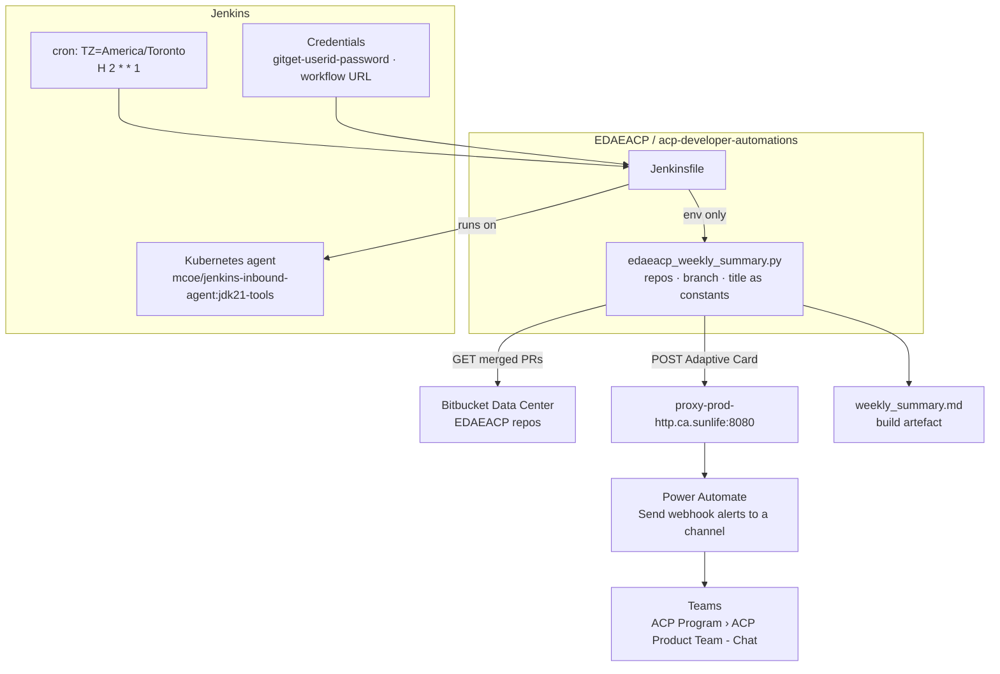
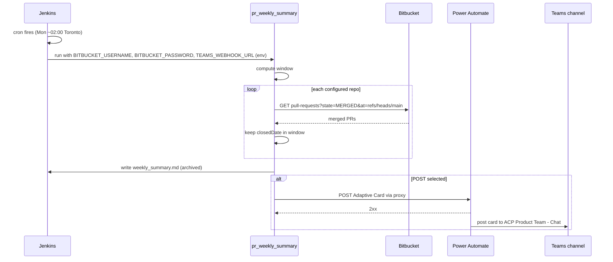
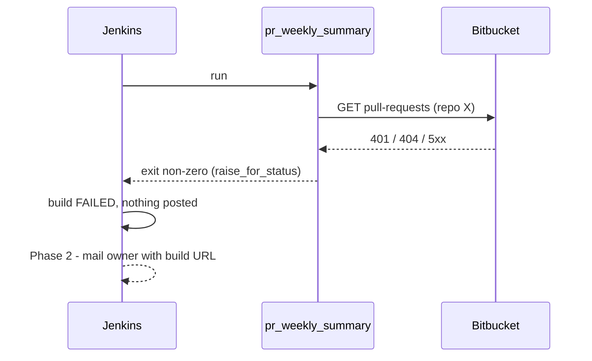
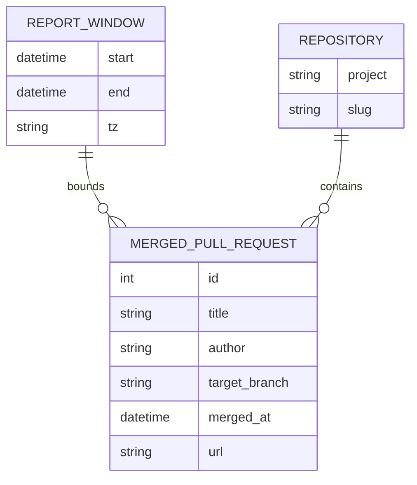

# Developer Automations — D2: Design

> **Gate**: D2 — Design | **Status**: Draft | **Epic**: [EACPP-1388](https://sunlife.atlassian.net/browse/EACPP-1388)

Scope of this gate: the first automation, **`pr-weekly-summary`**.

## Architecture Overview



One job, one script, no state. Jenkins supplies the schedule and the secrets; the script reads
Bitbucket, writes the Markdown report and posts the card.

### Starting point — a proven script, adopted then adapted

The implementation starts from a script and `Jenkinsfile` already running weekly for another
team (the *Enterprise Pipeline Weekly Summary* on `CSDP`). Because they are known to work in
Sun Life's Jenkins and network, they are adopted **as-is first** and changed only once the job
has run successfully for ACP. That splits the work in two:

**Phase 1 — adopt.** Only what must change for the job to report on *our* repositories, to
*our* channel, on a schedule:

| Change | Why it cannot wait |
|---|---|
| `PROJECT_KEY` `CSDP` → `EDAEACP`; `REPO_LIST` → the four ACP repositories | Otherwise it reports another team's work |
| Branch filter `refs/heads/develop` → `refs/heads/main`, and the matching "merged to develop" text | ACP repositories merge to `main`; `develop` returns nothing |
| `REPORT_TITLE` → *ACP Product Team Weekly Summary* | Identifies the card in the channel |
| **Remove the hard-coded default for `TEAMS_WEBHOOK_URL`** | The default is another team's signed workflow URL. A missing env var would post our report to their channel, and the secret is in source control (DD-7) |
| `Jenkinsfile` runs the script by its real file name | It invokes `enterprise_pipeline.py`; the script is `edaeacp_weekly_summary.py` |
| `Jenkinsfile` gains `triggers { cron('TZ=America/Toronto\nH 2 * * 1') }` | The starter job has no schedule |
| `Jenkinsfile` exposes the workflow URL as `TEAMS_WEBHOOK_URL` from a Jenkins credential | Replaces the removed default |

The agent (`jenkins-inbound-agent:jdk21-tools`), the `gitget-userid-password` credential, the
proxy, `requests`, the card layout and the Markdown artefact are **kept unchanged**.

**Phase 2 — adapt,** once Phase 1 has posted a correct card. Each item is independent and
traces to a requirement the starter script does not yet meet:

| Improvement | Requirement | Starter behaviour |
|---|---|---|
| Calendar-week window in `America/Toronto` (DD-3) | FR-2 | Rolling `now - 7 days`, in the agent's local time (likely UTC) |
| Pagination (DD-5) | FR-1 | One page of `limit=30`; a repository with more than 30 merges in the week is silently truncated |
| Card size budget with *"and N more"* | FR-4 | None — bounded only by the 30-per-repository page |
| Failure mail to the owner (DD-11) | FR-8 | None — a failed build is visible only in Jenkins |
| Retry Bitbucket once on 5xx (DD-10) | FR-8 | None |
| Escape `\|` and newlines in the Markdown table | FR-7 | Titles or descriptions containing `\|` or line breaks break the table |
| Bearer-token Bitbucket access | NFR-4 | Basic auth with `gitget` — works for the other team, but Basic auth is what triggers CAPTCHA account locks |

### Repository layout

```
acp-developer-automations/
├── Jenkinsfile
├── edaeacp_weekly_summary.py
└── tests/
```

Kept as a single script while it is being proven. It is split into modules only if Phase 2 or a
second automation makes that worthwhile.

## Key Design Decisions

| Decision | Choice | Alternatives Considered | Rationale |
|----------|--------|------------------------|-----------|
| DD-0 Starting point | Adopt the proven CSDP script and `Jenkinsfile`; change only what Phase 1 requires | Write from the spec | Already works against Sun Life's Jenkins, Bitbucket, proxy and Power Automate; every divergence is a new way to fail |
| DD-1 Scheduler | Jenkins declarative `triggers { cron(...) }` | Power Automate recurrence; a cron host | Jenkins is sanctioned, versioned in the repo, holds credentials and records every run |
| DD-2 Teams delivery | Power Automate *Send webhook alerts to a channel* with an Adaptive Card **1.5** | Office 365 connector webhook; Graph API | Workflow already exists; connectors are being retired; card version 1.5 is proven by the starter job |
| DD-3 Reporting window | Previous calendar week, Monday 00:00 → Monday 00:00 `America/Toronto` *(Phase 2)* | Rolling 7 days from run start *(Phase 1)* | `H` jitter and re-runs shift a rolling window; a calendar week is reproducible |
| DD-4 Merge time | Bitbucket `closedDate` on `MERGED` pull requests | Merge commit date from git | Available in the same response; no clone needed |
| DD-5 Pagination | Follow `nextPageStart` until the window is exhausted *(Phase 2)* | One page of 30 *(Phase 1)* | A busy week must not be silently truncated |
| DD-6 Dependencies | `requests`, as provided by the `jdk21-tools` agent image | Python standard library only | Proven on that image; avoids rewriting working HTTP and proxy code |
| DD-7 Secrets | Bitbucket: `gitget-userid-password` bound with `withCredentials`. Workflow URL: Jenkins *secret text*, exposed to the script as `TEAMS_WEBHOOK_URL`. **No default in the script** | Hard-coded default (starter); literal in the `Jenkinsfile` | The signed URL is a credential; a literal anywhere in the repository leaks it |
| DD-8 Configuration | Constants at the top of the script | `pipeline_config_*.groovy` | Matches the starter; four constants do not justify a second file |
| DD-9 Empty week | Post the card with every repository shown as *No PRs merged* | Post nothing | Silence is indistinguishable from a broken job (US-3). The starter already does this |
| DD-10 Retries | Retry Bitbucket GETs once on 5xx; **never** retry the POST *(Phase 2)* | Retry both | A retried POST that actually succeeded double-posts to the channel |
| DD-11 Failure notification | Jenkins `post { failure { mail ... } }` to the owner *(Phase 2)* | Failure card in the channel | Failures are the owner's to fix, not the channel's to read |
| DD-12 Branch | Only pull requests merged into `main` (`at=refs/heads/main`) | All target branches | Merges into feature branches are not delivery |
| DD-13 Artefact | `weekly_summary.md`, written on every run and archived | `card.json` | Readable in Jenkins without a card designer, and carries PR descriptions the card omits |
| DD-14 Proxy | Teams POST goes through `proxy-prod-http.ca.sunlife:8080`; Bitbucket is called directly | No proxy | Power Platform is external and unreachable from the agent without it |

## Sequence Diagrams

### Flow 1: Scheduled weekly run



### Flow 2: Failure



## API Design

### Bitbucket — merged pull requests

`GET https://bitbucket.sunlifecorp.com/rest/api/1.0/projects/EDAEACP/repos/{repo}/pull-requests?state=MERGED&at=refs/heads/main&limit=30`

Phase 2 adds `start={n}` paging (DD-5). Fields used from each value:

```json
{
  "id": 42,
  "title": "feat(developer-automations): draft D0 discovery",
  "author": { "user": { "displayName": "Sam Mamelli" } },
  "toRef": { "displayId": "main" },
  "closedDate": 1759161600000,
  "links": { "self": [ { "href": "https://bitbucket.sunlifecorp.com/projects/EDAEACP/repos/acp-product-specs/pull-requests/42" } ] }
}
```

`closedDate` is epoch milliseconds, UTC. A Jira key in the title (`[A-Z]+-\d+`) is linked to
`https://sunlife.atlassian.net/browse/<key>`.

### Power Automate — post the card

`POST $TEAMS_WEBHOOK_URL` through the proxy, `Content-Type: application/json`, 30 s timeout:

```json
{
  "type": "message",
  "attachments": [
    {
      "contentType": "application/vnd.microsoft.card.adaptive",
      "content": {
        "$schema": "http://adaptivecards.io/schemas/adaptive-card.json",
        "type": "AdaptiveCard",
        "version": "1.5",
        "msteams": { "width": "Full" },
        "body": [
          { "type": "TextBlock", "size": "Large", "weight": "Bolder", "text": "ACP Product Team Weekly Summary" },
          { "type": "TextBlock", "isSubtle": true, "text": "10 PR(s) merged to main between 2026-09-21 and 2026-09-28" },
          { "type": "Container", "separator": true, "items": [
            { "type": "TextBlock", "weight": "Bolder", "text": "acp-product-specs (5)" },
            { "type": "ColumnSet", "columns": [
              { "type": "Column", "width": "auto", "items": [ { "type": "TextBlock", "text": "[#66](https://…)" } ] },
              { "type": "Column", "width": "stretch", "items": [
                { "type": "TextBlock", "wrap": true, "text": "[EACPP-1388](https://…) feat(developer-automations): draft D0-D2" },
                { "type": "TextBlock", "isSubtle": true, "size": "Small", "text": "Sam Mamelli · 2026-09-30" }
              ] }
            ] }
          ] },
          { "type": "Container", "separator": true, "items": [
            { "type": "TextBlock", "weight": "Bolder", "text": "luminate-sunlife-deploy (0)" },
            { "type": "TextBlock", "isSubtle": true, "text": "No PRs merged." }
          ] }
        ]
      }
    }
  ]
}
```

Any non-2xx fails the build (`raise_for_status`).

**Card rules**

- Adaptive Card **1.5**, as proven by the starter job in the same Teams tenant.
- One container per repository, header `<repo> (<count>)`; a repository with no merges shows
  *No PRs merged.* rather than disappearing.
- Pull-request titles are Markdown-escaped (`\`, `` ` ``, `*`, `_`, `[`, `]`) so they render as text.
- Size budget with *"and N more"* truncation is Phase 2; until then the card is bounded by 30
  pull requests per repository.

### Markdown artefact

`weekly_summary.md` is written on every run, posted or not, and archived by Jenkins. One
section per repository with a table of PR number (linked), Jira ticket (linked), title, author,
merge date and description. It is the record of what the card said, and the dry-run output.

## Data Model

Stateless — nothing is persisted between runs.



### Script configuration

```python
BITBUCKET_URL = "https://bitbucket.sunlifecorp.com"
JIRA_URL = "https://sunlife.atlassian.net"
PROJECT_KEY = "EDAEACP"
TARGET_BRANCH = "main"
MAX_PR_COUNT = 30
REPORT_TITLE = "ACP Product Team Weekly Summary"
REPO_LIST = ["acp-product-specs", "acp-harness-sdk", "luminate-sunlife-deploy", "acp-product-devkit"]
TEAMS_WEBHOOK_URL = os.environ.get("TEAMS_WEBHOOK_URL", "")
HTTP_PROXY_URL = "proxy-prod-http.ca.sunlife:8080"
```

### Jenkins job shape (Phase 1)

The starter `Jenkinsfile` with three changes: the cron trigger, the real script name, and the
workflow URL supplied from a credential. The `agentPodYaml` helper is unchanged.

```groovy
pipeline {
    agent {
        kubernetes {
            yaml agentPodYaml('quay.prod-openshift-na.hybrid.sunlifecorp.com/mcoe/jenkins-inbound-agent:jdk21-tools-1.0.11')
        }
    }
    triggers { cron('TZ=America/Toronto\nH 2 * * 1') }
    parameters {
        booleanParam(name: 'POST', defaultValue: true, description: 'Post the report to Teams')
    }
    stages {
        stage('Generate and Publish Report') {
            steps {
                withCredentials([
                    usernamePassword(credentialsId: 'gitget-userid-password', passwordVariable: 'BITBUCKET_PASSWORD', usernameVariable: 'BITBUCKET_USERNAME'),
                    string(credentialsId: 'acp-teams-pr-summary-workflow-url', variable: 'TEAMS_WEBHOOK_URL'),
                ]) {
                    script {
                        String postParam = params.POST ? '--post' : ''
                        sh "python3 -u edaeacp_weekly_summary.py ${postParam}"
                    }
                }
            }
            post {
                always {
                    archiveArtifacts artifacts: 'weekly_summary.md', allowEmptyArchive: true
                }
            }
        }
    }
}
```

**Why `withCredentials` rather than a bare `withEnv` for the URL.** Both put `TEAMS_WEBHOOK_URL`
into the script's environment. A `withEnv(["TEAMS_WEBHOOK_URL=https://…"])` needs the literal
URL in the `Jenkinsfile` — committed, and printed unmasked in the build log. A secret-text
credential bound with `withCredentials` is the same environment variable, masked, and held
outside the repository. `withEnv` remains the right tool for non-secret values if any are later
moved out of the script.

The only interpolation into the `sh` string is `postParam`, which is one of two literals; no
parameter or credential value reaches the shell command line.

## Error Handling Strategy

| Error Category | Source | Behavior |
|---------------|--------|----------|
| Authentication (401/403) | Bitbucket | `raise_for_status` — build fails, nothing posted |
| Repository not found (404) | Bitbucket | `raise_for_status` — build fails, no partial card |
| Transient (5xx, timeout) | Bitbucket | Phase 1: fail. Phase 2: retry once, then fail (DD-10) |
| Non-2xx | Power Automate | `raise_for_status` — build fails; **never retried** (DD-10) |
| Card over budget | Script | Phase 2: truncate per repository (never fail on size) |
| `BITBUCKET_USERNAME`/`BITBUCKET_PASSWORD` missing | Script | Fail at start, naming the variable — never its value |
| `TEAMS_WEBHOOK_URL` missing with `--post` | Script | Fail at start. Only reachable once the hard-coded default is removed (Phase 1) |

Every failure exits non-zero, so Jenkins marks the build failed. Mail to the owner on failure is
Phase 2 (DD-11).

## Security Considerations

- **Authentication**: Phase 1 keeps the starter's Basic auth with the shared
  `gitget-userid-password` service account, which is proven. Basic auth against Bitbucket is
  what triggers CAPTCHA account locks, and a locked `gitget` breaks every job that shares it —
  so Phase 2 moves to a read-only HTTP access token sent as `Authorization: Bearer`.
- **Authorization**: `gitget` must have read on the four `EDAEACP` repositories. Confirm before
  the first run; a 401/403 is the symptom.
- **The workflow URL is a secret.** Its `sig` query parameter is the only thing authorising a
  post, so the URL is handled exactly like a token: Jenkins secret text, masked in the log,
  never committed, never echoed, never placed in `argv`. If exposed, regenerate it in Power
  Automate and update the credential.
- **The starter script contains another team's signed workflow URL** as a hard-coded default.
  It must be removed before the script is committed to any ACP repository, and the owning team
  should be told so they can regenerate it.
- **Input handling**: pull-request titles are Markdown-escaped before rendering in the card.
  The Markdown artefact does not yet escape `|` or newlines (Phase 2).
- **Audit**: Jenkins build history records every run; the archived `weekly_summary.md` is the
  content that was posted.

## Testing Strategy

| Layer | Framework | Coverage Target | Key Scenarios |
|-------|-----------|----------------|---------------|
| Proving run | Jenkins with `POST` unchecked | Before any post | `weekly_summary.md` archived and lists merges from all four repositories |
| Live | One manual run with `POST` checked | Once | Card appears correctly in *ACP Product Team - Chat*, and **not** in the other team's channel |
| Unit | pytest | ≥ 90% of Phase 2 code | Window boundaries incl. a DST week; pagination; `closedDate` filtering; Markdown and table escaping; size-budget truncation; empty week |
| Contract | pytest with recorded Bitbucket responses | Critical paths | Real response shape from each of the four repositories |

Phase 1 is proven by running it, because the starter has no tests and is adopted unchanged.
Unit tests arrive with the Phase 2 changes they cover.

## Observability

| Signal | Tool | Details |
|--------|------|---------|
| Run outcome | Jenkins build status | Success / failure per scheduled week |
| Content | Archived `weekly_summary.md` | What was, or would have been, posted |
| Counts | Build log | Pull requests fetched per repository, never secrets |
| Alerting | Jenkins `post { failure }` mail | Owner notified on any failed run *(Phase 2)* |

## Migration/Rollback Plan

- **Forward**: create the `EDAEACP` repository; commit the starter script and `Jenkinsfile`
  with the Phase 1 changes only; confirm `gitget` can read the four repositories; add the
  workflow-URL credential; run once with `POST` unchecked, once with it checked; leave the
  schedule to run; then take Phase 2 items one at a time.
- **Backward compatibility**: not applicable — new automation.
- **Rollback**: disable the Jenkins job. Nothing else depends on it and nothing is persisted.
- **Data migration**: none.

## Requirement Traceability

| D1 Requirement | Design Component | Verified By |
|---------------|-----------------|-------------|
| FR-1 | `_get_pull_requests`, DD-4, DD-5, DD-12 | Proving run; Phase 2 unit: pagination |
| FR-2 | Window computation, DD-3 | Phase 2 unit: window boundaries incl. DST |
| FR-3 | `REPO_LIST`, DD-8 | Proving run lists all four repositories |
| FR-4 | `_build_adaptive_card`, card rules | Live run; Phase 2 unit: escaping, truncation |
| FR-5 | Power Automate POST via proxy, DD-2, DD-14 | Live run |
| FR-6 | `triggers { cron }`, DD-1 | First scheduled Monday build |
| FR-7 | `POST` parameter, `weekly_summary.md`, DD-13 | Proving run archives the report |
| FR-8 | Error handling, DD-9, DD-10, DD-11 | Forced 401 fails the build; Phase 2: owner mailed |
| NFR-3 | DD-7, security considerations | Build log review; secret scan of repository |
| NFR-6 | DD-6 | Runs on the `jdk21-tools` agent with no `pip install` |
| US-1, US-2 | Flow 1, card layout | Live run |
| US-3 | Flow 2 | Forced-failure build |
| US-4 | `POST` parameter | Proving run |
