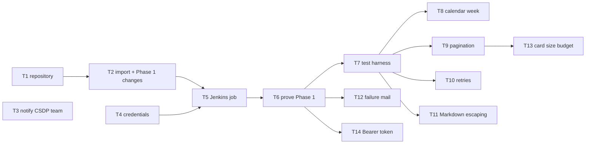

# Developer Automations — D3: Implementation Plan

> **Gate**: D3 — Tasks | **Status**: Draft | **Epic**: [EACPP-1388](https://sunlife.atlassian.net/browse/EACPP-1388)

## How to read this

Scope: the first automation, **`pr-weekly-summary`**. The D2 design is the target state; this
plan is the delta, in the two phases D2 defines.

- **Phase 1 (S1) — adopt.** T1–T6 put the proven starter script and `Jenkinsfile` into service
  with only the changes needed to report on ACP repositories, to the ACP channel, on a schedule.
  Nothing else in the starter changes until T6 has posted a correct card.
- **Phase 2 (S2–S3) — adapt.** T7–T14 close the requirements the starter does not yet meet.
  Each is independent once the test harness (T7) exists.

T3 is not ours to complete: it is a notice to the team that owns the starter script.

## Task Summary

| Task | Description | Type | Points | Sprint | Depends On |
|---|---|---|---|---|---|
| **T1** | Create the `EDAEACP` repository for developer automations. Name it (`acp-developer-automations` proposed), set `main` as the default branch with pull-request-only merges, and record the name in `spec.yaml`. Done when the empty repository exists and a branch permission blocks direct pushes to `main`. | Task | 1 | S1 | — |
| **T2** | Import the starter script and `Jenkinsfile` with the Phase 1 changes only. Set `PROJECT_KEY` to `EDAEACP`, `REPO_LIST` to the four ACP repositories, the branch filter and its text to `main`, and `REPORT_TITLE` to the ACP title; remove the hard-coded `TEAMS_WEBHOOK_URL` default; make the `Jenkinsfile` call the script by its real name; add `triggers { cron('TZ=America/Toronto\nH 2 * * 1') }`; bind the workflow URL with `withCredentials` as `TEAMS_WEBHOOK_URL`. Done when a diff against the starter shows only those changes and a secret scan finds no workflow URL. | Story | 2 | S1 | T1 |
| **T3** | Notify the CSDP team of their hard-coded workflow URL. Their signed Power Automate URL is the script's default and is in source control, so they should regenerate it and remove the default. Done when the owning team has acknowledged it. | Task | 1 | S1 | — |
| **T4** | Provision the credentials. Confirm `gitget-userid-password` can read `acp-product-specs`, `acp-harness-sdk`, `luminate-sunlife-deploy` and `acp-product-devkit`; regenerate the ACP workflow URL in Power Automate, since the current one has been shared outside a secret store; store it as the *secret text* credential `acp-teams-pr-summary-workflow-url`. Done when both credentials exist and the old URL no longer posts. | Task | 1 | S1 | — |
| **T5** | Create the Jenkins job from the repository `Jenkinsfile`, on the starter's Kubernetes `jdk21-tools` agent. Done when the job appears with the `POST` parameter and a Monday 02:00 Toronto schedule, with no job configuration held only in the Jenkins UI beyond credentials. | Story | 1 | S1 | T2, T4 |
| **T6** | Prove Phase 1. Run once with `POST` unchecked and check `weekly_summary.md` lists last week's merges from all four repositories; run once with `POST` checked and check the card appears in *ACP Product Team - Chat* and not in any other channel; then let the first scheduled Monday run complete. Done when the scheduled run has posted a correct card. | Task | 2 | S1 | T5 |
| **T7** | Add a pytest harness with contract fixtures. Record one real Bitbucket merged-pull-requests response from each of the four repositories and test the current normalisation, filtering and card building against them. Done when the tests run locally and in the job before the report stage. | Story | 2 | S2 | T6 |
| **T8** | Report the previous calendar week in Toronto time. Replace the rolling seven-day window with Monday 00:00 to Monday 00:00 `America/Toronto` (DD-3), and show merge dates in Toronto time. Done when unit tests cover a normal week, a daylight-saving week and a re-run later in the week, all producing the scheduled run's window. | Story | 3 | S2 | T7 |
| **T9** | Follow Bitbucket pagination (DD-5) instead of reading one page of 30, stopping once results fall before the window. Done when a test with more than 30 merges in the window reports all of them. | Story | 2 | S2 | T7 |
| **T10** | Retry each Bitbucket GET once on a 5xx or timeout, and never retry the Teams POST (DD-10). Done when tests show one retry on 5xx, no retry on 4xx, and exactly one POST attempt. | Story | 1 | S2 | T7 |
| **T11** | Escape pipe characters and newlines in the Markdown table so titles and descriptions cannot break it. Done when a test with both in a title and a description produces a valid table. | Story | 1 | S2 | T7 |
| **T12** | Mail the owner when the build fails. Add a `post { failure { mail } }` block (DD-11). Done when a forced 401 fails the build and the owner receives the mail with the build URL. | Story | 1 | S2 | T6 |
| **T13** | Enforce a card size budget under the Teams message limit. Truncate each repository's list with an *"and N more"* link to its merged pull requests. Done when a test with 30 pull requests per repository produces a card under budget with the link. | Story | 3 | S3 | T9 |
| **T14** | Read Bitbucket with a read-only Bearer token. Replace Basic auth on the shared `gitget` account with an HTTP access token sent as `Authorization: Bearer` (NFR-4). Done when the job reads all four repositories with the token and no longer binds `gitget-userid-password`. | Story | 2 | S3 | T6 |

## Dependency Graph

**Critical chain**: T1 → T2 → T5 → T6. Nothing in Phase 2 starts until T6 has proven the
adopted job, which is the point of the phase split.

## Sprint Allocation

### Sprint 1 — Adopt

| Task | Points | Definition of Done |
|---|---|---|
| T1 repository | 1 | Repository exists; `main` protected |
| T2 import | 2 | Diff against the starter shows only the Phase 1 changes; no workflow URL in source |
| T3 notify CSDP team | 1 | Owning team acknowledged |
| T4 credentials | 1 | Both credentials exist; old ACP URL regenerated |
| T5 Jenkins job | 1 | Job scheduled for Monday 02:00 Toronto |
| T6 prove Phase 1 | 2 | Scheduled run posted a correct card |

### Sprint 2 — Adapt

| Task | Points | Definition of Done |
|---|---|---|
| T7 test harness | 2 | Contract tests pass against recorded responses |
| T8 calendar week | 3 | DST and re-run tests pass |
| T9 pagination | 2 | More than 30 merges all reported |
| T10 retries | 1 | One GET retry; exactly one POST |
| T11 Markdown escaping | 1 | Table survives pipes and newlines |
| T12 failure mail | 1 | Forced failure mails the owner |

### Sprint 3 — Harden

| Task | Points | Definition of Done |
|---|---|---|
| T13 card size budget | 3 | Card under budget with *"and N more"* |
| T14 Bearer token | 2 | `gitget` no longer used by the job |

## Risk Mitigation

| Risk (from D0) | Mitigation Task | Sprint |
|---|---|---|
| A credential is committed or logged | T2 removes the hard-coded URL; T3 tells its owner; T4 regenerates ours | S1 |
| A failed run goes unnoticed | T12 | S2 |
| Shared `gitget` account CAPTCHA-locked by Basic auth | T14 | S3 |
| The repository list drifts | T2 keeps it in one place; reviewed through pull requests | S1 |

## Jira Ticket Map

> Created 2026-09-30 under epic [EACPP-1388](https://sunlife.atlassian.net/browse/EACPP-1388).

| Task | Jira Key | Status |
|---|---|---|
| T1 | [EACPP-1389](https://sunlife.atlassian.net/browse/EACPP-1389) | To Do |
| T2 | [EACPP-1390](https://sunlife.atlassian.net/browse/EACPP-1390) | To Do |
| T3 | [EACPP-1391](https://sunlife.atlassian.net/browse/EACPP-1391) | To Do |
| T4 | [EACPP-1392](https://sunlife.atlassian.net/browse/EACPP-1392) | To Do |
| T5 | [EACPP-1393](https://sunlife.atlassian.net/browse/EACPP-1393) | To Do |
| T6 | [EACPP-1394](https://sunlife.atlassian.net/browse/EACPP-1394) | To Do |
| T7 | [EACPP-1395](https://sunlife.atlassian.net/browse/EACPP-1395) | To Do |
| T8 | [EACPP-1396](https://sunlife.atlassian.net/browse/EACPP-1396) | To Do |
| T9 | [EACPP-1397](https://sunlife.atlassian.net/browse/EACPP-1397) | To Do |
| T10 | [EACPP-1398](https://sunlife.atlassian.net/browse/EACPP-1398) | To Do |
| T11 | [EACPP-1399](https://sunlife.atlassian.net/browse/EACPP-1399) | To Do |
| T12 | [EACPP-1400](https://sunlife.atlassian.net/browse/EACPP-1400) | To Do |
| T13 | [EACPP-1401](https://sunlife.atlassian.net/browse/EACPP-1401) | To Do |
| T14 | [EACPP-1402](https://sunlife.atlassian.net/browse/EACPP-1402) | To Do |

## Notes

- **Do not change the starter beyond T2 until T6 is done.** The script and `Jenkinsfile` are
  proven for another team; every unforced change is a new way for the first run to fail.
- **Do not renumber these tasks after the Jira tickets exist.** Ticket identity is keyed on the
  `T<n>:` summary prefix; insert a lettered task (`T6a`) instead.
