<!-- GENERATED FILE — do not edit directly.
     Source: d2-design/ pages. Regenerate with scripts/assemble_d2_design.py -->

# D2 Design — Overview

> **Gate**: D2 — Design | **Status**: In review | **D1 Approved**: TBD
>
> This D2 is a set of pages. `d2-design.md` beside this directory is **generated** from them by
> `scripts/assemble_d2_design.py` — edit the pages, not the generated file.
>
> **Revised 2026-10-06** after the *Luminate Gateway Environment Deployment Model* session. The
> topology moved from "all gateways in the production account" to "each environment's gateways in
> that environment's account, one production control plane". Segregation of duties, the promotion
> process and the ATG/ISRA package were added.

## The model in one picture

```mermaid
flowchart TB
    CP["<b>Production Luminate control plane</b><br/>prod account · one catalogue · one governance record · one audit trail"]
    subgraph DEVA["dev account · Non-production"]
        D1["DEV gateway · ca-central-1"]
        D2["DEV gateway · us-east-1"]
        D3["DEV gateway · further regions"]
    end
    subgraph TSTA["test account · Non-production"]
        S1["SIT gateway · ca-central-1"]
        S2["SIT gateway · us-east-1"]
        S3["SIT gateway · further regions"]
    end
    subgraph STGA["stage account · Stage"]
        G1["STAGE gateway · ca-central-1"]
        G2["STAGE gateway · us-east-1"]
        G3["STAGE gateway · further regions"]
    end
    subgraph PRDA["prod account · Production"]
        P1["PROD gateway · ca-central-1"]
        P2["PROD gateway · us-east-1"]
        P3["PROD gateway · further regions"]
    end
    D1 & D2 & S1 & S2 & G1 & G2 & P1 & P2 -->|"control link<br/>outbound · TLS 443 · no content"| CP
    D3 & S3 & G3 & P3 -.->|"same link (DD-19)"| CP
    classDef future stroke-dasharray: 5 5
    class D3,S3,G3,P3 future
    style CP fill:#ffebee,stroke:#c62828
    style DEVA fill:#e3f2fd,stroke:#1565c0
    style TSTA fill:#e8f5e9,stroke:#2e7d32
    style STGA fill:#fff8e1,stroke:#f9a825
    style PRDA fill:#ffebee,stroke:#c62828
```

**One control plane governs; each environment runs in its own account.** A business team registers
an agent once, in the production control plane, and promotes it DEV → SIT → STAGE → PROD. Each
promotion places it on the next environment's gateway, which runs in that environment's AWS
account and calls Bedrock in that account. The agent's identity, owner and governance record never
change; its gateway address and credential do.

**Regions are an open list.** Today every environment serves from `ca-central-1` and `us-east-1`.
A further region adds one gateway per environment, in the same accounts, by a defined procedure
and with no design change (DD-19).

## What runs where

| | dev account | test account | stage account | prod account |
|---|---|---|---|---|
| **Gateways of the production control plane** | DEV · ca + us | SIT · ca + us | STAGE · ca + us | PROD · ca + us |
| **Bedrock used by those gateways** | dev account | test account | stage account | prod account |
| **Production control plane** — portal, identity, data, observability | — | — | — | ✓ |
| **Lower Luminate install** — platform team only | dev install | test install | stage install | — |
| **EKS clusters** | `slf-eks-t1k-ca-dev`, `slf-eks-t1k-use1-dev` | `slf-eks-t1k-ca-uat`, a `us-east-1` cluster | `slf-eks-t1k-ca-stage`, a `us-east-1` cluster | `slf-eks-t1k-ca-prod`, `slf-eks-t1k-us-prod` |

The full component placement, data flows and hostnames are on the [Architecture](d2-design/architecture.md)
page.

## The two ladders

Two things are promoted through four stages each, by different people, for different reasons.

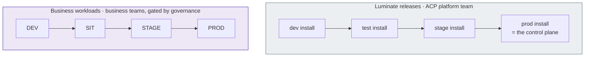

Where this spec says **environment** unqualified, it means a **workload environment** — DEV, SIT,
STAGE or PROD inside the production control plane. An **install** is a whole copy of Luminate.

## Who does what

| | Business team | ACP platform team | Governance |
|---|---|---|---|
| Register agents, models, tools | ✓ | | |
| Deploy into DEV and SIT | ✓ | | |
| Request promotion into STAGE and PROD | ✓ | | |
| Approve promotion into STAGE and PROD | Project owner, first level | | Governance approver, second level |
| Deploy into STAGE and PROD, issue credentials | | Production deployer | |
| Author the rules in force per environment | | | Governance administrator |
| Operate gateways, clusters, accounts and pipelines | | ✓, maker-checker on STAGE and PROD | |

[Segregation of duties](d2-design/segregation-of-duties.md) gives the personas, roles and enforcement for
each cell.

## Decisions

| # | Decision | Page |
|---|---|---|
| **DD-1** | One production control plane owns all four workload environments | [Topology](d2-design/topology.md) |
| **DD-2** | DEV, SIT, STAGE, PROD — SIT in the test account | [Topology](d2-design/topology.md) |
| **DD-3** | One gateway per environment per region, **in that environment's workload account** | [Topology](d2-design/topology.md) |
| **DD-4** | Promotion is a new deployment of the same resource, approval-gated into STAGE and PROD | [Promotion](d2-design/promotion.md) |
| **DD-5** | The same rules everywhere; observe below, enforce above | [Governance](d2-design/governance.md) |
| **DD-6** | Default-deny between workload environments | [Connectivity](d2-design/connectivity.md) |
| **DD-7** | Environments are shared tiers; teams are separated by project | [Environments, quotas and credentials](d2-design/access-and-quotas.md) |
| **DD-8** | Self-serve into DEV and SIT; STAGE and PROD gated | [Segregation of duties](d2-design/segregation-of-duties.md) |
| **DD-9** | Quota defaults by tier, with the account as a hard ceiling | [Environments, quotas and credentials](d2-design/access-and-quotas.md) |
| **DD-10** | Seven data-isolation boundaries; content removed before telemetry export | [Data isolation](d2-design/data-isolation.md) |
| **DD-11** | Visibility follows the resource hierarchy | [One control plane](d2-design/one-control-plane.md) |
| **DD-12** | Only identifiers, counts and outcome enums cross the account and region boundary | [One control plane](d2-design/one-control-plane.md) |
| **DD-13** | One outbound control link per gateway; nothing else crosses environments | [Connectivity](d2-design/connectivity.md) |
| **DD-14** | The control plane trusts a gateway only as itself | [Connectivity](d2-design/connectivity.md) |
| **DD-15** | Four layers of authority; no production change on one person's authority | [Segregation of duties](d2-design/segregation-of-duties.md) |
| **DD-16** | Every gateway has a friendly hostname that never changes | [Topology](d2-design/topology.md) |
| **DD-17** | The control plane is built for availability; gateways fail closed | [One control plane](d2-design/one-control-plane.md) |
| **DD-18** | Lower installs test Luminate, and nothing else | [Topology](d2-design/topology.md) |
| **DD-19** | Serving regions are an open list; a region is added by procedure, not by design change | [Topology](d2-design/topology.md) |

DD-13 to DD-19 are new in this revision. DD-3 changed: gateways moved from the production account to
their environment's account. DD-8 is now enforced through gateway projects per environment rather
than by the platform team performing every deployment.

## The ATG and ISRA

[Assurance](d2-design/assurance.md) is written to be submitted: scope, alternatives, the position against the
Infrastructure, Platform and Network Security Directive (section 2.3 in particular), a threat model,
22 controls with their evidence, and five residual risks.

---

# Architecture — what runs where

This page is the high-level architecture for the target topology: which AWS account and EKS cluster
each component runs in, how they connect, and what crosses each boundary. The decisions behind it
are on the other D2 pages. The [Assurance](d2-design/assurance.md) page reuses this page as the architecture
of record for the ATG and ISRA submissions.

## The model in one sentence

**One production Luminate install is the control plane for every workload environment. Each
workload environment's gateways run in that environment's own AWS workload account, in each region,
and call Amazon Bedrock in that same account.**

Agents call a gateway in their own environment and region. The gateway asks the control plane
whether each call is allowed, forwards allowed calls to Bedrock in its own account, and reports the
outcome back. The control plane never carries a call.

## Accounts, regions and clusters

Four AWS workload accounts, each with an EKS cluster in every serving region. The serving regions
are an open list (DD-19); today they are `ca-central-1` and `us-east-1`, and a further region adds
a column to this table. The environment of the account is the environment of the gateways in it.

| Account | AWS account | Directive environment ¹ | `ca-central-1` cluster | `us-east-1` cluster |
|---|---|---|---|---|
| **dev** | `360967146904` | Non-production | `slf-eks-t1k-ca-dev` | `slf-eks-t1k-use1-dev` |
| **test** | `692797214700` | Non-production ² | `slf-eks-t1k-ca-uat` | `slf-eks-t1k-<us>-test` ³ |
| **stage** | `775755739292` | Stage | `slf-eks-t1k-ca-stage` | `slf-eks-t1k-<us>-stage` ³ |
| **prod** | `035722575935` | Production | `slf-eks-t1k-ca-prod` | `slf-eks-t1k-us-prod` |

¹ The environment class from Appendix D of the Infrastructure, Platform and Network Security
Directive (IPNSD). See [Connectivity](d2-design/connectivity.md) for how DD-13 treats traffic between them.

² The test account carries the **SIT** workload environment. Appendix D lists SIT among the legacy
equivalents of *Stage*. DD-2 records why SIT is placed in the test account and how it is classified.

³ The `us-east-1` clusters in the test and stage accounts are part of the target topology and are
provisioned by D3. Their names are assigned by Cloud Container Enablement (CCE) at provisioning.
The two existing `us-east-1` clusters do not share a pattern (`use1-dev`, `us-prod`).

## Component placement

Each cluster runs two kinds of thing that must not be confused: **gateways of the production
control plane**, which serve business workloads, and a **lower Luminate install**, which only the
ACP platform team uses to test Luminate releases (DD-18).

| Component | dev account | test account | stage account | prod account |
|---|---|---|---|---|
| **Production control plane** — portal, backend, DBOS worker, frontend | — | — | — | `ca-central-1` ⁴ |
| **Production identity** — Keycloak (brokering Entra ID) | — | — | — | `ca-central-1` ⁴ |
| **Production data tier** — RDS PostgreSQL (portal, Keycloak, Langfuse), ElastiCache Valkey, S3 | — | — | — | `ca-central-1` ⁴ |
| **Production observability** — OTel collector, Langfuse, ClickHouse | — | — | — | `ca-central-1` ⁴ |
| **DEV gateways** (production control plane) | `ca` + `us` | — | — | — |
| **SIT gateways** (production control plane) | — | `ca` + `us` | — | — |
| **STAGE gateways** (production control plane) | — | — | `ca` + `us` | — |
| **PROD gateways** (production control plane) | — | — | — | `ca` + `us` |
| **Per-cluster gateway support** — OTel collector (content-redacting), Traefik route, Venafi certificate | `ca` + `us` | `ca` + `us` | `ca` + `us` | `ca` + `us` |
| **Gateway Bedrock access** — hub role `luminate-gateway-irsa` per region (suffixed `-us` in `us-east-1`) with in-account Bedrock policy | ✓ | ✓ | ✓ | ✓ |
| **Lower Luminate install** — full portal, identity, data tier, its own gateway | dev install | test install | stage install | — |

⁴ The control plane's region is an open decision. The us-east-1 relocation spec
(`us-cutover`, EACPP-1407) proposes moving it. Nothing on this page depends on which region holds
it: every gateway reaches it the same way (DD-13), from every region.

Where a row reads `ca` + `us`, a region added under DD-19 adds its region code.

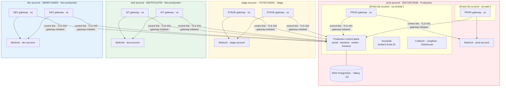

The lower Luminate installs are left out of the diagram on purpose. They share the dev, test and
stage clusters with the gateways but have no connection to the production control plane, and no
business workload runs on them.

## Inside one gateway cluster

Every cluster that hosts gateways has the same shape. The gateways of an environment are isolated
from the lower install on the same cluster by namespace, NetworkPolicy, Kubernetes RBAC and IAM
role.

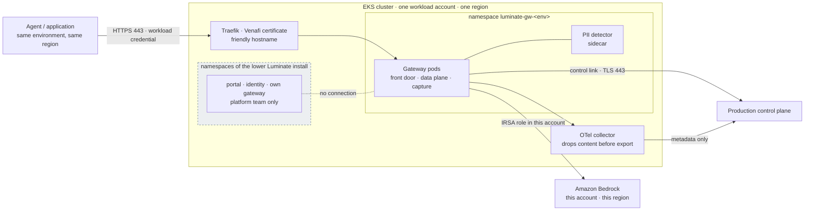

## Data flows

Every flow the topology creates, enumerated so each can be authorized, inspected and tested. The
**cross-environment** column is the one IPNSD section 2.3 is about: it marks a flow between a
gateway in a non-production or stage account and the production control plane.

| # | Flow | From → to | Protocol · port | Initiated by | Authenticated by | Carries | Cross-environment |
|---|---|---|---|---|---|---|---|
| **F-1** | Agent call | Agent → gateway, same environment and region | HTTPS 443 | Agent | Workload credential issued for that gateway | Prompts, responses, tool calls | No |
| **F-2** | Inference | Gateway → Bedrock, same account and region | HTTPS 443 (AWS API) | Gateway | IRSA role in the gateway's own account | Prompts, responses | No |
| **F-3** | Control stream | Gateway → control plane | gRPC over TLS 443 | Gateway | Gateway OAuth credential, bound to the gateway's identity (DD-14) | Configuration pushed down; health and status up | **Yes**, for DEV, SIT and STAGE gateways |
| **F-4** | Access decision | Gateway → control plane, per call | gRPC over TLS 443 | Gateway | As F-3 | Identifiers only — caller, target, gateway, environment, location | **Yes**, as F-3 |
| **F-5** | Token issuance | Gateway → control plane token endpoint | HTTPS 443 | Gateway | Gateway OAuth client credential | Gateway access token | **Yes**, as F-3 |
| **F-6** | Signing keys | Gateway → control plane JWKS | HTTPS 443 | Gateway | Public keys; server authenticated by TLS | Public signing keys | **Yes**, as F-3 |
| **F-7** | Audit and usage | Gateway → control plane | gRPC over TLS 443 | Gateway | As F-3 | Identifiers, counts, outcome enums — never content | **Yes**, as F-3 |
| **F-8** | Telemetry | Cluster collector → central Langfuse | OTLP over TLS 443 | Collector | Langfuse project key for the environment | Trace metadata — content is removed before export (DD-10a) | **Yes**, as F-3 |
| **F-9** | Operator access | Platform team → cluster | AWS SSO, EKS API | Operator | Per-account SSO permission set; namespaced Kubernetes RBAC | Administration | No — per account |
| **F-10** | Deployment | Jenkins → cluster | EKS API | Jenkins | Per-account deploy role; namespaced RBAC | Helm releases | No — per account |

**Direction is fixed.** Every cross-environment flow (F-3 to F-8) is opened by the gateway or its
collector, outbound, to a fixed set of production hostnames on port 443. The control plane opens no
connection into any non-production or stage account, and no non-production or stage workload can
reach anything in the production account except those endpoints.

**No cross-environment flow carries content.** F-1 and F-2 carry prompts and responses, and both
stay inside one account and one region. F-3 to F-8 carry identifiers, configuration, counts and
outcome enums. That is fixed by the wire contract (DD-12) and by the collector's redaction (DD-10a).

## Hostnames

Every gateway has its own **friendly hostname** (DD-16), independent of the cluster it runs on. An
agent's configuration names its gateway by that hostname, so moving a gateway between clusters or
accounts is invisible to the agents that call it.

| Gateway | Friendly hostname |
|---|---|
| DEV · `ca-central-1` / `us-east-1` | `luminate-gw-dev-ca.sunlifecorp.com` / `luminate-gw-dev-us.sunlifecorp.com` |
| SIT · `ca-central-1` / `us-east-1` | `luminate-gw-sit-ca.sunlifecorp.com` / `luminate-gw-sit-us.sunlifecorp.com` |
| STAGE · `ca-central-1` / `us-east-1` | `luminate-gw-stage-ca.sunlifecorp.com` / `luminate-gw-stage-us.sunlifecorp.com` |
| PROD · `ca-central-1` / `us-east-1` | `luminate-gw-prod-ca.sunlifecorp.com` / `luminate-gw-prod-us.sunlifecorp.com` |
| Control plane (portal) | `luminate.sunlifecorp.com` |

The pattern is the proposal; the exact names are confirmed in the DNS request (DD-16). A region
added under DD-19 adds one name per environment, ending in its region code. Each name is
a CNAME in the corporate zone to the Traefik load balancer of the cluster that runs the gateway,
and is a SAN on that cluster's Venafi certificate.

## Per-account resources

What each workload account needs to host its gateways. Everything here is provisioned per account
and per region; nothing is shared across accounts.

| Resource | Purpose | Managed in |
|---|---|---|
| EKS cluster with the Sun Life platform layer (Karpenter application NodePool, Traefik, Vault Secrets Operator, Gatekeeper) | Runs the gateways | CCE; NodePool in `luminate-sunlife-deploy/k8s/karpenter/` |
| Gateway hub role `luminate-gateway-irsa` per region (`-irsa-us` in `us-east-1`) with in-account Bedrock policy, trusting only the gateway service accounts | Bedrock access for the gateways in this account | `luminate-sunlife-deploy/terraform/gateway-iam`, one stack per account and region |
| Bedrock model access for the approved models | The models the gateways may call | Per account, Bedrock console or API |
| ECR repositories for the gateway and PII detector images | Image source for the cluster | Per account and region; promoted by digest |
| Jenkins deploy role and namespaced RBAC | Pipeline deploys of the gateway releases | `terraform/eks-deploy-access`; chart RBAC bootstrap |
| Support role and namespaced RBAC | Human triage without cluster-admin | `terraform/eks-support-access` |
| Gateway OAuth credential, as a Kubernetes Secret synced from Vault | The gateway's identity to the control plane | Minted by the control plane at registration; stored in Vault |
| DNS record and Venafi certificate SAN | The friendly hostname | ServiceNow DNS request; Venafi self-service |

## What does not change

- **The production control plane is one install.** One catalogue, one governance record, one audit
  trail, one inventory of gateways. Moving gateways between accounts changes none of them.
- **A gateway keeps its identity when it moves.** The `Gateway` record, its environment mapping, its
  OAuth client and every workload credential issued against it are unchanged. Moving a gateway is a
  redeployment of the same gateway in a different cluster, followed by a DNS change.
- **The business team sees no difference** except the gateway hostname, which becomes a friendly
  name that will not change again.

---

# Topology — control plane, environments, gateways

## DD-1 · One production control plane owns all four workload environments

**Decision.** The **prod** Luminate install is the single control plane for every business
workload, in every workload environment and every region. It holds the one catalogue, the one
governance record, the one audit trail and the one inventory of gateways.

Two words collide here, and the collision is the main way this design gets misread:

| Term | Meaning | Count |
|---|---|---|
| **Install** | A whole copy of Luminate: portal, database, identity provider and its own gateway | Four: dev, test, stage, **prod** |
| **Workload environment** | An `Environment` row inside the prod install, where a business team's resources are deployed | Four: **DEV, SIT, STAGE, PROD** |

When this spec says **dev install** it means a platform-team test system. **DEV** means the
workload environment inside the prod install. The words are not interchangeable.

**Why one control plane rather than one install per environment.** Every environment primitive the
product has is inside one install: the `GatewayEnvironment` join, `Deployment(environment,
gateway)`, `CrossEnvironmentRule` between two `Environment` rows, `GovernanceStatus` keyed
`(resource, environment)`, and the approval engine's view of a resource across environments.

Split the control plane and all of them stop meaning anything. A "promoted" resource becomes a
*different* resource, with no provable relationship to the one that was tested, and "is this agent
approved?" stops having a single answer. Model risk, audit and the business teams each need that
answer to stay single.

**Why gateways do not live with the control plane.** A gateway is where a workload's traffic runs.
Its environment is the environment of the traffic it carries, so it belongs in that environment's
workload account (DD-3). The control plane is where the workload is governed, and there is one of
it. Separating the two is what this design rests on. It is the same shape Sun Life already uses
for a central governance account over many workload accounts.

## DD-2 · Four workload environments, mapped to four accounts

| Key | Name | Order | `service_tier` | Workload account | Purpose | Governance | Who deploys |
|---|---|---|---|---|---|---|---|
| `dev` | DEV | 1st | `non_prod` | dev | Build and iterate. Synthetic or non-sensitive data. | observe | Business team |
| `sit` | SIT | 2nd | `non_prod` | **test** | Integration across teams. | observe | Business team |
| `stage` | STAGE | 3rd | `pre_prod` | stage | Production-like verification with real integrations. | **enforce** | Platform, after approval |
| `prod` | PROD | 4th | `prod` | prod | Live traffic. | **enforce** | Platform, after approval |

**SIT runs in the test account.** There is no SIT account and none is needed: the test account is
the non-production account that sits after dev. If integration and user-acceptance testing later
need separating, the test account can carry a second workload environment (UAT) with its own
gateways. That is a new `Environment` row and a new gateway pair, not a new account.

**SIT is classified as Non-production.** Appendix D of the directive lists SIT among the legacy
equivalents of *Stage*, defined as "configured to mimic production for final functional and
performance testing". At Sun Life that role belongs to STAGE. SIT is integration testing between
teams' builds, which matches Appendix D's *Non-Production* ("applications are built, integrated and
tested"). The test account's classification follows SIT's.

**The tier is a governance attribute, not a label.** `service_tier` is a mandatory,
governance-authoritative attribute on `environment`. Its values are closed by foreign key and only
platform-level roles may assign them, so tier-driven policy rests on something a team cannot edit.
STAGE carries `pre_prod`, which is what lets tier-driven policy separate it from DEV and SIT.

**Order is a position, not a value.** `Environment.rank` is a lexorank string assigned by the
library. A new environment is inserted between two existing ones with
`LexoRank.get_lexorank_in_between(prev, next, count)`; a plain create appends it after PROD, which is
the wrong end of the promotion path.

**Who may create an environment.** Environment writes authorize at organization scope only. They
belong to the **Platform Operator** role, held by the ACP platform team. An environment is global:
every project in the install sees it, so creating one is a platform decision and never a team one.

## DD-3 · One gateway per environment per region, in that environment's account

**Decision.** Each workload environment has **one gateway in each serving region**, and that gateway
runs in the **workload account of its environment**. The serving regions are an open list (DD-19);
today there are two, so eight gateways:

| Environment | Account | `ca-central-1` | `us-east-1` |
|---|---|---|---|
| DEV | dev | `luminate-gateway-dev` | `luminate-gateway-us-dev` |
| SIT | test | `luminate-gateway-sit` | `luminate-gateway-us-sit` |
| STAGE | stage | `luminate-gateway-stage` | `luminate-gateway-us-stage` |
| PROD | prod | `luminate-gateway-prod` | `luminate-gateway-us-prod` |

The keys are the gateways' registered keys in the control plane. They do not change when a gateway
moves to its account (see *Moving a gateway* below).

Each gateway is a Helm release of the `luminate-portal` chart with the portal components turned off,
in its own namespace `luminate-gw-<env>`, on the EKS cluster of its account and region. It is
**operated by the ACP platform team** and **governed by the production control plane**.

**Why a gateway per environment.** The gateway is the failure domain, the capacity pool and the
kill-switch boundary. Sharing one across environments would make a DEV agent's runaway loop a PROD
incident, and make "stop all DEV traffic" impossible without stopping production.

**Why in the environment's own account.** It puts each environment's traffic, Bedrock spend and
blast radius in the account Sun Life already classifies for that environment:

- **A DEV workload never runs on production infrastructure.** Its gateway, its Bedrock calls and
  its capacity are in the dev account.
- **Bedrock is called in the environment's own account.** Model access, invocation logging and the
  bill all land where the environment's owner expects them. No environment uses another
  environment's Bedrock account.
- **Non-production traffic cannot consume production capacity**, because it is not on the
  production cluster.
- **Account-level controls apply per environment.** Who may operate the DEV gateways and who may
  operate the PROD gateways are different AWS entitlements (DD-15).

**Why per region.** An environment spans regions; a gateway does not. `Gateway` carries a
`Location`; `Environment` is global. A second region adds gateways, not a second set of environments
and not a second install. An agent calls the gateway in its own region, so its payload is processed
in that region (DD-10, DD-12).

!!! warning "Anti-pattern — one Luminate install per region or per environment"
    A new region or environment adds **gateways**, never another install. A second install forks the
    catalogue, the governance record and the audit trail — the break DD-1 exists to prevent.

### Sizing

| Environment | Replicas | Autoscaling ceiling | Rationale |
|---|---|---|---|
| DEV | 2 | 3 | Enough to build against; restarts are announced |
| SIT | 2 | 3 | Bursty integration runs |
| STAGE | 2 | 6 | Production-shaped, so verification means something |
| PROD | 3, one per availability zone | 6 | Live traffic with headroom |

### Moving a gateway

A gateway moves between clusters **without changing its identity**. Its `Gateway` record, its
`GatewayEnvironment` mapping, its OAuth client and every workload credential issued against it are
kept. Only the place it runs changes:

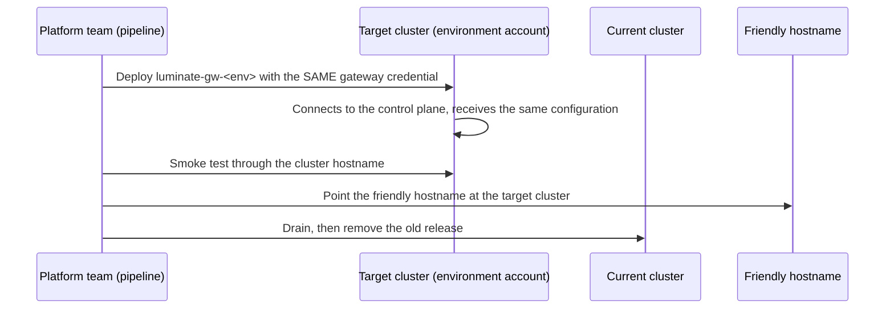

Both copies hold the same identity for the length of the cutover, and each receives the same
configuration push. Agents are unaffected apart from the DNS change, because their credential is
bound to the gateway record and not to the cluster. **No workload is re-credentialled.**

### The scaling ladder

| Rung | When | Operated by |
|---|---|---|
| **Tier 1** — one gateway per environment per region | The model in this spec | ACP platform team |
| **Tier 2** — a dedicated gateway for one team, per environment and region | Noisy neighbour, a compliance boundary, or a team whose blast radius must be its own | ACP platform team |
| **Tier 3** — a federated gateway operated by a business unit in its own account | A unit needs its own network, account, jurisdiction or provider-credential custody | The business unit, under the same control plane |

Tier 3 is the consortium **Federated Gateways** design (ACPDIS-124). It keeps one control plane,
one policy set and one audit trail, and binds every authorization decision to the gateway its
credential proves (DD-14). DD-3 is Tier 1 built the way Tier 3 will require, so a later move to
federated operation changes who runs a gateway and not how it is governed.

The consortium design phases it: **Phase 1** bound identity and gateway-held credentials, both
used by this topology from the start; **Phase 2** a unit's own identity provider, rotation without
a push, and held-credential health; **Phase 3** unit-scoped operator roles and fleet views, after
Multi-Tenancy. A business unit can operate its own gateway only once Phase 3 lands.

### Provisioning creates the environment mapping

A gateway is provisioned with its `GatewayEnvironment` row in the same step. An unmapped gateway is
invisible to the deployment form — an empty list with no error — so the provisioning script creates
the row and the smoke test asserts it.

## DD-16 · Every gateway has a friendly hostname that never changes

**Decision.** Each gateway is published on a hostname in the corporate domain that names its
environment and region, not its cluster:

| | `ca-central-1` | `us-east-1` |
|---|---|---|
| DEV | `luminate-gw-dev-ca.sunlifecorp.com` | `luminate-gw-dev-us.sunlifecorp.com` |
| SIT | `luminate-gw-sit-ca.sunlifecorp.com` | `luminate-gw-sit-us.sunlifecorp.com` |
| STAGE | `luminate-gw-stage-ca.sunlifecorp.com` | `luminate-gw-stage-us.sunlifecorp.com` |
| PROD | `luminate-gw-prod-ca.sunlifecorp.com` | `luminate-gw-prod-us.sunlifecorp.com` |

The control plane is published on `luminate.sunlifecorp.com`.

The last label is the **region code** from the region list in DD-19, so a further region adds a
column to this table and no new naming rule.

**Why.** A cluster hostname (`gw-dev.apps.slf-eks-t1k-ca-prod.aws.sunlifecorp.com`) names where a
gateway happens to run. Every agent configured with it breaks when the gateway moves — and DD-3
moves every non-PROD gateway. A friendly hostname names what the gateway *is*, so the move is a DNS
change that no agent sees, and so is any later move: a cluster rebuild, a region relocation, a
federated gateway.

**How.** Each name is a CNAME in the corporate (BlueCat) zone to the Traefik load balancer of the
cluster that runs the gateway, and a SAN on that cluster's Venafi certificate. The pattern above is
the proposal; the final names are fixed in the DNS request and recorded here.

**The cluster hostnames remain** as the operators' address for a specific cluster's copy of a
gateway — during a move, both copies are reachable by cluster hostname while the friendly name
decides which one serves agents. Business teams are only ever given the friendly name.

## DD-18 · Lower installs test Luminate, and nothing else

**Decision.** The dev, test and stage **installs** exist to promote Luminate itself — new releases,
configuration and migrations — before they reach the production control plane. Only the ACP
platform team uses them. No business team registers, deploys or runs anything on them.

| Install | Role | Business workloads |
|---|---|---|
| **dev** | Sandbox. Redeploy, reconfigure and break at will. | None |
| **test** | Release verification against a stable install | None |
| **stage** | Rehearsal of the production change with production-shaped data and approval | None |
| **prod** | The control plane for all four workload environments | All of them |

Two consequences follow:

- **A release reaches production through three installs, and a workload reaches production
  through four environments.** They are separate ladders with separate owners — the platform team
  and the business team — that happen to share names.
- **A lower install needs one gateway of its own** to test the gateway release. It needs no
  per-environment gateways, because it carries no business environments.

A lower install shares its account's clusters with the production control plane's gateways. They
are separate Helm releases in separate namespaces, with separate credentials, separate IAM roles and
a NetworkPolicy between them. The lower install has no connection to the production control plane.

## DD-19 · Serving regions are an open list

**Decision.** The regions gateways serve from are a **list kept by the ACP platform team**, not a
fixed pair. Today the list is `ca-central-1` and `us-east-1`. Any region where Sun Life runs
workload accounts and Amazon Bedrock is available can be added by the procedure below, with **no
change to this design**: a region adds clusters and gateways, never an install, an environment or a
project.

| Region | Code | Status |
|---|---|---|
| `ca-central-1` | `ca` | Serving |
| `us-east-1` | `us` | Serving |
| *Further regions* | *assigned when added* | *Added by the procedure below* |

**Region codes.** A code is short, unique and never reused or changed, because it appears in
gateway keys and hostnames (DD-16). The first region in a country takes the country code (`ca`,
`us`); a later region in the same country takes the AWS short form of its name (for example `usw2`
for `us-west-2`). Existing keys are kept: the `ca-central-1` gateways predate the convention and
carry no code (`luminate-gateway-dev`), and a gateway's key never changes (DD-3). New gateways are
keyed `luminate-gateway-<code>-<env>`.

**A region is added to all four environments.** A workload is promoted DEV → SIT → STAGE → PROD
within a region, so PROD use of a new region requires a gateway in every environment there. The
lower environments may come first; PROD comes last.

**Adding a region.** Each step reuses something this spec already defines for the first two:

| Step | What | Defined by |
|---|---|---|
| 1 | Record the business need, the residency regime and the region code; decide whether assurance needs re-submission (below) | DD-10, [Assurance](d2-design/assurance.md) |
| 2 | Request an EKS cluster in the region in each of the four workload accounts, with the gateway baseline | DD-3, [Architecture](d2-design/architecture.md#per-account-resources) |
| 3 | Provision the gateway hub role and in-account Bedrock access in each account; prove the approved models are callable in the region, and record which use cross-region inference | DD-3, DD-10 |
| 4 | Create the region's `Location` in the control plane and label it with its region (Platform Operator, with governance authority). Under Data Residency an unlabelled location serves no residency-bound use case | DD-15, DD-10 |
| 5 | Register one gateway per environment in that environment's gateway project, with its `GatewayEnvironment` mapping | DD-3, DD-15 |
| 6 | Prove the control link from each new cluster, and apply the default-deny NetworkPolicy | DD-13 |
| 7 | Publish the friendly hostnames with the region code | DD-16 |
| 8 | Configure residency labels and, where the regime requires it, regional trace content | DD-10 |
| 9 | Add the gateways to the pipeline and the smoke suite; publish the region to business teams | DD-15, DD-4 |

**Distance from the control plane.** Every call is authorized by the control plane (DD-13), so a
region far from it adds a round trip to every call. The added latency is measured in step 6 and
published with the region. If it is not acceptable for a region, that region needs a consortium
change to how gateways authorize, not a second control plane.

**When assurance must be re-submitted.** A region in a jurisdiction the approved ATG and ISRA do not
cover, or one that adds a residency regime, is a re-submission trigger. A further region in a
country already covered (for example a second US region) is recorded as a change to the Assurance
page.

---

# Segregation of duties — DD-8, DD-15

## DD-15 · Four layers of authority, and no one person holds two of them for production

**Decision.** Authority over the topology is split into four layers, each held by different people
through different mechanisms. **No change reaches STAGE or PROD on one person's authority**: every
such change has a maker and a different checker, and the systems refuse a checker who is also the
maker or the owner.

| Layer | What it controls | Where it is enforced | Held by |
|---|---|---|---|
| **1 · Infrastructure administration** | AWS accounts, EKS clusters, Helm releases, Terraform, the deployment pipelines | AWS IAM Identity Center, EKS access entries, namespaced Kubernetes RBAC, Jenkins, Bitbucket | ACP platform team |
| **2 · Control-plane administration** | Environments, locations, folders, projects, gateway registration, gateway attachment in STAGE and PROD | Luminate RBAC | ACP platform team |
| **3 · Governance** | The rules that apply in each environment, and the verdicts and approvals given under them | Luminate RBAC, with approval verbs separated in code | Governance administrators (authoring) and governance approvers (deciding) — separate people |
| **4 · Business use** | A team's own agents, models, tools and applications, and their DEV and SIT deployments | Luminate RBAC, scoped to the team's folder and projects | Business teams |

Business teams never act in layers 1 or 2. They see no gateway administration, no environment
administration and no other team's project. What they see and can do follows from the role
bindings on their own projects.

## Personas

| Persona | Layer | Luminate role, at what scope | Infrastructure access | Can | Cannot |
|---|---|---|---|---|---|
| **Business viewer** | 4 | Viewer on the team's project | None | Read the team's catalogue, deployments and findings | Change anything |
| **Builder** | 4 | Editor (or a per-type Editor) on the team's project; **Gateway Attacher** on the DEV and SIT gateway projects | None | Register resources; deploy to DEV and SIT; create access policies; request promotion to STAGE and PROD | Deploy to STAGE or PROD; issue credentials; approve anything |
| **Project owner** | 4 | Owner on the team's project | None | Everything a builder can, plus issue DEV and SIT workload credentials, delegate roles within the project, and give first-level approval of the team's promotions | Deploy to STAGE or PROD; approve their own request |
| **Platform operator** | 2 | Platform Operator at organization | None by itself | Create and order environments and locations; create folders and projects for new teams | Touch catalogue resources, deployments, access policies, governance or secrets |
| **Gateway administrator** | 2 | Gateway Administrator on the gateway projects | Deploy pipeline (as maker) | Register gateways, map them to environments, rotate gateway credentials | Approve their own pipeline run |
| **Production deployer** | 2 | Gateway Attacher on the STAGE and PROD gateway projects, plus deployment and credential verbs | None by itself | Create STAGE and PROD deployments after their approvals are complete; issue the workload credential | Approve the promotion they are carrying out; deploy to DEV or SIT on a team's behalf |
| **Governance administrator** | 3 | Governance Administrator at organization | None | Author rules, scopes, frameworks and enforcement mode per environment | Approve, verdict or transition a resource |
| **Governance approver** | 3 | Governance Approver, Access Policy Approver and the per-type Approver roles, at organization | None | Approve or reject promotions, access policies and governance verdicts | Author the rules they approve under; approve their own request; approve a resource they own |
| **Release engineer** | 1 | None required | Jenkins member; support and operate tiers on each cluster | Author changes to `luminate-sunlife-deploy`; trigger pipelines; triage | Merge their own pull request; approve a STAGE or PROD pipeline run |
| **Release approver** | 1 | None required | Jenkins lead (`User_JenkinsProdACPLead_ML`) | Review and approve pull requests and STAGE and PROD pipeline runs | Approve a run they triggered |
| **Break-glass administrator** | 1, 2 | Superuser (one account) | Cluster-admin through the account's administrator permission set | Recover from an incident | Act without a ticket; act without a second person present |

**Gateway Attacher** and **Gateway Administrator** are custom roles built from existing permissions
(`deployments.gateway_attachment.*` and `gateways.gateway.*`). Every other role is a predefined
Luminate role.

## How Luminate enforces the environment boundary

**Deploying a resource needs authority over both ends of the attachment.** Creating a deployment
requires the typed create permission at the **resource's** project and
`deployments.gateway_attachment.create` at the **gateway's** project. The second grant is the
environment control.

**So gateways are placed in one project per environment:**

| Project, under folder *Luminate Platform* | Holds | Gateway Attacher held by |
|---|---|---|
| **Gateways — DEV** | `luminate-gateway-dev`, `luminate-gateway-us-dev` | Builders and project owners |
| **Gateways — SIT** | `luminate-gateway-sit`, `luminate-gateway-us-sit` | Builders and project owners |
| **Gateways — STAGE** | `luminate-gateway-stage`, `luminate-gateway-us-stage` | Production deployers only |
| **Gateways — PROD** | `luminate-gateway-prod`, `luminate-gateway-us-prod` | Production deployers only |

A business team therefore can stand a deployment up in DEV and SIT on its own, and cannot in STAGE or
PROD, whatever role it holds on its own project. That is the structural form of *self-serve below,
gated above* (DD-8). It is a role binding, not a convention: an attempt without the binding is
refused by the authorization layer and audited.

**Placing a gateway at a residency-labelled location is a governance action.** Under Data Residency
(AIC-1075), placing a gateway at a labelled `Location` takes the same governance authority as
changing a residency label. The platform team registers and runs the gateway; the placement also
needs the Governance Administrator, so a gateway cannot be moved into a region by one team alone.

## The rule for production

**A change to STAGE or PROD needs two people, and the platform refuses the second if they are the
first.** This holds at every layer:

| Change | Maker | Checker | Enforced by |
|---|---|---|---|
| Promote a resource into STAGE or PROD | Builder or project owner, by request | Project owner, then governance approver | Approval chain with `exclude_requester` and the `resource_owner` relation excluded at the governance level |
| Governance verdict on a resource | — | Governance approver | Separated-duty permissions: approval verbs are withheld from every authoring role in code |
| Create the STAGE or PROD deployment | Production deployer | The completed approval chain above | Gateway attachment granted only on the STAGE and PROD gateway projects |
| Change a STAGE or PROD gateway's configuration or version | Release engineer, by pull request | Release approver, on the pull request and on the pipeline run | Bitbucket required reviewers; Jenkins lead approval; a ServiceNow change (CHG) |
| Change STAGE or PROD infrastructure | Release engineer, by pull request | Release approver | As above, through the Terraform pipeline |
| Change the rules in force | Governance administrator | Governance approver | Approval policies are themselves approval-gated (`approval_policy` subject) |

**Walter's question, answered directly.** *Can one person manage both non-production and production?*

- **For a business team, no.** Its members hold deployment authority in DEV and SIT only. STAGE and
  PROD are reached by request, approved by someone other than the requester, and carried out by a
  production deployer who is not a member of the team.
- **For the platform team, not alone.** Platform engineers work across environments by design, but
  every STAGE and PROD change needs a different approver at the pull request, at the pipeline and,
  for the control plane, in the approval chain. The people holding standing production authority —
  Jenkins lead, production deployer, break-glass — are named groups that are re-attested every
  quarter.

## Infrastructure access per account

Production access is an AWS entitlement on the **prod account** only. Holding access to the dev
account confers nothing in the prod account, so the account boundary in DD-3 is also an access
boundary.

| Tier | Identity | Cluster authorization | Granted in |
|---|---|---|---|
| **Support** | `luminate-support` role | Read and logs in the Luminate namespaces | Each account |
| **Operate** | Same role, operate tier | Support, plus restart and delete pod | Each account |
| **Deploy** | `slf-t1kacp-eks-deploy` → `luminate-deployer` | Namespaced admin in the Luminate namespaces | Jenkins only, never humans |
| **Break-glass** | The account's administrator permission set | Cluster-admin | Ticketed and time-boxed |

The product team's day-to-day entitlement on the stage and prod accounts is the support role. The
cluster-admin permission set is not held for routine work.

## Change paths

Every change to a gateway, the control plane or their infrastructure goes through a pull request
to `luminate-sunlife-deploy` and a pipeline. There is no supported path that bypasses them.

| Change | Pipeline | DEV and SIT gateways | STAGE and PROD gateways, control plane |
|---|---|---|---|
| Gateway version or configuration | `luminate-gateway-deploy` | Pull request approved by another engineer | Pull request + release approver + CHG |
| Control-plane version or configuration | `luminate-sunlife-deploy` | — | Pull request + release approver + CHG |
| AWS infrastructure | `luminate-terraform` | Pull request approved by another engineer | Pull request + release approver + CHG |
| Verification | `luminate-smoke` | None (read-only) | None (read-only) |

**STAGE and PROD deploy only from `main`.** A STAGE or PROD pipeline run refuses any other
reference, so what runs in production is always what was reviewed and merged.

**Configuration in the portal is not code.** Registering an agent, creating an access policy or
approving a promotion changes what a gateway serves through the control plane's own audited
workflows. It deploys no code and needs no CHG. The control is the approval chain above.

## Attestation

| Cadence | What is re-attested | By |
|---|---|---|
| Quarterly | Holders of Administrator, Platform Operator, Gateway Administrator, production deployer, Governance Administrator and Governance Approver bindings | ACP product owner, with the governance lead for layer 3 |
| Quarterly | Jenkins lead group membership; break-glass holders; stage and prod account entitlements | ACP product owner |
| On every change of role | Remove the bindings the person no longer needs | Their manager, through the access request |

## DD-8 · Self-serve below, gated above

| Action | DEV | SIT | STAGE | PROD |
|---|---|---|---|---|
| Register a resource | Team | Team | Team | Team |
| Deploy | **Team** | **Team** | Production deployer, after approval | Production deployer, after approval |
| Create an access policy | **Team** | **Team** | Team, approval-gated | Team, approval-gated |
| Issue the workload credential | Project owner | Project owner | Production deployer | Production deployer |
| Set quotas | Tier defaults | Tier defaults | Tier defaults, platform-set | Platform-set |
| Promote into | **Team** | **Team** | Gated | Gated |

The gate sits between SIT and STAGE because that is where Sun Life's own change discipline begins:
STAGE is the first environment with real integrations, and enforcement starts there (DD-5).

---

# Promotion — DD-4

**Decision.** Promotion is **a new deployment of the same catalogue resource on the next
environment's gateway**, carrying provenance and re-establishing everything that must not be
inherited. DEV and SIT are self-service. STAGE and PROD are reached by request, decided under
policy, approved by someone other than the requester, and carried out by a production deployer.

The resource itself never moves and is never copied. One agent has one catalogue record, one owner
and one governance record, and a deployment in each environment it has reached.

## The path

```mermaid
flowchart LR
    R["Register once<br/>in the team's project"] --> D["DEV<br/>self-serve · observe"]
    D --> S["SIT<br/>self-serve · observe"]
    S --> Q1{"Request STAGE"}
    Q1 --> P1["Policy evaluated<br/>STAGE rules · enforce"]
    P1 --> A1["Approved by project owner,<br/>then governance approver"]
    A1 --> G["STAGE<br/>deployed by production deployer"]
    G --> Q2{"Request PROD"}
    Q2 --> P2["Policy evaluated<br/>PROD rules · enforce<br/>STAGE evidence attached"]
    P2 --> A2["Approved by project owner,<br/>then governance approver"]
    A2 --> P["PROD<br/>deployed by production deployer"]
    style G fill:#fff8e1,stroke:#f9a825
    style P fill:#ffebee,stroke:#c62828
```

**Promotion is one step at a time**: DEV to SIT, SIT to STAGE, STAGE to PROD. A deployment in an
environment is per gateway, so reaching PROD in every serving region is one deployment per region under one approval.

## Into DEV and SIT — self-service

A builder, holding Gateway Attacher on the DEV and SIT gateway projects (DD-15):

1. Creates the deployment of the resource on the environment's gateway, with the access policies
   it needs in that environment.
2. Has the project owner issue the workload credential for that gateway.
3. Points the workload at the environment's gateway hostname with the new credential.

Governance observes in DEV and SIT: rules are evaluated and findings are shown, and nothing blocks.
A team reads the findings it will meet at STAGE from its first day in DEV.

## Into STAGE and PROD — request, decide, approve, deploy

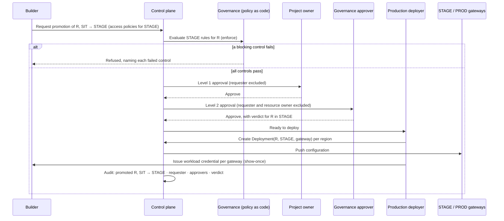

**What the approver decides.** Whether *this resource* may run in *this environment*, given the
rules in force there and the evidence attached. The approver sees the findings from the
environment below, the obligations resolved for the resource's risk band and frameworks, and the
access policies requested. Approval is recorded against the resource and environment, so a PROD
approval is never inferred from a STAGE one (DD-5).

**Who decides is fixed by policy, not by who is available.** Approval chains resolve their approver
pools from RBAC roles. The requester is excluded from every level, and the resource's owner is
excluded at the governance level. A chain that cannot find an eligible approver is *undecidable*,
not approved.

**What the production deployer does not decide.** The production deployer carries out an approved
promotion. They create the deployment and issue the credential; they do not approve, and they hold
no authority to deploy into STAGE or PROD without a completed approval.

## What moves, and what is re-established

| Carried forward | Re-established in the target environment |
|---|---|
| The **catalogue resource** — same agent, model or tool record, so identity and governance history stay continuous | **Credentials** — issued per `(resource, gateway)`; a new gateway means a new show-once secret |
| **Deployment configuration**, as a template of the shape that worked below | **Quotas** — the target tier's defaults, never the source's |
| **Provenance** — the source environment and source deployment, recorded on the new deployment | **Access policies** — granted for the target environment, approval-gated in STAGE and PROD |
| **Evidence** — evaluations and findings produced below, attached to the request | **Governance verdict** — given per environment |

**The asymmetry is deliberate.** A promotion that inherited DEV's quotas and DEV's access grants is
how a test budget and a test audience would reach production.

**Dependencies are promoted too.** An agent that calls a model or a tool needs those resources
deployed, and access to them granted, in the target environment. The promotion request names them,
and the approver sees them.

## What changes for the workload — configuration only

Each environment's gateway has its own friendly hostname (DD-16), and each deployment has its own
credential. Promotion therefore changes exactly two values in the workload's configuration:

| Value | DEV | PROD |
|---|---|---|
| Gateway | `https://luminate-gw-dev-ca.sunlifecorp.com` | `https://luminate-gw-prod-ca.sunlifecorp.com` |
| Credential | DEV credential for that gateway | PROD credential for that gateway |

The agent's call sites do not change between environments. Teams integrating through the
`acp-harness-sdk` set both values through `ACP_`-prefixed configuration, so promotion is a
configuration change and never a code change.

Where a gateway physically runs is invisible to the workload: moving a gateway between accounts or
clusters (DD-3) changes neither value.

## After PROD

A workload that reaches PROD keeps its DEV and SIT deployments; that is where the next change is
built and tested. Withdrawal is explicit — deleting a deployment revokes its credential — and is
never automatic.

## Repeatability

Promotion is an orchestration of control-plane actions: request, approve, deploy, issue. Each step
is an API call, audited by the control plane, and the platform team runs the STAGE and PROD steps
through a scripted path rather than a sequence of portal clicks. The business team uses the portal
or the harness SDK for the steps it owns. The procedure is published for business teams in
`luminate-user-guides` under *Promoting your agent*.

---

# Governance and policy — DD-5

## DD-5 · The same rules everywhere; observe below, enforce above

**Decision.** Governance rules apply in every environment. In DEV and SIT they **observe**: they
are evaluated, and their findings are shown to the team, but nothing is blocked. In STAGE and PROD
they **enforce**: a resource that fails a blocking control is refused, and the refusal names the
control.

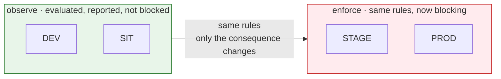

This is the most valuable property of the strategy: **the rules do not change at STAGE, only their
consequence does.** A team that has read its findings since DEV meets no new requirement at the
gate.

## How it works

| Element | In Luminate | Set by |
|---|---|---|
| **Applicability** — which resources a rule governs | `ApplicabilityRule`, matched over governance-authoritative attributes (risk band, frameworks, data classification, `service_tier`) | Governance administrator |
| **Obligations** — what a governed resource must evidence | Obligation profiles keyed by framework and risk band | Governance administrator, from the policy owner's requirements |
| **Enforcement mode** — observe or enforce, per rule, per environment | `RuleEnforcement`, promoted one environment at a time, each promotion gated on an acknowledged impact report | Governance administrator |
| **Status** — whether a resource is compliant in an environment | `GovernanceStatus`, one row per `(resource, environment)` | Computed |
| **Verdict** — whether a resource is approved in an environment | `GovernanceVerdict`, given through the approval chain | Governance approver |
| **Refusal** — what a team sees when enforcement blocks | The refusal names each blocking control | Computed |

**Enforcement is promoted, never switched on globally.** Moving a rule from observe to enforce is a
per-rule, per-environment action, and it is refused until the impact report for that rule — which
resources it would block, and why — has been generated and acknowledged. Demotion carries no gate,
because turning a control off during an incident must be fast.

## Who sets the rules, and who decides under them

| Role | Does | Does not |
|---|---|---|
| **Policy owner** — Model Risk (CMRM) for model and agent risk; Governance-by-Design for intake obligations; Privacy and Security for their domains | States the requirement: what must be true before a resource reaches STAGE or PROD | Configure the platform |
| **Governance administrator** | Encodes the requirement as rules, applicability and obligations; promotes enforcement per environment | Approve, verdict or transition a resource |
| **Governance approver** | Approves or rejects a resource in an environment, and access policies that reach STAGE or PROD | Author the rules; approve their own request; approve a resource they own |
| **ACP platform team** | Operates the mechanism and stewards the rule set until each policy owner takes it on | Set policy on a policy owner's behalf |

**Policy as code.** Model Risk's pre-production checklist — today worked by hand in Archer — is
encoded as rules evaluated at the STAGE and PROD gates. The `acp-cmrm-policy-as-code` repository
holds that encoding; the control plane evaluates it on every promotion. A checklist item becomes an
obligation the resource must evidence, and a failed item becomes a named, blocking control.

**The separation is enforced in code, not by convention.** The approval verbs
(`governance.resource.approve`, `governance.resource.transition`) are withheld from every authoring
role, including Administrator, and held only by Governance Approver. Writing a rule and approving
under it is the conflation the split exists to prevent. The platform checks the separation at
start-up and refuses to run if the role definitions disagree with it.

## Does a STAGE verdict carry into PROD?

**No.** `GovernanceStatus` and verdicts are per `(resource, environment)`, so PROD is decided in its
own right. A STAGE verdict, and the evidence behind it, is attached to the PROD request as input to
that decision. The resource may carry different attributes, quotas and audience in PROD, which is
the reason for a separate tier.

## Policies a gateway enforces on every call

Governance decides what may be deployed where. The gateway then enforces, on every call:

| Control | Effect |
|---|---|
| **Deployment on this gateway** | A resource is reachable only through a gateway it is deployed on. A resource in SIT is not reachable through the STAGE gateway. |
| **Access policy** | A caller reaches a target only if an active access policy allows it, optionally narrowed to an environment, location, gateway or provider |
| **Governance status** | A target whose status in this environment is non-compliant, stale or untrusted is refused where its rule enforces |
| **Guardrails** | Content inspection — PII detection, banned terms, and the other configured guardrails — runs inside the gateway, in its region |
| **Residency** | A residency-labelled caller or target is refused at a gateway outside its permitted regions (DD-10) |
| **Cross-environment rules** | A call from one environment's resource into another environment is refused unless the standing matrix allows it (DD-6) |

---

# Connectivity — DD-6, DD-13, DD-14

Three questions, three decisions: which workload environments may reach each other (DD-6), how a
gateway in one account reaches the control plane in another and why that is allowed (DD-13), and
how the control plane knows it is talking to the gateway it thinks it is (DD-14).

## DD-13 · One outbound control link per gateway, and nothing else crosses

**Decision.** The only communication between a gateway in a non-production or stage account and
the production account is the gateway's **control link**: gateway-initiated, outbound, over TLS on
port 443, to a fixed set of production endpoints, authenticated by the gateway's own credential,
and carrying no workload content. The production account opens no connection into any other
account.

### Why this needs a decision

The Infrastructure, Platform and Network Security Directive, section 2.3:

> Any new workload communication is strictly prohibited between new environments (e.g. Production,
> Stage, Non-production, Lab), as described in Appendix D, and requires authorized access and
> inspection layers.

A single control plane governing four environments is, by construction, communication between
environments. Every topology that keeps one catalogue and one governance record has it; the choice
is only *how much* of it there is and what it carries. The alternative that removes it entirely —
one Luminate install per environment — is what DD-1 rejects, because it ends the single governance
record that model risk and audit rely on.

So this design does not claim the link is absent. It **minimizes it, fixes its direction, removes
content from it, authenticates and inspects it, and submits it for approval** through the ATG and
ISRA (see [Assurance](d2-design/assurance.md)).

### What crosses

| Flow (see [Architecture](d2-design/architecture.md#data-flows)) | Direction | Carries |
|---|---|---|
| F-3 Control stream | Gateway → control plane | Configuration down, including any provider credential the control plane resolves (none for Bedrock, which is keyless through the in-account role); health and status up |
| F-4 Access decision | Gateway → control plane, per call | Identifiers only |
| F-5 Token issuance | Gateway → control plane | The gateway's own access token |
| F-6 Signing keys | Gateway → control plane | Public keys |
| F-7 Audit and usage | Gateway → control plane | Identifiers, counts, outcome enums |
| F-8 Telemetry | Collector → central Langfuse | Trace metadata, content removed |

**Nothing else.** In particular, no prompt, response, tool argument or tool result crosses
(DD-12), no business workload in a lower account can reach anything in the production account, and
nothing in the production account can initiate a connection to a lower account.

### How it satisfies "authorized access and inspection layers"

| Requirement | How the control link meets it |
|---|---|
| **Authorized access** | Each gateway authenticates with an OAuth client credential minted for that gateway by the control plane. Every decision is made for the gateway the credential proves, never for a gateway a request claims (DD-14). Workloads in lower accounts hold no production credential of any kind. |
| **Inspection** | The link leaves the workload account through the enterprise network path between accounts and enters the production account only at the control plane's ingress, where TLS terminates and every request is authenticated, authorized and audited. The set of endpoints is fixed and enumerable, so a network control can allow exactly those hostnames on port 443 from each gateway cluster and nothing else. |
| **Least privilege** | Outbound only; port 443 only; to three production hostnames — the portal, its identity provider and the telemetry store; from gateway namespaces and collectors only, enforced by egress NetworkPolicy. |
| **Minimal data** | Identifiers, configuration, counts and outcome enums. Content stays in the workload account (DD-10, DD-12). |
| **Auditability** | Every control-link call is an authenticated request recorded by the control plane, attributable to one gateway. |

**The approval path.** The directive owner's position, relayed in the 2026-10-06 session, is that
the model is acceptable once the architecture and its security assessment are signed off. The ATG
records the architectural decision; the ISRA assesses the link against the directive. If the ISRA
concludes the link needs a formal exception, a Security Exception (directive section 13) is raised
with this page and the [Assurance](d2-design/assurance.md) page as its evidence.

### Network path

The gateway reaches the control plane through the control plane's **public ingress hostname**, not
the pod network. Pod address ranges overlap across Sun Life's EKS VPCs (each carries the same
non-routed secondary range), so pod-to-pod routing between clusters is neither possible nor wanted.
The ingress address is routable across the enterprise network, and the TLS certificate it presents
chains to the Sun Life root.

This is the path the `us-east-1` gateways already use to reach the `ca-central-1` control plane. It
is the same whether the gateway is in another region of the production account or in another
account.

### Ingress for agents

Each gateway is published on its friendly hostname (DD-16) through its cluster's Traefik ingress,
with a Venafi certificate covering the hostname and TLS to the gateway pod. Agents in the same
environment reach their gateway through the enterprise network on port 443. A gateway accepts
traffic only through its ingress; it has no other listener reachable from outside its namespace.

### NetworkPolicy on gateway namespaces

Every `luminate-gw-<env>` namespace carries a default-deny NetworkPolicy with exactly these
exceptions:

| Direction | Allowed peer | Port |
|---|---|---|
| Ingress | The cluster's Traefik ingress | Gateway listener |
| Egress | Cluster DNS | 53 |
| Egress | The control plane's ingress (F-3 to F-7) | 443 |
| Egress | The cluster's OTel collector (F-8) | OTLP |
| Egress | AWS STS and Bedrock regional endpoints | 443 |
| Egress | Registered tool and agent endpoints, by policy | 443 |

The lower Luminate install on the same cluster is therefore unreachable from the gateways, and
the gateways are unreachable from it.

## DD-14 · The control plane trusts a gateway only as itself

**Decision.** Every authorization decision the control plane makes for a gateway is made **for the
gateway its credential proves**. A request that names a different gateway, environment or location
is refused. The control plane publishes signing keys at an address every gateway can reach, so a
gateway validates tokens without any route into the control plane's cluster.

**Why this matters more once gateways leave the production account.** While every gateway ran in
the production account, a gateway's claim about its own identity was a production workload talking
to itself. A gateway in the dev account is a non-production workload. If it could name the PROD
gateway or the PROD environment in its requests and be believed, the environment boundary would be
whatever a lower account asserts. Binding the decision to the proven credential closes that.

| Property | Design |
|---|---|
| **Bound identity** | The gateway credential identifies one registered gateway. The control plane resolves the gateway, its environments and its location from that, and refuses any request whose claims disagree. This is the *bound identity* guarantee of the consortium Federated Gateways design (ACPDIS-124). |
| **Configuration is per gateway** | A gateway receives only the configuration for the deployments on it. The DEV gateway never holds STAGE or PROD configuration or credentials. |
| **Reachable signing keys** | The JWKS URI the control plane pushes to gateways is the identity provider's public HTTPS address, which resolves and verifies from every cluster. No gateway depends on an in-cluster service name. |
| **TLS everywhere off-cluster** | The control link uses TLS with certificate verification against the Sun Life root. A plaintext hop is used only inside a single cluster under NetworkPolicy, and no environment's gateway uses one in the target topology. |
| **Credential custody** | Each gateway's OAuth credential is stored in Vault and synced into its namespace by the Vault Secrets Operator. Rotation is per gateway and does not touch any other. |

!!! info "Consortium design: Federated Gateways (ACPDIS-124, `luminate-designs` branch `designs/ACPDIS-124-federated-gateways`, Draft)"
    Written for business-unit gateways (Tier 3), but its Phase 1 is what this topology needs from
    day one:

    - **Bound identity** (T49). The access decision resolves the gateway from its bearer, matched
      on the same client identifiers the control stream uses. A request naming another gateway is
      refused without evaluation, entry by entry in a batch check.
    - **Gateway-held provider credentials.** The gateway reads a provider key from a store mounted
      in its own account (Vault-populated), and the control plane holds only its name. That takes
      the last secrets off F-3 for any non-Bedrock provider served from a lower account (T74).
    - **Placement needs authority over both projects**, pinned against a concurrent move. That is
      the guarantee the per-environment gateway projects rely on (DD-15).
    - **The portal's gRPC endpoint does not terminate TLS.** Cross-network gateways put TLS in front
      of it, which DD-13's ingress path already does.

    Later phases add a per-gateway trusted identity provider (until then every gateway uses the
    production token endpoint, F-5), rotation without a push, and held-credential health in the
    fleet view. Outage behaviour stays with ACPDIS-133.

## DD-6 · Default-deny between workload environments

**Decision.** A resource deployed in one workload environment may not call a resource in another,
except along a small, published allow matrix. The matrix is evaluated by the control plane on every
access decision.

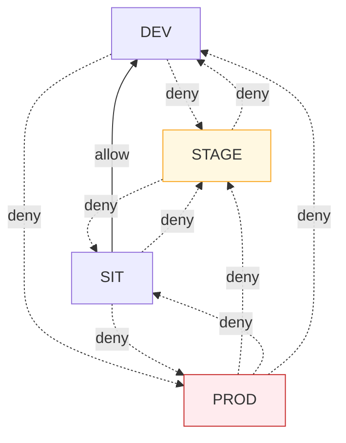

| Source → target | Action | Why |
|---|---|---|
| Same environment | Not matrix-evaluated | The normal case |
| SIT → DEV | **allow** | Integration testing legitimately reaches down |
| STAGE → SIT, STAGE → DEV | **deny** | Pre-production must not depend on non-production |
| PROD → anything else | **deny** | The rule the auditors ask about first |
| DEV or SIT → STAGE or PROD | **deny** | Test traffic must not reach pre-production or production |

Everything not listed is denied. The matrix is a second, independent control on top of the
account boundary: a gateway serves only deployments in its own environment, and the matrix refuses
a cross-environment call even where a credential or an access policy would otherwise allow it.

**Ownership.** The ACP platform team owns the matrix, and every change is audited. A change needs
two platform-team approvers and carries a time-boxed reversal.

**Legibility.** A matrix denial names the matrix as its cause. A generic authorization failure
would send a team hunting through access policies for a rule that is not there.

---

# Data isolation — DD-10

**Decision.** Data classification is a first-class input to the topology. Isolation is achieved by
**seven boundaries**, each carried by a named mechanism and each verifiable on its own. Because
DD-3 places each environment's gateways in that environment's account, the strongest boundaries are
account boundaries rather than namespaces.

## How isolation is achieved

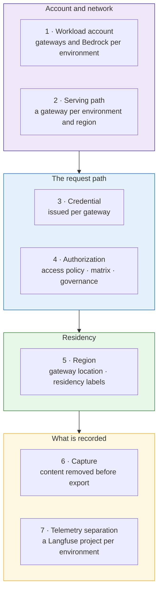

| # | Boundary | What it separates | Mechanism |
|---|---|---|---|
| 1 | **Workload account** | Environment from environment, at the infrastructure level | Each environment's gateways, their Bedrock access, their capacity and their operator entitlements are in that environment's AWS account (DD-3) |
| 2 | **Serving path** | Environment from environment, at the traffic level | One gateway per environment per region, in its own namespace, with default-deny NetworkPolicy (DD-13) |
| 3 | **Credential** | Caller from environment | A workload credential is issued per `(resource, gateway)`. A DEV credential does not authenticate at the PROD gateway. |
| 4 | **Authorization** | Resource from resource | Access policies, the cross-environment matrix (DD-6) and per-environment governance status (DD-5), evaluated by the control plane on every call for the gateway the credential proves (DD-14) |
| 5 | **Region** | Region from region | A gateway's `Location`; residency labels on locations, projects and resources |
| 6 | **Capture** | Content from the telemetry store | The cluster's collector removes prompt and completion content from traces before export (DD-10a) |
| 7 | **Telemetry separation** | One environment's records from another's | A Langfuse project and key pair per environment (DD-10b), with a retention limit (DD-10c) |
| + | **Blast radius** | Failure from failure | Per-gateway capacity and autoscaling, per-tier quota defaults (DD-9), and a per-gateway kill switch |

Boundaries 1 to 5 govern the request path. Boundaries 6 and 7 govern what the request path
records. Telemetry is the only place content would otherwise accumulate and outlive the request,
which is why it has two boundaries of its own.

## Where content goes

| Data | Where it is processed | Where it is stored | Crosses an account or region boundary |
|---|---|---|---|
| Prompts, completions, tool arguments and results | The gateway, and Bedrock in the gateway's own account and region | Nowhere by default; the gateway is stateless | **No** |
| Content inspection (guardrails) | Inside the gateway, in its region | Outcome only | Outcome enums and counts only |
| Identifiers — caller, target, gateway, environment, location | The control plane | The control plane's audit trail | Yes — this is the control link (DD-13) |
| Usage and cost | The control plane | The control plane's usage ledger | Yes, as counts |
| Trace metadata | The cluster's collector | Central Langfuse, in the environment's project | Yes, with content removed |
| Policy bodies | The control plane, in-process | The control plane | No |

**Bedrock is in-account.** Each gateway calls Bedrock with its own role, in its own account and
region. No environment's inference runs in another environment's account, and none is routed
through a shared spoke account.

**Where a model processes a request is a property of the model offering.** A cross-region inference
profile (for example `us.anthropic.*`) may process a request in another AWS region within the
profile's region set. Residency for a use case is therefore confirmed per model offering, and the
approved-model list states which offerings stay in-region.

## Residency labels

The control plane can confine a regulated use case to a region. A governance attribute, named by
`DATA_RESIDENCY_ATTRIBUTE_KEY`, labels locations, projects and resources with the regions they may
run in. Once a label is set:

| Control | Effect |
|---|---|
| **Placement** | A labelled resource cannot be deployed on a gateway whose location does not carry a permitted region, and a gateway bundle withholds it if its labels change later |
| **Calls** | A labelled caller or target is refused at an out-of-region gateway, checked on every call |
| **Credentials** | An out-of-region project's account binding is withheld, so its provider credential never reaches that gateway |
| **Content** | The gateway keeps the request's content out of any trace, log or mirror whose sink is not declared to be in a permitted region (`GATEWAY_TRACE_CONTENT_REGIONS`), and the portal never fetches it centrally |

Placing a gateway at a labelled location is itself a governance action, because every decision
above trusts the gateway's location — another reason DD-14 binds location to the gateway's proven
identity.

!!! info "Consortium design: Data Residency (AIC-1075, `luminate-designs` branch `designs/AIC-1075-data-residency`, Draft)"
    The controls above are that design's Phase 1. What it adds for this topology:

    - **It fails closed, so the order of switching it on matters.** An unlabelled `Location`
      satisfies no label, so every location, including `Default`, is labelled before any use case
      is. A gateway that does not declare it enforces the content ruling is refused every bound
      request, so all gateways run a residency-capable build first. A key that names no definition
      restricts all content to nowhere rather than refusing traffic.
    - **Content can stay in region and still be debuggable.** A region may keep content in its own
      trace store: the collector sends the full record there and a stripped copy centrally, and the
      portal links the operator's browser to the regional view (`TRACE_REGIONAL_CONTENT_URLS`)
      without fetching it. DD-10a stays the default; a regional store is opt-in, per region, when a
      regime needs debuggable content.
    - **Tenant and folder labels are Phase 2**, after Multi-Tenancy. Until then labels go on
      projects and resources.
    - **Gaps a residency-bound use case must work around until later phases:** an external guardrail
      evaluator (Model Armor) has no declared region, so none is attached to a bound use case; an
      agent's own downstream calls do not inherit the restriction; organization-wide administrators
      are not limited (Phase 3); and where *operators* sit is not covered (personnel residency), so
      it rests on account entitlements (DD-15).

## The capture boundary — DD-10a, DD-10b, DD-10c

Specified in the order that decides exposure: what is captured, then who can read it, then how
long it is kept. Only the first closes the question; the other two bound it.

| # | Control | Effect | Where |
|---|---|---|---|
| **DD-10a** | **Remove content at the collector** | No content in central telemetry, whatever any emitter sends | A `redaction` or `transform` processor in every cluster's collector, ahead of export |
| **DD-10b** | **A Langfuse project per environment** | "Who could read PROD records" has an answer; DEV readers cannot query PROD | Central Langfuse, one project and key pair per environment |
| **DD-10c** | **Retention** | Records expire | ClickHouse TTL on trace tables |

**The durable form is a governance obligation.** The consortium Governance Mode design maps a
resource's frameworks and risk band onto a `capture_policy` of `metadata_only` or
`content_opt_in`. Content capture then becomes an obligation a framework opts into for a specific
resource, not a platform default. DD-10a is the platform floor underneath it.

## Control requirements this design satisfies

Mapped to OSFI B-13, *Technology and Cyber Risk Management*, which applies to all Sun Life
workloads.

| Control | Requirement | How this design meets it |
|---|---|---|
| **B-13 §2.1** Technology architecture | Architecture aligned to risk | Each environment is a separate account, gateway, namespace and credential — not a tag on a shared path |
| **B-13 §3.1.4** Data identified, classified and protected | Classification drives control | Classification and residency are inputs to placement and to every authorization decision |
| **B-13 §3.2.4** Layered cyber controls | Defence in depth | Seven independent boundaries. A credential failure is caught by authorization; an authorization failure is bounded by the account, the quota and the kill switch |
| **B-13 §3.2.5** Data protection and loss prevention | Controls at rest, in transit and in use | In transit — content never enters the control link. In use — guardrails run in region. At rest — content is removed before export, separated per environment and expired |
| **B-13 §3.2.7** Identity and access management | Risk-based access | Per-gateway credentials; bound gateway identity; RBAC visibility over the resource hierarchy; separated duties (DD-15) |
| **B-13 §3.3.1** Centralized security logging | Centralized logging for investigation | One audit record per call, carrying identifiers, counts and outcome enums |

A central audit trail and regional data isolation are usually in tension. Here they are not,
because the record that centralizes is **metadata by contract** rather than content redacted after
the fact.

### Regime applicability

| Regime | Applies to | What it asks of this design |
|---|---|---|
| **OSFI B-13** | All workloads | The controls mapped above |
| **PIPEDA**, **Quebec Law 25**, **PHIPA** | Canadian workloads; health data | Purpose limitation, retention limits, disposal — residency labels and DD-10c |
| **HIPAA** Security Rule technical safeguards | US workloads handling PHI | Access control, audit, integrity, transmission security — the `us-east-1` gateways and residency labels |

Which regime applies to a workload is a compliance determination, recorded as a governance
attribute on the resource. The topology supplies the boundaries; it does not decide the regime.

---

# One control plane — DD-11, DD-12, DD-17

**Decision.** One Luminate install and one portal govern every environment and every region.
Regional and environment isolation is delivered by **where a gateway runs** (DD-3), **where a
resource sits in the hierarchy** (who can see it, DD-11) and **what never leaves the gateway**
(what can be read, DD-12) — not by a second control plane. Because there is one, it is built for
availability (DD-17).

## Why one control plane survives the objections

| Objection | Really asking | Answer |
|---|---|---|
| "How does a regional team see only its own gateways and resources?" | Is visibility isolation real, and on what axis? | DD-11 |
| "Will a regulator accept a central control plane?" | What data crosses the region and account boundary? | DD-12 |
| "Doesn't one portal mean one point of failure?" | What happens to traffic when the control plane is unavailable? | DD-17 |
| "Doesn't one portal mean one bug reaches every environment?" | How are control-plane changes proven before production? | DD-17 and DD-18 |

## DD-11 · Visibility follows the hierarchy, not a region tag

Visibility is enforced server-side. List endpoints resolve the caller's effective scopes and filter
by them, failing closed to an empty result. Scopes are `organization`, `folder`, `project` and
`resource`; a binding at a project lets its holder see that project and nothing beside it.

**A team sees only what sits under the folder or project its bindings are scoped to.** A regional
or business-unit boundary is therefore modelled as a folder, with each team's projects beneath it:

| Folder | Holds | Visible to |
|---|---|---|
| *Luminate Platform* | Gateway projects (one per environment), platform-owned models, shared resources | ACP platform team; shared models and resources by grant |
| One folder per business unit or region | That unit's projects | That unit's bindings |

`Location` is not a visibility scope. It constrains what may reach what (through access policies
and residency labels), not who can see what. Visibility and authorization compose: list visibility
filters by scope, and each action on a specific object is authorized again on its own.

## DD-12 · What crosses the account and region boundary

A gateway talks to the control plane on every call. What that call can carry is fixed by the wire
contract, so it is enumerated rather than asserted.

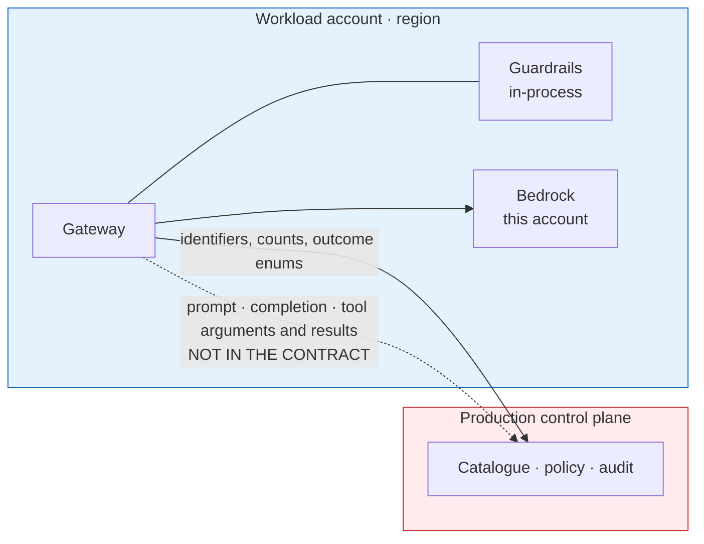

| Toward the control plane | Class |
|---|---|
| Caller, target, selector, gateway, environment, provider, location | Identifiers |
| API key id, delegation flag and scopes, actor type and id | Identifiers and flags |
| Guardrail outcome — matched-term count, matched category labels | Counts and labels, never the matched text |
| Prompt, completion, tool arguments, tool results | **Not in the contract at any version** |

| Supporting fact | Consequence |
|---|---|
| Guardrails evaluate inside the gateway | Content is inspected where it already is |
| Policy is evaluated inside the control plane, and no policy body is sent to a gateway | Nothing about the rules leaks into a lower account |
| The gateway is stateless — no database, no session store | No content store by default. A regional trace store is opt-in under Data Residency (DD-10) and is never central |
| Telemetry content is removed at the collector before export (DD-10a) | The telemetry path carries metadata only |

!!! note "Statement of fact for a regulatory or security review"
    The only data leaving a gateway's account and region is identifiers, counts and outcome
    enumerations — no prompt text, no completion text, no tool arguments or results, and no request
    or response bodies. Content inspection runs inside the region. The gateway holds no persistent
    state.

## DD-17 · The control plane is built for availability, and gateways fail closed

**Decision.** Every gateway asks the control plane before serving a call. If it cannot get an
answer, it refuses the call: **no call runs without a decision.** The control plane is therefore
run for availability across zones, with tested recovery, and its region is chosen so that both
regions' gateways reach it.

| Concern | Design |
|---|---|
| **Compute** | At least three backend replicas, one per availability zone, with a disruption budget; frontend and worker at two or more |
| **Identity** | Two Keycloak instances across zones |
| **Database** | RDS PostgreSQL, Multi-AZ, with point-in-time recovery |
| **Telemetry** | ClickHouse with scheduled backups to S3 and a tested restore |
| **Recovery** | Rebuild from `luminate-sunlife-deploy` plus a database restore, rehearsed in the stage install |
| **Monitoring** | Alerts on control-link errors seen by gateways (`portal_unreachable` refusals) and on control-plane health |
| **Region** | One region, chosen by the us-east-1 relocation decision (`us-cutover`, EACPP-1407). Gateways in every serving region reach it the same way (DD-13). |

**Fail closed is the right default.** An outage of the control plane stops traffic; it never lets
ungoverned traffic through. The consortium is designing what a gateway may continue to serve
during a control-plane outage (ACPDIS-133) — a bounded, cached decision set co-located with the
gateway. It improves availability without moving the decision out of the control plane, and this
topology adopts it when it lands.

**One bug reaching every environment.** Control-plane releases are promoted through the dev, test
and stage installs before they reach production (DD-18), and promoted by image digest so the bytes
tested are the bytes deployed. A gateway release is promoted through the DEV, SIT and STAGE
gateways before the PROD gateways. A change therefore reaches PROD traffic last, not first.

---

# Environments, quotas and credentials — DD-7, DD-9

## DD-7 · Environments are shared tiers, and teams are separated by project

`Environment` has no project, folder or tenant key. The four environments are shared by every team,
and that is the right model for an SDLC: per-team environments would fragment the promotion path
and grow the cross-environment matrix combinatorially.

**Separation between teams is the project's job, not the environment's.** A team's resources,
deployments, access policies and usage are scoped to its projects (DD-11), and another team's DEV
deployment is invisible to it even though both are in DEV.

A genuinely private environment — a regulated pilot, a vendor sandbox — is expressed as a dedicated
gateway (Tier 2 of the scaling ladder, DD-3) serving a project-restricted audience, not as a new
environment.

## DD-9 · Quota defaults by tier

| Tier | Requests | Tokens | Spend | Intent |
|---|---|---|---|---|
| DEV | Low | Low | Low | Enough to build; visibly insufficient for load testing |
| SIT | Moderate | Moderate | Moderate | Integration runs |
| STAGE | Production-shaped | Production-shaped | Production-shaped | Meaningful verification |
| PROD | Sized to demand | Sized to demand | Budgeted | Real traffic, with headroom |

`Quota` binds to a target deployment, so tier defaults are applied when the deployment is created —
the moment promotion already touches. A STAGE or PROD quota above the tier default is an
approval-gated change.

**The account is a second, hard ceiling.** Each environment's Bedrock calls are made in its own
account (DD-3), so its spend is also bounded and visible by AWS account, and a DEV workload cannot
spend from the PROD account under any quota setting.

## Credentials across environments and regions

A workload credential is issued for one `(resource, gateway)` pair and shown once. Four
environments and two serving regions today means up to eight credentials per resource; each further region adds four.

| Event | Action |
|---|---|
| Promotion into an environment | A new credential for each target gateway |
| Rotation | Per gateway; rotating DEV does not touch PROD |
| Withdrawal | Deleting the deployment revokes its credential |
| Gateway moves to another cluster or account | **Nothing** — the credential is bound to the gateway record, not to where it runs (DD-3) |

Issuing the credential is the last step of a promotion (DD-4), so the secret is created exactly
when it is first needed and handed to the team that will use it.

---

# Assurance — the ATG submission and the ISRA control set

| Record | Identifier |
|---|---|
| Architecture governance (ATG) | **To be raised** for this topology |
| Security risk assessment (ISRA) | **To be raised** for this topology |
| Platform baseline this extends | ATG0005196 / ISRA 26-0739 — the ACP platform, approved |
| Identity baseline this relies on | ATG0005518 / ISRA 26-1565 — Keycloak as the internal M2M issuer for this workload, approved |

**Scope of the new records.** The gateway deployment topology in this spec: one production
Luminate control plane governing the DEV, SIT, STAGE and PROD workload environments, with each
environment's gateways in that environment's AWS workload account, in each serving region (today
`ca-central-1` and `us-east-1`), the procedure for adding a serving region (DD-19), and the control
link between them (DD-13). It includes the segregation of duties
(DD-15) and the promotion process (DD-4) that keep the environments apart.

**Out of scope** — already covered by the baseline records, and unchanged by this topology: the
control plane's own components, its data tier and observability tier, and Keycloak as the M2M
issuer. Adding an account or environment to the tables on the
[Architecture](d2-design/architecture.md) page is a change to the assessed scope. Adding a region follows the
rule in DD-19: it is a change to the assessed scope only in a jurisdiction or residency regime these
records do not cover. Adding a gateway inside an existing account, environment and region is not.

This page lets the ATG and ISRA submissions be produced from the spec rather than reconstructed.
It states what the architecture is, which decisions were taken and why, how the design stands
against the Infrastructure, Platform and Network Security Directive, and which controls exist with
what evidence.

## The architecture, as submitted

The [Architecture](d2-design/architecture.md) page is the architecture of record: accounts and clusters,
component placement, the ten data flows F-1 to F-10, hostnames and per-account resources.

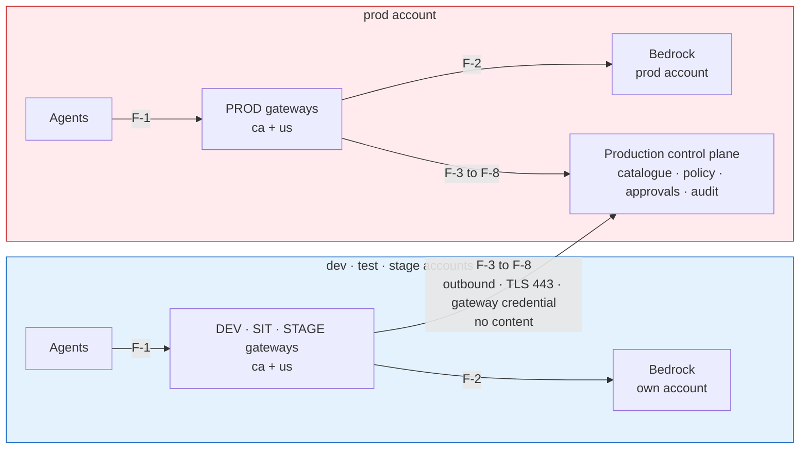

## Design decisions

| # | Decision | Page |
|---|---|---|
| **DD-1** | One production control plane owns all four workload environments | [Topology](d2-design/topology.md) |
| **DD-2** | DEV, SIT, STAGE, PROD; SIT in the test account; `service_tier` per environment | [Topology](d2-design/topology.md) |
| **DD-3** | One gateway per environment per region, in that environment's workload account | [Topology](d2-design/topology.md) |
| **DD-4** | Promotion is a new deployment of the same resource, approval-gated into STAGE and PROD | [Promotion](d2-design/promotion.md) |
| **DD-5** | The same rules everywhere; observe in DEV and SIT, enforce in STAGE and PROD | [Governance](d2-design/governance.md) |
| **DD-6** | Default-deny between workload environments, with a published allow matrix | [Connectivity](d2-design/connectivity.md) |
| **DD-7** | Environments are shared tiers; teams are separated by project | [Environments, quotas and credentials](d2-design/access-and-quotas.md) |
| **DD-8** | Self-serve into DEV and SIT; STAGE and PROD gated | [Segregation of duties](d2-design/segregation-of-duties.md) |
| **DD-9** | Quota defaults by tier, with the account as a hard ceiling | [Environments, quotas and credentials](d2-design/access-and-quotas.md) |
| **DD-10** | Seven data-isolation boundaries; content removed before telemetry export | [Data isolation](d2-design/data-isolation.md) |
| **DD-11** | Visibility follows the resource hierarchy | [One control plane](d2-design/one-control-plane.md) |
| **DD-12** | Only identifiers, counts and outcome enums cross the account and region boundary | [One control plane](d2-design/one-control-plane.md) |
| **DD-13** | One outbound control link per gateway, and nothing else crosses environments | [Connectivity](d2-design/connectivity.md) |
| **DD-14** | The control plane trusts a gateway only as itself | [Connectivity](d2-design/connectivity.md) |
| **DD-15** | Four layers of authority; no production change on one person's authority | [Segregation of duties](d2-design/segregation-of-duties.md) |
| **DD-16** | Every gateway has a friendly hostname that never changes | [Topology](d2-design/topology.md) |
| **DD-17** | The control plane is built for availability, and gateways fail closed | [One control plane](d2-design/one-control-plane.md) |
| **DD-18** | Lower installs test Luminate, and nothing else | [Topology](d2-design/topology.md) |
| **DD-19** | Serving regions are an open list; a region is added by procedure, not by design change | [Topology](d2-design/topology.md) |

## Alternatives considered

| Option | What it is | Why not chosen |
|---|---|---|
| **A · All gateways in the production account** | The topology this replaces. Eight gateways in the prod account's clusters, in per-environment namespaces | Non-production and stage traffic, Bedrock spend and operator access sit in the production account. Every lower environment's workload communicates with a production-account gateway, and that gateway calls into lower environments' backends. More cross-environment communication than option C, not less. |
| **B · One Luminate install per environment** | A separate control plane, catalogue and governance record in each account | Removes the control link, and with it the single governance record: a promoted resource becomes a different resource, approvals do not carry, and "is this agent approved?" has four answers. Rejected by DD-1. |
| **C · Gateways in their environment's account, one control plane** | This design | Keeps one governance record. Moves each environment's traffic, Bedrock use and operator access into its own account. Reduces cross-environment communication to one outbound, content-free, authenticated control link per gateway. |

## Position against the Infrastructure, Platform and Network Security Directive

| Section | Requirement | Position |
|---|---|---|
| **1.3** | New architectural patterns approved through Architecture Technology Governance | This submission |
| **2.1** | Workload environments segmented to support the SDLC | Each workload environment's gateways run in that environment's account (DD-3) |
| **2.2** | Each environment segmented into functional zones | The control plane is a control-plane zone in the production account; gateways are application-layer workloads in each environment's account; the data tier is separate (RDS) |
| **2.3** | New workload communication between environments prohibited; requires authorized access and inspection layers | One control link per gateway, outbound only, authenticated per gateway, enumerated endpoints, no content, traversing the enterprise network path and terminating at an authenticated ingress (DD-13). **Submitted for approval through this ATG and ISRA; a Security Exception is raised if the ISRA requires one.** |
| **2.6** | Geographic isolation as required | One gateway per region; residency labels confine a regulated use case to a region (DD-10) |
| **2.8** | Micro-segmentation permits only required inter-workload communication | Default-deny NetworkPolicy on every gateway namespace with an enumerated allow list (DD-13); cross-environment matrix (DD-6) |
| **2.11** | Lower trust to higher trust denied by default | Lower environments reach the production account only through the control link; production initiates nothing into lower environments |
| **4.1** | Changes to production follow IT change management | STAGE and PROD changes need a CHG, a release approver and a reviewed pull request; deploy from `main` only (DD-15) |
| **4.3** | Remote management only from management zones, encrypted | Operator access by AWS SSO and EKS API per account, with namespaced RBAC tiers (DD-15) |

## Threat model — what the topology changes

| # | Threat | Applies because | Mitigated by |
|---|---|---|---|
| **T-1** | A compromised lower-environment gateway impersonates the PROD gateway or environment | Lower-environment gateways now run in lower-trust accounts | C-1, C-2 |
| **T-2** | A lower-environment workload reaches production systems | The accounts are connected through the enterprise network | C-4, C-5, C-6 |
| **T-3** | Production content leaks into a lower environment, or lower-environment content into central telemetry | One control plane and one telemetry store serve all environments | C-3, C-9, C-10 |
| **T-4** | A business user deploys or changes something in PROD by mistake | One portal serves all environments | C-11, C-12, C-13 |
| **T-5** | A platform engineer changes PROD intending to change DEV | One team operates all environments | C-14, C-15, C-16 |
| **T-6** | The control plane is unavailable and traffic is served without a decision | All environments depend on one control plane | C-17, C-18 |
| **T-7** | A control-plane defect reaches every environment at once | One control plane | C-19 |
| **T-8** | The control link is intercepted or a gateway credential stolen | The link crosses accounts | C-2, C-7, C-8 |
| **T-9** | A regulated workload's payload is processed outside its permitted region | Gateways in more than one region, and regions added over time (DD-19) | C-20, C-21 |

## The ISRA control set

| # | Control | Evidence |
|---|---|---|
| **C-1** | Every authorization decision is made for the gateway the credential proves; a request naming another gateway, environment or location is refused | Authorization tests with a mismatched gateway claim; refusals in the audit trail |
| **C-2** | Each gateway has its own OAuth credential, stored in Vault and synced into its namespace; rotation is per gateway | Vault paths per gateway; rotation runbook |
| **C-3** | A gateway receives only the configuration for deployments on it | Configuration bundle inspection per gateway |
| **C-4** | The control link is outbound only, TLS 443, to three production hostnames | Network rule set; NetworkPolicy egress lists |
| **C-5** | Default-deny NetworkPolicy on every gateway namespace with an enumerated allow list | Rendered NetworkPolicy per namespace |
| **C-6** | The production account initiates no connection into any lower account | Flow table F-1 to F-10; network rule set |
| **C-7** | TLS with certificate verification on every off-cluster hop; Sun Life root trust only | Gateway configuration; handshake evidence |
| **C-8** | Signing keys are fetched from the identity provider's public HTTPS address over verified TLS | Pushed JWKS URI; verification evidence |
| **C-9** | No prompt, completion or tool content is carried by the control link | The gateway↔control-plane wire contract |
| **C-10** | Content is removed from traces at each cluster's collector before export; telemetry is separated per environment and expired | Collector configuration; Langfuse projects; ClickHouse TTL |
| **C-11** | Business users hold deployment authority only on the DEV and SIT gateway projects | Role bindings on the gateway projects |
| **C-12** | Promotion into STAGE or PROD requires an approval chain that excludes the requester and the resource owner | Approval policies; approval records |
| **C-13** | Governance approval verbs are withheld from every authoring role, enforced at start-up | Role definitions; separated-duty check |
| **C-14** | STAGE and PROD changes need a reviewed pull request, a release approver distinct from the author, and a CHG; deploy from `main` only | Bitbucket branch rules; Jenkins approval records; CHG records |
| **C-15** | Production infrastructure access is an entitlement on the prod account only; routine access is the namespaced support role | AWS Identity Center assignments; EKS access entries |
| **C-16** | Standing production authority is re-attested quarterly | Attestation records |
| **C-17** | Gateways refuse every call when the control plane cannot decide | Gateway configuration; `portal_unreachable` refusals in logs |
| **C-18** | The control plane runs across three availability zones on a Multi-AZ database, with rehearsed recovery and alerting | Deployment configuration; restore rehearsal record; alert definitions |
| **C-19** | Control-plane releases pass through the dev, test and stage installs, promoted by image digest; gateway releases pass DEV, SIT and STAGE gateways before PROD | Release notes; digest records |
| **C-20** | Each gateway calls Bedrock in its own account and region | IAM role policies per account |
| **C-21** | Residency labels confine a labelled use case's traffic and content to its permitted regions | Residency configuration; placement refusals |
| **C-22** | Every gateway call, decision, approval and promotion is recorded in one audit trail | Audit trail |

## Residual risks to declare

| # | Risk | Rating basis | Treatment |
|---|---|---|---|
| **R-1** | The control link is communication between environments under IPNSD 2.3, however minimized | Inherent to one control plane | Accept with the controls above; Security Exception if the ISRA requires one |
| **R-2** | A control-plane outage stops traffic in every environment | Fail-closed by design | Accept; mitigated by C-17, C-18; reduced further by a co-located decision cache when the consortium delivers it (ACPDIS-133) |
| **R-3** | Platform engineers can work in every environment | A single product team | Accept; maker-checker on every STAGE and PROD change (C-14), account-scoped entitlements (C-15), attestation (C-16) |
| **R-4** | A cross-region inference profile may process a request outside the gateway's region | AWS-owned routing for that model class | Confirm residency per model offering; residency labels restrict placement |
| **R-5** | Lower Luminate installs share clusters with production-plane gateways | Account clusters are shared | Separate namespaces, credentials, IAM roles and NetworkPolicy; no connection to the control plane |

## What the ATG is being asked to approve

1. **The topology** — one production control plane governing four workload environments, with each
   environment's gateways in its own AWS workload account and region (DD-1, DD-3).
2. **The control link** — as the one permitted communication between environments, on the terms in
   DD-13 and controls C-1 to C-9.
3. **The segregation of duties and promotion process** — DD-4 and DD-15.
4. **The procedure for adding a serving region** — DD-19, so that a further region in a country
   these records cover is a recorded change rather than a new submission.
5. **The residual risks** R-1 to R-5.

**Re-submission triggers.** A new account or environment; a region in a jurisdiction these records
do not cover, or one that adds a residency regime (a further region in a covered country is recorded
here as a change, DD-19); a gateway operated by anyone other
than the ACP platform team (federated gateways); any flow added to the cross-environment set; any
change to what the control link carries.

---

# Roadmap and consortium asks

## Phases to the target topology

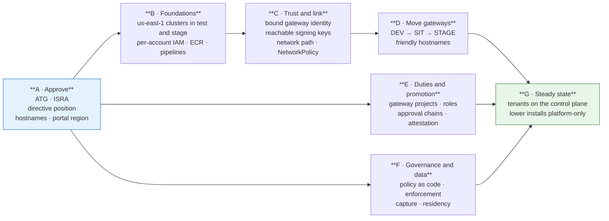

| Phase | Outcome | Gates |
|---|---|---|
| **A · Approve** | ATG and ISRA submitted and decided; directive owner's position recorded; friendly hostnames and the control plane's region decided | Nothing |
| **B · Foundations** | Every account has an EKS cluster in each serving region, with gateway IAM, image repositories and pipeline access, all parameterised by region | A |
| **C · Trust and link** | Gateways are trusted only as themselves, validate tokens from a public key address, and reach the control plane on the enumerated link only | A, B |
| **D · Move gateways** | DEV, SIT and STAGE gateways run in their own accounts behind friendly hostnames; PROD gateways behind friendly hostnames | C |
| **E · Duties and promotion** | Gateway projects per environment, the roles and bindings in DD-15, approval chains for STAGE and PROD, attestation | A |
| **F · Governance and data** | Model risk's checklist as policy as code; enforcement in STAGE and PROD; content removed from telemetry; residency configured | A |
| **G · Steady state** | Every business workload on the production control plane; the lower installs used only to test Luminate | D, E, F |

D3 sequences these phases into tasks.

## Consortium asks

What the target topology needs from Luminate itself. Nothing here is forked locally; each is raised
upstream and tracked in D3.

| # | Ask | Needed for | Upstream vehicle |
|---|---|---|---|
| 1 | **Access-layer enforcement of `enforcement_mode`** — the per-rule, per-environment observe/enforce switch exists; a rule in enforce must refuse at the access layer | DD-5 | Governance Mode (Epic H) |
| 2 | **Bound gateway identity** — decide every request for the gateway its credential proves, refusing mismatched claims | DD-14 | Federated Gateways (ACPDIS-124) |
| 3 | **A gateway-reachable signing-key address** — push the identity provider's public JWKS URI to gateways rather than an in-cluster service name | DD-14 | Gateway authentication |
| 4 | **Evaluate `CrossEnvironmentRule`** at access-decision time, with a denial reason that names the matrix | DD-6 | Connectivity Rules |
| 5 | **`Deployment` provenance** — record the source deployment and environment on a promoted deployment | DD-4 | Deployments |
| 6 | **Approval chains selected by target environment tier** — so an access policy reaching STAGE or PROD resolves the tier's chain | DD-4, DD-15 | Approval Flows |
| 7 | **`pre_prod` value for `service_tier`** | DD-2 | Entity attributes seed |
| 8 | **`Quota` spend dimension** | DD-9 | Quotas |
| 9 | **`capture_policy`** — `metadata_only` / `content_opt_in` per obligation profile | DD-10 | Governance Mode |
| 10 | **Authorization during a control-plane outage** — a bounded decision cache co-located with the gateway | DD-17 | ACPDIS-133 |
| 11 | **Gateway-held provider credentials** — the control plane knows a lower-account provider key only by name | DD-13, DD-14 | Federated Gateways (ACPDIS-124) |
| 12 | **Region-aware guardrail evaluators and downstream calls** — an external evaluator declares a region, and a restriction follows an agent's own downstream calls | DD-10 | Data Residency (AIC-1075), open questions 5 and 6 |

## What this design does not do

- **Does not create an install per environment or per region.** One control plane (DD-1).
- **Does not add a third region.** It makes adding one a procedure (DD-19); which region comes next
  is a business decision.
- **Does not hand gateway operation to business units.** That is the federated gateway (Tier 3,
  DD-3), a separate decision with its own submission.
- **Does not remove the control link.** It minimizes, authenticates and inspects it, and submits it
  for approval (DD-13).
- **Does not choose the control plane's region.** That is the us-east-1 relocation decision
  (EACPP-1407); this design works with either answer.
