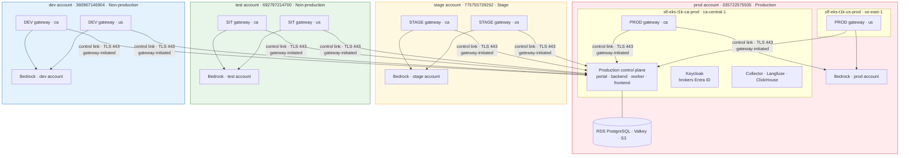
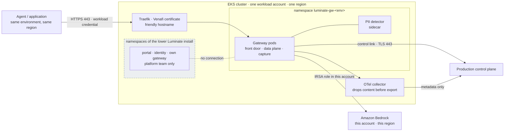

# Architecture — what runs where

This page is the high-level architecture for the target topology: which AWS account and EKS cluster
each component runs in, how they connect, and what crosses each boundary. The decisions behind it
are on the other D2 pages. The [Assurance](assurance.md) page reuses this page as the architecture
of record for the ATG and ISRA submissions.

## The model in one sentence

**One production Luminate install is the control plane for every workload environment. Each
workload environment's gateways run in that environment's own AWS workload account, in each region,
and call Amazon Bedrock in that same account.**

Agents call a gateway in their own environment and region. The gateway asks the control plane
whether each call is allowed, forwards allowed calls to Bedrock in its own account, and reports the
outcome back. The control plane never carries a call.

## Accounts, regions and clusters

Four AWS workload accounts, each with an EKS cluster in every serving region. The serving regions
are an open list (DD-19); today they are `ca-central-1` and `us-east-1`, and a further region adds
a column to this table. The environment of the account is the environment of the gateways in it.

| Account | AWS account | Directive environment ¹ | `ca-central-1` cluster | `us-east-1` cluster |
|---|---|---|---|---|
| **dev** | `360967146904` | Non-production | `slf-eks-t1k-ca-dev` | `slf-eks-t1k-use1-dev` |
| **test** | `692797214700` | Non-production ² | `slf-eks-t1k-ca-uat` | `slf-eks-t1k-<us>-test` ³ |
| **stage** | `775755739292` | Stage | `slf-eks-t1k-ca-stage` | `slf-eks-t1k-<us>-stage` ³ |
| **prod** | `035722575935` | Production | `slf-eks-t1k-ca-prod` | `slf-eks-t1k-us-prod` |

¹ The environment class from Appendix D of the Infrastructure, Platform and Network Security
Directive (IPNSD). See [Connectivity](connectivity.md) for how DD-13 treats traffic between them.

² The test account carries the **SIT** workload environment. Appendix D lists SIT among the legacy
equivalents of *Stage*. DD-2 records why SIT is placed in the test account and how it is classified.

³ The `us-east-1` clusters in the test and stage accounts are part of the target topology and are
provisioned by D3. Their names are assigned by Cloud Container Enablement (CCE) at provisioning.
The two existing `us-east-1` clusters do not share a pattern (`use1-dev`, `us-prod`).

## Component placement

Each cluster runs two kinds of thing that must not be confused: **gateways of the production
control plane**, which serve business workloads, and a **lower Luminate install**, which only the
ACP platform team uses to test Luminate releases (DD-18).

| Component | dev account | test account | stage account | prod account |
|---|---|---|---|---|
| **Production control plane** — portal, backend, DBOS worker, frontend | — | — | — | `ca-central-1` ⁴ |
| **Production identity** — Keycloak (brokering Entra ID) | — | — | — | `ca-central-1` ⁴ |
| **Production data tier** — RDS PostgreSQL (portal, Keycloak, Langfuse), ElastiCache Valkey, S3 | — | — | — | `ca-central-1` ⁴ |
| **Production observability** — OTel collector, Langfuse, ClickHouse | — | — | — | `ca-central-1` ⁴ |
| **DEV gateways** (production control plane) | `ca` + `us` | — | — | — |
| **SIT gateways** (production control plane) | — | `ca` + `us` | — | — |
| **STAGE gateways** (production control plane) | — | — | `ca` + `us` | — |
| **PROD gateways** (production control plane) | — | — | — | `ca` + `us` |
| **Per-cluster gateway support** — OTel collector (content-redacting), Traefik route, Venafi certificate | `ca` + `us` | `ca` + `us` | `ca` + `us` | `ca` + `us` |
| **Gateway Bedrock access** — hub role `luminate-gateway-irsa` per region (suffixed `-us` in `us-east-1`) with in-account Bedrock policy | ✓ | ✓ | ✓ | ✓ |
| **Lower Luminate install** — full portal, identity, data tier, its own gateway | dev install | test install | stage install | — |

⁴ The control plane's region is an open decision. The us-east-1 relocation spec
(`us-cutover`, EACPP-1407) proposes moving it. Nothing on this page depends on which region holds
it: every gateway reaches it the same way (DD-13), from every region.

Where a row reads `ca` + `us`, a region added under DD-19 adds its region code.

The lower Luminate installs are left out of the diagram on purpose. They share the dev, test and
stage clusters with the gateways but have no connection to the production control plane, and no
business workload runs on them.

## Inside one gateway cluster

Every cluster that hosts gateways has the same shape. The gateways of an environment are isolated
from the lower install on the same cluster by namespace, NetworkPolicy, Kubernetes RBAC and IAM
role.

## Data flows

Every flow the topology creates, enumerated so each can be authorized, inspected and tested. The
**cross-environment** column is the one IPNSD section 2.3 is about: it marks a flow between a
gateway in a non-production or stage account and the production control plane.

| # | Flow | From → to | Protocol · port | Initiated by | Authenticated by | Carries | Cross-environment |
|---|---|---|---|---|---|---|---|
| **F-1** | Agent call | Agent → gateway, same environment and region | HTTPS 443 | Agent | Workload credential issued for that gateway | Prompts, responses, tool calls | No |
| **F-2** | Inference | Gateway → Bedrock, same account and region | HTTPS 443 (AWS API) | Gateway | IRSA role in the gateway's own account | Prompts, responses | No |
| **F-3** | Control stream | Gateway → control plane | gRPC over TLS 443 | Gateway | Gateway OAuth credential, bound to the gateway's identity (DD-14) | Configuration pushed down; health and status up | **Yes**, for DEV, SIT and STAGE gateways |
| **F-4** | Access decision | Gateway → control plane, per call | gRPC over TLS 443 | Gateway | As F-3 | Identifiers only — caller, target, gateway, environment, location | **Yes**, as F-3 |
| **F-5** | Token issuance | Gateway → control plane token endpoint | HTTPS 443 | Gateway | Gateway OAuth client credential | Gateway access token | **Yes**, as F-3 |
| **F-6** | Signing keys | Gateway → control plane JWKS | HTTPS 443 | Gateway | Public keys; server authenticated by TLS | Public signing keys | **Yes**, as F-3 |
| **F-7** | Audit and usage | Gateway → control plane | gRPC over TLS 443 | Gateway | As F-3 | Identifiers, counts, outcome enums — never content | **Yes**, as F-3 |
| **F-8** | Telemetry | Cluster collector → central Langfuse | OTLP over TLS 443 | Collector | Langfuse project key for the environment | Trace metadata — content is removed before export (DD-10a) | **Yes**, as F-3 |
| **F-9** | Operator access | Platform team → cluster | AWS SSO, EKS API | Operator | Per-account SSO permission set; namespaced Kubernetes RBAC | Administration | No — per account |
| **F-10** | Deployment | Jenkins → cluster | EKS API | Jenkins | Per-account deploy role; namespaced RBAC | Helm releases | No — per account |

**Direction is fixed.** Every cross-environment flow (F-3 to F-8) is opened by the gateway or its
collector, outbound, to a fixed set of production hostnames on port 443. The control plane opens no
connection into any non-production or stage account, and no non-production or stage workload can
reach anything in the production account except those endpoints.

**No cross-environment flow carries content.** F-1 and F-2 carry prompts and responses, and both
stay inside one account and one region. F-3 to F-8 carry identifiers, configuration, counts and
outcome enums. That is fixed by the wire contract (DD-12) and by the collector's redaction (DD-10a).

## Hostnames

Every gateway has its own **friendly hostname** (DD-16), independent of the cluster it runs on. An
agent's configuration names its gateway by that hostname, so moving a gateway between clusters or
accounts is invisible to the agents that call it.

| Gateway | Friendly hostname |
|---|---|
| DEV · `ca-central-1` / `us-east-1` | `luminate-gw-dev-ca.sunlifecorp.com` / `luminate-gw-dev-us.sunlifecorp.com` |
| SIT · `ca-central-1` / `us-east-1` | `luminate-gw-sit-ca.sunlifecorp.com` / `luminate-gw-sit-us.sunlifecorp.com` |
| STAGE · `ca-central-1` / `us-east-1` | `luminate-gw-stage-ca.sunlifecorp.com` / `luminate-gw-stage-us.sunlifecorp.com` |
| PROD · `ca-central-1` / `us-east-1` | `luminate-gw-prod-ca.sunlifecorp.com` / `luminate-gw-prod-us.sunlifecorp.com` |
| Control plane (portal) | `luminate.sunlifecorp.com` |

The pattern is the proposal; the exact names are confirmed in the DNS request (DD-16). A region
added under DD-19 adds one name per environment, ending in its region code. Each name is
a CNAME in the corporate zone to the Traefik load balancer of the cluster that runs the gateway,
and is a SAN on that cluster's Venafi certificate.

## Per-account resources

What each workload account needs to host its gateways. Everything here is provisioned per account
and per region; nothing is shared across accounts.

| Resource | Purpose | Managed in |
|---|---|---|
| EKS cluster with the Sun Life platform layer (Karpenter application NodePool, Traefik, Vault Secrets Operator, Gatekeeper) | Runs the gateways | CCE; NodePool in `luminate-sunlife-deploy/k8s/karpenter/` |
| Gateway hub role `luminate-gateway-irsa` per region (`-irsa-us` in `us-east-1`) with in-account Bedrock policy, trusting only the gateway service accounts | Bedrock access for the gateways in this account | `luminate-sunlife-deploy/terraform/gateway-iam`, one stack per account and region |
| Bedrock model access for the approved models | The models the gateways may call | Per account, Bedrock console or API |
| ECR repositories for the gateway and PII detector images | Image source for the cluster | Per account and region; promoted by digest |
| Jenkins deploy role and namespaced RBAC | Pipeline deploys of the gateway releases | `terraform/eks-deploy-access`; chart RBAC bootstrap |
| Support role and namespaced RBAC | Human triage without cluster-admin | `terraform/eks-support-access` |
| Gateway OAuth credential, as a Kubernetes Secret synced from Vault | The gateway's identity to the control plane | Minted by the control plane at registration; stored in Vault |
| DNS record and Venafi certificate SAN | The friendly hostname | ServiceNow DNS request; Venafi self-service |

## What does not change

- **The production control plane is one install.** One catalogue, one governance record, one audit
  trail, one inventory of gateways. Moving gateways between accounts changes none of them.
- **A gateway keeps its identity when it moves.** The `Gateway` record, its environment mapping, its
  OAuth client and every workload credential issued against it are unchanged. Moving a gateway is a
  redeployment of the same gateway in a different cluster, followed by a DNS change.
- **The business team sees no difference** except the gateway hostname, which becomes a friendly
  name that will not change again.
