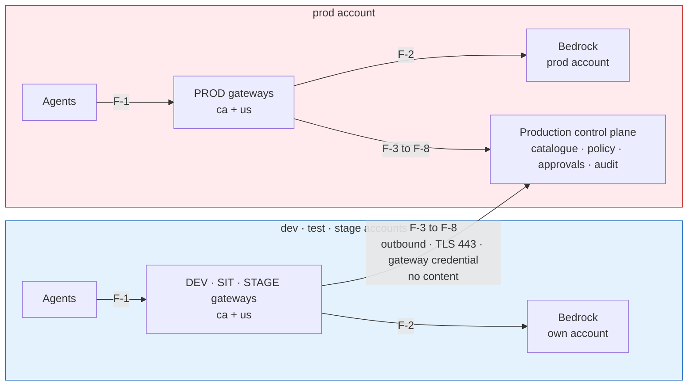

# Assurance — the ATG submission and the ISRA control set

| Record | Identifier |
|---|---|
| Architecture governance (ATG) | **To be raised** for this topology |
| Security risk assessment (ISRA) | **To be raised** for this topology |
| Platform baseline this extends | ATG0005196 / ISRA 26-0739 — the ACP platform, approved |
| Identity baseline this relies on | ATG0005518 / ISRA 26-1565 — Keycloak as the internal M2M issuer for this workload, approved |

**Scope of the new records.** The gateway deployment topology in this spec: one production
Luminate control plane governing the DEV, SIT, STAGE and PROD workload environments, with each
environment's gateways in that environment's AWS workload account, in each serving region (today
`ca-central-1` and `us-east-1`), the procedure for adding a serving region (DD-19), and the control
link between them (DD-13). It includes the segregation of duties
(DD-15) and the promotion process (DD-4) that keep the environments apart.

**Out of scope** — already covered by the baseline records, and unchanged by this topology: the
control plane's own components, its data tier and observability tier, and Keycloak as the M2M
issuer. Adding an account or environment to the tables on the
[Architecture](architecture.md) page is a change to the assessed scope. Adding a region follows the
rule in DD-19: it is a change to the assessed scope only in a jurisdiction or residency regime these
records do not cover. Adding a gateway inside an existing account, environment and region is not.

This page lets the ATG and ISRA submissions be produced from the spec rather than reconstructed.
It states what the architecture is, which decisions were taken and why, how the design stands
against the Infrastructure, Platform and Network Security Directive, and which controls exist with
what evidence.

## The architecture, as submitted

The [Architecture](architecture.md) page is the architecture of record: accounts and clusters,
component placement, the ten data flows F-1 to F-10, hostnames and per-account resources.

## Design decisions

| # | Decision | Page |
|---|---|---|
| **DD-1** | One production control plane owns all four workload environments | [Topology](topology.md) |
| **DD-2** | DEV, SIT, STAGE, PROD; SIT in the test account; `service_tier` per environment | [Topology](topology.md) |
| **DD-3** | One gateway per environment per region, in that environment's workload account | [Topology](topology.md) |
| **DD-4** | Promotion is a new deployment of the same resource, approval-gated into STAGE and PROD | [Promotion](promotion.md) |
| **DD-5** | The same rules everywhere; observe in DEV and SIT, enforce in STAGE and PROD | [Governance](governance.md) |
| **DD-6** | Default-deny between workload environments, with a published allow matrix | [Connectivity](connectivity.md) |
| **DD-7** | Environments are shared tiers; teams are separated by project | [Environments, quotas and credentials](access-and-quotas.md) |
| **DD-8** | Self-serve into DEV and SIT; STAGE and PROD gated | [Segregation of duties](segregation-of-duties.md) |
| **DD-9** | Quota defaults by tier, with the account as a hard ceiling | [Environments, quotas and credentials](access-and-quotas.md) |
| **DD-10** | Seven data-isolation boundaries; content removed before telemetry export | [Data isolation](data-isolation.md) |
| **DD-11** | Visibility follows the resource hierarchy | [One control plane](one-control-plane.md) |
| **DD-12** | Only identifiers, counts and outcome enums cross the account and region boundary | [One control plane](one-control-plane.md) |
| **DD-13** | One outbound control link per gateway, and nothing else crosses environments | [Connectivity](connectivity.md) |
| **DD-14** | The control plane trusts a gateway only as itself | [Connectivity](connectivity.md) |
| **DD-15** | Four layers of authority; no production change on one person's authority | [Segregation of duties](segregation-of-duties.md) |
| **DD-16** | Every gateway has a friendly hostname that never changes | [Topology](topology.md) |
| **DD-17** | The control plane is built for availability, and gateways fail closed | [One control plane](one-control-plane.md) |
| **DD-18** | Lower installs test Luminate, and nothing else | [Topology](topology.md) |
| **DD-19** | Serving regions are an open list; a region is added by procedure, not by design change | [Topology](topology.md) |

## Alternatives considered

| Option | What it is | Why not chosen |
|---|---|---|
| **A · All gateways in the production account** | The topology this replaces. Eight gateways in the prod account's clusters, in per-environment namespaces | Non-production and stage traffic, Bedrock spend and operator access sit in the production account. Every lower environment's workload communicates with a production-account gateway, and that gateway calls into lower environments' backends. More cross-environment communication than option C, not less. |
| **B · One Luminate install per environment** | A separate control plane, catalogue and governance record in each account | Removes the control link, and with it the single governance record: a promoted resource becomes a different resource, approvals do not carry, and "is this agent approved?" has four answers. Rejected by DD-1. |
| **C · Gateways in their environment's account, one control plane** | This design | Keeps one governance record. Moves each environment's traffic, Bedrock use and operator access into its own account. Reduces cross-environment communication to one outbound, content-free, authenticated control link per gateway. |

## Position against the Infrastructure, Platform and Network Security Directive

| Section | Requirement | Position |
|---|---|---|
| **1.3** | New architectural patterns approved through Architecture Technology Governance | This submission |
| **2.1** | Workload environments segmented to support the SDLC | Each workload environment's gateways run in that environment's account (DD-3) |
| **2.2** | Each environment segmented into functional zones | The control plane is a control-plane zone in the production account; gateways are application-layer workloads in each environment's account; the data tier is separate (RDS) |
| **2.3** | New workload communication between environments prohibited; requires authorized access and inspection layers | One control link per gateway, outbound only, authenticated per gateway, enumerated endpoints, no content, traversing the enterprise network path and terminating at an authenticated ingress (DD-13). **Submitted for approval through this ATG and ISRA; a Security Exception is raised if the ISRA requires one.** |
| **2.6** | Geographic isolation as required | One gateway per region; residency labels confine a regulated use case to a region (DD-10) |
| **2.8** | Micro-segmentation permits only required inter-workload communication | Default-deny NetworkPolicy on every gateway namespace with an enumerated allow list (DD-13); cross-environment matrix (DD-6) |
| **2.11** | Lower trust to higher trust denied by default | Lower environments reach the production account only through the control link; production initiates nothing into lower environments |
| **4.1** | Changes to production follow IT change management | STAGE and PROD changes need a CHG, a release approver and a reviewed pull request; deploy from `main` only (DD-15) |
| **4.3** | Remote management only from management zones, encrypted | Operator access by AWS SSO and EKS API per account, with namespaced RBAC tiers (DD-15) |

## Threat model — what the topology changes

| # | Threat | Applies because | Mitigated by |
|---|---|---|---|
| **T-1** | A compromised lower-environment gateway impersonates the PROD gateway or environment | Lower-environment gateways now run in lower-trust accounts | C-1, C-2 |
| **T-2** | A lower-environment workload reaches production systems | The accounts are connected through the enterprise network | C-4, C-5, C-6 |
| **T-3** | Production content leaks into a lower environment, or lower-environment content into central telemetry | One control plane and one telemetry store serve all environments | C-3, C-9, C-10 |
| **T-4** | A business user deploys or changes something in PROD by mistake | One portal serves all environments | C-11, C-12, C-13 |
| **T-5** | A platform engineer changes PROD intending to change DEV | One team operates all environments | C-14, C-15, C-16 |
| **T-6** | The control plane is unavailable and traffic is served without a decision | All environments depend on one control plane | C-17, C-18 |
| **T-7** | A control-plane defect reaches every environment at once | One control plane | C-19 |
| **T-8** | The control link is intercepted or a gateway credential stolen | The link crosses accounts | C-2, C-7, C-8 |
| **T-9** | A regulated workload's payload is processed outside its permitted region | Gateways in more than one region, and regions added over time (DD-19) | C-20, C-21 |

## The ISRA control set

| # | Control | Evidence |
|---|---|---|
| **C-1** | Every authorization decision is made for the gateway the credential proves; a request naming another gateway, environment or location is refused | Authorization tests with a mismatched gateway claim; refusals in the audit trail |
| **C-2** | Each gateway has its own OAuth credential, stored in Vault and synced into its namespace; rotation is per gateway | Vault paths per gateway; rotation runbook |
| **C-3** | A gateway receives only the configuration for deployments on it | Configuration bundle inspection per gateway |
| **C-4** | The control link is outbound only, TLS 443, to three production hostnames | Network rule set; NetworkPolicy egress lists |
| **C-5** | Default-deny NetworkPolicy on every gateway namespace with an enumerated allow list | Rendered NetworkPolicy per namespace |
| **C-6** | The production account initiates no connection into any lower account | Flow table F-1 to F-10; network rule set |
| **C-7** | TLS with certificate verification on every off-cluster hop; Sun Life root trust only | Gateway configuration; handshake evidence |
| **C-8** | Signing keys are fetched from the identity provider's public HTTPS address over verified TLS | Pushed JWKS URI; verification evidence |
| **C-9** | No prompt, completion or tool content is carried by the control link | The gateway↔control-plane wire contract |
| **C-10** | Content is removed from traces at each cluster's collector before export; telemetry is separated per environment and expired | Collector configuration; Langfuse projects; ClickHouse TTL |
| **C-11** | Business users hold deployment authority only on the DEV and SIT gateway projects | Role bindings on the gateway projects |
| **C-12** | Promotion into STAGE or PROD requires an approval chain that excludes the requester and the resource owner | Approval policies; approval records |
| **C-13** | Governance approval verbs are withheld from every authoring role, enforced at start-up | Role definitions; separated-duty check |
| **C-14** | STAGE and PROD changes need a reviewed pull request, a release approver distinct from the author, and a CHG; deploy from `main` only | Bitbucket branch rules; Jenkins approval records; CHG records |
| **C-15** | Production infrastructure access is an entitlement on the prod account only; routine access is the namespaced support role | AWS Identity Center assignments; EKS access entries |
| **C-16** | Standing production authority is re-attested quarterly | Attestation records |
| **C-17** | Gateways refuse every call when the control plane cannot decide | Gateway configuration; `portal_unreachable` refusals in logs |
| **C-18** | The control plane runs across three availability zones on a Multi-AZ database, with rehearsed recovery and alerting | Deployment configuration; restore rehearsal record; alert definitions |
| **C-19** | Control-plane releases pass through the dev, test and stage installs, promoted by image digest; gateway releases pass DEV, SIT and STAGE gateways before PROD | Release notes; digest records |
| **C-20** | Each gateway calls Bedrock in its own account and region | IAM role policies per account |
| **C-21** | Residency labels confine a labelled use case's traffic and content to its permitted regions | Residency configuration; placement refusals |
| **C-22** | Every gateway call, decision, approval and promotion is recorded in one audit trail | Audit trail |

## Residual risks to declare

| # | Risk | Rating basis | Treatment |
|---|---|---|---|
| **R-1** | The control link is communication between environments under IPNSD 2.3, however minimized | Inherent to one control plane | Accept with the controls above; Security Exception if the ISRA requires one |
| **R-2** | A control-plane outage stops traffic in every environment | Fail-closed by design | Accept; mitigated by C-17, C-18; reduced further by a co-located decision cache when the consortium delivers it (ACPDIS-133) |
| **R-3** | Platform engineers can work in every environment | A single product team | Accept; maker-checker on every STAGE and PROD change (C-14), account-scoped entitlements (C-15), attestation (C-16) |
| **R-4** | A cross-region inference profile may process a request outside the gateway's region | AWS-owned routing for that model class | Confirm residency per model offering; residency labels restrict placement |
| **R-5** | Lower Luminate installs share clusters with production-plane gateways | Account clusters are shared | Separate namespaces, credentials, IAM roles and NetworkPolicy; no connection to the control plane |

## What the ATG is being asked to approve

1. **The topology** — one production control plane governing four workload environments, with each
   environment's gateways in its own AWS workload account and region (DD-1, DD-3).
2. **The control link** — as the one permitted communication between environments, on the terms in
   DD-13 and controls C-1 to C-9.
3. **The segregation of duties and promotion process** — DD-4 and DD-15.
4. **The procedure for adding a serving region** — DD-19, so that a further region in a country
   these records cover is a recorded change rather than a new submission.
5. **The residual risks** R-1 to R-5.

**Re-submission triggers.** A new account or environment; a region in a jurisdiction these records
do not cover, or one that adds a residency regime (a further region in a covered country is recorded
here as a change, DD-19); a gateway operated by anyone other
than the ACP platform team (federated gateways); any flow added to the cross-environment set; any
change to what the control link carries.
