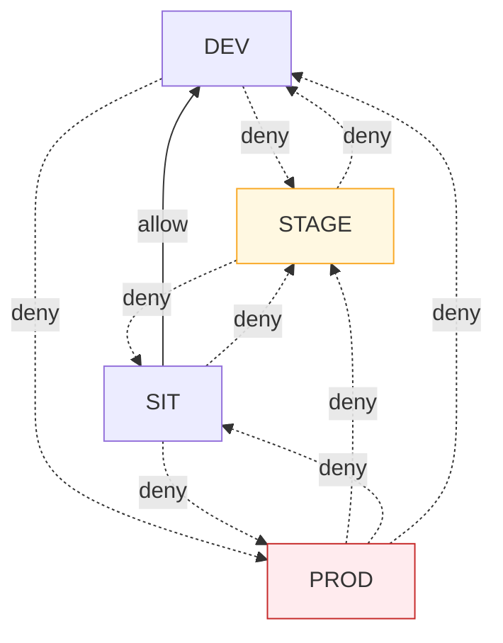

# Connectivity — DD-6, DD-13, DD-14

Three questions, three decisions: which workload environments may reach each other (DD-6), how a
gateway in one account reaches the control plane in another and why that is allowed (DD-13), and
how the control plane knows it is talking to the gateway it thinks it is (DD-14).

## DD-13 · One outbound control link per gateway, and nothing else crosses

**Decision.** The only communication between a gateway in a non-production or stage account and
the production account is the gateway's **control link**: gateway-initiated, outbound, over TLS on
port 443, to a fixed set of production endpoints, authenticated by the gateway's own credential,
and carrying no workload content. The production account opens no connection into any other
account.

### Why this needs a decision

The Infrastructure, Platform and Network Security Directive, section 2.3:

> Any new workload communication is strictly prohibited between new environments (e.g. Production,
> Stage, Non-production, Lab), as described in Appendix D, and requires authorized access and
> inspection layers.

A single control plane governing four environments is, by construction, communication between
environments. Every topology that keeps one catalogue and one governance record has it; the choice
is only *how much* of it there is and what it carries. The alternative that removes it entirely —
one Luminate install per environment — is what DD-1 rejects, because it ends the single governance
record that model risk and audit rely on.

So this design does not claim the link is absent. It **minimizes it, fixes its direction, removes
content from it, authenticates and inspects it, and submits it for approval** through the ATG and
ISRA (see [Assurance](assurance.md)).

### What crosses

| Flow (see [Architecture](architecture.md#data-flows)) | Direction | Carries |
|---|---|---|
| F-3 Control stream | Gateway → control plane | Configuration down, including any provider credential the control plane resolves (none for Bedrock, which is keyless through the in-account role); health and status up |
| F-4 Access decision | Gateway → control plane, per call | Identifiers only |
| F-5 Token issuance | Gateway → control plane | The gateway's own access token |
| F-6 Signing keys | Gateway → control plane | Public keys |
| F-7 Audit and usage | Gateway → control plane | Identifiers, counts, outcome enums |
| F-8 Telemetry | Collector → central Langfuse | Trace metadata, content removed |

**Nothing else.** In particular, no prompt, response, tool argument or tool result crosses
(DD-12), no business workload in a lower account can reach anything in the production account, and
nothing in the production account can initiate a connection to a lower account.

### How it satisfies "authorized access and inspection layers"

| Requirement | How the control link meets it |
|---|---|
| **Authorized access** | Each gateway authenticates with an OAuth client credential minted for that gateway by the control plane. Every decision is made for the gateway the credential proves, never for a gateway a request claims (DD-14). Workloads in lower accounts hold no production credential of any kind. |
| **Inspection** | The link leaves the workload account through the enterprise network path between accounts and enters the production account only at the control plane's ingress, where TLS terminates and every request is authenticated, authorized and audited. The set of endpoints is fixed and enumerable, so a network control can allow exactly those hostnames on port 443 from each gateway cluster and nothing else. |
| **Least privilege** | Outbound only; port 443 only; to three production hostnames — the portal, its identity provider and the telemetry store; from gateway namespaces and collectors only, enforced by egress NetworkPolicy. |
| **Minimal data** | Identifiers, configuration, counts and outcome enums. Content stays in the workload account (DD-10, DD-12). |
| **Auditability** | Every control-link call is an authenticated request recorded by the control plane, attributable to one gateway. |

**The approval path.** The directive owner's position, relayed in the 2026-10-06 session, is that
the model is acceptable once the architecture and its security assessment are signed off. The ATG
records the architectural decision; the ISRA assesses the link against the directive. If the ISRA
concludes the link needs a formal exception, a Security Exception (directive section 13) is raised
with this page and the [Assurance](assurance.md) page as its evidence.

### Network path

The gateway reaches the control plane through the control plane's **public ingress hostname**, not
the pod network. Pod address ranges overlap across Sun Life's EKS VPCs (each carries the same
non-routed secondary range), so pod-to-pod routing between clusters is neither possible nor wanted.
The ingress address is routable across the enterprise network, and the TLS certificate it presents
chains to the Sun Life root.

This is the path the `us-east-1` gateways already use to reach the `ca-central-1` control plane. It
is the same whether the gateway is in another region of the production account or in another
account.

### Ingress for agents

Each gateway is published on its friendly hostname (DD-16) through its cluster's Traefik ingress,
with a Venafi certificate covering the hostname and TLS to the gateway pod. Agents in the same
environment reach their gateway through the enterprise network on port 443. A gateway accepts
traffic only through its ingress; it has no other listener reachable from outside its namespace.

### NetworkPolicy on gateway namespaces

Every `luminate-gw-<env>` namespace carries a default-deny NetworkPolicy with exactly these
exceptions:

| Direction | Allowed peer | Port |
|---|---|---|
| Ingress | The cluster's Traefik ingress | Gateway listener |
| Egress | Cluster DNS | 53 |
| Egress | The control plane's ingress (F-3 to F-7) | 443 |
| Egress | The cluster's OTel collector (F-8) | OTLP |
| Egress | AWS STS and Bedrock regional endpoints | 443 |
| Egress | Registered tool and agent endpoints, by policy | 443 |

The lower Luminate install on the same cluster is therefore unreachable from the gateways, and
the gateways are unreachable from it.

## DD-14 · The control plane trusts a gateway only as itself

**Decision.** Every authorization decision the control plane makes for a gateway is made **for the
gateway its credential proves**. A request that names a different gateway, environment or location
is refused. The control plane publishes signing keys at an address every gateway can reach, so a
gateway validates tokens without any route into the control plane's cluster.

**Why this matters more once gateways leave the production account.** While every gateway ran in
the production account, a gateway's claim about its own identity was a production workload talking
to itself. A gateway in the dev account is a non-production workload. If it could name the PROD
gateway or the PROD environment in its requests and be believed, the environment boundary would be
whatever a lower account asserts. Binding the decision to the proven credential closes that.

| Property | Design |
|---|---|
| **Bound identity** | The gateway credential identifies one registered gateway. The control plane resolves the gateway, its environments and its location from that, and refuses any request whose claims disagree. This is the *bound identity* guarantee of the consortium Federated Gateways design (ACPDIS-124). |
| **Configuration is per gateway** | A gateway receives only the configuration for the deployments on it. The DEV gateway never holds STAGE or PROD configuration or credentials. |
| **Reachable signing keys** | The JWKS URI the control plane pushes to gateways is the identity provider's public HTTPS address, which resolves and verifies from every cluster. No gateway depends on an in-cluster service name. |
| **TLS everywhere off-cluster** | The control link uses TLS with certificate verification against the Sun Life root. A plaintext hop is used only inside a single cluster under NetworkPolicy, and no environment's gateway uses one in the target topology. |
| **Credential custody** | Each gateway's OAuth credential is stored in Vault and synced into its namespace by the Vault Secrets Operator. Rotation is per gateway and does not touch any other. |

!!! info "Consortium design: Federated Gateways (ACPDIS-124, `luminate-designs` branch `designs/ACPDIS-124-federated-gateways`, Draft)"
    Written for business-unit gateways (Tier 3), but its Phase 1 is what this topology needs from
    day one:

    - **Bound identity** (T49). The access decision resolves the gateway from its bearer, matched
      on the same client identifiers the control stream uses. A request naming another gateway is
      refused without evaluation, entry by entry in a batch check.
    - **Gateway-held provider credentials.** The gateway reads a provider key from a store mounted
      in its own account (Vault-populated), and the control plane holds only its name. That takes
      the last secrets off F-3 for any non-Bedrock provider served from a lower account (T74).
    - **Placement needs authority over both projects**, pinned against a concurrent move. That is
      the guarantee the per-environment gateway projects rely on (DD-15).
    - **The portal's gRPC endpoint does not terminate TLS.** Cross-network gateways put TLS in front
      of it, which DD-13's ingress path already does.

    Later phases add a per-gateway trusted identity provider (until then every gateway uses the
    production token endpoint, F-5), rotation without a push, and held-credential health in the
    fleet view. Outage behaviour stays with ACPDIS-133.

## DD-6 · Default-deny between workload environments

**Decision.** A resource deployed in one workload environment may not call a resource in another,
except along a small, published allow matrix. The matrix is evaluated by the control plane on every
access decision.

| Source → target | Action | Why |
|---|---|---|
| Same environment | Not matrix-evaluated | The normal case |
| SIT → DEV | **allow** | Integration testing legitimately reaches down |
| STAGE → SIT, STAGE → DEV | **deny** | Pre-production must not depend on non-production |
| PROD → anything else | **deny** | The rule the auditors ask about first |
| DEV or SIT → STAGE or PROD | **deny** | Test traffic must not reach pre-production or production |

Everything not listed is denied. The matrix is a second, independent control on top of the
account boundary: a gateway serves only deployments in its own environment, and the matrix refuses
a cross-environment call even where a credential or an access policy would otherwise allow it.

**Ownership.** The ACP platform team owns the matrix, and every change is audited. A change needs
two platform-team approvers and carries a time-boxed reversal.

**Legibility.** A matrix denial names the matrix as its cause. A generic authorization failure
would send a team hunting through access policies for a rule that is not there.
