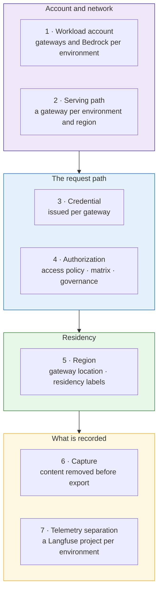

# Data isolation — DD-10

**Decision.** Data classification is a first-class input to the topology. Isolation is achieved by
**seven boundaries**, each carried by a named mechanism and each verifiable on its own. Because
DD-3 places each environment's gateways in that environment's account, the strongest boundaries are
account boundaries rather than namespaces.

## How isolation is achieved

| # | Boundary | What it separates | Mechanism |
|---|---|---|---|
| 1 | **Workload account** | Environment from environment, at the infrastructure level | Each environment's gateways, their Bedrock access, their capacity and their operator entitlements are in that environment's AWS account (DD-3) |
| 2 | **Serving path** | Environment from environment, at the traffic level | One gateway per environment per region, in its own namespace, with default-deny NetworkPolicy (DD-13) |
| 3 | **Credential** | Caller from environment | A workload credential is issued per `(resource, gateway)`. A DEV credential does not authenticate at the PROD gateway. |
| 4 | **Authorization** | Resource from resource | Access policies, the cross-environment matrix (DD-6) and per-environment governance status (DD-5), evaluated by the control plane on every call for the gateway the credential proves (DD-14) |
| 5 | **Region** | Region from region | A gateway's `Location`; residency labels on locations, projects and resources |
| 6 | **Capture** | Content from the telemetry store | The cluster's collector removes prompt and completion content from traces before export (DD-10a) |
| 7 | **Telemetry separation** | One environment's records from another's | A Langfuse project and key pair per environment (DD-10b), with a retention limit (DD-10c) |
| + | **Blast radius** | Failure from failure | Per-gateway capacity and autoscaling, per-tier quota defaults (DD-9), and a per-gateway kill switch |

Boundaries 1 to 5 govern the request path. Boundaries 6 and 7 govern what the request path
records. Telemetry is the only place content would otherwise accumulate and outlive the request,
which is why it has two boundaries of its own.

## Where content goes

| Data | Where it is processed | Where it is stored | Crosses an account or region boundary |
|---|---|---|---|
| Prompts, completions, tool arguments and results | The gateway, and Bedrock in the gateway's own account and region | Nowhere by default; the gateway is stateless | **No** |
| Content inspection (guardrails) | Inside the gateway, in its region | Outcome only | Outcome enums and counts only |
| Identifiers — caller, target, gateway, environment, location | The control plane | The control plane's audit trail | Yes — this is the control link (DD-13) |
| Usage and cost | The control plane | The control plane's usage ledger | Yes, as counts |
| Trace metadata | The cluster's collector | Central Langfuse, in the environment's project | Yes, with content removed |
| Policy bodies | The control plane, in-process | The control plane | No |

**Bedrock is in-account.** Each gateway calls Bedrock with its own role, in its own account and
region. No environment's inference runs in another environment's account, and none is routed
through a shared spoke account.

**Where a model processes a request is a property of the model offering.** A cross-region inference
profile (for example `us.anthropic.*`) may process a request in another AWS region within the
profile's region set. Residency for a use case is therefore confirmed per model offering, and the
approved-model list states which offerings stay in-region.

## Residency labels

The control plane can confine a regulated use case to a region. A governance attribute, named by
`DATA_RESIDENCY_ATTRIBUTE_KEY`, labels locations, projects and resources with the regions they may
run in. Once a label is set:

| Control | Effect |
|---|---|
| **Placement** | A labelled resource cannot be deployed on a gateway whose location does not carry a permitted region, and a gateway bundle withholds it if its labels change later |
| **Calls** | A labelled caller or target is refused at an out-of-region gateway, checked on every call |
| **Credentials** | An out-of-region project's account binding is withheld, so its provider credential never reaches that gateway |
| **Content** | The gateway keeps the request's content out of any trace, log or mirror whose sink is not declared to be in a permitted region (`GATEWAY_TRACE_CONTENT_REGIONS`), and the portal never fetches it centrally |

Placing a gateway at a labelled location is itself a governance action, because every decision
above trusts the gateway's location — another reason DD-14 binds location to the gateway's proven
identity.

!!! info "Consortium design: Data Residency (AIC-1075, `luminate-designs` branch `designs/AIC-1075-data-residency`, Draft)"
    The controls above are that design's Phase 1. What it adds for this topology:

    - **It fails closed, so the order of switching it on matters.** An unlabelled `Location`
      satisfies no label, so every location, including `Default`, is labelled before any use case
      is. A gateway that does not declare it enforces the content ruling is refused every bound
      request, so all gateways run a residency-capable build first. A key that names no definition
      restricts all content to nowhere rather than refusing traffic.
    - **Content can stay in region and still be debuggable.** A region may keep content in its own
      trace store: the collector sends the full record there and a stripped copy centrally, and the
      portal links the operator's browser to the regional view (`TRACE_REGIONAL_CONTENT_URLS`)
      without fetching it. DD-10a stays the default; a regional store is opt-in, per region, when a
      regime needs debuggable content.
    - **Tenant and folder labels are Phase 2**, after Multi-Tenancy. Until then labels go on
      projects and resources.
    - **Gaps a residency-bound use case must work around until later phases:** an external guardrail
      evaluator (Model Armor) has no declared region, so none is attached to a bound use case; an
      agent's own downstream calls do not inherit the restriction; organization-wide administrators
      are not limited (Phase 3); and where *operators* sit is not covered (personnel residency), so
      it rests on account entitlements (DD-15).

## The capture boundary — DD-10a, DD-10b, DD-10c

Specified in the order that decides exposure: what is captured, then who can read it, then how
long it is kept. Only the first closes the question; the other two bound it.

| # | Control | Effect | Where |
|---|---|---|---|
| **DD-10a** | **Remove content at the collector** | No content in central telemetry, whatever any emitter sends | A `redaction` or `transform` processor in every cluster's collector, ahead of export |
| **DD-10b** | **A Langfuse project per environment** | "Who could read PROD records" has an answer; DEV readers cannot query PROD | Central Langfuse, one project and key pair per environment |
| **DD-10c** | **Retention** | Records expire | ClickHouse TTL on trace tables |

**The durable form is a governance obligation.** The consortium Governance Mode design maps a
resource's frameworks and risk band onto a `capture_policy` of `metadata_only` or
`content_opt_in`. Content capture then becomes an obligation a framework opts into for a specific
resource, not a platform default. DD-10a is the platform floor underneath it.

## Control requirements this design satisfies

Mapped to OSFI B-13, *Technology and Cyber Risk Management*, which applies to all Sun Life
workloads.

| Control | Requirement | How this design meets it |
|---|---|---|
| **B-13 §2.1** Technology architecture | Architecture aligned to risk | Each environment is a separate account, gateway, namespace and credential — not a tag on a shared path |
| **B-13 §3.1.4** Data identified, classified and protected | Classification drives control | Classification and residency are inputs to placement and to every authorization decision |
| **B-13 §3.2.4** Layered cyber controls | Defence in depth | Seven independent boundaries. A credential failure is caught by authorization; an authorization failure is bounded by the account, the quota and the kill switch |
| **B-13 §3.2.5** Data protection and loss prevention | Controls at rest, in transit and in use | In transit — content never enters the control link. In use — guardrails run in region. At rest — content is removed before export, separated per environment and expired |
| **B-13 §3.2.7** Identity and access management | Risk-based access | Per-gateway credentials; bound gateway identity; RBAC visibility over the resource hierarchy; separated duties (DD-15) |
| **B-13 §3.3.1** Centralized security logging | Centralized logging for investigation | One audit record per call, carrying identifiers, counts and outcome enums |

A central audit trail and regional data isolation are usually in tension. Here they are not,
because the record that centralizes is **metadata by contract** rather than content redacted after
the fact.

### Regime applicability

| Regime | Applies to | What it asks of this design |
|---|---|---|
| **OSFI B-13** | All workloads | The controls mapped above |
| **PIPEDA**, **Quebec Law 25**, **PHIPA** | Canadian workloads; health data | Purpose limitation, retention limits, disposal — residency labels and DD-10c |
| **HIPAA** Security Rule technical safeguards | US workloads handling PHI | Access control, audit, integrity, transmission security — the `us-east-1` gateways and residency labels |

Which regime applies to a workload is a compliance determination, recorded as a governance
attribute on the resource. The topology supplies the boundaries; it does not decide the regime.
