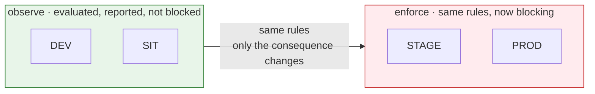

# Governance and policy — DD-5

## DD-5 · The same rules everywhere; observe below, enforce above

**Decision.** Governance rules apply in every environment. In DEV and SIT they **observe**: they
are evaluated, and their findings are shown to the team, but nothing is blocked. In STAGE and PROD
they **enforce**: a resource that fails a blocking control is refused, and the refusal names the
control.

This is the most valuable property of the strategy: **the rules do not change at STAGE, only their
consequence does.** A team that has read its findings since DEV meets no new requirement at the
gate.

## How it works

| Element | In Luminate | Set by |
|---|---|---|
| **Applicability** — which resources a rule governs | `ApplicabilityRule`, matched over governance-authoritative attributes (risk band, frameworks, data classification, `service_tier`) | Governance administrator |
| **Obligations** — what a governed resource must evidence | Obligation profiles keyed by framework and risk band | Governance administrator, from the policy owner's requirements |
| **Enforcement mode** — observe or enforce, per rule, per environment | `RuleEnforcement`, promoted one environment at a time, each promotion gated on an acknowledged impact report | Governance administrator |
| **Status** — whether a resource is compliant in an environment | `GovernanceStatus`, one row per `(resource, environment)` | Computed |
| **Verdict** — whether a resource is approved in an environment | `GovernanceVerdict`, given through the approval chain | Governance approver |
| **Refusal** — what a team sees when enforcement blocks | The refusal names each blocking control | Computed |

**Enforcement is promoted, never switched on globally.** Moving a rule from observe to enforce is a
per-rule, per-environment action, and it is refused until the impact report for that rule — which
resources it would block, and why — has been generated and acknowledged. Demotion carries no gate,
because turning a control off during an incident must be fast.

## Who sets the rules, and who decides under them

| Role | Does | Does not |
|---|---|---|
| **Policy owner** — Model Risk (CMRM) for model and agent risk; Governance-by-Design for intake obligations; Privacy and Security for their domains | States the requirement: what must be true before a resource reaches STAGE or PROD | Configure the platform |
| **Governance administrator** | Encodes the requirement as rules, applicability and obligations; promotes enforcement per environment | Approve, verdict or transition a resource |
| **Governance approver** | Approves or rejects a resource in an environment, and access policies that reach STAGE or PROD | Author the rules; approve their own request; approve a resource they own |
| **ACP platform team** | Operates the mechanism and stewards the rule set until each policy owner takes it on | Set policy on a policy owner's behalf |

**Policy as code.** Model Risk's pre-production checklist — today worked by hand in Archer — is
encoded as rules evaluated at the STAGE and PROD gates. The `acp-cmrm-policy-as-code` repository
holds that encoding; the control plane evaluates it on every promotion. A checklist item becomes an
obligation the resource must evidence, and a failed item becomes a named, blocking control.

**The separation is enforced in code, not by convention.** The approval verbs
(`governance.resource.approve`, `governance.resource.transition`) are withheld from every authoring
role, including Administrator, and held only by Governance Approver. Writing a rule and approving
under it is the conflation the split exists to prevent. The platform checks the separation at
start-up and refuses to run if the role definitions disagree with it.

## Does a STAGE verdict carry into PROD?

**No.** `GovernanceStatus` and verdicts are per `(resource, environment)`, so PROD is decided in its
own right. A STAGE verdict, and the evidence behind it, is attached to the PROD request as input to
that decision. The resource may carry different attributes, quotas and audience in PROD, which is
the reason for a separate tier.

## Policies a gateway enforces on every call

Governance decides what may be deployed where. The gateway then enforces, on every call:

| Control | Effect |
|---|---|
| **Deployment on this gateway** | A resource is reachable only through a gateway it is deployed on. A resource in SIT is not reachable through the STAGE gateway. |
| **Access policy** | A caller reaches a target only if an active access policy allows it, optionally narrowed to an environment, location, gateway or provider |
| **Governance status** | A target whose status in this environment is non-compliant, stale or untrusted is refused where its rule enforces |
| **Guardrails** | Content inspection — PII detection, banned terms, and the other configured guardrails — runs inside the gateway, in its region |
| **Residency** | A residency-labelled caller or target is refused at a gateway outside its permitted regions (DD-10) |
| **Cross-environment rules** | A call from one environment's resource into another environment is refused unless the standing matrix allows it (DD-6) |
