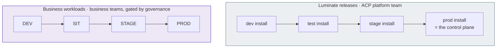

# D2 Design — Overview

> **Gate**: D2 — Design | **Status**: In review | **D1 Approved**: TBD
>
> This D2 is a set of pages. `d2-design.md` beside this directory is **generated** from them by
> `scripts/assemble_d2_design.py` — edit the pages, not the generated file.
>
> **Revised 2026-10-06** after the *Luminate Gateway Environment Deployment Model* session. The
> topology moved from "all gateways in the production account" to "each environment's gateways in
> that environment's account, one production control plane". Segregation of duties, the promotion
> process and the ATG/ISRA package were added.

## The model in one picture

```mermaid
flowchart TB
    CP["<b>Production Luminate control plane</b><br/>prod account · one catalogue · one governance record · one audit trail"]
    subgraph DEVA["dev account · Non-production"]
        D1["DEV gateway · ca-central-1"]
        D2["DEV gateway · us-east-1"]
        D3["DEV gateway · further regions"]
    end
    subgraph TSTA["test account · Non-production"]
        S1["SIT gateway · ca-central-1"]
        S2["SIT gateway · us-east-1"]
        S3["SIT gateway · further regions"]
    end
    subgraph STGA["stage account · Stage"]
        G1["STAGE gateway · ca-central-1"]
        G2["STAGE gateway · us-east-1"]
        G3["STAGE gateway · further regions"]
    end
    subgraph PRDA["prod account · Production"]
        P1["PROD gateway · ca-central-1"]
        P2["PROD gateway · us-east-1"]
        P3["PROD gateway · further regions"]
    end
    D1 & D2 & S1 & S2 & G1 & G2 & P1 & P2 -->|"control link<br/>outbound · TLS 443 · no content"| CP
    D3 & S3 & G3 & P3 -.->|"same link (DD-19)"| CP
    classDef future stroke-dasharray: 5 5
    class D3,S3,G3,P3 future
    style CP fill:#ffebee,stroke:#c62828
    style DEVA fill:#e3f2fd,stroke:#1565c0
    style TSTA fill:#e8f5e9,stroke:#2e7d32
    style STGA fill:#fff8e1,stroke:#f9a825
    style PRDA fill:#ffebee,stroke:#c62828
```

**One control plane governs; each environment runs in its own account.** A business team registers
an agent once, in the production control plane, and promotes it DEV → SIT → STAGE → PROD. Each
promotion places it on the next environment's gateway, which runs in that environment's AWS
account and calls Bedrock in that account. The agent's identity, owner and governance record never
change; its gateway address and credential do.

**Regions are an open list.** Today every environment serves from `ca-central-1` and `us-east-1`.
A further region adds one gateway per environment, in the same accounts, by a defined procedure
and with no design change (DD-19).

## What runs where

| | dev account | test account | stage account | prod account |
|---|---|---|---|---|
| **Gateways of the production control plane** | DEV · ca + us | SIT · ca + us | STAGE · ca + us | PROD · ca + us |
| **Bedrock used by those gateways** | dev account | test account | stage account | prod account |
| **Production control plane** — portal, identity, data, observability | — | — | — | ✓ |
| **Lower Luminate install** — platform team only | dev install | test install | stage install | — |
| **EKS clusters** | `slf-eks-t1k-ca-dev`, `slf-eks-t1k-use1-dev` | `slf-eks-t1k-ca-uat`, a `us-east-1` cluster | `slf-eks-t1k-ca-stage`, a `us-east-1` cluster | `slf-eks-t1k-ca-prod`, `slf-eks-t1k-us-prod` |

The full component placement, data flows and hostnames are on the [Architecture](architecture.md)
page.

## The two ladders

Two things are promoted through four stages each, by different people, for different reasons.

Where this spec says **environment** unqualified, it means a **workload environment** — DEV, SIT,
STAGE or PROD inside the production control plane. An **install** is a whole copy of Luminate.

## Who does what

| | Business team | ACP platform team | Governance |
|---|---|---|---|
| Register agents, models, tools | ✓ | | |
| Deploy into DEV and SIT | ✓ | | |
| Request promotion into STAGE and PROD | ✓ | | |
| Approve promotion into STAGE and PROD | Project owner, first level | | Governance approver, second level |
| Deploy into STAGE and PROD, issue credentials | | Production deployer | |
| Author the rules in force per environment | | | Governance administrator |
| Operate gateways, clusters, accounts and pipelines | | ✓, maker-checker on STAGE and PROD | |

[Segregation of duties](segregation-of-duties.md) gives the personas, roles and enforcement for
each cell.

## Decisions

| # | Decision | Page |
|---|---|---|
| **DD-1** | One production control plane owns all four workload environments | [Topology](topology.md) |
| **DD-2** | DEV, SIT, STAGE, PROD — SIT in the test account | [Topology](topology.md) |
| **DD-3** | One gateway per environment per region, **in that environment's workload account** | [Topology](topology.md) |
| **DD-4** | Promotion is a new deployment of the same resource, approval-gated into STAGE and PROD | [Promotion](promotion.md) |
| **DD-5** | The same rules everywhere; observe below, enforce above | [Governance](governance.md) |
| **DD-6** | Default-deny between workload environments | [Connectivity](connectivity.md) |
| **DD-7** | Environments are shared tiers; teams are separated by project | [Environments, quotas and credentials](access-and-quotas.md) |
| **DD-8** | Self-serve into DEV and SIT; STAGE and PROD gated | [Segregation of duties](segregation-of-duties.md) |
| **DD-9** | Quota defaults by tier, with the account as a hard ceiling | [Environments, quotas and credentials](access-and-quotas.md) |
| **DD-10** | Seven data-isolation boundaries; content removed before telemetry export | [Data isolation](data-isolation.md) |
| **DD-11** | Visibility follows the resource hierarchy | [One control plane](one-control-plane.md) |
| **DD-12** | Only identifiers, counts and outcome enums cross the account and region boundary | [One control plane](one-control-plane.md) |
| **DD-13** | One outbound control link per gateway; nothing else crosses environments | [Connectivity](connectivity.md) |
| **DD-14** | The control plane trusts a gateway only as itself | [Connectivity](connectivity.md) |
| **DD-15** | Four layers of authority; no production change on one person's authority | [Segregation of duties](segregation-of-duties.md) |
| **DD-16** | Every gateway has a friendly hostname that never changes | [Topology](topology.md) |
| **DD-17** | The control plane is built for availability; gateways fail closed | [One control plane](one-control-plane.md) |
| **DD-18** | Lower installs test Luminate, and nothing else | [Topology](topology.md) |
| **DD-19** | Serving regions are an open list; a region is added by procedure, not by design change | [Topology](topology.md) |

DD-13 to DD-19 are new in this revision. DD-3 changed: gateways moved from the production account to
their environment's account. DD-8 is now enforced through gateway projects per environment rather
than by the platform team performing every deployment.

## The ATG and ISRA

[Assurance](assurance.md) is written to be submitted: scope, alternatives, the position against the
Infrastructure, Platform and Network Security Directive (section 2.3 in particular), a threat model,
22 controls with their evidence, and five residual risks.
