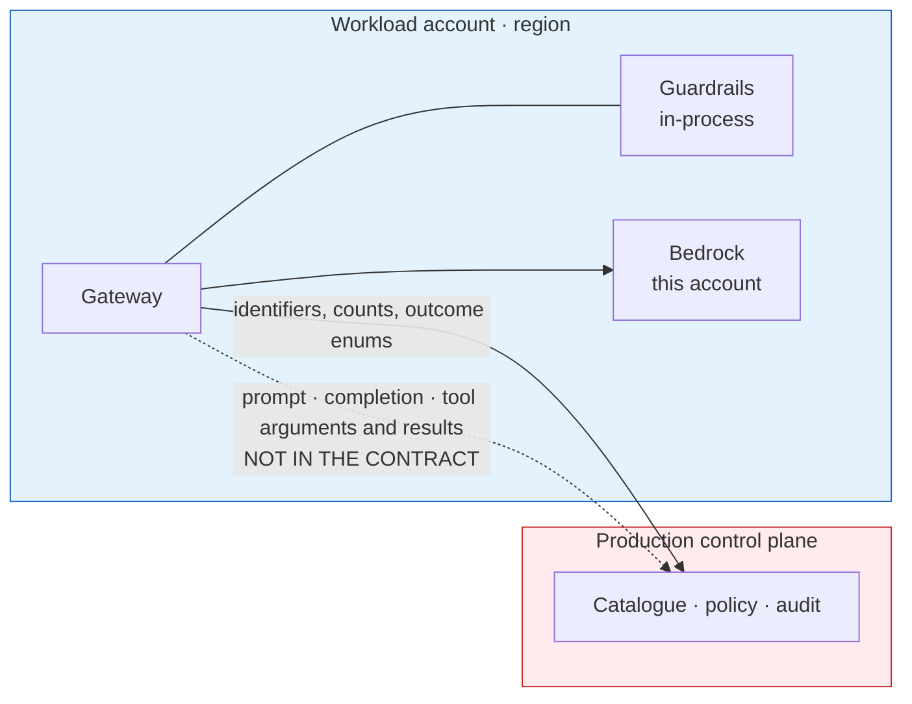

# One control plane — DD-11, DD-12, DD-17

**Decision.** One Luminate install and one portal govern every environment and every region.
Regional and environment isolation is delivered by **where a gateway runs** (DD-3), **where a
resource sits in the hierarchy** (who can see it, DD-11) and **what never leaves the gateway**
(what can be read, DD-12) — not by a second control plane. Because there is one, it is built for
availability (DD-17).

## Why one control plane survives the objections

| Objection | Really asking | Answer |
|---|---|---|
| "How does a regional team see only its own gateways and resources?" | Is visibility isolation real, and on what axis? | DD-11 |
| "Will a regulator accept a central control plane?" | What data crosses the region and account boundary? | DD-12 |
| "Doesn't one portal mean one point of failure?" | What happens to traffic when the control plane is unavailable? | DD-17 |
| "Doesn't one portal mean one bug reaches every environment?" | How are control-plane changes proven before production? | DD-17 and DD-18 |

## DD-11 · Visibility follows the hierarchy, not a region tag

Visibility is enforced server-side. List endpoints resolve the caller's effective scopes and filter
by them, failing closed to an empty result. Scopes are `organization`, `folder`, `project` and
`resource`; a binding at a project lets its holder see that project and nothing beside it.

**A team sees only what sits under the folder or project its bindings are scoped to.** A regional
or business-unit boundary is therefore modelled as a folder, with each team's projects beneath it:

| Folder | Holds | Visible to |
|---|---|---|
| *Luminate Platform* | Gateway projects (one per environment), platform-owned models, shared resources | ACP platform team; shared models and resources by grant |
| One folder per business unit or region | That unit's projects | That unit's bindings |

`Location` is not a visibility scope. It constrains what may reach what (through access policies
and residency labels), not who can see what. Visibility and authorization compose: list visibility
filters by scope, and each action on a specific object is authorized again on its own.

## DD-12 · What crosses the account and region boundary

A gateway talks to the control plane on every call. What that call can carry is fixed by the wire
contract, so it is enumerated rather than asserted.

| Toward the control plane | Class |
|---|---|
| Caller, target, selector, gateway, environment, provider, location | Identifiers |
| API key id, delegation flag and scopes, actor type and id | Identifiers and flags |
| Guardrail outcome — matched-term count, matched category labels | Counts and labels, never the matched text |
| Prompt, completion, tool arguments, tool results | **Not in the contract at any version** |

| Supporting fact | Consequence |
|---|---|
| Guardrails evaluate inside the gateway | Content is inspected where it already is |
| Policy is evaluated inside the control plane, and no policy body is sent to a gateway | Nothing about the rules leaks into a lower account |
| The gateway is stateless — no database, no session store | No content store by default. A regional trace store is opt-in under Data Residency (DD-10) and is never central |
| Telemetry content is removed at the collector before export (DD-10a) | The telemetry path carries metadata only |

!!! note "Statement of fact for a regulatory or security review"
    The only data leaving a gateway's account and region is identifiers, counts and outcome
    enumerations — no prompt text, no completion text, no tool arguments or results, and no request
    or response bodies. Content inspection runs inside the region. The gateway holds no persistent
    state.

## DD-17 · The control plane is built for availability, and gateways fail closed

**Decision.** Every gateway asks the control plane before serving a call. If it cannot get an
answer, it refuses the call: **no call runs without a decision.** The control plane is therefore
run for availability across zones, with tested recovery, and its region is chosen so that both
regions' gateways reach it.

| Concern | Design |
|---|---|
| **Compute** | At least three backend replicas, one per availability zone, with a disruption budget; frontend and worker at two or more |
| **Identity** | Two Keycloak instances across zones |
| **Database** | RDS PostgreSQL, Multi-AZ, with point-in-time recovery |
| **Telemetry** | ClickHouse with scheduled backups to S3 and a tested restore |
| **Recovery** | Rebuild from `luminate-sunlife-deploy` plus a database restore, rehearsed in the stage install |
| **Monitoring** | Alerts on control-link errors seen by gateways (`portal_unreachable` refusals) and on control-plane health |
| **Region** | One region, chosen by the us-east-1 relocation decision (`us-cutover`, EACPP-1407). Gateways in every serving region reach it the same way (DD-13). |

**Fail closed is the right default.** An outage of the control plane stops traffic; it never lets
ungoverned traffic through. The consortium is designing what a gateway may continue to serve
during a control-plane outage (ACPDIS-133) — a bounded, cached decision set co-located with the
gateway. It improves availability without moving the decision out of the control plane, and this
topology adopts it when it lands.

**One bug reaching every environment.** Control-plane releases are promoted through the dev, test
and stage installs before they reach production (DD-18), and promoted by image digest so the bytes
tested are the bytes deployed. A gateway release is promoted through the DEV, SIT and STAGE
gateways before the PROD gateways. A change therefore reaches PROD traffic last, not first.
