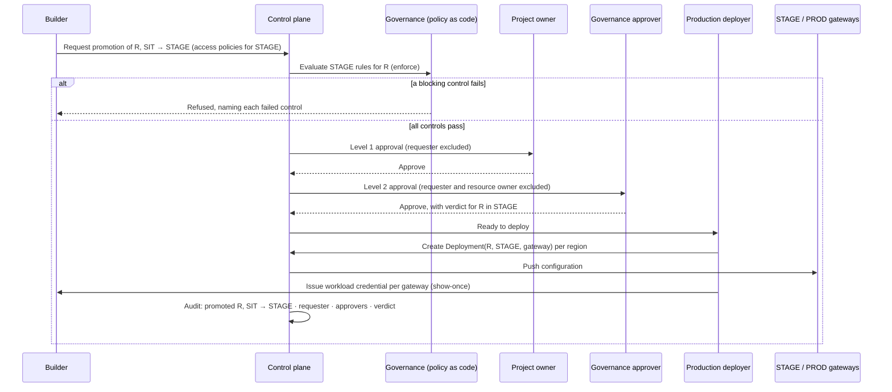

# Promotion — DD-4

**Decision.** Promotion is **a new deployment of the same catalogue resource on the next
environment's gateway**, carrying provenance and re-establishing everything that must not be
inherited. DEV and SIT are self-service. STAGE and PROD are reached by request, decided under
policy, approved by someone other than the requester, and carried out by a production deployer.

The resource itself never moves and is never copied. One agent has one catalogue record, one owner
and one governance record, and a deployment in each environment it has reached.

## The path

```mermaid
flowchart LR
    R["Register once<br/>in the team's project"] --> D["DEV<br/>self-serve · observe"]
    D --> S["SIT<br/>self-serve · observe"]
    S --> Q1{"Request STAGE"}
    Q1 --> P1["Policy evaluated<br/>STAGE rules · enforce"]
    P1 --> A1["Approved by project owner,<br/>then governance approver"]
    A1 --> G["STAGE<br/>deployed by production deployer"]
    G --> Q2{"Request PROD"}
    Q2 --> P2["Policy evaluated<br/>PROD rules · enforce<br/>STAGE evidence attached"]
    P2 --> A2["Approved by project owner,<br/>then governance approver"]
    A2 --> P["PROD<br/>deployed by production deployer"]
    style G fill:#fff8e1,stroke:#f9a825
    style P fill:#ffebee,stroke:#c62828
```

**Promotion is one step at a time**: DEV to SIT, SIT to STAGE, STAGE to PROD. A deployment in an
environment is per gateway, so reaching PROD in every serving region is one deployment per region under one approval.

## Into DEV and SIT — self-service

A builder, holding Gateway Attacher on the DEV and SIT gateway projects (DD-15):

1. Creates the deployment of the resource on the environment's gateway, with the access policies
   it needs in that environment.
2. Has the project owner issue the workload credential for that gateway.
3. Points the workload at the environment's gateway hostname with the new credential.

Governance observes in DEV and SIT: rules are evaluated and findings are shown, and nothing blocks.
A team reads the findings it will meet at STAGE from its first day in DEV.

## Into STAGE and PROD — request, decide, approve, deploy

**What the approver decides.** Whether *this resource* may run in *this environment*, given the
rules in force there and the evidence attached. The approver sees the findings from the
environment below, the obligations resolved for the resource's risk band and frameworks, and the
access policies requested. Approval is recorded against the resource and environment, so a PROD
approval is never inferred from a STAGE one (DD-5).

**Who decides is fixed by policy, not by who is available.** Approval chains resolve their approver
pools from RBAC roles. The requester is excluded from every level, and the resource's owner is
excluded at the governance level. A chain that cannot find an eligible approver is *undecidable*,
not approved.

**What the production deployer does not decide.** The production deployer carries out an approved
promotion. They create the deployment and issue the credential; they do not approve, and they hold
no authority to deploy into STAGE or PROD without a completed approval.

## What moves, and what is re-established

| Carried forward | Re-established in the target environment |
|---|---|
| The **catalogue resource** — same agent, model or tool record, so identity and governance history stay continuous | **Credentials** — issued per `(resource, gateway)`; a new gateway means a new show-once secret |
| **Deployment configuration**, as a template of the shape that worked below | **Quotas** — the target tier's defaults, never the source's |
| **Provenance** — the source environment and source deployment, recorded on the new deployment | **Access policies** — granted for the target environment, approval-gated in STAGE and PROD |
| **Evidence** — evaluations and findings produced below, attached to the request | **Governance verdict** — given per environment |

**The asymmetry is deliberate.** A promotion that inherited DEV's quotas and DEV's access grants is
how a test budget and a test audience would reach production.

**Dependencies are promoted too.** An agent that calls a model or a tool needs those resources
deployed, and access to them granted, in the target environment. The promotion request names them,
and the approver sees them.

## What changes for the workload — configuration only

Each environment's gateway has its own friendly hostname (DD-16), and each deployment has its own
credential. Promotion therefore changes exactly two values in the workload's configuration:

| Value | DEV | PROD |
|---|---|---|
| Gateway | `https://luminate-gw-dev-ca.sunlifecorp.com` | `https://luminate-gw-prod-ca.sunlifecorp.com` |
| Credential | DEV credential for that gateway | PROD credential for that gateway |

The agent's call sites do not change between environments. Teams integrating through the
`acp-harness-sdk` set both values through `ACP_`-prefixed configuration, so promotion is a
configuration change and never a code change.

Where a gateway physically runs is invisible to the workload: moving a gateway between accounts or
clusters (DD-3) changes neither value.

## After PROD

A workload that reaches PROD keeps its DEV and SIT deployments; that is where the next change is
built and tested. Withdrawal is explicit — deleting a deployment revokes its credential — and is
never automatic.

## Repeatability

Promotion is an orchestration of control-plane actions: request, approve, deploy, issue. Each step
is an API call, audited by the control plane, and the platform team runs the STAGE and PROD steps
through a scripted path rather than a sequence of portal clicks. The business team uses the portal
or the harness SDK for the steps it owns. The procedure is published for business teams in
`luminate-user-guides` under *Promoting your agent*.
