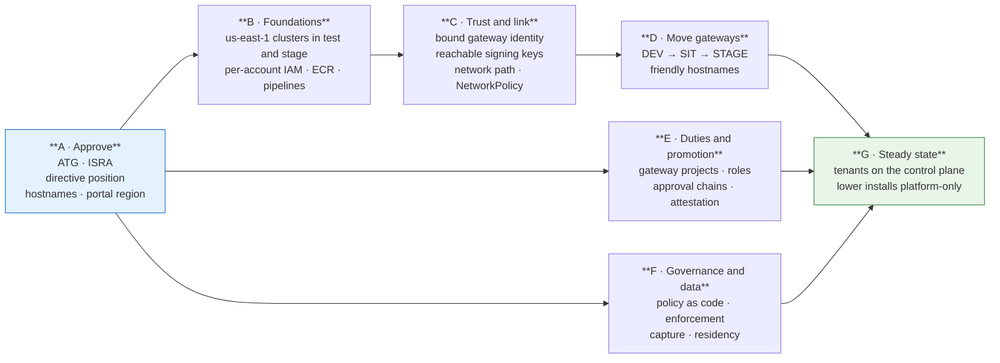

# Roadmap and consortium asks

## Phases to the target topology

| Phase | Outcome | Gates |
|---|---|---|
| **A · Approve** | ATG and ISRA submitted and decided; directive owner's position recorded; friendly hostnames and the control plane's region decided | Nothing |
| **B · Foundations** | Every account has an EKS cluster in each serving region, with gateway IAM, image repositories and pipeline access, all parameterised by region | A |
| **C · Trust and link** | Gateways are trusted only as themselves, validate tokens from a public key address, and reach the control plane on the enumerated link only | A, B |
| **D · Move gateways** | DEV, SIT and STAGE gateways run in their own accounts behind friendly hostnames; PROD gateways behind friendly hostnames | C |
| **E · Duties and promotion** | Gateway projects per environment, the roles and bindings in DD-15, approval chains for STAGE and PROD, attestation | A |
| **F · Governance and data** | Model risk's checklist as policy as code; enforcement in STAGE and PROD; content removed from telemetry; residency configured | A |
| **G · Steady state** | Every business workload on the production control plane; the lower installs used only to test Luminate | D, E, F |

D3 sequences these phases into tasks.

## Consortium asks

What the target topology needs from Luminate itself. Nothing here is forked locally; each is raised
upstream and tracked in D3.

| # | Ask | Needed for | Upstream vehicle |
|---|---|---|---|
| 1 | **Access-layer enforcement of `enforcement_mode`** — the per-rule, per-environment observe/enforce switch exists; a rule in enforce must refuse at the access layer | DD-5 | Governance Mode (Epic H) |
| 2 | **Bound gateway identity** — decide every request for the gateway its credential proves, refusing mismatched claims | DD-14 | Federated Gateways (ACPDIS-124) |
| 3 | **A gateway-reachable signing-key address** — push the identity provider's public JWKS URI to gateways rather than an in-cluster service name | DD-14 | Gateway authentication |
| 4 | **Evaluate `CrossEnvironmentRule`** at access-decision time, with a denial reason that names the matrix | DD-6 | Connectivity Rules |
| 5 | **`Deployment` provenance** — record the source deployment and environment on a promoted deployment | DD-4 | Deployments |
| 6 | **Approval chains selected by target environment tier** — so an access policy reaching STAGE or PROD resolves the tier's chain | DD-4, DD-15 | Approval Flows |
| 7 | **`pre_prod` value for `service_tier`** | DD-2 | Entity attributes seed |
| 8 | **`Quota` spend dimension** | DD-9 | Quotas |
| 9 | **`capture_policy`** — `metadata_only` / `content_opt_in` per obligation profile | DD-10 | Governance Mode |
| 10 | **Authorization during a control-plane outage** — a bounded decision cache co-located with the gateway | DD-17 | ACPDIS-133 |
| 11 | **Gateway-held provider credentials** — the control plane knows a lower-account provider key only by name | DD-13, DD-14 | Federated Gateways (ACPDIS-124) |
| 12 | **Region-aware guardrail evaluators and downstream calls** — an external evaluator declares a region, and a restriction follows an agent's own downstream calls | DD-10 | Data Residency (AIC-1075), open questions 5 and 6 |

## What this design does not do

- **Does not create an install per environment or per region.** One control plane (DD-1).
- **Does not add a third region.** It makes adding one a procedure (DD-19); which region comes next
  is a business decision.
- **Does not hand gateway operation to business units.** That is the federated gateway (Tier 3,
  DD-3), a separate decision with its own submission.
- **Does not remove the control link.** It minimizes, authenticates and inspects it, and submits it
  for approval (DD-13).
- **Does not choose the control plane's region.** That is the us-east-1 relocation decision
  (EACPP-1407); this design works with either answer.
