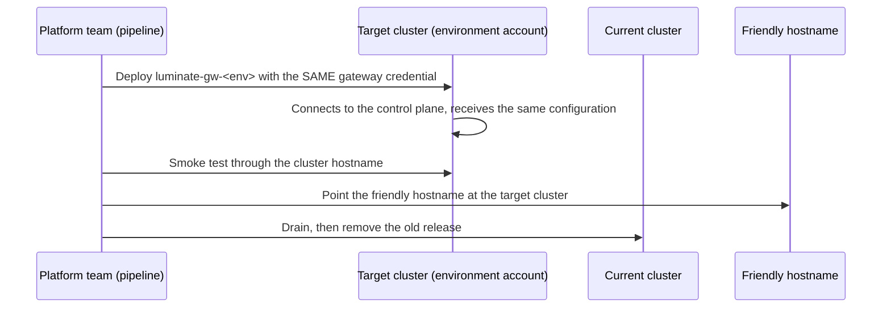

# Topology — control plane, environments, gateways

## DD-1 · One production control plane owns all four workload environments

**Decision.** The **prod** Luminate install is the single control plane for every business
workload, in every workload environment and every region. It holds the one catalogue, the one
governance record, the one audit trail and the one inventory of gateways.

Two words collide here, and the collision is the main way this design gets misread:

| Term | Meaning | Count |
|---|---|---|
| **Install** | A whole copy of Luminate: portal, database, identity provider and its own gateway | Four: dev, test, stage, **prod** |
| **Workload environment** | An `Environment` row inside the prod install, where a business team's resources are deployed | Four: **DEV, SIT, STAGE, PROD** |

When this spec says **dev install** it means a platform-team test system. **DEV** means the
workload environment inside the prod install. The words are not interchangeable.

**Why one control plane rather than one install per environment.** Every environment primitive the
product has is inside one install: the `GatewayEnvironment` join, `Deployment(environment,
gateway)`, `CrossEnvironmentRule` between two `Environment` rows, `GovernanceStatus` keyed
`(resource, environment)`, and the approval engine's view of a resource across environments.

Split the control plane and all of them stop meaning anything. A "promoted" resource becomes a
*different* resource, with no provable relationship to the one that was tested, and "is this agent
approved?" stops having a single answer. Model risk, audit and the business teams each need that
answer to stay single.

**Why gateways do not live with the control plane.** A gateway is where a workload's traffic runs.
Its environment is the environment of the traffic it carries, so it belongs in that environment's
workload account (DD-3). The control plane is where the workload is governed, and there is one of
it. Separating the two is what this design rests on. It is the same shape Sun Life already uses
for a central governance account over many workload accounts.

## DD-2 · Four workload environments, mapped to four accounts

| Key | Name | Order | `service_tier` | Workload account | Purpose | Governance | Who deploys |
|---|---|---|---|---|---|---|---|
| `dev` | DEV | 1st | `non_prod` | dev | Build and iterate. Synthetic or non-sensitive data. | observe | Business team |
| `sit` | SIT | 2nd | `non_prod` | **test** | Integration across teams. | observe | Business team |
| `stage` | STAGE | 3rd | `pre_prod` | stage | Production-like verification with real integrations. | **enforce** | Platform, after approval |
| `prod` | PROD | 4th | `prod` | prod | Live traffic. | **enforce** | Platform, after approval |

**SIT runs in the test account.** There is no SIT account and none is needed: the test account is
the non-production account that sits after dev. If integration and user-acceptance testing later
need separating, the test account can carry a second workload environment (UAT) with its own
gateways. That is a new `Environment` row and a new gateway pair, not a new account.

**SIT is classified as Non-production.** Appendix D of the directive lists SIT among the legacy
equivalents of *Stage*, defined as "configured to mimic production for final functional and
performance testing". At Sun Life that role belongs to STAGE. SIT is integration testing between
teams' builds, which matches Appendix D's *Non-Production* ("applications are built, integrated and
tested"). The test account's classification follows SIT's.

**The tier is a governance attribute, not a label.** `service_tier` is a mandatory,
governance-authoritative attribute on `environment`. Its values are closed by foreign key and only
platform-level roles may assign them, so tier-driven policy rests on something a team cannot edit.
STAGE carries `pre_prod`, which is what lets tier-driven policy separate it from DEV and SIT.

**Order is a position, not a value.** `Environment.rank` is a lexorank string assigned by the
library. A new environment is inserted between two existing ones with
`LexoRank.get_lexorank_in_between(prev, next, count)`; a plain create appends it after PROD, which is
the wrong end of the promotion path.

**Who may create an environment.** Environment writes authorize at organization scope only. They
belong to the **Platform Operator** role, held by the ACP platform team. An environment is global:
every project in the install sees it, so creating one is a platform decision and never a team one.

## DD-3 · One gateway per environment per region, in that environment's account

**Decision.** Each workload environment has **one gateway in each serving region**, and that gateway
runs in the **workload account of its environment**. The serving regions are an open list (DD-19);
today there are two, so eight gateways:

| Environment | Account | `ca-central-1` | `us-east-1` |
|---|---|---|---|
| DEV | dev | `luminate-gateway-dev` | `luminate-gateway-us-dev` |
| SIT | test | `luminate-gateway-sit` | `luminate-gateway-us-sit` |
| STAGE | stage | `luminate-gateway-stage` | `luminate-gateway-us-stage` |
| PROD | prod | `luminate-gateway-prod` | `luminate-gateway-us-prod` |

The keys are the gateways' registered keys in the control plane. They do not change when a gateway
moves to its account (see *Moving a gateway* below).

Each gateway is a Helm release of the `luminate-portal` chart with the portal components turned off,
in its own namespace `luminate-gw-<env>`, on the EKS cluster of its account and region. It is
**operated by the ACP platform team** and **governed by the production control plane**.

**Why a gateway per environment.** The gateway is the failure domain, the capacity pool and the
kill-switch boundary. Sharing one across environments would make a DEV agent's runaway loop a PROD
incident, and make "stop all DEV traffic" impossible without stopping production.

**Why in the environment's own account.** It puts each environment's traffic, Bedrock spend and
blast radius in the account Sun Life already classifies for that environment:

- **A DEV workload never runs on production infrastructure.** Its gateway, its Bedrock calls and
  its capacity are in the dev account.
- **Bedrock is called in the environment's own account.** Model access, invocation logging and the
  bill all land where the environment's owner expects them. No environment uses another
  environment's Bedrock account.
- **Non-production traffic cannot consume production capacity**, because it is not on the
  production cluster.
- **Account-level controls apply per environment.** Who may operate the DEV gateways and who may
  operate the PROD gateways are different AWS entitlements (DD-15).

**Why per region.** An environment spans regions; a gateway does not. `Gateway` carries a
`Location`; `Environment` is global. A second region adds gateways, not a second set of environments
and not a second install. An agent calls the gateway in its own region, so its payload is processed
in that region (DD-10, DD-12).

!!! warning "Anti-pattern — one Luminate install per region or per environment"
    A new region or environment adds **gateways**, never another install. A second install forks the
    catalogue, the governance record and the audit trail — the break DD-1 exists to prevent.

### Sizing

| Environment | Replicas | Autoscaling ceiling | Rationale |
|---|---|---|---|
| DEV | 2 | 3 | Enough to build against; restarts are announced |
| SIT | 2 | 3 | Bursty integration runs |
| STAGE | 2 | 6 | Production-shaped, so verification means something |
| PROD | 3, one per availability zone | 6 | Live traffic with headroom |

### Moving a gateway

A gateway moves between clusters **without changing its identity**. Its `Gateway` record, its
`GatewayEnvironment` mapping, its OAuth client and every workload credential issued against it are
kept. Only the place it runs changes:

Both copies hold the same identity for the length of the cutover, and each receives the same
configuration push. Agents are unaffected apart from the DNS change, because their credential is
bound to the gateway record and not to the cluster. **No workload is re-credentialled.**

### The scaling ladder

| Rung | When | Operated by |
|---|---|---|
| **Tier 1** — one gateway per environment per region | The model in this spec | ACP platform team |
| **Tier 2** — a dedicated gateway for one team, per environment and region | Noisy neighbour, a compliance boundary, or a team whose blast radius must be its own | ACP platform team |
| **Tier 3** — a federated gateway operated by a business unit in its own account | A unit needs its own network, account, jurisdiction or provider-credential custody | The business unit, under the same control plane |

Tier 3 is the consortium **Federated Gateways** design (ACPDIS-124). It keeps one control plane,
one policy set and one audit trail, and binds every authorization decision to the gateway its
credential proves (DD-14). DD-3 is Tier 1 built the way Tier 3 will require, so a later move to
federated operation changes who runs a gateway and not how it is governed.

The consortium design phases it: **Phase 1** bound identity and gateway-held credentials, both
used by this topology from the start; **Phase 2** a unit's own identity provider, rotation without
a push, and held-credential health; **Phase 3** unit-scoped operator roles and fleet views, after
Multi-Tenancy. A business unit can operate its own gateway only once Phase 3 lands.

### Provisioning creates the environment mapping

A gateway is provisioned with its `GatewayEnvironment` row in the same step. An unmapped gateway is
invisible to the deployment form — an empty list with no error — so the provisioning script creates
the row and the smoke test asserts it.

## DD-16 · Every gateway has a friendly hostname that never changes

**Decision.** Each gateway is published on a hostname in the corporate domain that names its
environment and region, not its cluster:

| | `ca-central-1` | `us-east-1` |
|---|---|---|
| DEV | `luminate-gw-dev-ca.sunlifecorp.com` | `luminate-gw-dev-us.sunlifecorp.com` |
| SIT | `luminate-gw-sit-ca.sunlifecorp.com` | `luminate-gw-sit-us.sunlifecorp.com` |
| STAGE | `luminate-gw-stage-ca.sunlifecorp.com` | `luminate-gw-stage-us.sunlifecorp.com` |
| PROD | `luminate-gw-prod-ca.sunlifecorp.com` | `luminate-gw-prod-us.sunlifecorp.com` |

The control plane is published on `luminate.sunlifecorp.com`.

The last label is the **region code** from the region list in DD-19, so a further region adds a
column to this table and no new naming rule.

**Why.** A cluster hostname (`gw-dev.apps.slf-eks-t1k-ca-prod.aws.sunlifecorp.com`) names where a
gateway happens to run. Every agent configured with it breaks when the gateway moves — and DD-3
moves every non-PROD gateway. A friendly hostname names what the gateway *is*, so the move is a DNS
change that no agent sees, and so is any later move: a cluster rebuild, a region relocation, a
federated gateway.

**How.** Each name is a CNAME in the corporate (BlueCat) zone to the Traefik load balancer of the
cluster that runs the gateway, and a SAN on that cluster's Venafi certificate. The pattern above is
the proposal; the final names are fixed in the DNS request and recorded here.

**The cluster hostnames remain** as the operators' address for a specific cluster's copy of a
gateway — during a move, both copies are reachable by cluster hostname while the friendly name
decides which one serves agents. Business teams are only ever given the friendly name.

## DD-18 · Lower installs test Luminate, and nothing else

**Decision.** The dev, test and stage **installs** exist to promote Luminate itself — new releases,
configuration and migrations — before they reach the production control plane. Only the ACP
platform team uses them. No business team registers, deploys or runs anything on them.

| Install | Role | Business workloads |
|---|---|---|
| **dev** | Sandbox. Redeploy, reconfigure and break at will. | None |
| **test** | Release verification against a stable install | None |
| **stage** | Rehearsal of the production change with production-shaped data and approval | None |
| **prod** | The control plane for all four workload environments | All of them |

Two consequences follow:

- **A release reaches production through three installs, and a workload reaches production
  through four environments.** They are separate ladders with separate owners — the platform team
  and the business team — that happen to share names.
- **A lower install needs one gateway of its own** to test the gateway release. It needs no
  per-environment gateways, because it carries no business environments.

A lower install shares its account's clusters with the production control plane's gateways. They
are separate Helm releases in separate namespaces, with separate credentials, separate IAM roles and
a NetworkPolicy between them. The lower install has no connection to the production control plane.

## DD-19 · Serving regions are an open list

**Decision.** The regions gateways serve from are a **list kept by the ACP platform team**, not a
fixed pair. Today the list is `ca-central-1` and `us-east-1`. Any region where Sun Life runs
workload accounts and Amazon Bedrock is available can be added by the procedure below, with **no
change to this design**: a region adds clusters and gateways, never an install, an environment or a
project.

| Region | Code | Status |
|---|---|---|
| `ca-central-1` | `ca` | Serving |
| `us-east-1` | `us` | Serving |
| *Further regions* | *assigned when added* | *Added by the procedure below* |

**Region codes.** A code is short, unique and never reused or changed, because it appears in
gateway keys and hostnames (DD-16). The first region in a country takes the country code (`ca`,
`us`); a later region in the same country takes the AWS short form of its name (for example `usw2`
for `us-west-2`). Existing keys are kept: the `ca-central-1` gateways predate the convention and
carry no code (`luminate-gateway-dev`), and a gateway's key never changes (DD-3). New gateways are
keyed `luminate-gateway-<code>-<env>`.

**A region is added to all four environments.** A workload is promoted DEV → SIT → STAGE → PROD
within a region, so PROD use of a new region requires a gateway in every environment there. The
lower environments may come first; PROD comes last.

**Adding a region.** Each step reuses something this spec already defines for the first two:

| Step | What | Defined by |
|---|---|---|
| 1 | Record the business need, the residency regime and the region code; decide whether assurance needs re-submission (below) | DD-10, [Assurance](assurance.md) |
| 2 | Request an EKS cluster in the region in each of the four workload accounts, with the gateway baseline | DD-3, [Architecture](architecture.md#per-account-resources) |
| 3 | Provision the gateway hub role and in-account Bedrock access in each account; prove the approved models are callable in the region, and record which use cross-region inference | DD-3, DD-10 |
| 4 | Create the region's `Location` in the control plane and label it with its region (Platform Operator, with governance authority). Under Data Residency an unlabelled location serves no residency-bound use case | DD-15, DD-10 |
| 5 | Register one gateway per environment in that environment's gateway project, with its `GatewayEnvironment` mapping | DD-3, DD-15 |
| 6 | Prove the control link from each new cluster, and apply the default-deny NetworkPolicy | DD-13 |
| 7 | Publish the friendly hostnames with the region code | DD-16 |
| 8 | Configure residency labels and, where the regime requires it, regional trace content | DD-10 |
| 9 | Add the gateways to the pipeline and the smoke suite; publish the region to business teams | DD-15, DD-4 |

**Distance from the control plane.** Every call is authorized by the control plane (DD-13), so a
region far from it adds a round trip to every call. The added latency is measured in step 6 and
published with the region. If it is not acceptable for a region, that region needs a consortium
change to how gateways authorize, not a second control plane.

**When assurance must be re-submitted.** A region in a jurisdiction the approved ATG and ISRA do not
cover, or one that adds a residency regime, is a re-submission trigger. A further region in a
country already covered (for example a second US region) is recorded as a change to the Assurance
page.
