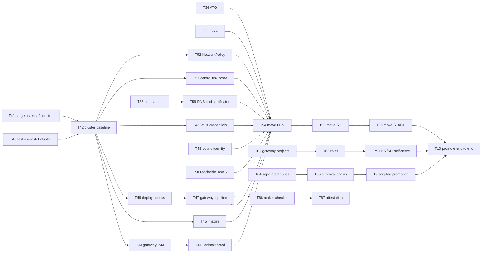

# Luminate Gateway & Environment Strategy — D3: Implementation Plan

> **Gate**: D3 — Tasks | **Status**: In review | **D2 Approved**: TBD
> **Epic**: EACPP-1089 · Board label `acp-product-team`
>
> **Revised 2026-10-06** for the target topology: each environment's gateways in that environment's
> AWS account, one production control plane. Existing task numbers are kept, because Jira tickets
> are keyed on them; tasks that remain open are restated for the new design, and new work starts at
> **T34**. Completed and retired tasks are listed at the end.

## Overview

Eight phases take the estate from today's state (D0) to the target (D2). Phase A is approval and
gates nothing technical. B and C build the foundations and the trust the move depends on. D moves
the gateways. E, F and G run alongside D. H is the steady state.

## Where the platform stands against the target

| Target (D2) | Today (D0) | Closed by |
|---|---|---|
| ATG and ISRA approve the topology and the control link (DD-13) | Not raised | T34, T35, T36 |
| Every account has a cluster in each serving region (DD-3, DD-19) | Test and stage have no `us-east-1` cluster | T40, T41, T42 |
| A serving region is added by procedure, not by design change (DD-19) | Per-region copies (`gateway-iam-us`, hand-written pipeline entries); no procedure or region list | T43, T47, T73 |
| Each gateway in its environment's account, calling Bedrock in that account (DD-3) | All eight gateways in the prod account | T43, T44, T45, T54, T55, T56 |
| A gateway is trusted only as itself (DD-14) | Gateway, environment and location are taken from the request | T49 |
| Signing keys reachable from every cluster (DD-14) | One in-cluster address; a relay in `us-east-1` | T50 |
| Control link is the only cross-environment flow, inspected (DD-13) | Untested from lower accounts | T51, T52 |
| No provider secret crosses the control link (DD-13) | Resolved by the control plane and pushed in configuration | T74 |
| Friendly hostname per gateway (DD-16) | Cluster hostnames; the portal's vanity name blocked in DNS | T38, T59, T60 |
| Per-environment deployment authority (DD-15) | All gateways in one project; no approval policies | T25, T62, T63, T65 |
| Separated governance duties (DD-15) | `RBAC_GOVERNANCE_MODE_ENABLED` off | T64 |
| Maker-checker on every production change (DD-15) | Branch rules bypassable; any branch deployable; cluster-admin held for routine work | T47, T66, T67 |
| Enforcement in STAGE and PROD (DD-5) | Switch exists; nothing denies on it | T26, T68 |
| Cross-environment matrix evaluated (DD-6) | Seeded; not evaluated | T20, T23, T24 |
| Content removed from telemetry; per-environment projects; retention (DD-10) | One project; content exported | T29, T30, T31, T53 |
| Residency labels (DD-10) | Shipped, off | T69 |
| Tenants on the control plane only (DD-18) | Most tenants on the dev install | T17, T18 |

## Tasks

### Phase A · Approve

| Task | Description | Depends |
|------|-------------|---------|
| **T34** | Submit the ATG for the gateway deployment topology. Use [Assurance](d2-design/assurance.md) as the submission: scope, alternatives, the directive position, DD-1 to DD-19, and the re-submission triggers. Record the ATG number in `references/assurance-records.yaml`. (FR-44) | — |
| **T35** | Submit the ISRA for the topology and its control link. Submit C-1 to C-22 and R-1 to R-5 from the Assurance page, with the IPNSD section 2.3 position. If the assessment requires a Security Exception, raise it under directive section 13 with the same evidence. Record the numbers in `references/assurance-records.yaml`. (FR-10, FR-44) | — |
| **T36** | Obtain the directive owner's position in writing. Security Engineering and Advisory's position — that the model is acceptable once the architecture and security assessment are signed off — was relayed verbally on 2026-10-06; attach the written form to T34 and T35. (FR-10) | — |
| **T37** | Accept ADR-0032 (gateways in their environment's account). Circulate to Platform Architecture and the ACP team together with the T34 submission, and move ADR-0031 to Accepted with it. (FR-1, FR-4) | — |
| **T38** | Decide the eight gateway friendly hostnames with the DNS request owner. Confirm the proposed `luminate-gw-<env>-<region>.sunlifecorp.com` pattern or replace it, and record the final names in DD-16 and on the Architecture page. (FR-17) | — |
| **T39** | Record the control plane's region once EACPP-1407 decides it. Update DD-17 and the Architecture page; no other part of this design changes with the answer. (FR-1) | — |

### Phase B · Foundations in every account

| Task | Description | Depends |
|------|-------------|---------|
| **T40** | Request a `us-east-1` EKS cluster in the test account from CCE. Same platform layer as `slf-eks-t1k-use1-dev`: Traefik Gateway API with the wildcard certificate, Vault Secrets Operator, Gatekeeper, an OIDC issuer for IRSA. Record the cluster name in the Architecture page. (FR-6) | — |
| **T41** | Request a `us-east-1` EKS cluster in the stage account from CCE. As T40. (FR-6) | — |
| **T42** | Bring every gateway cluster to the gateway baseline. Karpenter application NodePool (with the Sun Life CA in user data), Traefik route support with a Venafi listener, and the CA ConfigMap a gateway namespace needs — on `slf-eks-t1k-use1-dev` and the two new clusters; verify the `ca-central-1` clusters already meet it. (FR-6) | T40, T41 |
| **T43** | Provision gateway IAM in every account and region from one region-parameterised stack. `terraform/gateway-iam` takes the account and region as inputs and replaces the `gateway-iam-us` copy; it must trust `system:serviceaccount:luminate-gw-<env>:luminate-gateway` in dev, test and stage. Each hub role carries the in-account Bedrock policy only. (FR-5, FR-45) | T42 |
| **T44** | Prove Bedrock access from every hub role in every serving region. Converse probes against the approved model set from each account and region, in at least two timestamped rounds; record which offerings are in-region and which use cross-region inference profiles. (FR-5, FR-37) | T43 |
| **T45** | Make the gateway images available in every account and region. ECR repositories for the gateway and PII detector, promoted by digest, or the Artifactory consortium mirror (EACPP-624) where reachable. (FR-4) | T42 |
| **T46** | Give the pipeline deploy access to every gateway cluster. `terraform/eks-deploy-access` for each new cluster, the namespaced RBAC bootstrap, and Jenkins credentials for the test and stage accounts, which have none today. (FR-22) | T42 |
| **T47** | Extend the gateway pipeline to all eight targets, driven by the region list. One `pipeline_config_gateway.groovy` entry per account and region, generated from the DD-19 region list with its registered gateway keys, so a new region adds list entries and no pipeline code; approval and `refTicket` required for the stage and prod accounts; STAGE and PROD runs refuse any reference other than `main`. (FR-22, FR-23, FR-45) | T46 |
| **T48** | Store every gateway's OAuth credential in Vault. A Vault path per gateway, synced into its namespace by a VaultStaticSecret, replacing the hand-made Secret; rotation per gateway documented. (FR-13) | T42 |

### Phase C · Trust and the control link

| Task | Description | Depends |
|------|-------------|---------|
| **T49** | **[Luminate code change]** Bind every access decision to the gateway the credential proves. Raise and track the bound-identity guarantee of Federated Gateways (ACPDIS-124): resolve gateway, environment and location from the gateway credential and refuse mismatched claims. Required before any gateway leaves the production account. (FR-13) | — |
| **T50** | **[Luminate code change]** Push a gateway-reachable signing-key address. The control plane pushes the identity provider's in-cluster JWKS URI to every gateway; a relay cannot stand in on the dev, test and stage clusters because each runs its own Keycloak under the same service name. Raise a setting for the public JWKS URI, or adopt it if it lands first. (FR-14) | — |
| **T51** | Prove the control link from every gateway cluster, and confirm its inspection. From a pod in each of the eight clusters: TLS handshake to the control plane's ingress verified against the Sun Life root, and an unauthenticated 401. Confirm with network engineering which inspection layer the inter-account path traverses, and record the allow rule set. (FR-10, FR-11) | T42 |
| **T52** | Add a default-deny NetworkPolicy to every gateway namespace. Chart template with the allow list from DD-13 — Traefik ingress; DNS; control plane, collector and AWS endpoints on egress — rendered for every gateway release and verified with a denied probe from the lower install's namespace. (FR-15) | T42 |
| **T53** | Deploy an OTel collector in every gateway cluster. Exports to the environment's project in the central Langfuse over TLS, with the content-redaction processor from T29 ahead of the exporter. (FR-35, FR-36) | T29, T42 |
| **T74** | **[Luminate code change]** Adopt gateway-held provider credentials. When Federated Gateways (ACPDIS-124) Phase 1 ships, hold every non-Bedrock provider key served from a lower account in that account's Vault, mounted for the gateway, so the control plane holds only its name and no secret crosses the control link. (FR-10, FR-47) | T48 |

### Phase D · Move the gateways

| Task | Description | Depends |
|------|-------------|---------|
| **T54** | Move the DEV gateways into the dev account. Deploy `luminate-gateway-dev` on `slf-eks-t1k-ca-dev` and `luminate-gateway-us-dev` on `slf-eks-t1k-use1-dev` with their existing gateway credentials; smoke through the cluster hostname; switch the friendly hostname; drain and remove the prod-account releases and their NetworkPolicy allow entries. No workload is re-credentialled. (FR-4, FR-7) | T34, T35, T43, T44, T45, T47, T48, T49, T50, T51, T52, T59 |
| **T55** | Move the SIT gateways into the test account. As T54, onto `slf-eks-t1k-ca-uat` and the test account's `us-east-1` cluster. (FR-4, FR-7) | T54 |
| **T56** | Move the STAGE gateways into the stage account. As T54, onto `slf-eks-t1k-ca-stage` and the stage account's `us-east-1` cluster, under a CHG. (FR-4, FR-7) | T55 |
| **T57** | Give the PROD `ca-central-1` gateway its own release. Move it out of the portal release into `luminate-gw-prod`, keeping its identity, so every gateway has the same lifecycle and the portal and PROD gateway are upgraded independently. Under a CHG. (FR-3) | T47, T52 |
| **T58** | Retire the dev install's second gateway. A lower install needs one gateway (DD-18); remove `luminate-gateway-dev-sit` and its namespace, after confirming nothing is deployed on it. (FR-9) | T18 |
| **T59** | Publish the eight gateway friendly hostnames and the portal's. DNS requests for CNAMEs in the corporate zone to each cluster's Traefik load balancer, citing the `jenkins-dna.sunlifecorp.com` precedent; Venafi SANs on each cluster's certificate; HTTPRoutes per gateway release. (FR-17) | T38, T42 |
| **T60** | Move business teams to the friendly hostnames. Update the deployments registry in `acp-product-devkit`, the onboarding message and the user guides; notify every team with a deployment; keep cluster hostnames for operators only. (FR-29, FR-42) | T59 |
| **T61** | Extend the smoke suite to all eight gateways. Through friendly hostnames: reachability, environment mapping, a control-link check, and a governed call per environment. (FR-8) | T59 |

### Phase E · Segregation of duties and promotion

| Task | Description | Depends |
|------|-------------|---------|
| **T62** | Create one gateway project per environment and move the gateways into them. *Gateways — DEV, SIT, STAGE, PROD* under *Luminate Platform*. Rehearse on the dev install first and confirm existing deployments and credentials are unaffected by a gateway's change of project. (FR-19) | — |
| **T63** | Create the Gateway Attacher and Gateway Administrator roles and bind production deployers. Custom roles from `deployments.gateway_attachment.*` and `gateways.gateway.*`; bind production deployers on the STAGE and PROD gateway projects and gateway administrators on all four; nobody else holds them there. (FR-18, FR-19) | T62 |
| **T25** | Open DEV and SIT to team self-service. Bind Gateway Attacher on the DEV and SIT gateway projects to each team's builders and owners, and prove a team can deploy into DEV and SIT and is refused in STAGE and PROD. (FR-19) | T63 |
| **T64** | Turn on separated governance duties. Set `RBAC_GOVERNANCE_MODE_ENABLED` on the dev install, verify the start-up check and that Administrator no longer approves, then on the control plane; bind Governance Administrator and Governance Approver to named groups agreed with Model Risk. (FR-21) | — |
| **T65** | Configure the STAGE and PROD approval chains. Two levels — project owner, then governance approver — with the requester excluded and the resource owner excluded at level two, for access policies that reach STAGE or PROD and for governance verdicts. Verify the chain is selected by target environment; if it cannot be, raise consortium ask 6. (FR-20) | T64 |
| **T9** | Script the STAGE and PROD steps of promotion. Given a completed approval: create the deployments on the target gateways, apply tier quotas, issue credentials, emit the provenance audit event. Run by production deployers only. (FR-26, FR-27, FR-30) | T63, T65, T8 |
| **T66** | Close the platform-side maker-checker gaps. Withdraw the product team's cluster-admin permission set on the stage and prod accounts in favour of the support role (IAM request); remove the direct-push exemption on `luminate-sunlife-deploy` `main`; restore pipeline-only production changes. (FR-22, FR-24) | T47 |
| **T67** | Start quarterly attestation of standing production authority. Who holds each role in DD-15's attestation table, recorded and signed; the first attestation run once T63 to T66 land. (FR-25) | T63, T64, T66 |
| **T15** | Publish the business-team view in `luminate-user-guides`. Update *Promoting your agent* for approval chains and friendly hostnames, *Personas* and *Roles* for DD-15, and add a one-page answer to "what can I do in each environment". (FR-42) | T60, T65 |

### Phase F · Governance and data

| Task | Description | Depends |
|------|-------------|---------|
| **T68** | Encode Model Risk's pre-production checklist as STAGE and PROD rules. From `acp-cmrm-policy-as-code`: applicability, obligation profiles and blocking controls, in observe on every environment first. (FR-33) | T64 |
| **T26** | Promote the rules to enforce in STAGE and PROD. Per rule, per environment, with the impact report generated and acknowledged; access-layer enforcement through Governance Mode Epic H (consortium ask 1). DEV and SIT stay in observe. (FR-31, FR-32) | T68, T4 |
| **T2a** | Raise consortium ask 7 — the `pre_prod` `service_tier` value — and tag STAGE with it when it lands. (FR-2) | T2 |
| **T8** | Set per-tier quota defaults and apply them at deployment creation. Keyed on the environment until `pre_prod` exists. (FR-27) | — |
| **T20** | **[Luminate code change]** Evaluate `CrossEnvironmentRule` in the access decision, with a refusal that names the matrix. The matrix is seeded (T3) and inert until this lands. (FR-16) | — |
| **T21** | **[Luminate code change]** Decide `CrossLocationRule`'s fate. Evaluate it alongside T20, or remove it in favour of residency labels, which already constrain region. (FR-37) | T20 |
| **T22** | Decide whether residency needs the caller's own region. With residency labels on projects and resources, decide whether a caller-location field adds anything; record the answer in DD-10. (FR-37) | T69 |
| **T23** | Confirm the seeded matrix denies once T20 ships. Re-run the matrix from T3 against the evaluator and publish the result. (FR-16) | T20 |
| **T24** | Re-test isolation against the real evaluator. Repeat T11 with cross-environment calls once T20 ships. (FR-16) | T20, T11 |
| **T28** | Name who assigns a workload's regulatory regime, and against which attribute. A compliance decision; the platform records it. (FR-38) | — |
| **T29** | Add the content-redaction processor to the collector pipeline. Drop or hash prompt and completion attributes before export; carried into every cluster's collector by T53. (FR-35) | — |
| **T30** | Give each environment its own Langfuse project and key pair. So PROD telemetry is not queryable from the DEV project. (FR-36) | T29 |
| **T31** | Set a retention TTL on the ClickHouse trace tables. (FR-36) | — |
| **T32** | Raise consortium ask 9 — `capture_policy` per obligation profile. (FR-35) | T28 |
| **T33** | Re-test isolation for data, not just capacity. Prove a DEV operator cannot read PROD content or telemetry. (FR-35, FR-36) | T30, T53 |
| **T69** | Turn on residency labels. Upgrade every gateway to a residency-capable build first; set `DATA_RESIDENCY_ATTRIBUTE_KEY`; label every location, including `Default`, before any use case; set `GATEWAY_TRACE_CONTENT_REGIONS` on each gateway and `TRACE_REGIONAL_CONTENT_URLS` on the portal; and prove an out-of-region placement is refused. (FR-37) | T53 |

### Phase G · Availability and recovery

| Task | Description | Depends |
|------|-------------|---------|
| **T70** | Bring the control plane to the DD-17 availability baseline. Confirm two Keycloak instances in production, alert on gateway `portal_unreachable` refusals and on control-plane health, and schedule the smoke suite. (FR-39, FR-40) | — |
| **T13** | Rehearse a control-plane recovery in the stage install. Rebuild from `luminate-sunlife-deploy` plus a point-in-time database restore, and confirm the governance record, audit trail and every gateway's reconnection survive it. (FR-40) | T56 |
| **T27** | Adopt federated-gateway outage behaviour when the consortium ships it. Track Federated Gateways (ACPDIS-124) and the outage design (ACPDIS-133); revisit the scaling ladder and DD-17 when either lands. (FR-39) | — |

### Phase H · Steady state

| Task | Description | Depends |
|------|-------------|---------|
| **T4** | Raise the remaining consortium asks with evidence. Asks 1, 5, 6, 8, 10 and 12 from the D2 Roadmap; asks 2 and 3 are T49 and T50, ask 4 is T20, ask 7 is T2a, ask 9 is T32, ask 11 is T74. (NFR-1) | — |
| **T10** | Promote one workload DEV → SIT → STAGE → PROD across the four accounts. End to end, with the approval chains, from every serving region, recording what broke. (FR-26) | T56, T9, T25 |
| **T11** | Verify isolation between environments. A DEV workload cannot reach or exhaust a PROD gateway; a lower install's namespace cannot reach a gateway; the kill switch stops one gateway without the others. (NFR-3) | T56, T52 |
| **T16** | Update `config/environments.yml` in `luminate-user-guides`. One control plane on its friendly hostname, and the lower installs shown as platform-only. (FR-42) | T59 |
| **T17** | Reconcile the onboarding specs with this model. `gbd`, `mdx`, `aims`, `orcc`, `waldo`, `ai-ready-data`, `agentic-cloud-provisioning` and others onboard into the control plane's four environments, by friendly hostname. (FR-1) | T15 |
| **T18** | Move every tenant from the dev install to the control plane. Recreate projects, resources and deployments in DEV, re-credential, and retire them from the dev install, which then holds no business workload. (FR-9) | T15, T25 |
| **T19** | Confirm the harness SDK carries the per-environment path as configuration. Gateway hostname and credential per environment through `ACP_` settings. (FR-29) | T60 |
| **T71** | Update the operating documentation in `luminate-sunlife-deploy`. Operating model, gateway values README, US region enablement, deploy checklists and `deploy_info.md` for the per-account topology, the move procedure and the duties in DD-15. (FR-43) | T56 |
| **T72** | Amend the dependent specs. `agentic-cloud-provisioning`, `us-cutover`, `sunlife-deployment` and `self-service-onboarding` for gateway placement, friendly hostnames and the duties model. (FR-1) | T37 |
| **T73** | Publish the region list and the add-a-region procedure. The DD-19 region list with codes, and the nine-step procedure as a runbook in `luminate-sunlife-deploy`, including the latency measurement and the assurance check; validate it against the T40/T41 provisioning, which is the same procedure for one account. (FR-45, FR-46) | T43, T47, T71 |

## Sequencing

The critical path to the first moved gateway is **T40/T41 → T42 → T43 → T54**, with **T49 and T50**
— both consortium changes — as the external dependencies that most likely set the date. DEV moves
first because it is the lowest-risk environment and the one where a mistake costs least.

## Ticket disposition

These tickets are not in the task tables above, so the Jira generator leaves them alone.

| Ticket | Was | Disposition |
|---|---|---|
| T1 · EACPP-1090 | Axis ADR (ADR-0031) | Done |
| T2 · EACPP-1091 | Environment set | Done |
| T3 · EACPP-1092 | Seed the cross-environment matrix | Done — inert until T20 |
| T5 · EACPP-1094 | Create the four environments | Done, in the prod install |
| T6 · EACPP-1095 | Four `ca-central-1` gateways with their mappings | Done, in the prod account; T54–T57 move them |
| T6a · EACPP-1374 | DNS and TLS for the cluster gateway hostnames | Done; superseded for business use by T59 |
| T12 · EACPP-1101 | Prod install topology | Done |
| T7 · EACPP-1096 | Interim governance scoping by environment | **Retire** — the enforcement switch exists; replaced by T26 |
| T14 · EACPP-1103 | Extend to `us-east-1` | **Retire** — built in the prod account; per-account placement is T54–T56 |

Closing T7 and T14, and creating T34–T74, waits for this D3 to be approved.

## Definition of done

- ATG and ISRA decided for this topology, with any Security Exception recorded.
- Every account has a cluster in each serving region; each environment's gateways run in its own
  account and call Bedrock there.
- The region list and the add-a-region procedure are published, and IAM and the pipeline take the
  region as a parameter.
- Every gateway is trusted only as itself, validates tokens from a reachable address, reaches the
  control plane only over the control link, and sits behind a default-deny NetworkPolicy.
- Every gateway is on its friendly hostname, and every business team uses it.
- Deployment authority is per environment through gateway projects; STAGE and PROD promotion runs
  through approval chains that exclude the requester and owner; governance duties are separated in
  code; every production change is maker-checker; standing authority is attested.
- Model Risk's checklist enforces in STAGE and PROD and observes in DEV and SIT.
- Telemetry carries no content, is separated per environment and expires; residency labels are on.
- One workload has been promoted DEV → PROD across the four accounts.
- No business workload remains on a lower install.

## References

- Spec: [D0](d0-discovery.md) · [D1](d1-requirements.md) · [D2](d2-design.md)
  ([pages](d2-design/index.md), [Assurance](d2-design/assurance.md))
- ADR-0031, ADR-0032
- [`luminate-sunlife-deploy`](https://bitbucket.sunlifecorp.com/projects/EDAEACP/repos/luminate-sunlife-deploy/browse) ·
  [`luminate-user-guides`](https://bitbucket.sunlifecorp.com/projects/EDAEACP/repos/luminate-user-guides/browse) ·
  `acp-cmrm-policy-as-code`
- Related: `us-cutover` (EACPP-1407) · `agentic-cloud-provisioning` (EACPP-1163) ·
  `sunlife-deployment` (EACPP-596) · `self-service-onboarding` (EACPP-1325) ·
  Federated Gateways (ACPDIS-124) · ACPDIS-133
