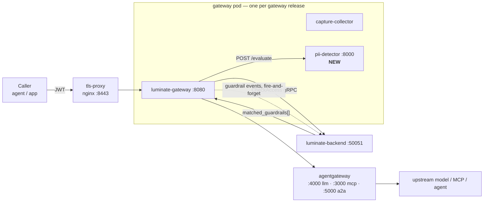
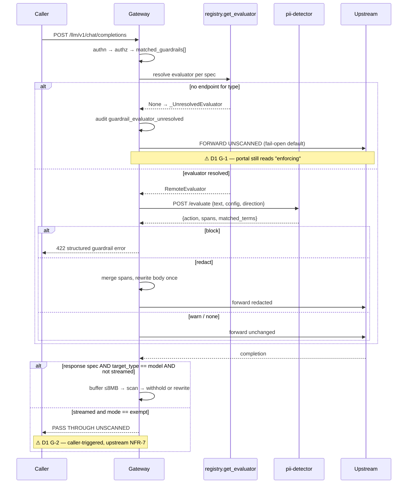
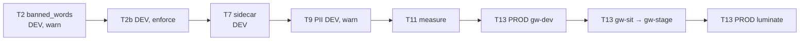

# Guardrails Enablement — D2: Design

> **Gate**: D2 — Design | **Status**: Draft | **Epic**: [EACPP-1295](https://sunlife.atlassian.net/browse/EACPP-1295)
>
> Platform facts carry forward from [D0 §3–§5](d0-discovery.md). Nothing in this design changes
> Luminate's behaviour in Phase 1 — it is deployment, configuration and control authoring against
> a subsystem that already ships. Phase 2 is the only part that proposes upstream code, and it is
> gated on a consortium decision Sun Life does not control.

!!! info "Implementation status — 2026-10-05"
    Phase 1 T3–T8 are built and running on both DEV-install gateways
    (`luminate-sunlife-deploy` PR #28, operator guide `docs/guardrails.md`). Most of the design held.
    The places it changed after testing against the real platform are marked **Revised**:
    DD-4 (`audit`, not `exempt`), DD-6 (the guard is structural, not a check), §4.1 (loopback bind,
    exec probes, an egress fix) and §4.2 (timeout 10 s, not 3 s). §4.4 gains a measured entity-selection
    finding.
## 1. Overview

Three things have to become true, in this order, and the order is the design:

1. **An evaluator exists on every gateway** before any control that needs one is authored — because
   a control with no evaluator reads as enforcing and is not ([D1 G-1](d1-requirements.md#g-1-an-unevaluable-control-reads-as-enforcing)).
2. **The posture is explicit** — fail mode, streaming mode, timeouts and the endpoint map are set
   in values rather than inherited from code defaults, so the deployed behaviour is legible from
   the cluster.
3. **Controls are promoted, not launched** — `warn` first with the impact measured, then `enforce`.

Phase 2 adds a fourth: a content-safety evaluator covering prompt injection, jailbreak and topic
policy, which Phase 1 does not reach. §5 works that as three routes rather than one — and the
recommendation (DD-11) is **in-cluster and open-source first**, with AWS Bedrock as the managed
fallback rather than the plan.

## 2. Architecture

### 2.1 Where enforcement happens



The decision is made in the backend and the enforcement in the gateway. `authz.rego` returns
`matched_guardrails` on the `CheckAccess` response;
`gateway/app/middleware/guardrails.py` reads them off `scope["state"]["guardrails"]`, partitions by
direction, and fans the request-direction specs out concurrently. There is no new control plane to
build — the only structural addition is the sidecar container.

### 2.2 Evaluation flow, and the two places it can quietly do nothing



Both grey paths are pre-existing platform behaviour. The design's job is to make sure neither is
where we end up by accident.

## 3. Decisions

### DD-1 — Sidecar-first, control-second, and `banned_words` is the first control

**Decision.** No `pii_detection` or `model_armor` guardrail is created in any environment until the
matching endpoint is present in that gateway's `GATEWAY_GUARDRAIL_REMOTE_ENDPOINTS`. The first
control authored anywhere is `banned_words`.

**Why.** `banned_words` is the only type in `LOCAL_EVALUATORS`, so it enforces on the images already
running with no infrastructure and no new failure mode. It gives us a true end-to-end proof — portal
→ rego → gateway → block → activity row — before any sidecar exists, which cleanly separates "the
guardrail pipeline works" from "the sidecar works". Doing it the other way round means a first
attempt that appears to succeed and enforces nothing.

**Consequence.** T2 (prove `banned_words` in DEV) has no dependency on the sidecar work at all and
can run immediately.

### DD-2 — Every enforcing remote-type control carries an explicit `fail_open: false`

**Decision.** Sun Life-authored `pii_detection` (and later `bedrock_guardrails`) controls set
`fail_open: false` on the guardrail rather than relying on the deployment knob.

**Why.** The deployment knob `guardrail_remote_fail_open` governs a *configured* evaluator that
times out or 5xxs. It does **not** govern an *unresolved* one — `_UnresolvedEvaluator` uses
`default=True` regardless, and only an explicit per-guardrail `false` denies there. So the knob
alone leaves exactly the hole D1 G-1 describes. Setting it on the guardrail closes both cases with
one field.

**Consequence.** The documented rollback lever — unset the endpoint to stop a type resolving — stops
working for our controls, by design: it would deny instead of degrade. The real rollback lever
becomes `is_active: false` on the guardrail, or flipping the attachment to `warn`. **NFR-4 and the
runbook (T15) must say this explicitly**, because the upstream docstring recommends the lever we
are deliberately disabling.

### DD-3 — `guardrail_remote_fail_open: false` everywhere, including DEV

**Decision.** The deployment knob stays at its code default of `false` in all five gateways, and is
written into values explicitly rather than left implicit.

**Why.** A control that is allowed to degrade to "allow" under load is not a control anyone can put
in an ISRA. DEV is where we want the fail-closed behaviour to be *experienced* and rehearsed
(AC-9), not hidden. Writing it explicitly is what satisfies NFR-10 — a reader of the ConfigMap can
see the posture without knowing the code default.

**Open**: D0 Q-3 may overturn this for DEV if it proves too disruptive to developer flow.

### DD-4 — `guardrail_response_streaming` is `audit`, written explicitly, and promoted to `enforce` on measurement

**Revised 2026-10-05.** The upstream decisions this DD was waiting on are settled:

- AIC-680 and AIC-717 were decided on 2026-09-13.
- AIC-691, done 2026-09-17, made `audit` a real mode: it scans a streamed response after the stream
  ends, never interrupts it, and is now the code default.

Deploying `exempt` would therefore *weaken* the image default. So we deploy `audit`, written
explicitly. The rest of the decision stands.

**Decision.** Deploy `audit` (the code default, written explicitly), measure the TTFT delta under
`enforce` in DEV, and promote to `enforce` only once NFR-2 has a number.

**Why.** `enforce` is real and upstream runs it locally, so this is not a capability gap — it is a
latency unknown on the most user-visible path we have. The upstream D2 withdrew its own 200 ms
target (D-6) because it had never been measured, and repeating that mistake in the other direction
by enabling a streaming scanner on an unmeasured budget would be the same error.

**Consequence, and it must be said out loud.** For as long as we sit on `audit`, a response-direction
control is **detective, not preventive** for any caller that streams. The response is scanned and
recorded, but it has already been delivered unredacted. No onboarding document, ISRA or capability
claim may describe it otherwise. This is the single most likely place for the "control exists on
paper" failure to recur, which is why it is a decision and not a footnote. Non-streamed responses
are always scanned and enforced.

**Watch**: AIC-693 (done 2026-10-01) verified the latency budget and measured response-path TTFT
upstream. Read its result before T12.

### DD-5 — One PII sidecar per gateway pod, added to the SLF chart

**Decision.** Add `pii-detector` as a fourth container in
`helm/luminate-portal/templates/gateway/deployment.yaml`, gated on `.Values.gateway.guardrails.piiDetector.enabled`,
reachable at `http://127.0.0.1:8000/evaluate`.

**Why localhost rather than a Service.** A `Service` would load-balance inspection traffic across
pods and send prompt content over the pod network for no benefit. Loopback keeps inspected content
inside the pod's network namespace — which is also what makes NFR-7 easy to assert.

Upstream backs this, though note the exact wording: **NFR-14** is written about the *judge* sidecar
("one sidecar per pod, no cross-pod judge traffic"), and it is **NFR-8** that generalises it —
cross-tenant isolation is recorded as *Not applicable to this design* because "NFR-14 gives each
Gateway pod its own sidecar and forbids cross-pod **evaluator** traffic, so no evaluator
infrastructure is shared between organizations". So the per-pod rule is load-bearing for every
evaluator, but it is NFR-8 that says so.

**Consequence.** Cost scales with gateway *replicas*, not with traffic. Five gateway releases at
current replica counts is the multiplier to size against (T5).

**Alternative rejected.** A shared cluster-wide PII service would be cheaper, but upstream NFR-8
("cross-tenant isolation on shared evaluator infrastructure, with the timing-attack inference risk
mitigated") is recorded as *Not applicable to this design* precisely because no infrastructure is
shared — and it explicitly "binds any future design that shares one", with shared evaluator
infrastructure "not approved for production until it is met". Adopting a shared service would make
an unmet upstream NFR ours to meet.

**Upstream deploy repo went the other way.** `luminate-deploy` (consortium) ships the detector as
a separate Deployment and Service in its own namespace. The hop is plaintext and is guarded by a
deny-egress NetworkPolicy, and it is recorded there as a non-production exception. We keep DD-5:
the loopback hop needs no TLS exception and shares no evaluator. The divergence is recorded in
`luminate-sunlife-deploy` `docs/fork-lineage.md`, so a chart sync does not port
`templates/pii-detector/*` back in.
### DD-6 — The chart gets a typed `gateway.guardrails` block, not a raw env passthrough

**Decision.** Add a `gateway.guardrails` values block that renders the four `GATEWAY_GUARDRAIL_*`
keys, rather than asking operators to hand-write them into `gateway.config`.

**Why.** `gateway.config` is `range .Values.gateway.config` with `| quote`, so a JSON map value
works but is unreviewable and easy to get wrong — the endpoint map is a JSON string inside a YAML
string. A typed block also lets the template refuse the combination that produces D1 G-1: a
`piiDetector.enabled: false` alongside an endpoint map naming `pii_detection` should fail the
render, not the request.

**Revised 2026-10-05 — as built, the mismatch is unrepresentable rather than detected.**

- The `pii_detection` endpoint is *derived* from `piiDetector.enabled`, so one flag adds the
  container and the endpoint together.
- `remoteEndpoints.pii_detection` is rejected outright. `remoteEndpoints` remains for types whose
  evaluator runs elsewhere.
- The render also fails on any `GATEWAY_GUARDRAIL_*` key written into `gateway.config`, because a
  duplicate ConfigMap key silently overwrites instead of merging.
- It also fails on an unknown `responseStreaming` value.
- Unset fields render nothing, so a release that does not opt in renders byte-identical to the
  pre-feature chart. Verified across all 12 releases (4 portals, 8 gateway releases).
**Consequence.** `gateway.config` stays the escape hatch for anything not modelled.

### DD-7 — Controls are authored by a recorded script in `luminate-sunlife-deploy`, not by hand

**Decision.** The Sun Life control set is created through the REST API by a checked-in, re-runnable
script; the portal is used to *inspect*, not to author.

**Why.** D1 G-3: upstream YAML seeding is a Should-Have that is not built, so the control set is
database state no GitOps pipeline reconciles. A rebuilt environment loses every control silently. A
recorded script makes the set reproducible (AC-10) and puts the change history in git, which also
covers D1 G-4 while the upstream audit items are open.

**Consequence.** The script is a stopgap with an exit condition: retire it when upstream FR-14
lands.

### DD-8 — The capability map gains a deployment-state qualifier for CAP-10

**Decision.** CAP-10 keeps its ✅ (it is correct about Luminate) and gains an explicit note that the
capability is unconfigured at Sun Life until this epic completes, in the INT-02 style.

**Why.** The map is the menu for use-case discovery and feeds Product Board ranking. A Mandatory
control read as "we have this" when no gateway enforces it is the exact error class the map's own
verification rules exist to prevent. This is not a gap to escalate to the consortium — it is our
configuration, so it belongs in the map's deployment column, not on the roadmap.

### DD-9 — A new evaluator type is a contribution routed through the ballot, never a fork

**Decision.** Any new `GuardrailType` Sun Life wants is pursued as a **new ACPDIS idea** followed by
a Sun Life-authored upstream contribution — not as an AIC story and not as a Sun Life fork. This
holds for every option in §5 that needs a new type (A and C alike).

**Why.** An ask not in ACPDIS cannot be ranked at a Product Board round, and no existing idea covers
a non-GCP content-safety evaluator. A fork is worse than useless here: `GuardrailType` is a shared
`StrEnum` in `luminate_types`, so a gateway whose copy does not know a type **denies the request
with `portal_invalid_guardrails`** rather than ignoring it — org-wide for an org-scoped attachment.
A locally-added type would break every gateway we had not simultaneously rebuilt.

**Why we are well placed to contribute.** The upstream design reserved the seam (`FR-15`: "a non-GCP
path is a later type") rather than rejecting it, and we hold both halves of the evidence — a
self-hostable serving stack (SLM pipeline) and a working cross-account Bedrock path.

**See also DD-13**, which settles what the ballot idea actually says, and **DD-11**, which settles
which backend leads.

### DD-10 — Sun Life does not enable Model Armor

**Decision.** `MODEL_ARMOR_ENABLED` stays `false` in every environment.

**Why.** Model Armor is a Google Cloud service. Sun Life has no GCP path for this traffic, and
enabling the type would only create a class of control that can be authored and never evaluated —
manufacturing D1 G-1 deliberately. The Model Armor *sidecar pattern* is still valuable: it is the
reference implementation Phase 2 copies.

**Note the asymmetry, because it is a trap in the other direction too.** `MODEL_ARMOR_ENABLED`
gates **creation** only — `serializers.py` rejects a new `model_armor` guardrail when it is false,
and existing rows "keep serving so a rolling deploy does not break them". So turning the flag off
is not a way to disable a control that already exists. The lever for that is `is_active: false` on
the guardrail, the same one DD-2 leaves us with. The runbook (T15) says so once, for both cases.

## 4. Phase 1 — enablement

### 4.1 Chart change

`helm/luminate-portal/templates/gateway/deployment.yaml` gains a fourth container. The pod today is
`luminate-gateway` (100m / 256Mi), `capture-collector` (50m / 128Mi), `tls-proxy` (25m / 32Mi).

```yaml
{{- if .Values.gateway.guardrails.piiDetector.enabled }}
- name: pii-detector
  image: "{{ .Values.gateway.guardrails.piiDetector.image.repository }}:{{ .Values.gateway.guardrails.piiDetector.image.tag }}"
  imagePullPolicy: Always
  ports:
    - { name: http, containerPort: 8000 }
  startupProbe:            # the analyser loads en_core_web_lg on first call
    httpGet: { path: /health, port: 8000 }
    failureThreshold: 30
    periodSeconds: 5
  readinessProbe:
    httpGet: { path: /health, port: 8000 }
  resources:               # MANDATORY — Gatekeeper denies the ReplicaSet without both
    requests: { cpu: {{ .Values.gateway.guardrails.piiDetector.resources.requests.cpu }},    memory: ... }
    limits:   { cpu: ..., memory: ... }
  securityContext:
    allowPrivilegeEscalation: false
    readOnlyRootFilesystem: true
    runAsNonRoot: true
{{- end }}
```

Three traps, all previously observed in this cluster:

- **Gatekeeper `container-must-have-limits-and-requests` applies to every container.** Without both,
  the ReplicaSet fails *silently*: `generation == observedGeneration`, `updatedReplicas` empty, and
  `rollout status` hangs on "0 out of 1 new replicas have been updated". The real error appears only
  in `kubectl get events` / `describe deploy` as `FailedCreate ... admission webhook denied`.
- **Startup, not liveness, is what needs the long threshold.** The Presidio analyser loads
  `en_core_web_lg` on the first `/health` call, which is why the upstream compose file gives it a
  long `start_period`. A liveness probe tuned for the gateway will kill the sidecar mid-load.
- **`readOnlyRootFilesystem: true` needs a writable temp mount** if Presidio spills; verify in DEV
  before assuming.

**As built (revised 2026-10-05).** The sketch above was right in shape. Four details changed when
tested against the real image in DEV:

- **Bind loopback explicitly.** The image's CMD is `uvicorn --host 0.0.0.0`. Without overriding the
  command to `--host 127.0.0.1`, the scanner is reachable from any pod that can route to the gateway
  pod's IP. SLF gateway pods have no NetworkPolicy, so that is the whole cluster.
- **Probes therefore `exec`.** The kubelet probes the pod IP, so an `httpGet` probe cannot reach a
  loopback listener. Each probe runs a short `python -c urllib.request.urlopen(...)`. Readiness
  keeps the *whole pod* out of the Service until the analyser has loaded, so a fail-closed gateway
  never takes traffic it cannot scan.
- **`readOnlyRootFilesystem: true` holds**, with an `emptyDir` at `/tmp` and `HOME=/tmp`.
- **Egress trap: `HTTPS_PROXY=http://127.0.0.1:9`.** Presidio's `EmailRecognizer` calls `tldextract`,
  which fetches the Public Suffix List from the internet with **no timeout**. These clusters drop
  internet egress silently, so:
    - the first email-bearing scan hangs;
    - every concurrent scan then waits 20 s on its file lock;
    - `EMAIL_ADDRESS` is **silently dropped** from a result that still reads `redact`.

  A proxy pointed at a closed loopback port makes the fetch fail immediately, and `tldextract` falls
  back to the copy bundled in the image. Measured on the first email-bearing call: over 20 s with
  EMAIL missing before, 0.5 s with EMAIL found after. Upstream did not hit this, because its
  deny-egress NetworkPolicy refuses the connection outright rather than dropping it.
### 4.2 Values shape

```yaml
gateway:
  guardrails:
    piiDetector:
      enabled: true
      image:
        repository: 360967146904.dkr.ecr.ca-central-1.amazonaws.com/luminate/pii-detector
        tag: sha-<promoted>
      resources: { requests: { cpu: 250m, memory: 1Gi }, limits: { cpu: 1, memory: 2Gi } }   # T5, measured
    remoteEndpoints: {}          # pii_detection is derived from piiDetector.enabled (DD-6)
    remoteFailOpen: false        # DD-3
    remoteTimeout: 10            # T5: ~0.1 s per KB scanned; 16 KB = 1.3-2.1 s
    responseStreaming: audit     # DD-4 — promoted to `enforce` after T12
```

rendering to:

| Key | Value | Decision |
|---|---|---|
| `GATEWAY_GUARDRAIL_REMOTE_ENDPOINTS` | `{"pii_detection":"http://127.0.0.1:8000/evaluate"}` | DD-5 |
| `GATEWAY_GUARDRAIL_REMOTE_FAIL_OPEN` | `false` | DD-3 |
| `GATEWAY_GUARDRAIL_REMOTE_TIMEOUT` | `10` | T5 |
| `GATEWAY_GUARDRAIL_RESPONSE_STREAMING` | `audit` → `enforce` | DD-4 |

**Revised 2026-10-05: timeout 10 s, not 3 s.** Scan latency is linear in text size at about 0.1 s per
KB (§T5 in D3). An RCA prompt carrying a stack trace is easily 16 KB, which takes 1.3–2.1 s to scan.
Under DD-3 a timeout *denies*, so 3 s would leave too little headroom. 10 s matches what upstream's
`luminate-deploy` runs in nonp and prod after measuring 43 s `/health` stalls under node memory
pressure. Tune it down once per-evaluation latency is instrumented (T14).

`GATEWAY_GUARDRAIL_REMOTE_MAX_TEXT_BYTES` stays at its 256 KB default. Note what it does: text over
the cap is a **scan failure**, not a truncated scan — so under DD-3 an over-long prompt is denied
rather than silently half-inspected. That is the correct behaviour and it will surprise someone;
the runbook says so.

### 4.3 Image promotion

The sidecars are published by the upstream `docker-publish.yml` matrix alongside backend, frontend
and gateway, so promotion is the pattern already in use:

```
crane copy containers.ai-consortium.ghe.com/<prefix>-pii-detector:sha-<x> \
            360967146904.dkr.ecr.ca-central-1.amazonaws.com/luminate/pii-detector:sha-<x>
```

Two preconditions: the ECR repository must exist (new repo, terraform), and the GHE container
registry needs a **classic `read:packages` PAT** — an OAuth `docker login` succeeds and the pull is
then denied, which reads as a network fault rather than an auth one.

### 4.4 First control set

| # | Control | Type | Scope | Direction | Mode → | Action |
|---|---|---|---|---|---|---|
| 1 | Sun Life prohibited terms | `banned_words` | organization | request | `warn` → `enforce` | `block` |
| 2 | Customer PII — prompt | `pii_detection` | organization | request | `warn` → `enforce` | `redact` |
| 3 | Customer PII — completion | `pii_detection` | `target_model` | response | `warn` → `enforce` | `redact` |

`redact` rather than `block` for PII is deliberate: blocking a prompt that merely *mentions* a
policy number makes the platform unusable for the claims and pharmacy use cases already onboarded,
while redaction keeps the call alive and the data in. Control 3 is target-scoped so it protects the
model from every caller without editing each one — and because response-direction controls only
work on the model lane anyway (D0 §3.3).

Entity selection and thresholds are D0 Q-1 and are not decided here. One platform note for whoever
does decide: `score_threshold` is **nullable on purpose** — "a materialised default cannot be told
apart from a typed one, and the evaluator treats an explicit value as a decision that replaces its
own measured per-entity floors". Setting a global threshold to look tidy silently discards
Presidio's per-recogniser calibration. Prefer `entity_thresholds` per entity.

**Measured 2026-10-05: `URL`, `LOCATION` and `IP_ADDRESS` match ordinary operational text.** The
test used a realistic AWS Glue error carrying **no** personal data. The message referenced an
`s3://…` object path and the `ca-central-1` region.

| Entity list | Action | Result |
|---|---|---|
| AIMS's list, which includes `URL`, `LOCATION`, `IP_ADDRESS` | `block` | **blocked** (422), matched `URL` |
| `EMAIL_ADDRESS`, `PHONE_NUMBER`, `US_SSN`, `CA_SIN`, `CREDIT_CARD`, `PERSON` | `block` | passed (200); synthetic PII still blocked |

For any use case whose prompts are logs, diagnostics or infrastructure text, D0 Q-1 should default
to a personal-data-only list. Add `URL`, `LOCATION` or `IP_ADDRESS` only with `redact`, never with
`block`.
### 4.5 Rollout



Every control enters `warn` and is promoted on evidence. The PROD install's own progression —
`luminate-gw-dev` → `gw-sit` → `gw-stage` → the portal-embedded PROD gateway — is the workload
SDLC, and is the right order regardless of which install we are in.

## 5. Phase 2 — closing the content-safety gap

Phase 1 delivers banned terms and PII. Neither covers prompt injection, jailbreak, denied topics or
toxicity. Upstream's only answer to those today is `model_armor`, which is Google Cloud — and
DD-10 rules it out for Sun Life.

This section works the question properly, because the obvious framing ("Bedrock or nothing?") is
the wrong one. There are three credible routes, they are **not** mutually exclusive, and the
open-source ones are stronger on the axis that raised the question in the first place.

> **Phase 1 already ships an open-source, in-cluster evaluator.** Presidio is **MIT**, runs as a
> CPU sidecar inside the gateway pod, and content never leaves the pod. The gap being closed here
> is *category* coverage, not open-source-ness.

### 5.1 The one constraint every option shares

`guardrail_remote_endpoints` is `dict[str, str]` keyed **by guardrail type**, and the type must be
a `GuardrailType` member. That single fact bounds the entire option space to three routes:

| Route | Upstream change | Constraint |
|---|---|---|
| **R1** Substitute a different implementation behind an existing type | **None.** `registry.get_evaluator` states a remote endpoint "always wins over a same-named local entry — that lets a deployer swap a built-in evaluator out for a sidecar without code changes" | The backend validates the guardrail's config against *that type's* schema. So whatever sits behind `pii_detection` must be semantically PII |
| **R2** Use `llm_judge` and point it at a self-hosted model | **None by Sun Life** — but `llm_judge` must be *built* upstream. ACPDIS-84 is in **Discovery**, so this is a **ranking** action, not a code contribution | Allow/block only; needs a judge-eligible model deployment on that gateway |
| **R3** Contribute a new evaluator type | Enum member + validator + projector + portal branch + sidecar | C-7: coordinated deploy. Every gateway must know the type before one is created, or requests are denied `portal_invalid_guardrails` |

**The choice of Bedrock versus open source is therefore not a choice about the integration seam.**
Both are R3 and cost the same upstream. What differs is custody of the content, licence, and who
operates the model. Framing it as an integration question is the error to avoid.

### 5.2 The landscape, with licences verified rather than recalled

Licences read from the GitHub API on 2026-09-11, not from memory:

| Project | SPDX (measured) | Maintained? | What it is |
|---|---|---|---|
| `microsoft/presidio` | **MIT** | active, 10.8k★ | PII detection + redaction — **already Phase 1** |
| `ibm-granite/granite-guardian` | **Apache-2.0** | active | Generative safety classifier (harm categories, RAG groundedness) |
| `guardrails-ai/guardrails` | **Apache-2.0** | active, 7.4k★ | Validator framework + hub |
| `unitaryai/detoxify` | **Apache-2.0** | active | Toxicity classifier (encoder) |
| `NVIDIA/NeMo-Guardrails` | `NOASSERTION` → **LICENSE.md declares `SPDX-License-Identifier: Apache-2.0`** | active, 7.1k★ | Programmable rails framework (Colang) |
| `meta-llama/PurpleLlama` | `NOASSERTION` → **LICENSE is the LLAMA 3.2 COMMUNITY LICENSE AGREEMENT** | active, 4.4k★ | Llama Guard, Prompt Guard, CodeShield |
| `protectai/llm-guard` | MIT | **ARCHIVED**, last push 2026-07-08 | Scanner library |
| `protectai/rebuff` | Apache-2.0 | **ARCHIVED**, last push 2024-08-07 | Prompt-injection detection |

Three things fall out of that table that a list assembled from memory would have got wrong:

- **Two of the best-known OSS guardrail libraries are archived.** `llm-guard` and `rebuff` are both
  read-only; `rebuff` has had no commit in over two years. Neither is a defensible dependency for a
  regulated control, whatever the licence says. They remain useful as a *source of detector ideas*.
- **`NOASSERTION` is not "no licence".** It means GitHub could not classify the file. NeMo Guardrails
  is genuinely Apache-2.0 — its `LICENSE.md` carries the SPDX identifier and GitHub simply does not
  match a non-verbatim file. The same field on PurpleLlama means the opposite: it really is a
  bespoke community licence.
- **Meta's safety models are not open source in the sense Sun Life's gate means.** Llama Guard and
  Prompt Guard ship under the Llama Community Licence — acceptable-use policy, redistribution
  conditions, and an MAU threshold. Google's ShieldGemma is the same shape under the Gemma Terms.
  **Only Granite Guardian among the frontier safety models is under a plain OSI licence.**

That matters more here than it usually would, because Sun Life already enforces it — see §5.4.

**No efficacy claim is made about any of these.** Nothing in this section says one detector catches
more than another; that is what the bake-off in T20 is for, and it must be measured on Sun Life
traffic rather than on a public leaderboard.

### 5.3 The split that decides the architecture

Open-source guardrails fall into two classes with **completely different infrastructure profiles**,
and conflating them is how this goes wrong:

| | **Class 1 — encoder classifiers** | **Class 2 — generative judges** |
|---|---|---|
| Examples | Presidio NER, DeBERTa prompt-injection, `toxic-bert` | Granite Guardian, Llama Guard, ShieldGemma |
| Size | ~100–400M params | 2–12B params |
| Compute | **CPU is fine** — tens of ms | **GPU required** |
| Output | label + score | generated verdict + category |
| Fits the sidecar pattern? | **Yes** | **No** |
| Right Luminate seam | **R3** — new evaluator type, per-pod sidecar | **R2** — `llm_judge` → registry-managed model |

The reason Class 2 does not belong in a sidecar is structural, not a preference. Upstream NFR-8
requires one evaluator per gateway pod with no cross-pod evaluator traffic (DD-5). Sun Life's GPU
capacity comes from a Karpenter NodePool **tainted `nvidia.com/gpu`**, which the SLM pipeline design
notes "cannot absorb CPU workloads".

Be precise about what the taint does: it requires a toleration, so a gateway pod *could* be made to
schedule there. The objection is what that would mean — **pinning every gateway replica onto a GPU
node and paying for one GPU per replica**, for a container that is idle between requests. That is
not a costing anyone would sign, and it drags the whole data plane onto scarce accelerator capacity
to run a classifier.

Sun Life's own measured numbers make the same point from the other side
([slm-pipeline D2](../slm-pipeline/d2-design.md), decisions 8 and 12):

| Measurement | Result |
|---|---|
| CPU generative inference | **1.5 tok/s — ~11 minutes for a 1,508-token prompt** |
| Same prompt, GPU | **1.2 s** |
| Unbatched `transformers` server | 14.8 tok/s, $21.42 / 1M tokens |
| Batched + fused attention, A10G (`g5`) | 444.74 tok/s, $0.71 / 1M |
| Batched + fused attention, L4 (`g6`) | **481.93 tok/s, $0.53 / 1M** |

So: a Class 2 judge on CPU is not slow, it is **out of the question** — roughly **440× the 1.5 s
evaluation ceiling** on a single prompt. And on GPU it is only affordable batched; the same design
records that without batching "a GPU is ~30× more expensive per token and throughput *falls* under
concurrency".

Note what that 1.2 s figure implies even in the good case: NFR-2's ceiling bounds *the evaluator's
whole evaluate call, including any inference it makes on its own*, and the deployment default is
1.5 s. A generative judge on a long prompt is **already at the ceiling** before any network hop.
That is a measurement task (T21), not an assumption either way.

### 5.4 Sun Life already owns the hard part

The reason an in-cluster open-source model is cheaper here than it looks is that every control it
would need **already exists in the SLM pipeline design** — nothing new has to be built to acquire,
screen, pin or revoke a safety model:

| Control | What it already does | Why it matters here |
|---|---|---|
| C1/C2 Allowlist projection | Artifactory `includesPattern` written from the Model Registry approved set | A safety model is approved the same way as any other |
| C3 Digest pinning | `hf_repo_id@{revision}@{sha256}`, floating tags rejected | Reproducible, auditable evaluator weights |
| **C4 Sonatype firewall gate** | **blocks download/cache on critical CVE, malware, or *disallowed licence*** | **The licence question in §5.2 has an existing enforcement point** |
| C5 Weight-format guard | safetensors preferred, pickle rejected | No arbitrary code at load |
| C6/C7 Fail-closed + revocation | unknown repo → deny pull *and* serve; revoke → unservable ≤15 min | A withdrawn safety model stops serving |
| C10 Network scoping | "Netskope allows the HF domains only from Artifactory egress; EKS/users have no direct path" | Single governed chokepoint |

C10 is verifiable from a laptop right now: `https://huggingface.co/api/models/...` returns **HTTP
403 with a Netskope block page**. That is not an obstacle to discover later — it is the control
working as designed, and the governed path around it already exists.

Model approval additionally requires `triaged` + `legal_reviewed` ⇒ `approved`. So "is the Llama
Community Licence acceptable?" is not a question this spec has to answer — it is a question the
existing gate will ask, and **Granite Guardian's Apache-2.0 is the reason it is the default
candidate**, ahead of any quality argument.

### 5.5 Option A — an in-cluster encoder classifier as a new evaluator type

**Shape.** R3. A `prompt_injection` (or `content_safety`) evaluator type whose sidecar wraps a small
encoder classifier, colocated in the gateway pod exactly like `pii-detector`.

| Dimension | Assessment |
|---|---|
| Content custody | **Never leaves the pod.** Strongest possible answer to D0 Q-6 |
| Latency | Tens of ms — comfortably inside the NFR-2 ceiling |
| Infrastructure | **None beyond Phase 1.** CPU sidecar, same chart change, same probe pattern |
| Licence | Apache-2.0 / MIT candidates exist and pass the C4 gate unmodified |
| Cost | Marginal CPU per gateway pod |
| Upstream cost | One evaluator type — **identical to the Bedrock contribution** |
| Coverage | Prompt injection / jailbreak well; topic policy and nuanced harm categories poorly |

**Why this is the strongest consortium argument.** Upstream FR-15 is the jailbreak /
prompt-injection gap, and it is out of scope only because "a non-GCP path is a later type". A
*self-hostable* path closes it for **every member regardless of cloud**, with no vendor account, no
egress and no per-call charge. A Bedrock path closes it for AWS members only. Same framework
change, materially broader appeal — which is what ranks at a Product Board round.

### 5.6 Option B — `llm_judge` routed to a self-hosted safety model

**Shape.** R2, and the elegant one: **no new evaluator type at all.**

Upstream's `llm_judge` Decision 1 chose **Option B, gateway-loopback routing** — the judge sidecar
calls back through the gateway beside it, and the gateway routes the judge call on its existing
per-deployment route. Its stated precondition is "requires a judge-eligible deployment to exist".

At Sun Life that deployment is a Granite Guardian (or similar) model served by the SLM pipeline on
the existing GPU NodePool and registered in the catalogue. The consequence is worth stating
plainly: **the safety model becomes a governed Luminate model** — access-policied, audited,
traced in Langfuse, cost-attributed to a project, and revocable through the same C7 path as any
other model. A guardrail that is itself governed is a materially better story in front of an ETAB
than a sidecar nobody can see inside.

| Dimension | Assessment |
|---|---|
| Content custody | Never leaves the cluster |
| Sun Life build cost | **Lowest of the three — a ranking action.** ACPDIS-84 is in Discovery; support it at the next Product Board round |
| Infrastructure | GPU NodePool + serving stack — **already built** for the SLM pipeline |
| Coverage | Broadest: harm taxonomies, topic policy, RAG groundedness, operator-authored natural-language rules |
| Licence | Granite Guardian Apache-2.0 clears C4; Llama Guard / ShieldGemma need a legal read |
| Latency | **The open risk.** 1.2 s measured for a 1,508-token prompt against a 1.5 s default ceiling |
| **Cannot do** | **Redaction.** FR-17 is allow/block only, and "judge-driven content rewriting" is out of scope with *Future phase? No* |

That last row is why Option B does **not** replace Phase 1: PII redaction stays Presidio's job.
They are complementary.

Two upstream caveats to carry: FR-18 requires resolution to skip guardrails for callers that are
themselves an inspector, and **AIC-741 ("Recursion suppression cannot key on the caller principal
alone") is open in Backlog** — a known defect in exactly that mechanism. And FR-20 pins the judge
model per gateway in Phase 1, with an allowlisted picker only in Phase 2.

### 5.7 Option C — AWS Bedrock Guardrails (managed)

R3, mirroring `model_armor` exactly — which is what makes it a small, reviewable contribution
rather than a new subsystem:

| Piece | File | Change |
|---|---|---|
| Enum member | `packages/types/.../guardrails.py` | `bedrock_guardrails = "bedrock_guardrails"` |
| Config TypedDict | same | `{guardrail_id, guardrail_version, region, fail_open}` |
| Config validator | `backend/app/guardrails/models.py` `_CONFIG_VALIDATORS` | id/version shape + optional account allow-list |
| Projector | same | mirrors `_CONFIG_PROJECTORS` |
| Deployment flag | `backend/app/settings.py` | `BEDROCK_GUARDRAILS_ENABLED`, default `False` |
| Portal form | `frontend/app/components/guardrails/GuardrailForm.vue` | one more branch |
| Sidecar | `services/bedrock-guardrails/` | copy of `services/model-armor/` |

The sidecar wire contract needs **no change at all**. `ApplyGuardrail` maps onto it directly:

| Luminate sidecar field | Bedrock `ApplyGuardrail` |
|---|---|
| `action: "block"` | `action == "GUARDRAIL_INTERVENED"` with a blocking policy |
| `action: "redact"` + `replacement_text` | the masked output text |
| `matched_terms` | assessment policy / filter type labels — **categorical, never content** |
| `reason` | `bedrock_guardrails_match` |
| 502 on any failure to get a verdict | gateway applies its own fail policy |

That last row matters: the sidecar never decides the fail posture. `services/model-armor/app/main.py`
is explicit that `config.fail_open` "is consumed by the gateway, not here", and any failure to
obtain a verdict is a 502. Copying that is what keeps one failure matrix (upstream D-9).

**What makes it credible:** the credential path exists (gateway IRSA →
`arn:aws:iam::131935619052:role/delegated/acp-gateway-xaccount`, keyless, satisfying NFR-15/16
without a new pattern), and `aws bedrock list-guardrails --region ca-central-1` returns 200, so
inspected content stays in Canada (D0 §5.4).

**What it costs:**

| Item | Detail |
|---|---|
| IAM | `bedrock:ApplyGuardrail` is inside the spoke role's `bedrock:*` boundary but **not granted**. Cross-account cloud request, same shape as the existing one |
| Region mismatch | The existing spoke policy writes `us-east-1` resources while `gateway.aws.region` is `ca-central-1`. Reconcile before reasoning about residency |
| Data classification | **Content leaves the pod** for a regional AWS service. D0 Q-6 — a Security decision before a technical one, and the one place Options A and B are strictly stronger |
| Per-call charge | A metered API on every inspected request, unlike an amortised in-cluster model |
| Rollout coupling | C-7: every gateway must run a `luminate_types` that knows the type **before** any such guardrail is created |
| Consortium | Ranking is not in our gift, and it serves AWS members only |

**What it buys that the others do not:** no GPU, no model lifecycle, no weights to screen or
re-screen, and a vendor-maintained taxonomy that improves without a Sun Life release. For a team
that does not want to operate a model, that is the whole argument.

### 5.8 Comparison and recommendation

| | **A — OSS classifier sidecar** | **B — `llm_judge` + self-hosted** | **C — Bedrock** |
|---|---|---|---|
| Content leaves the pod | No | Cluster-internal | **Yes** |
| GPU needed | No | Yes (exists) | No |
| Sun Life upstream cost | New type | **Ranking only** | New type |
| Latency | ~tens of ms | **Unproven, at ceiling** | Network + API |
| Can redact | Yes | **No** | Yes |
| Coverage breadth | Narrow (injection) | **Broadest** | Broad |
| Licence risk | None (Apache/MIT) | Low if Granite | None |
| Serves non-AWS members | **Yes** | **Yes** | No |
| Ongoing cost | Marginal CPU | GPU, amortised | Per call |

### DD-11 — Phase 2's default is in-cluster and open-source; Bedrock is the fallback, not the plan

**Decision.** Pursue **B first, A second, C as the managed fallback** for a use case that cannot
take a GPU dependency or needs a vendor-maintained taxonomy.

**Why.** The question that created Phase 2 was D0 Q-6 — whether inspected content leaving the
gateway changes the data classification of the traffic. A and B **dissolve** that question rather
than answering it. C has to answer it, and the answer is a Security decision with a lead time.

B is also the cheapest thing Sun Life can do: it is a **vote**, not a contribution. ACPDIS-84 is
already on the ballot in Discovery, the GPU capacity and serving stack already exist for the SLM
pipeline, and the model-acquisition controls (§5.4) already exist. Nothing in that sentence is new
work.

**Consequence.** The Bedrock spike (T18) stays, because C remains the right answer for a
GPU-averse consumer and because proving the IAM path has a long lead time. It is demoted from
*the* Phase 2 plan to *one of three*.

### DD-12 — The two evaluator classes go to different seams, permanently

**Decision.** Encoder classifiers are sidecars. Generative judges go through `llm_judge` to a
registry-managed model. Never the reverse.

**Why.** §5.3. Sun Life's GPU capacity is a tainted NodePool holding scarce accelerators, so a GPU
sidecar means pinning every gateway replica to a GPU node and buying one GPU per replica for a
container that idles between requests. And CPU generative inference is **~440× the evaluation
ceiling** on a single prompt. Writing this down prevents the plausible-sounding suggestion — "just
put Llama Guard in a sidecar" — from being re-proposed each time someone new joins.

### DD-13 — The ballot idea is reframed to the non-GCP path, with two reference backends

**Decision.** Rather than submitting "AWS-Native Content Safety Evaluator", submit **one** idea for
a non-GCP content-safety evaluator with **two reference backends — a self-hostable classifier and a
managed cloud service** — and offer Sun Life to contribute the self-hostable one.

**Why.** Upstream FR-15 is a single gap and the framework change is identical for both backends, so
two ideas would split the vote on one problem. A self-hostable default is the broader member
argument: it works with no vendor account, no egress and no per-call charge, for a member on any
cloud. Leading with AWS narrows the appeal to AWS members and reads as Sun Life asking the
consortium to serve Sun Life's infrastructure.

**Consequence.** `references/acpdis-idea-bedrock-guardrails.md` is superseded by
`references/acpdis-idea-content-safety-evaluator.md`. T17 submits the latter.

### 5.9 Alternatives rejected

| Option | Verdict |
|---|---|
| Reuse `model_armor` pointing at any non-GCP sidecar | **Rejected.** `_validate_model_armor_config` enforces a GCP resource-name regex; encoding another provider's identity into it to pass a validator is an audit finding waiting to happen, and the portal labels the field Model Armor |
| Put a prompt-injection classifier behind `pii_detection` (R1) | **Rejected.** It would work at runtime, but the config schema is `entities[]` / `redaction_mode`, the portal would label it PII, and the audit's categorical labels would lie. Same class of abuse as the `model_armor` hack, for the same reason |
| Fork `GuardrailType` locally | **Rejected.** A gateway on an older `luminate_types` denies with `portal_invalid_guardrails` — org-wide. Breaks every gateway not rebuilt in lockstep |
| Adopt NeMo Guardrails or Guardrails AI as the enforcement layer | **Rejected as a layer, kept as a source.** Luminate already owns the catalogue, attachment, resolution, strictest-wins merge, audit and retention. Running a second policy framework behind it means two policy languages and two audit trails, and D-1's merge cannot see inside a Colang rail. Both remain useful as libraries to source individual detectors from |
| `protectai/llm-guard` or `rebuff` as a dependency | **Rejected.** Both **archived** (§5.2). Not a defensible dependency for a regulated control |
| Llama Guard / ShieldGemma as the default candidate | **Not rejected, but not default.** Both ship under bespoke community licences that must clear the C4 Sonatype gate and a `legal_reviewed` step. Granite Guardian's Apache-2.0 makes it the default candidate on licence grounds; T20 may still pick another on measured efficacy |
| Do nothing; rely on Presidio | **Viable interim, and it is Phase 1.** Presidio covers PII. It does not cover prompt injection, jailbreak or topic policy — which is the entire Phase 2 argument |

## 6. Risks

| # | Risk | Likelihood | Impact | Mitigation |
|---|---|---|---|---|
| R-1 | A remote-type control is authored before its sidecar exists and reads as enforcing while passing traffic | **High** — it is the obvious first action | High | DD-1 ordering; DD-2 explicit `fail_open: false`; AC-4 asserts zero `guardrail_evaluator_unresolved` rows |
| R-2 | Response controls are claimed in an onboarding doc while `audit` (detective only) is deployed for streaming callers | High | High | DD-4 makes it a named decision; D1 FR-9 / G-2 carry the wording; runbook repeats it |
| R-3 | Fail-closed posture denies real traffic during a sidecar outage | Medium | High | DD-3 is deliberate; T15 runbook with `is_active: false` as the lever (**not** the upstream endpoint-unset lever — DD-2 disabled that for our controls) |
| R-4 | Sidecar memory footprint destabilises gateway pods | Medium | Medium | T5 sizes from measurement before any PROD rollout; startup probe prevents a slow load reading as a crash |
| R-5 | Streaming `enforce` adds unacceptable TTFT | Medium | Medium | T12 measures before promotion; `audit` remains a one-value rollback |
| R-6 | Control set lost on environment rebuild | Medium | Medium | DD-7 recorded script; AC-10 proves recreate |
| R-7 | Upstream changes the streaming default under us | Medium | Low | **Occurred** (AIC-691 moved `exempt` → `audit`, 2026-09-17). Values now set it explicitly, so the next change cannot move us silently |
| R-8 | Phase 2 never ranks | Medium | Low | Phase 1 stands alone; Presidio covers PII either way. DD-11 also gives two independent routes, so one idea failing to rank does not close the gap |
| R-9 | PII redaction breaks a use case that needs the customer's own data back | Medium | Medium | `warn` first and read the activity feed before promoting. ACPDIS-95 *Reversible PII Tokenization* is the upstream answer and is in Parking Lot — support it rather than raise a duplicate |
| R-10 | A generative judge (Option B) cannot meet the evaluation ceiling | **Medium–High** | High | Sun Life's own measurement is 1.2 s for a 1,508-token prompt against a 1.5 s default ceiling (§5.3). T21 measures it on a real safety model **before** the ballot is argued, so the ask is not made on an assumption. Fallback is Option A, whose latency is not in doubt |
| R-11 | "Just put Llama Guard in a sidecar" is re-proposed | **High** — it sounds obvious | Medium | DD-12 states the split permanently. A GPU sidecar means one GPU per gateway replica on a tainted NodePool; CPU generative inference is ~440× the evaluation ceiling |
| R-12 | A chosen safety model's licence fails the gate late | Medium | Medium | C4 Sonatype blocks on disallowed licence and approval needs `legal_reviewed` — so it fails *early*, at mirror time. Granite Guardian's Apache-2.0 is the default candidate for this reason; T20 checks licence **before** measuring efficacy, not after |
| R-13 | Sun Life ends up maintaining a detector nobody upstream owns | Medium | Medium | DD-9 routes it through the ballot as an upstream contribution. If it does not rank, do not build it locally — C-7 makes a forked type actively dangerous |
| R-14 | An archived OSS project is adopted for a regulated control | Low (now) | High | §5.2 records `llm-guard` and `rebuff` as archived. T20's first gate is maintenance status, verified from the API rather than from stars or reputation |

## 7. Related

- [D0 — Discovery](d0-discovery.md) · [D1 — Requirements](d1-requirements.md) · [D3 — Tasks](d3-tasks.md)
- [references/acpdis-idea-content-safety-evaluator.md](references/acpdis-idea-content-safety-evaluator.md) — the ballot draft (DD-13)
- [references/acpdis-idea-bedrock-guardrails.md](references/acpdis-idea-bedrock-guardrails.md) — **superseded**, retained for the Bedrock-specific detail
- [SLM Pipeline D2](../slm-pipeline/d2-design.md) — the GPU capacity, serving stack and model-acquisition controls Option B reuses
- [ACP Capability Map — CAP-10](../../../capability-map.md#cap-10)
- Upstream: `luminate-designs` → `.../designs/guardrails/d2-guardrails.md` (umbrella, authoritative);
  `d2-guardrails-model-armor.md` (superseded, retained for the sidecar deployment shape Phase 2 copies)
