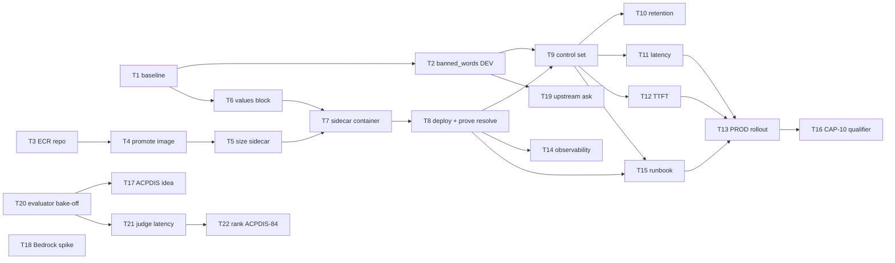

# Guardrails Enablement — D3: Implementation Plan

> **Gate**: D3 — Tasks | **Status**: Draft | **Epic**: [EACPP-1295](https://sunlife.atlassian.net/browse/EACPP-1295)
>
> ⚠️ **Do not run `scripts/create_jira_from_spec.py` against this spec.** The table below carries an
> explicit **Jira** column, which makes `has_cached` false for every row — the script would PUT a
> regenerated description over all nineteen existing tickets. Add tasks by hand
> (`POST /rest/api/3/issue`, parent `EACPP-1295`). Same precedent as `acp-harness-sdk`.

## Task summary

| # | Task | Type | Points | Sprint | Depends On | Jira |
|---|------|------|--------|--------|------------|------|
| 1 | Baseline and publish the guardrail posture of all five Sun Life gateways | Task | 2 | S1 | — | [EACPP-1296](https://sunlife.atlassian.net/browse/EACPP-1296) |
| 2 | Prove the guardrail pipeline end to end in DEV with `banned_words` | Task | 3 | S1 | T1 | [EACPP-1297](https://sunlife.atlassian.net/browse/EACPP-1297) |
| 3 | Create the `luminate/pii-detector` ECR repository | Task | 1 | S1 | — | [EACPP-1298](https://sunlife.atlassian.net/browse/EACPP-1298) |
| 4 | Promote the `pii-detector` image from GHCR to Sun Life ECR | Task | 2 | S1 | T3 | [EACPP-1299](https://sunlife.atlassian.net/browse/EACPP-1299) |
| 5 | Size the PII sidecar from measurement — cold start, memory, evaluation latency | Spike | 3 | S1 | T4 | [EACPP-1300](https://sunlife.atlassian.net/browse/EACPP-1300) |
| 6 | Add a typed `gateway.guardrails` values block to the Helm chart | Task | 3 | S2 | T1 | [EACPP-1301](https://sunlife.atlassian.net/browse/EACPP-1301) |
| 7 | Add the `pii-detector` sidecar container to the gateway deployment template | Task | 3 | S2 | T5, T6 | [EACPP-1302](https://sunlife.atlassian.net/browse/EACPP-1302) |
| 8 | Deploy the sidecar to the DEV gateway and prove the evaluator resolves | Task | 2 | S2 | T7 | [EACPP-1303](https://sunlife.atlassian.net/browse/EACPP-1303) |
| 9 | Author the Sun Life control set through a recorded, re-runnable script | Task | 5 | S2 | T2, T8 | [EACPP-1304](https://sunlife.atlassian.net/browse/EACPP-1304) |
| 10 | Decide and apply the evaluation-record retention window | Task | 2 | S2 | T9 | [EACPP-1305](https://sunlife.atlassian.net/browse/EACPP-1305) |
| 11 | Measure the request-direction guardrail latency budget in DEV | Task | 3 | S3 | T9 | [EACPP-1306](https://sunlife.atlassian.net/browse/EACPP-1306) |
| 12 | Measure the response-path TTFT delta under `guardrail_response_streaming: enforce` | Task | 3 | S3 | T9 | [EACPP-1307](https://sunlife.atlassian.net/browse/EACPP-1307) |
| 13 | Roll the posture out to the four PROD-install gateways, warn first | Task | 5 | S3 | T11, T12, T15 | [EACPP-1308](https://sunlife.atlassian.net/browse/EACPP-1308) |
| 14 | Surface guardrail latency, deny rate and evaluator availability in Splunk | Task | 3 | S3 | T8 | [EACPP-1309](https://sunlife.atlassian.net/browse/EACPP-1309) |
| 15 | Write the guardrail incident, rollback and fail-closed-outage runbook | Task | 3 | S3 | T8, T9 | [EACPP-1310](https://sunlife.atlassian.net/browse/EACPP-1310) |
| 16 | Qualify CAP-10 in the capability map with Sun Life deployment state | Task | 2 | S3 | T13 | [EACPP-1311](https://sunlife.atlassian.net/browse/EACPP-1311) |
| 17 | Submit an ACPDIS idea for non-GCP content-safety evaluators | Task | 2 | S2 | T20 | [EACPP-1312](https://sunlife.atlassian.net/browse/EACPP-1312) |
| 18 | Spike: prove `bedrock:ApplyGuardrail` from the gateway's cross-account identity | Spike | 5 | S3 | — | [EACPP-1313](https://sunlife.atlassian.net/browse/EACPP-1313) |
| 19 | Raise the upstream ask: warn at attach time when the bound gateway cannot evaluate the type | Task | 2 | S2 | T2 | [EACPP-1314](https://sunlife.atlassian.net/browse/EACPP-1314) |
| 20 | Content-safety evaluator bake-off — licence and maintenance first, then efficacy | Spike | 5 | S2 | — | [EACPP-1315](https://sunlife.atlassian.net/browse/EACPP-1315) |
| 21 | Measure whether a self-hosted safety judge can meet the 1.5 s evaluation ceiling | Spike | 3 | S3 | T20 | [EACPP-1316](https://sunlife.atlassian.net/browse/EACPP-1316) |
| 22 | Rank ACPDIS-84 (`llm_judge`) at the next Product Board round | Task | 1 | S2 | T21 | [EACPP-1317](https://sunlife.atlassian.net/browse/EACPP-1317) |

## Luminate support checks

| Task | Luminate support | What to re-verify at pick-up |
|------|------------------|------------------------------|
| T2 | [CAP-10](../../../capability-map.md#cap-10) | That `banned_words` is still the only member of `gateway/app/guardrails/registry.py:LOCAL_EVALUATORS`. If a second local evaluator landed, the "zero infrastructure" proof can use it and T3–T8 may partially drop out. |
| T7 | CAP-10 · G-1 | That `_UnresolvedEvaluator` still resolves `spec_fail_open(spec, default=True)`. If upstream flipped it (AIC-714 or successor), DD-2's explicit `fail_open: false` becomes belt-and-braces rather than the mitigation, and the sidecar-first ordering can relax. |
| T9 | CAP-10 · G-3 | Whether upstream FR-14 (YAML bootstrap seeding) has landed. If it has, author the control set as seed data and retire the script in DD-7 rather than building on it. |
| T12 | CAP-10 · G-2 | **Re-verified 2026-10-05: the default moved.** AIC-680 and AIC-717 were decided on 2026-09-13, and AIC-691 made `audit` the code default and a real shadow scan. DEV deploys `audit` explicitly. Read AIC-693's TTFT measurement (done 2026-10-01) before measuring our own. |
| T13 | CAP-10 | That response-direction scanning is still model-lane only (`gateway/app/middleware/guardrails.py`, `target_type != "model"`). If MCP response scanning landed, the PROD control set should cover the MCP lane too. |
| T18 | — · G-5 | That `ApplyGuardrail` / `guardrailIdentifier` still return zero hits in `luminate`. If someone upstream started this, join it rather than duplicating — check AIC and the ballot before writing code. |
| T20 | — · G-5 | That the shortlist's maintenance status still holds. `protectai/llm-guard` and `protectai/rebuff` were **archived** on 2026-09-11; others may have joined them. Read `archived` and `pushed_at` from the GitHub API, not stars. |
| T21 | CAP-10 | The deployment's `guardrail_remote_timeout` and whether upstream NFR-2's 1.5 s default still stands. AIC-693 (verify the guardrail latency budget) is **done (2026-10-01)**: read its figure first. The DEV deployment runs `remoteTimeout: 10` (T5). |
| T22 | — | ACPDIS-84's status. It was **Discovery** (rankable) on 2026-09-11. If it has moved to Ready for Delivery or Delivery it is already taken and the vote should go elsewhere. |
| T19 | CAP-10 · G-1 | Whether AIC-714 has been extended to cover unevaluable *types* as well as unenforceable *flow types*. If so, comment there instead of raising a new item. (2026-10-05: AIC-714 is done and covers flow types only, so the ask still stands.) |

## Progress — 2026-10-05

Delivered in `luminate-sunlife-deploy` PR #28 (`feature/EACPP-1302-pii-detector`). It is deployed to
both DEV-install gateways from the branch and awaiting review. The operator guide is that repo's
`docs/guardrails.md`.

| # | State | Evidence |
|---|---|---|
| T3 | **DEV only.** The repository already existed in `360967146904` (not Terraform-managed); it is absent from `035722575935` | `aws ecr describe-repositories` in both accounts |
| T4 | Done for DEV | `luminate/pii-detector:sha-093285b`; digest equal to upstream `sha256:45f4f80d…` |
| T5 | Done | Figures under T5 above |
| T6 | Done (in review) | 12 releases rendered against main: only `portal-dev` and `gw-dev-sit` change; the guard cases fail the render as designed (DD-6 as built) |
| T7 | Done (in review) | Four-container pod 4/4 on both DEV gateways; Gatekeeper admitted it; `readOnlyRootFilesystem` holds |
| T8 | Done | Temporary guardrail with AIMS's exact config on a probe agent: clean prompt 200, PII prompt 422, PII echoed in the response 422 with `"direction":"response"`; **zero** `guardrail_evaluator_unresolved` rows. The probe objects were deleted afterwards |
| T1, T2, T9–T22 | Not started | — |

Found on the way, and folded into D2: the loopback bind and exec probes (§4.1), the `tldextract`
egress hang that silently dropped `EMAIL_ADDRESS` (§4.1), the 10 s timeout (§4.2), and
`URL`/`LOCATION`/`IP_ADDRESS` blocking ordinary log text (§4.4).

## Dependency graph

The critical chain is **T3 → T4 → T5 → T7 → T8 → T9 → T11/T12 → T13**. T2 is deliberately off it:
`banned_words` needs no sidecar, so the first real enforcement proof lands in Sprint 1 regardless of
how the image promotion goes. The whole Phase 2 cluster (T17, T18, T20–T22) runs in parallel and
blocks nothing in Phase 1.

Note T20 now precedes T17: the ballot idea argues for a *self-hostable* backend
([DD-13](d2-design.md#dd-13-the-ballot-idea-is-reframed-to-the-non-gcp-path-with-two-reference-backends)),
and it is a weaker argument without a named candidate whose licence and maintenance status have
been verified. T18 no longer depends on T17 — the Bedrock IAM request has a long lead time and
should start regardless of how the ballot goes.

## Sprint allocation

### Sprint 1 — prove the pipeline, prepare the sidecar

| Task | Points | Definition of done |
|------|--------|--------------------|
| T1 | 2 | A committed baseline showing, per gateway, the full guardrail posture in force |
| T2 | 3 | A crafted request is blocked in DEV and the block is visible in the activity surface |
| T3 | 1 | ECR repository exists with the same lifecycle policy as the other Luminate repos |
| T4 | 2 | The image is in SLF ECR and pullable by the gateway service account |
| T5 | 3 | Cold-start, steady-state memory and p50/p95 evaluation latency are recorded, and requests/limits are derived from them |

### Sprint 2 — deploy the evaluator and author the controls

| Task | Points | Definition of done |
|------|--------|--------------------|
| T6 | 3 | `helm template` renders all four keys; the chart refuses an endpoint map naming a disabled evaluator |
| T7 | 3 | The four-container pod rolls out cleanly, with the Gatekeeper admission check passing |
| T8 | 2 | A `pii_detection` guardrail evaluates with **zero** `guardrail_evaluator_unresolved` rows |
| T9 | 5 | Three controls exist, created by the script, all in `warn`, all re-creatable from scratch |
| T10 | 2 | `retention_days` set per control, with the reasoning recorded |
| T17 | 2 | ACPDIS idea submitted by the Sun Life representative |
| T19 | 2 | Upstream item raised or an existing one commented on, with the reproduction attached |
| T20 | 5 | A shortlist with verified licences and maintenance status, and measured precision/recall on Sun Life traffic |
| T22 | 1 | ACPDIS-84 carried into the Sun Life ranked list with a written rationale |

### Sprint 3 — measure, roll out, and make it operable

| Task | Points | Definition of done |
|------|--------|--------------------|
| T11 | 3 | Measured latency figures published; NFR-1 satisfied with numbers, not estimates |
| T12 | 3 | TTFT delta published; a go/no-go recommendation on `enforce` recorded |
| T13 | 5 | All four PROD-install gateways carry the posture; controls promoted `warn` → `enforce` on evidence |
| T14 | 3 | Dashboards show per-evaluator latency, deny rate per control and evaluator availability |
| T15 | 3 | Runbook merged, covering sidecar outage, rollback and the over-length-body denial |
| T16 | 2 | CAP-10 carries a deployment-state qualifier; capability map republished |
| T18 | 5 | A recorded result either way — `ApplyGuardrail` proven from the gateway identity, or the blocker named |
| T21 | 3 | A measured verdict on whether a generative judge fits the evaluation ceiling |

## Task details

### T1: Baseline and publish the guardrail posture of all five Sun Life gateways

**Type**: Task | **Points**: 2 | **Sprint**: S1

Record, per gateway, the guardrail posture actually in force: the ConfigMap keys, the settings
resolved inside the pod, and the Guardrail / GuardrailAttachment / GuardrailEvaluation counts in
each install's database. Five gateways — the DEV install's `luminate`, and the PROD install's
`luminate`, `luminate-gw-dev`, `luminate-gw-sit`, `luminate-gw-stage`.

This is the "before" half of every later claim, and it is what makes a regression visible. Read the
running cluster, not the values files — the whole finding that started this epic is that the two can
differ, and a values file cannot tell you a code default is in force.

**DoD** — a committed baseline document showing, per gateway, all four `GATEWAY_GUARDRAIL_*` values
in effect (including those inherited from code defaults) and the three row counts.

---

### T2: Prove the guardrail pipeline end to end in DEV with `banned_words`

**Type**: Task | **Points**: 3 | **Sprint**: S1 | **Depends**: T1

Author one `banned_words` guardrail, attach it at organization scope on the request direction in
`warn`, confirm `x-luminate-guardrails-warned` and an evaluation row, then promote to
`enforce` / `block` and confirm HTTP 422 with the structured error.

This runs before any sidecar exists, which is the point (DD-1): `banned_words` is the only member of
`LOCAL_EVALUATORS`, so a pass here proves portal → rego → gateway → enforcement → audit with no
infrastructure in the way. If this fails, nothing downstream is worth attempting.

Test against a model that is really deployed on that gateway — an undeployed model name returns 403
with the same sanitised body as an auth failure, which will read as a guardrail problem and is not
one.

**DoD** — AC-2 and AC-5 met, with the request, the response and the evaluation row captured.

---

### T3: Create the `luminate/pii-detector` ECR repository

**Type**: Task | **Points**: 1 | **Sprint**: S1

New ECR repository in `360967146904` (and the PROD-install account), matching the lifecycle and scan
configuration of the existing `luminate/*` repositories. Terraform, not console.

**DoD** — repository exists in both accounts, pullable by the gateway service account.

---

### T4: Promote the `pii-detector` image from GHCR to Sun Life ECR

**Type**: Task | **Points**: 2 | **Sprint**: S1 | **Depends**: T3

`crane copy` from `containers.ai-consortium.ghe.com` to ECR, pinning the same upstream sha the
gateway runs so the sidecar and its caller come from one commit.

Two known traps. The GHE container registry needs a **classic `read:packages` PAT** — an OAuth
`docker login` succeeds and the pull is then denied, which reads as a network fault. And the
upstream image build fetches the spaCy `en_core_web_lg` wheel from github.com with a pinned SHA256;
if the image is ever rebuilt behind the Sun Life proxy rather than promoted, that fetch is where it
will fail.

**DoD** — image in ECR at a pinned sha, digest recorded next to the gateway's.

---

### T5: Size the PII sidecar from measurement

**Type**: Spike | **Points**: 3 | **Sprint**: S1 | **Depends**: T4

Run the promoted image and measure: time from start to first successful `/health` (the analyser
loads `en_core_web_lg` on that call), steady-state RSS, and p50/p95/p99 `/evaluate` latency for
representative prompt sizes.

Derive three numbers from it: the container requests/limits, the startup-probe `failureThreshold`,
and `GATEWAY_GUARDRAIL_REMOTE_TIMEOUT`. The code default is 1.5 s, tuned upstream "for a warm sidecar
with its model preloaded"; the upstream compose file runs 3 s locally. Pick ours from measurement,
and remember the timeout is per-evaluator, so under DD-3 exceeding it **denies**.

Also state the multiplier: one sidecar per gateway pod (upstream NFR-8, generalising NFR-14) across five gateway
releases at their current replica counts.

**DoD** — figures recorded in the spec; requests, limits, probe thresholds and timeout all traceable
to a measurement.

**Measured 2026-10-05, DEV install, image `sha-093285b`** (digest `sha256:45f4f80d…`, about 585 MB):

| Measure | Result | Drives |
|---|---|---|
| Steady RSS, analyser warm | **740–754 Mi** (upstream measured 753 Mi in nonp) | request 1Gi, limit 2Gi |
| CPU, idle/probing | 16–20 m; spikes during scans | request 250m, limit 1 (Gatekeeper requires one; kept well above the peak so throttling never meets the timeout) |
| Start → pod ready, analyser loaded | **12–16 s** | startup probe 60 × 5 s, a wide margin for a cold image pull |
| `/evaluate`, 0.2 KB | p50 35 ms, max 76 ms | — |
| `/evaluate`, 4 KB | p50 0.4 s, max 0.64 s | — |
| `/evaluate`, 16 KB | p50 1.3 s, max 2.1 s | `remoteTimeout: 10` (about 0.1 s per KB; under DD-3 a timeout denies) |
| Through the gateway, evaluation `latency_ms` | 11–161 ms on short prompts | — |

Multiplier: in the DEV install, 3 gateway pods (`luminate` × 2, `luminate-gw-sit` × 1) = 3 Gi requested.
For the PROD install, count it at T13 with `kubectl get deploy -A | grep gateway`. The portal gateway
runs at an HA floor and the three `luminate-gw-*` releases run their own replicas.
---

### T6: Add a typed `gateway.guardrails` values block to the Helm chart

**Type**: Task | **Points**: 3 | **Sprint**: S2 | **Depends**: T1

Per DD-6, render `GATEWAY_GUARDRAIL_REMOTE_ENDPOINTS`, `_REMOTE_FAIL_OPEN`, `_REMOTE_TIMEOUT` and
`_RESPONSE_STREAMING` from a typed block rather than hand-written `gateway.config` entries.

Include the guard that earns the block its keep: **fail the render** when `remoteEndpoints` names a
type whose evaluator is not enabled in the same values. That is D1 G-1 caught at `helm template`
time instead of in production traffic.

**DoD** — `helm template` output verified for all five gateways; the mismatch case fails the render
with a readable message.

---

### T7: Add the `pii-detector` sidecar container to the gateway deployment template

**Type**: Task | **Points**: 3 | **Sprint**: S2 | **Depends**: T5, T6

Fourth container in the gateway pod, gated on `gateway.guardrails.piiDetector.enabled`, listening on
loopback :8000 (DD-5 — no Service; a Service would load-balance inspection across pods and violate
the per-pod rule upstream states in NFR-8, "no evaluator infrastructure is shared between
organizations").

Three things that have bitten this cluster before. Gatekeeper's
`container-must-have-limits-and-requests` applies to **every** container and fails the ReplicaSet
*silently* — `updatedReplicas` stays empty and `rollout status` hangs; the real error is only in
`kubectl get events`. The long probe threshold belongs on **startup**, not liveness, or the probe
kills the sidecar mid model-load. And verify `readOnlyRootFilesystem: true` against a real Presidio
run before assuming it holds.

**DoD** — the four-container pod rolls out in DEV; admission passes; the sidecar reaches ready.

---

### T8: Deploy the sidecar to the DEV gateway and prove the evaluator resolves

**Type**: Task | **Points**: 2 | **Sprint**: S2 | **Depends**: T7

Create one `pii_detection` guardrail in `warn`, send a request containing a synthetic identifier,
and prove the evaluator **actually ran**.

The proof is the absence of `guardrail_evaluator_unresolved` in the evaluation rows — not a portal
badge, and not the presence of rows. Rows appear either way; that is the entire trap (D1 G-1). Query
the evaluation table directly.

**DoD** — AC-4 met: zero `guardrail_evaluator_unresolved` rows across the run.

---

### T9: Author the Sun Life control set through a recorded, re-runnable script

**Type**: Task | **Points**: 5 | **Sprint**: S2 | **Depends**: T2, T8

The three controls in D2 §4.4, created via the REST API by a checked-in script in
`luminate-sunlife-deploy` (DD-7). All start in `warn`.

Every enforcing remote-type control sets `fail_open: false` explicitly (DD-2) — the deployment knob
does not cover the unresolved case.

On PII configuration: prefer `entity_thresholds` per entity over a global `score_threshold`. The
field is nullable on purpose — an explicit value is treated as a decision that **replaces** the
evaluator's own measured per-entity floors, so setting one to look tidy silently discards Presidio's
calibration.

Entity selection and the term list come from Privacy and Security (D0 Q-1); this task delivers the
mechanism and the placeholders, not the content.

**DoD** — three controls exist in DEV, all `warn`; AC-10 proven by dropping and recreating them.

---

### T10: Decide and apply the evaluation-record retention window

**Type**: Task | **Points**: 2 | **Sprint**: S2 | **Depends**: T9

Set `retention_days` per control and decide whether `GUARDRAIL_RETENTION_DELETE_ENABLED` moves off
`false`. Null retention means unbounded and is a deliberate opt-in, not a default to drift into.

Upstream AIC-747 is the matching open decision on a compliance floor — read it before deciding, and
feed our answer back if it is useful.

**DoD** — window set with recorded reasoning; the scheduled sweep verified to run.

---

### T11: Measure the request-direction guardrail latency budget in DEV

**Type**: Task | **Points**: 3 | **Sprint**: S3 | **Depends**: T9

p50/p95/p99 for the `gateway.guardrails` span, with and without the controls attached, for
representative payloads.

Upstream withdrew its own 200 ms target (D-6) because it had never been measured; do not reintroduce
an unmeasured number in either direction. Request-direction evaluators run concurrently, so the cost
is the largest resolved ceiling plus fan-out, not the sum.

**DoD** — NFR-1 satisfied with published figures.

---

### T12: Measure the response-path TTFT delta under `guardrail_response_streaming: enforce`

**Type**: Task | **Points**: 3 | **Sprint**: S3 | **Depends**: T9

Flip DEV to `enforce`, measure time-to-first-token against the `exempt` baseline for a streamed
chat completion, and recommend go/no-go for PROD (DD-4).

State plainly in the result what is true while we sit on `exempt`: a caller disables our
response-direction controls by sending `"stream": true`. Upstream records this as an unmet
requirement (D2 NFR-7) and removes the exemption in D-11; AIC-680 and AIC-717 are the decisions in
flight. Re-read both before recommending — if the default moved upstream, staying on `exempt` is now
a deliberate weakening that needs its own justification.

**DoD** — NFR-2 satisfied; a recorded recommendation either way.

---

### T13: Roll the posture out to the four PROD-install gateways

**Type**: Task | **Points**: 5 | **Sprint**: S3 | **Depends**: T11, T12, T15

`luminate-gw-dev` → `gw-sit` → `gw-stage` → the portal-embedded PROD gateway. Controls land in
`warn`, and promote to `enforce` only on the evidence in the activity feed for that environment.

Note the PROD-install `luminate` namespace runs the gateway **embedded in the `luminate-portal`
release** — `helm list` shows only three gateway releases and it looks like one is missing. It is
not; check `kubectl get deploy -A`. Treating that as a gap has wasted a review cycle before.

**DoD** — AC-1 met on all five gateways; promotion decisions recorded per environment.

---

### T14: Surface guardrail latency, deny rate and evaluator availability in Splunk

**Type**: Task | **Points**: 3 | **Sprint**: S3 | **Depends**: T8

Per-evaluator latency labelled by type, deny rate per guardrail, evaluator availability, and the
audit drop counter — into the existing OTEL → Splunk path.

Deny rate is per **guardrail**, not per attachment (upstream D-7: attachment provenance is a
configuration surface, not an audit field). The type label is what lets a timeout be set from an
evaluator's own observed cost rather than inherited.

**DoD** — NFR-9 met; dashboards reviewed with the on-call owner.

---

### T15: Write the guardrail incident, rollback and fail-closed-outage runbook

**Type**: Task | **Points**: 3 | **Sprint**: S3 | **Depends**: T8, T9

Covering: sidecar outage under a fail-closed posture; how to roll a control back; how to tell a
guardrail denial from an authz denial; and the over-length-body case.

Two things this runbook must get right and that a generic one will not:

- **The upstream rollback lever does not apply to our controls.** Unsetting a type's endpoint returns
  it to fail-open — but DD-2 sets `fail_open: false` on every enforcing control we author, so that
  lever **denies** instead of degrading. Ours is `is_active: false` on the guardrail, or flipping the
  attachment to `warn`.
- **A body over `GATEWAY_GUARDRAIL_REMOTE_MAX_TEXT_BYTES` (256 KB) is a scan *failure*, not a
  truncated scan** — so under DD-3 an over-long prompt is denied. That is correct, and it will
  surprise someone at 2am.

Also record that the gateway's error handler sanitises proxy-route errors, so a guardrail-adjacent
failure can surface as `upstream authentication failed` with nothing to do with the upstream.

Mirrors upstream AIC-713; offer it back if it is useful.

**DoD** — runbook merged and walked through with the on-call owner.

---

### T16: Qualify CAP-10 in the capability map with Sun Life deployment state

**Type**: Task | **Points**: 2 | **Sprint**: S3 | **Depends**: T13

CAP-10 keeps its ✅ — it is correct about Luminate. Add the deployment-state qualifier in the INT-02
style, so the row cannot be read as "Sun Life enforces this" when no gateway does (DD-8).

Note in the same pass what remains true after this epic: response controls are model-lane only, and
streamed responses follow whatever `guardrail_response_streaming` we ended on.

This is **not** a consortium gap and must not reach the roadmap — it is our configuration.

**DoD** — map updated, regenerated via `render_capability_map.py --export`, republished.

---

### T17: Submit an ACPDIS idea for non-GCP content-safety evaluators

**Type**: Task | **Points**: 2 | **Sprint**: S2 | **Depends**: T20

Submit the draft at [references/acpdis-idea-content-safety-evaluator.md](references/acpdis-idea-content-safety-evaluator.md)
to the ACPDIS ballot via the Sun Life consortium representative.

One idea, two reference backends, **leading with the self-hostable one**
([DD-13](d2-design.md#dd-13-the-ballot-idea-is-reframed-to-the-non-gcp-path-with-two-reference-backends)).
Upstream FR-15 is a single gap and the framework change is identical either way, so two ideas would
split the vote on one problem. A self-hostable default serves members on any cloud; an AWS-specific
ask serves AWS members and reads as Sun Life asking the consortium to serve Sun Life's
infrastructure.

The AWS-specific draft at `references/acpdis-idea-bedrock-guardrails.md` is **superseded** — do not
submit it. It is retained for the `ApplyGuardrail` field mapping.

An ask not in ACPDIS cannot be ranked at a Product Board round, and no existing idea covers a
non-GCP content-safety path — the nearest, ACPDIS-97 *Enterprise DLP Integration*, is a different
shape and sits in Parking Lot. Check the ballot again at pick-up in case one has been raised since
2026-09-11.

**DoD** — idea visible in ACPDIS with its key recorded here, naming the candidate from T20.

---

### T18: Spike — prove `bedrock:ApplyGuardrail` from the gateway's cross-account identity

**Type**: Spike | **Points**: 5 | **Sprint**: S3

Create a throwaway Bedrock guardrail in the spoke account, then call `ApplyGuardrail` **from inside
the gateway pod** using its own `[profile chain]` identity — not from a laptop with a different
role. The whole question is whether the existing credential chain reaches it.

This no longer depends on T17. Bedrock is the managed fallback rather than the plan
([DD-11](d2-design.md#dd-11-phase-2s-default-is-in-cluster-and-open-source-bedrock-is-the-fallback-not-the-plan)),
but the IAM request below has a long lead time and the answer is worth having regardless of how the
ballot goes.

Expect one blocker: the spoke role's inline policy grants only `bedrock:InvokeModel` and
`InvokeModelWithResponseStream`. `ApplyGuardrail` is inside the `bedrock:*` permission boundary but
not granted, so this needs a cross-account request of the same shape as the existing one. Raise it
early — the lead time on that request is the spike's real duration.

While there, reconcile the region mismatch: the spoke policy writes `us-east-1` resources while
`gateway.aws.region` is `ca-central-1`. `bedrock list-guardrails` returned 200 in `ca-central-1` on
2026-09-11, so the residency answer is available — the policy just does not reflect it.

Capture latency and the response shape, so the sidecar contract in D2 §5.7 can be confirmed rather
than assumed.

**DoD** — a recorded result either way: proven end to end, or the blocker named with its owner.

---

### T19: Raise the upstream ask — warn at attach time when the bound gateway cannot evaluate the type

**Type**: Task | **Points**: 2 | **Sprint**: S2 | **Depends**: T2

The portal lets an operator attach a `pii_detection` guardrail to a gateway with no PII evaluator,
and then shows it as enforcing while traffic passes unscanned. The fail-open default is defensible
(it protects the rollback lever); the absence of any signal is not.

AIC-714 ("Refuse guardrail attachments on flow types that cannot be enforced") is adjacent and in
Backlog — comment there rather than duplicating if it can stretch to cover unevaluable *types*.

This is a portal affordance, not a platform capability change, so it does **not** need a ballot idea.
Attach the reproduction from T8.

**DoD** — item raised or commented, with the reproduction and the exact code path
(`gateway/app/middleware/guardrails.py:_UnresolvedEvaluator`).

---

### T20: Content-safety evaluator bake-off — licence and maintenance first, then efficacy

**Type**: Spike | **Points**: 5 | **Sprint**: S2

Produce a shortlist for the self-hostable backend the ballot idea offers (T17), and the judge model
Option B would run (T21).

**Gate the candidates in this order**, because the cheap gates eliminate most of the field and
measuring efficacy first wastes the effort:

1. **Maintenance.** Read `archived` and `pushed_at` from the GitHub API. Two of the best-known OSS
   guardrail libraries — `protectai/llm-guard` and `protectai/rebuff` — were **archived** as of
   2026-09-11, `rebuff` with no commit in over two years. Stars and reputation do not show this.
2. **Licence.** Read the actual `LICENSE` file, not GitHub's `spdx_id`. `NOASSERTION` means
   unclassifiable, not unlicensed: NeMo Guardrails declares `Apache-2.0` inside a `LICENSE.md`, while
   the same field on Meta's PurpleLlama really is a bespoke **Llama Community Licence**. Google's
   ShieldGemma is the same shape. Only Granite Guardian among the frontier safety models carries a
   plain OSI licence, which is why it is the default candidate.
3. **Will it clear the gate?** The SLM pipeline's C4 Sonatype firewall blocks download on "critical
   CVE, malware, or disallowed license", and approval needs `triaged` + `legal_reviewed`. A
   candidate that cannot pass is not a candidate, whatever it scores.
4. **Class.** Encoder classifier (CPU, sidecar) or generative judge (GPU, `llm_judge`)? They are not
   interchangeable — see [DD-12](d2-design.md#dd-12-the-two-evaluator-classes-go-to-different-seams-permanently).
5. **Only then, efficacy.** Precision and recall on **Sun Life traffic**, not a public leaderboard.
   A false-positive rate that is tolerable on a benchmark can be unusable on claims or pharmacy
   prompts.

Do not fetch weights from a laptop — `huggingface.co` returns HTTP 403 behind Netskope by design
(SLM pipeline control C10). Go through the Artifactory mirror.

**DoD** — a shortlist with verified licence and maintenance status per candidate, a class
assignment, and measured precision/recall for the top two on a Sun Life sample.

---

### T21: Measure whether a self-hosted safety judge can meet the 1.5 s evaluation ceiling

**Type**: Spike | **Points**: 3 | **Sprint**: S3 | **Depends**: T20

Option B's one open risk (R-10). Serve the T20 judge candidate on the existing GPU NodePool and
measure end-to-end evaluation latency for representative prompt lengths.

The concern is concrete rather than theoretical. Upstream NFR-2's ceiling bounds *the evaluator's
whole evaluate call, including any inference it makes on its own*, and the deployment default is
**1.5 s**. Sun Life's own SLM measurement puts a 1,508-token prompt at **1.2 s on GPU** — so a
generative judge on a long prompt is already at the ceiling before the loopback hop through the
gateway. A safety verdict is only a handful of output tokens, so prefill dominates; measure against
realistic prompt lengths, not short ones.

Batching is not optional: the SLM pipeline measured an unbatched server at 14.8 tok/s / $21.42 per
1M against 444–482 tok/s / $0.53–0.71 per 1M batched, and notes that without batching throughput
*falls* under concurrency.

Record the answer either way. If the ceiling cannot be met, Option A (encoder classifier) is the
fallback and its latency is not in doubt — that is a finding, not a failure.

**DoD** — measured p50/p95/p99 against prompt length, with a verdict on Option B's viability and a
recommendation on whether the deployment ceiling needs raising.

---

### T22: Rank ACPDIS-84 (`llm_judge`) at the next Product Board round

**Type**: Task | **Points**: 1 | **Sprint**: S2 | **Depends**: T21

The cheapest move available in this whole spec: `llm_judge` is already on the ballot in **Discovery**,
and it closes most of the content-safety gap for any member who can host a model — with **no new
evaluator type and no Sun Life code**. Upstream chose gateway-loopback routing, so the judge call
reaches a registered model deployment; at Sun Life that is a safety model on the SLM pipeline's
existing GPU capacity, which makes the guardrail itself a governed, audited, cost-attributed
Luminate model.

Rank it **alongside** the T17 idea, not instead of it. They serve different members: a member with no
GPU and a strict residency posture is served by T17's self-hostable classifier and not by
ACPDIS-84; a member wanting operator-authored natural-language rules is served by ACPDIS-84 and not
by T17.

Carry T21's measurement into the rationale — an ask backed by a number is worth more than an ask
backed by an assumption. Note the top-3 protection rule when placing it in the ranked list.

**DoD** — ACPDIS-84 carried into the Sun Life ranked list with a written rationale citing T21.

## Related

- [D0 — Discovery](d0-discovery.md) · [D1 — Requirements](d1-requirements.md) · [D2 — Design](d2-design.md)
- [ACP Capability Map — CAP-10](../../../capability-map.md#cap-10)
