<!-- GENERATED FILE — do not edit directly.
     Source: d2-design/ pages. Regenerate with scripts/assemble_d2_design.py -->

# D2 Design — Pattern Catalogue

> **Gate**: D2 — Design | **Status**: Draft | **D1 Approved**: TBD
>
> `d2-design.md` beside this directory is **generated** from these pages by
> `scripts/assemble_d2_design.py` — edit the pages, not the generated file.

## Pick your pattern

Two questions, answered independently: **where does the workload run**, and **whose Bedrock is
invoked**.

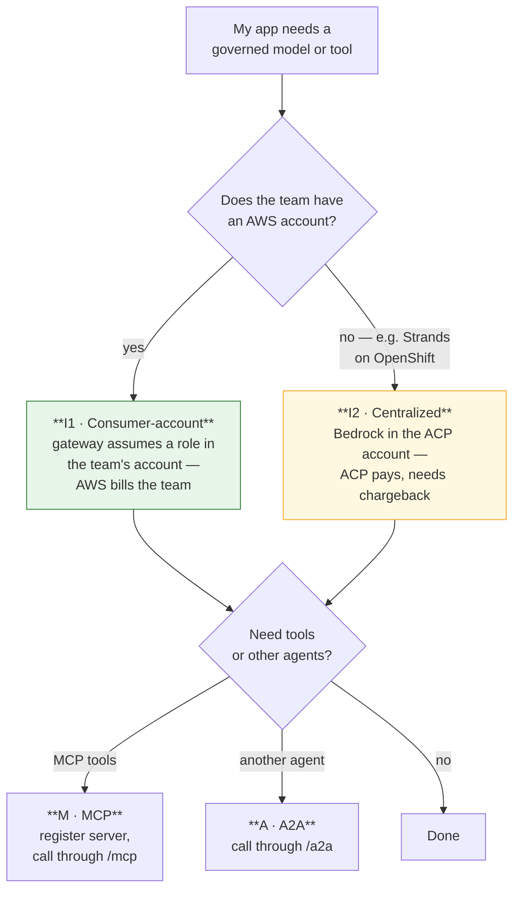

Hosting — the team's AWS account, a Bedrock AgentCore runtime, or OpenShift/Kubernetes — is a
separate choice that composes with either. The only hard constraint: **no AWS account means
centralized**, because there is nothing to assume into.

## The catalogue

| # | Pattern | Who it is for | Maturity |
|---|---|---|---|
| **I1** | **Consumer-account inference** — the gateway assumes a role in the consumer's account, so AWS bills the consumer | Teams with an AWS account. **The default.** | Mechanism proven; Service Catalog product missing |
| **I2** | **Centralized inference** — Bedrock enabled in the ACP workload account | Teams with **no** AWS account; Strands agents on OpenShift/K8s | Gated on chargeback |
| **H** | **Hosting shapes** — team AWS account, AgentCore runtime, OpenShift/K8s | Everyone; composes with I1 or I2 | Works today |
| **M** | **MCP tools** — register a server, call tools through `/mcp` | Any workload needing governed tools | Works today |
| **A** | **Agent-to-agent** — delegate through `/a2a` | Multi-agent workloads | Partial — see Gaps |
| **R** | **Registration** — get the resource into the catalogue | Everyone, first | Portal UI only |

## Every pattern shares one spine

Whatever the pattern, the governed call is the same shape.


The patterns differ only in **step 6** — whose account's Bedrock is invoked, and therefore who AWS
bills. Steps 1 to 5 are identical whichever pattern you chose.

The mechanics of each step — endpoints, payloads, error codes — live in
[`luminate-user-guides`](https://bitbucket.sunlifecorp.com/projects/EDAEACP/repos/luminate-user-guides/browse),
and [`acp-harness-sdk`](https://bitbucket.sunlifecorp.com/projects/EDAEACP/repos/acp-harness-sdk/browse)
does steps 1 to 3 for you. This spec names the pattern; it is not the reference manual.

## Reading order

| Page | Covers |
|---|---|
| **Identity** | The four credential shapes, the token exchange, storage, TTL, delegated tokens |
| **Invocation** | `/llm`, `/mcp`, `/a2a` — paths, authorization, failure modes |
| **Inference** | P1, P2, P3 side by side — IAM, identity, attribution |
| **Adoption** | SDK vs raw HTTP, and what registration actually requires today |
| **Gaps** | What is blocked, and the consortium ask that unblocks it |

## The rule that catches everyone

**A credential belongs to a `(resource, gateway)` pair.** Registering an agent creates a governed
identity; it does not create a credential. Until the resource is **deployed to a gateway**, the
Credentials screen has nothing to offer.

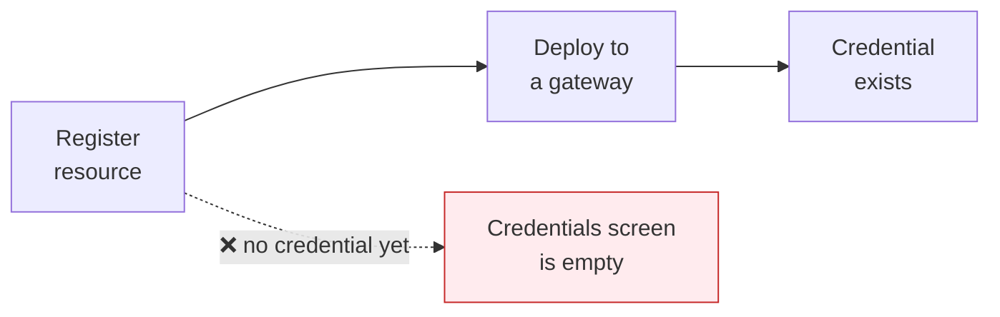

---

# Identity — credentials and token flows

## The four credential shapes

The gateway routes on the header before it validates anything.

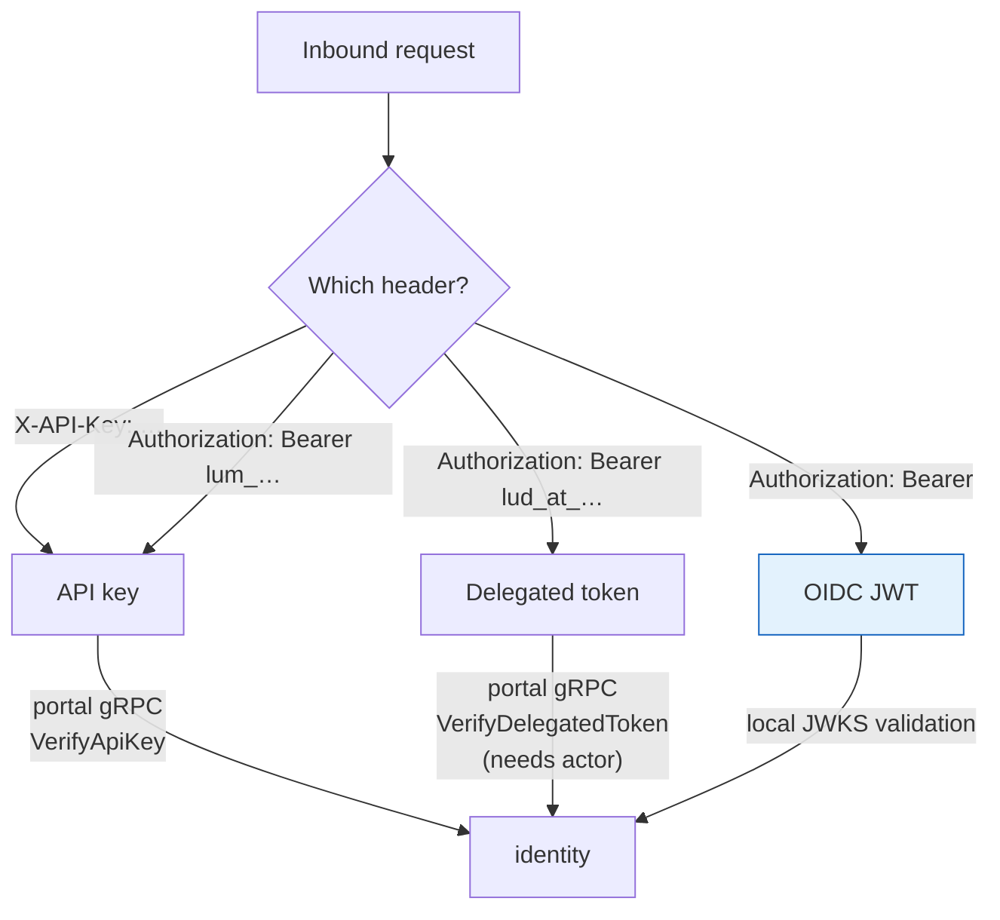

| Shape | Validated by | Use it for |
|---|---|---|
| **OIDC JWT** — `Bearer <jwt>` | Gateway, locally against JWKS | Machine workloads. The normal pattern. |
| **API key** — `X-API-Key` or `Bearer lum_…` | Portal, per request | Simple callers; **not accepted on delegated MCP endpoints** |
| **Delegated token** — `Bearer lud_at_…` | Portal, per request | On-behalf-of-a-user MCP access |

## What the JWT path actually checks

All five must pass. The fifth is the one that surprises people.

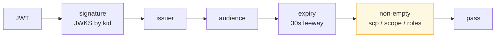

A token that is otherwise perfect but carries no `scp`, `scope` or `roles` claim is refused — the
check exists so an app-only token cannot pass through as an unrestricted identity.

**Refusal reasons** the validator distinguishes: `invalid_signature`, `invalid_issuer`,
`invalid_audience`, `token_expired`, `malformed_token`, `jwks_unavailable`,
`missing_authorization_claim`. For API keys: `invalid_key`, `portal_unreachable`.

## Getting a token

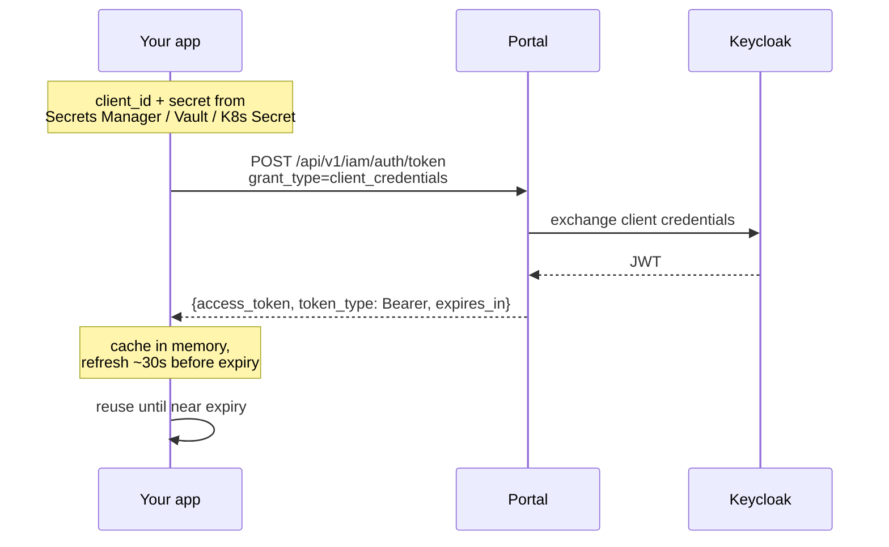

| Property | Value |
|---|---|
| Endpoint | `POST {portal}/api/v1/iam/auth/token` |
| Grant | `client_credentials` (form body, or HTTP Basic) |
| Client id | `agent-<resource-uuid>-<client-uuid>` — retrievable later |
| Client secret | **Shown once.** Rotation issues a different secret |
| Lifetime | Read `expires_in` — commonly ~300s. Do not hard-code |
| **Rate limit** | **The endpoint is throttled.** Fetching per request fails under load |

**Cache the token.** This is the most common load-related failure: a client that mints a token per
request will pass in dev and throttle in production.

## Where the secret lives

| Runtime | Storage | Notes |
|---|---|---|
| AWS workload | Secrets Manager | Harness SDK reads it directly |
| Kubernetes / OpenShift | Vault → `VaultStaticSecret` → Secret | Rotation-survivable with `refreshAfter` |
| OpenShift, no Vault yet | `oc create secret generic` + `envFrom` | Minimum viable |
| Local dev | Environment variable | Dev only |

Never write a token to disk or a ConfigMap. The secret, not the token, is what gets stored.

## Delegated (on-behalf-of) access

For MCP calls that must carry a *user's* identity rather than the workload's.

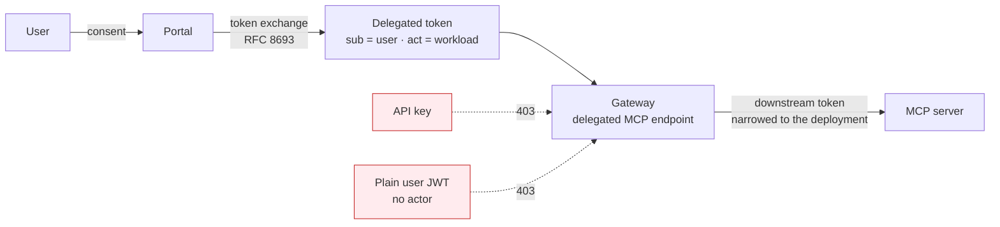

Only a **machine identity** or a **delegated token with a complete actor** is eligible. An API key
gets a 403 — which looks identical to a policy denial unless you know to check endpoint
eligibility first.

---

# Invocation — the three gateway surfaces

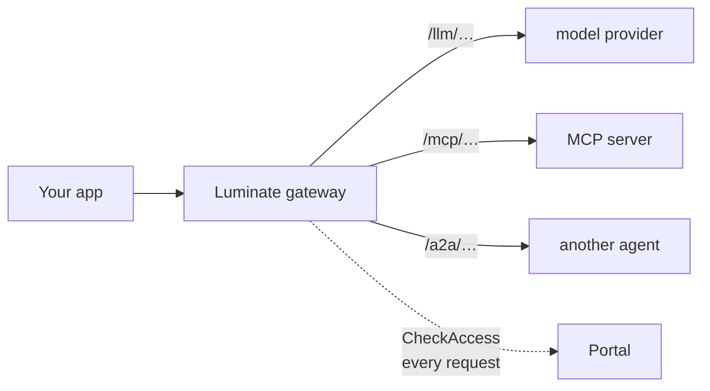

| Surface | Target type | Shape |
|---|---|---|
| `/llm/…` | `model` | OpenAI-compatible chat completions |
| `/mcp/…` | `mcp_server` | MCP over HTTP; API keys not accepted on delegated endpoints |
| `/a2a/…` | `agent` | Agent-to-agent delegation |

## LLM — the common case

```python
## Harness SDK — the same code on either target
from acp_aws_harness_sdk import ACPSettings, GatewayClient

settings = ACPSettings()                 # ACP_TARGET=luminate re-points everything
result = GatewayClient(settings).complete("Summarise this claim")
print(result.text, result.usage)
```

```bash
## Raw HTTP — the SDK is a convenience, not a dependency
curl -X POST "$GATEWAY/llm/v1/chat/completions" \
  -H "Authorization: Bearer $TOKEN" \
  -H 'Content-Type: application/json' \
  -d '{"model":"claude-3-haiku","messages":[{"role":"user","content":"hi"}]}'
```

Request and response are OpenAI-shaped, including `tools` / `tool_choice` for tool calling and
`usage` for token counts. Streaming is available over WebSocket, with automatic ping and a single
re-handshake on token expiry.

## Every request is authorized centrally

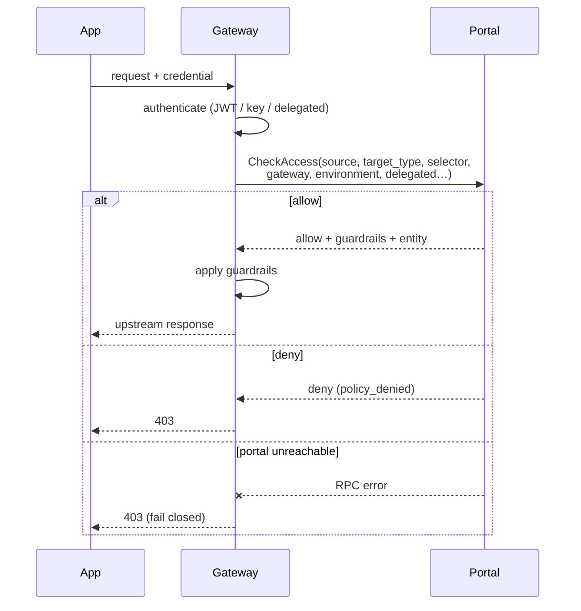

**The control plane is on the request path.** There is no local policy cache, so a portal outage
denies traffic rather than failing open. That is deliberate, and it is a availability
characteristic worth designing around.

## Failure modes

Read these in order — the first two are indistinguishable from the outside unless you know the rule.

| Symptom | Likely cause | Check |
|---|---|---|
| **401** | Credential rejected | The validator reason: audience, expiry, issuer, signature, or the missing `scope`/`roles` claim |
| **403** on a delegated MCP endpoint | Credential *type* ineligible | API key or plain user JWT used where a machine or delegated identity is required |
| **403** elsewhere | Access policy denied, **or the portal was unreachable** | Both surface as 403 |
| **403** on `list_models()` | Authorization resolves the model from the request body; a list has none | Name the model explicitly |
| **Empty gateway dropdown** in the portal | No `GatewayEnvironment` mapping | Not an auth problem at all |
| **Throttled token endpoint** | Minting a token per request | Cache and reuse until ~30s before expiry |

## MCP

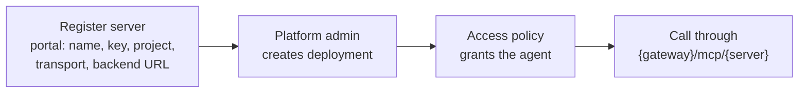

Access to an MCP server is granted by **access policy**, not by a binding record. The backend URL
must include scheme and path. Tools are discovered from the server; the agent never holds the
tool's credentials.

---

# Model inference — where the call executes, and who pays

Two independent questions. Conflating them is what makes this confusing.


**In both, the gateway makes the call.** The workload never holds a Bedrock credential. What
changes is *which account's Bedrock is invoked*, and therefore who AWS bills.

## Axis 1 — the billing decision

| | **Consumer-account** | **Centralized** |
|---|---|---|
| Bedrock invoked in | The **consumer's** AWS account | The **ACP workload** account |
| Gateway credential | Assumes a role in the consumer account | Its own pod role |
| AWS bills | **The consumer, directly** | **ACP** |
| Chargeback needed | **No** — AWS attributes it already | **Yes** — or ACP absorbs the spend |
| Consumer needs an AWS account | **Yes** | **No** |
| Enablement | AWS Service Catalog product deploys the role | Enable Bedrock in the ACP account |

**Consumer-account is the default** where the team has an AWS account: costs land where they are
incurred, with no chargeback machinery required. **Centralized exists for teams with no AWS
account** — and that is precisely why it needs a chargeback model, because ACP fronts the spend.

## Consumer-account — how the role gets there

[`acp-aws-service-catalog`](https://bitbucket.sunlifecorp.com/projects/T1KACP/repos/acp-aws-service-catalog/browse)
publishes an **AWS Service Catalog product** a business account self-provisions. It creates four
`/delegated/` roles under the `slf-aws-delegated-perm-boundary` permissions boundary — so **no
Cloud-team ticket is required** — with trust locked to a specific ACP hub principal and gated by an
**ExternalId** for confused-deputy protection.

| Role | Used by | Permissions |
|---|---|---|
| `acp-gateway-xaccount` | The AI gateway, for model / MCP / agent routing | `bedrock:InvokeModel*`, `bedrock:Converse*`, `bedrock-agentcore:InvokeAgentRuntime` |
| `acp-eval-judge` | Evaluation tooling (LLM-as-judge) | `bedrock:InvokeModel*` on approved judge models |
| `acp-agent-discovery` | Discovery service | read-only `List*` / `Get*` across Bedrock and AgentCore |
| `acp-bedrock-agent-exec` | Bedrock Agents service, for discovery test cases | `bedrock:InvokeModel*` on approved models |

Only the first is on the inference path; the others are why the product is a portfolio rather than
a single role.

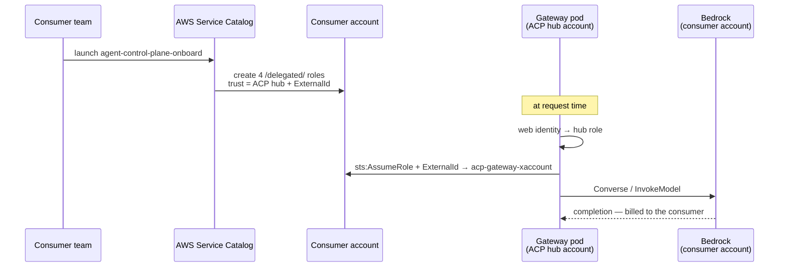

Mechanically this is an AWS shared-config file mounted into the gateway, `AWS_PROFILE=chain`:

```ini
[profile chain]
role_arn        = <consumer spoke role>
source_profile  = base

[profile base]
role_arn                = <ACP hub role>            # per environment
web_identity_token_file = /var/run/secrets/sts-token/token
```

**Two properties worth keeping.** No OIDC provider is needed in the consumer account — the web
identity is exchanged only in the hub — and there is **no app-side assume-role**: the default
provider chain resolves it, so no application code knows about the chain.

### Why the chain exists at all

Not only for billing. **The ACP hub account is SCP-denied from `bedrock:*` and
`bedrock-agentcore:*`.** Role-chaining into a spoke is what puts the call inside an account where
Bedrock is permitted — SCPs are evaluated in the **spoke**, against the consumer's own guardrails.

That is the part worth remembering: the chain is not a billing convenience bolted on afterwards. It
is load-bearing. Remove it and the call does not become centralized — it fails.

### Where this stands today

The product is **published and verified end-to-end** in the dev test account: launching it created
all four roles with the boundary and hub trust, and terminating removed them cleanly. It ships via
two forked Cloud Engineering repos — a StackSet distributing the provisioning execution role, and a
portfolio publishing the product itself.

What is not yet real is the **multi-consumer** shape.

| Environment | Hub role (ACP account) | Spoke |
|---|---|---|
| dev | `360967146904` | `131935619052` |
| test | `692797214700` | `131935619052` |
| stage | `775755739292` | `131935619052` |

**The spoke is the same account in all three** — `t1k-acp-test-dev-ca`, a **test consumer account**,
not a model account and not a real consumer. The stage checklist already records that sharing it
with dev "is not acceptable long-term".

So the honest status: **the product exists and works; the rollout has not happened.** What remains
is onboarding real consumers onto their own spokes, and the ExternalId and trust-policy lifecycle
as consumers arrive and leave — not building the thing.

## Centralized — Bedrock in the ACP workload account

No spoke, no assume-role. Bedrock is enabled in the ACP workload account where the gateway already
runs, and the gateway calls it with its own pod role.

Simpler than the consumer-account chain in every respect except two, and both are real:

1. **ACP pays the bill.** Without a way to attribute and recover that spend, the pattern moves a
   business unit's model costs onto the platform's budget.
2. **The hub account is SCP-denied on Bedrock today.** "Enable Bedrock in the ACP account" is not a
   console toggle — it means lifting an organisation-level SCP on the account that hosts the
   control plane, or hosting the gateway somewhere the deny does not apply. That is a governance
   conversation, not a configuration change.

**This is still the pattern a Strands agent on OpenShift needs**, because there is no consumer
account to assume into. It is also the pattern most likely to be asked for, precisely because it
asks least of the consumer — which is why both blockers are worth settling deliberately rather than
discovering later.

## Axis 2 — where the workload runs

Hosting is independent of billing. Each hosting shape can use either Axis-1 pattern, except where
noted.

| Hosting | Consumer-account | Centralized | Notes |
|---|---|---|---|
| Team's AWS account | ✅ preferred | possible | The team already has an account; use it |
| Bedrock AgentCore runtime | ✅ | possible | LLM goes through the gateway, never direct boto3 |
| **OpenShift / Kubernetes, no AWS account** | ❌ nothing to assume into | ✅ **the only option** | The case that makes chargeback load-bearing |

### AgentCore hosting

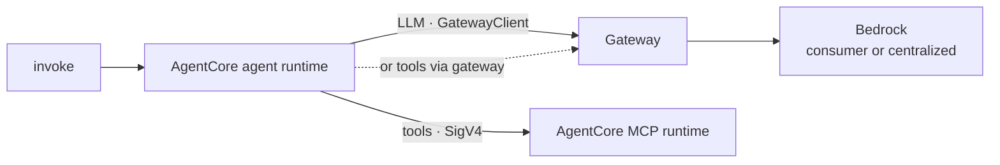

The agent holds no model credential and no tool credential — the MCP runtime has its own IAM role.
Tools can go SigV4-direct to the runtime ARN **or** through `{gateway}/mcp/{endpoint}`; only the
gateway route is governed, so it should be the recommendation, but that decision is not yet
recorded.

### The non-pattern worth naming

A workload in its own AWS account can always call `bedrock-runtime` directly, bypassing the gateway.
That is not a pattern in this catalogue — it is the absence of one. **ACP sees nothing**: no policy
check, no trace, no kill switch, no token accounting. Named here so it is recognised when
encountered.

## Chargeback — what exists

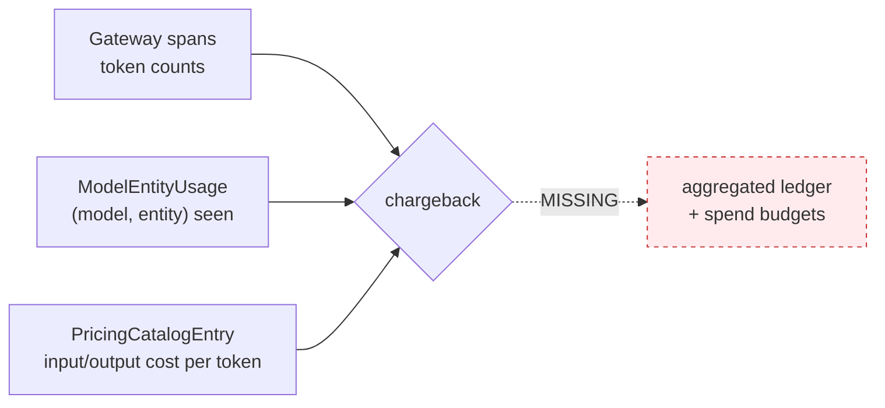

**Exists.** A pricing catalogue with per-token USD costs — `input_cost_per_token`,
`output_cost_per_token` and large-context variants, with overrides and an audit log. Per-entity
attribution of which entity was seen using which model. Token counts on spans.

**Does not.** An aggregated billing ledger. `ModelEntityUsage` is a **presence index** — it records
that a `(model, entity)` pair was seen, with first and last seen timestamps, and carries **no token
counts and no cost**. And `Quota.dimension` is `requests` or `tokens` only, so a **dollar budget
cannot be expressed**.

**So chargeback today is showback-by-query** — join spans to the pricing catalogue yourself.
Adequate for visibility; not adequate for cross-charging a business unit.

**Which is the gate on centralized.** Consumer-account needs none of it, because AWS bills the
consumer directly. Centralized cannot be offered fairly until the ledger and a spend dimension
exist.

---

# Adoption — SDK, raw HTTP, and what registration really needs

## Two ways in

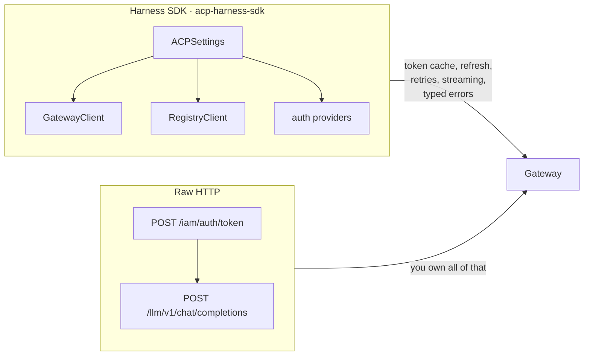

The SDK is a convenience, not a dependency — every pattern works over plain HTTP. What the SDK buys
is token caching and refresh (the throttling failure mode disappears), typed errors
(`PolicyDeniedError`, `KillSwitchActiveError`, `GuardrailBlockedError`, `RateLimitedError`),
streaming with reconnect, and **portability**.

## Portability is the reason to use it

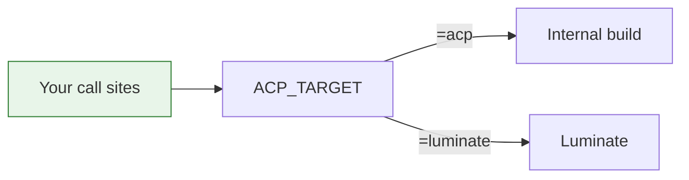

`ACP_TARGET=luminate` re-points the same clients at a Luminate stack. Combined with per-environment
configuration, an application's **call sites do not change** between the internal build and
Luminate, or between DEV and PROD — only its `ACP_`-prefixed configuration does.

Auth providers, by target:

| Provider | For |
|---|---|
| `OktaAuthProvider` | Internal build; credentials from Secrets Manager or JSON |
| `LuminateAuthProvider` | Luminate portal client-credentials |
| `ApiKeyAuthProvider` | A pre-issued `lum_` key; static, non-refreshable |

## Registration: portal UI today

This is the part that surprises teams, so lead with it.

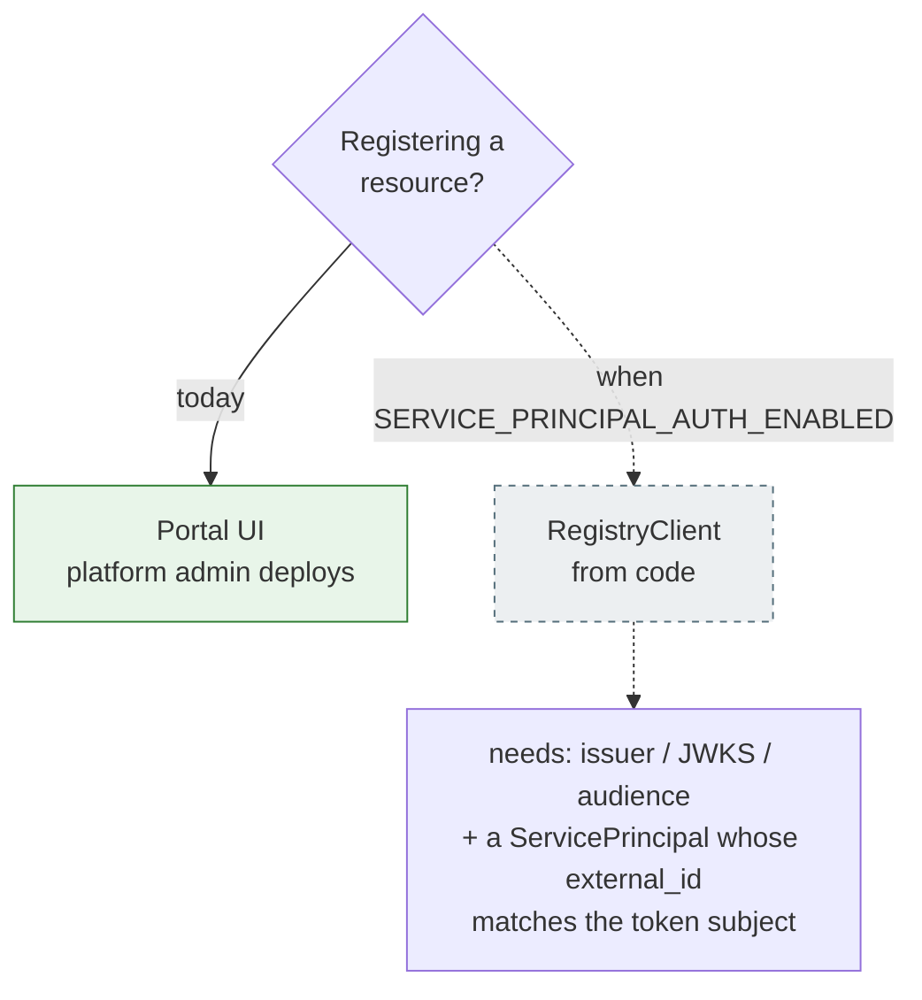

Machine-to-machine auth on the portal catalogue ships **default-off**. Against current deployments,
`RegistryClient` calls return `401` — **while the entire gateway path works normally**. That
asymmetry is the thing to communicate: *register in the portal, invoke from code*.

`self_register()` likewise returns 401 on Luminate, and `list_models()` returns 403 because
authorization resolves the model from the request body and a list has none.

## What a team provides to register

| Resource | Required | Then |
|---|---|---|
| **Agent** | Name, key (permanent slug), project | Platform admin deploys + grants access policy |
| **Model** | Name, key, project, author, type, context window, max tokens, gateway slug | Platform admin creates the offering (provider credentials + quota) |
| **MCP server** | Name, key, project, transport, backend URL (scheme + path) | Platform admin creates the deployment; access by policy |

Then — and only then — a credential can be issued, because it belongs to the `(resource, gateway)`
pair.

## The end-to-end a team actually walks

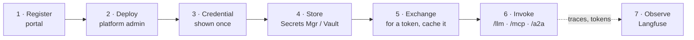

Steps 2 and 3 are **platform-admin actions** and cannot be delegated today — the constraint that
`gateway-environment-strategy` raises as its
second consortium ask.

## Worked examples to copy

[`acp-agentcore-sample`](https://bitbucket.sunlifecorp.com/projects/T1KACP/repos/acp-agentcore-sample/browse)
carries deployable examples, each demonstrating one shape:

| Example | Shape |
|---|---|
| `01-single-agent-mcp` | Agent → MCP tools, LLM governed. The smallest complete integration |
| `01-single-agent-mcp-luminate` | The **same agent** against Luminate — a configuration-only swap |
| `02-agent-to-agent` | Orchestrator → worker delegation |
| `03-single-agent-slm` | Agent against a small local model |

That `01-…` and `01-…-luminate` differ only in configuration is the portability claim, demonstrated
rather than asserted.

---

# Gaps and consortium asks

Each gap blocks or degrades a pattern. None is forked locally.

| # | Gap | Blocks | Interim |
|---|---|---|---|
| 1 | **Registry machine-to-machine auth is default-off** — needs `SERVICE_PRINCIPAL_AUTH_ENABLED` plus issuer/JWKS/audience and a `ServicePrincipal` whose `external_id` matches the token subject | Registration from code (Adoption) | Register in the portal UI; invoke from code |
| 2 | **No aggregated billing ledger** — pricing catalogue and per-entity attribution exist; token counts ride on spans; nothing joins them | Chargeback for P2 (Inference) | Showback by query |
| 3 | **No `spend` quota dimension** — only `requests` and `tokens` | Dollar budgets per team | Token ceilings as a proxy |
| 4 | **Deploy and credential issuance are platform-admin only** — `deployments.deployment.*` exists but the API does not consult it | Self-service for every pattern | Platform team performs both |
| 5 | **`list_models()` returns 403** — authorization resolves the model from the request body, and a list has none | Model discovery from code | Name the model explicitly |
| 6 | **Portal outage denies all traffic** — no local policy cache on the gateway | Availability of every pattern | Treat the control plane as on the request path |
| 7 | **Consumer-account rollout has not happened** — the Service Catalog product is published and verified end-to-end, but no real consumer is onboarded. All three environments share one **test** consumer account (`131935619052`) | I1 in practice | Onboard consumers onto their own spokes |
| 8 | **The ACP hub account is SCP-denied on `bedrock:*`** — so centralized cannot execute there without an organisation-level SCP change | I2 entirely | Consumer-account chaining, which is why it exists |
| 9 | **A2A is partial** — agent-to-agent works on the internal build; the Luminate gateway path is not equivalent | Multi-agent workloads | Internal build, or direct |

## Which gaps matter most

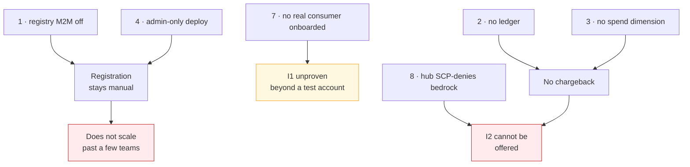

Three clusters, three consequences:

- **Gaps 1 and 4 together** mean every registration and every deployment is a platform-team action.
  With seven use cases specced, that is the constraint that decides whether this scales.
- **Gap 7** is a rollout gap, not a build gap. The Service Catalog product exists and provisions
  cleanly; what is missing is a real consumer on its own spoke instead of everything pointing at one
  shared *test* account.
- **Gaps 2, 3 and 8 together** mean **centralized** (I2) cannot be offered at all today: ACP cannot
  bill the spend back, *and* the hub account is SCP-denied from calling Bedrock in the first place.
  I2 is the pattern teams without an AWS account need, so both have to be settled before it can be
  promised to anyone.

## Relationship to other specs

| Gap | Owned or tracked by |
|---|---|
| 1, 4 | `gateway-environment-strategy` — Portal RBAC ask |
| 2, 3 | Consortium — raised for the wider platform |
| 5, 6, 9 | Consortium — Luminate gateway and catalogue |
| 7 | This spec — a Sun Life rollout decision |
| 8 | Sun Life Cloud / org governance — an SCP change, not a Luminate gap |

**Gaps 7 and 8 are ours.** Everything else needs the consortium; onboarding real consumers onto
their own spokes, and deciding whether to pursue an SCP exception plus a chargeback story for
centralized inference, are Sun Life decisions we can take without upstream.
