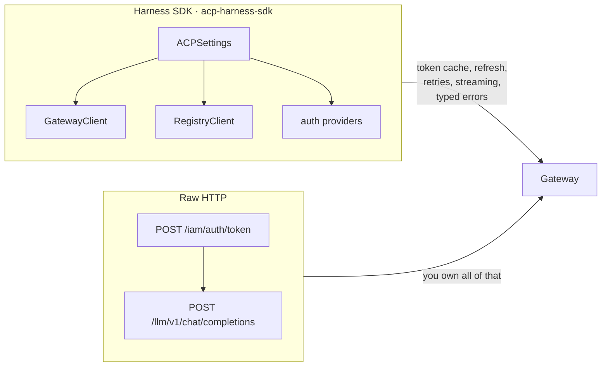
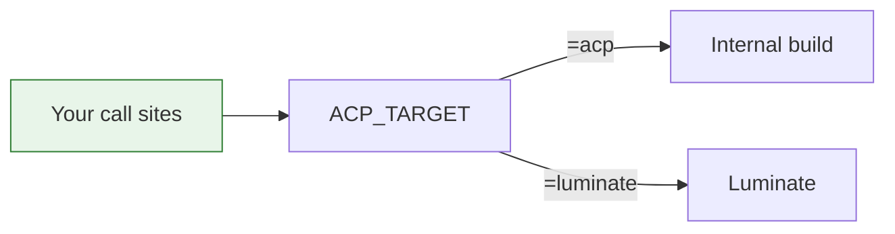
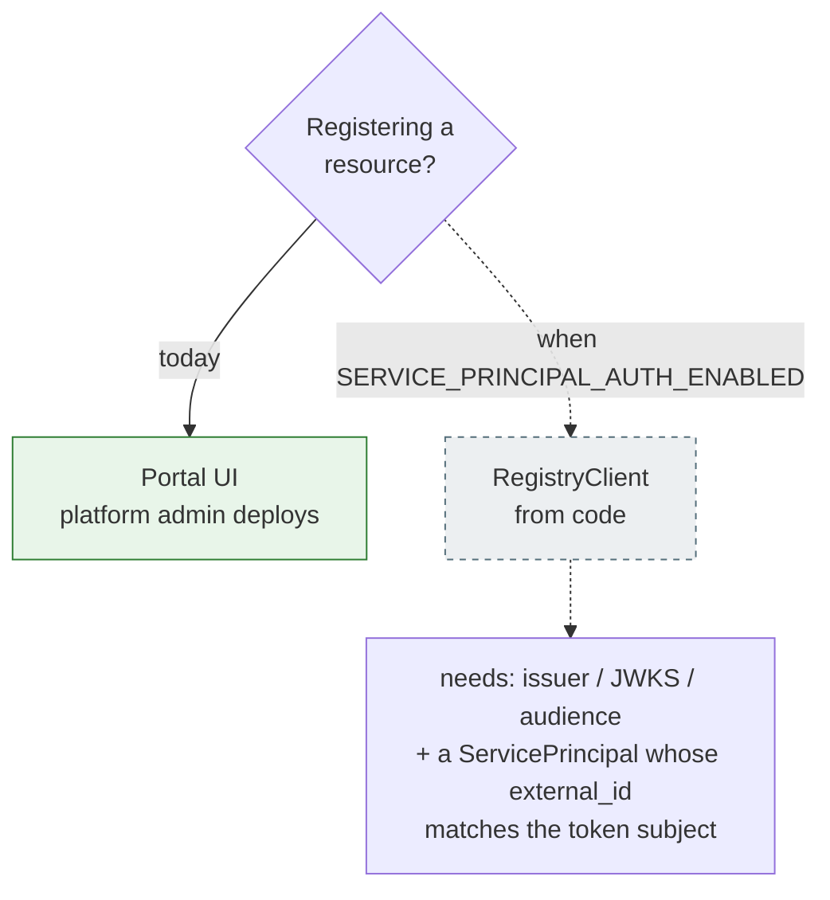
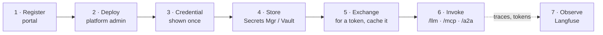

# Adoption — SDK, raw HTTP, and what registration really needs

## Two ways in

The SDK is a convenience, not a dependency — every pattern works over plain HTTP. What the SDK buys
is token caching and refresh (the throttling failure mode disappears), typed errors
(`PolicyDeniedError`, `KillSwitchActiveError`, `GuardrailBlockedError`, `RateLimitedError`),
streaming with reconnect, and **portability**.

## Portability is the reason to use it

`ACP_TARGET=luminate` re-points the same clients at a Luminate stack. Combined with per-environment
configuration, an application's **call sites do not change** between the internal build and
Luminate, or between DEV and PROD — only its `ACP_`-prefixed configuration does.

Auth providers, by target:

| Provider | For |
|---|---|
| `OktaAuthProvider` | Internal build; credentials from Secrets Manager or JSON |
| `LuminateAuthProvider` | Luminate portal client-credentials |
| `ApiKeyAuthProvider` | A pre-issued `lum_` key; static, non-refreshable |

## Registration: portal UI today

This is the part that surprises teams, so lead with it.

Machine-to-machine auth on the portal catalogue ships **default-off**. Against current deployments,
`RegistryClient` calls return `401` — **while the entire gateway path works normally**. That
asymmetry is the thing to communicate: *register in the portal, invoke from code*.

`self_register()` likewise returns 401 on Luminate, and `list_models()` returns 403 because
authorization resolves the model from the request body and a list has none.

## What a team provides to register

| Resource | Required | Then |
|---|---|---|
| **Agent** | Name, key (permanent slug), project | Platform admin deploys + grants access policy |
| **Model** | Name, key, project, author, type, context window, max tokens, gateway slug | Platform admin creates the offering (provider credentials + quota) |
| **MCP server** | Name, key, project, transport, backend URL (scheme + path) | Platform admin creates the deployment; access by policy |

Then — and only then — a credential can be issued, because it belongs to the `(resource, gateway)`
pair.

## The end-to-end a team actually walks

Steps 2 and 3 are **platform-admin actions** and cannot be delegated today — the constraint that
`gateway-environment-strategy` raises as its
second consortium ask.

## Worked examples to copy

[`acp-agentcore-sample`](https://bitbucket.sunlifecorp.com/projects/T1KACP/repos/acp-agentcore-sample/browse)
carries deployable examples, each demonstrating one shape:

| Example | Shape |
|---|---|
| `01-single-agent-mcp` | Agent → MCP tools, LLM governed. The smallest complete integration |
| `01-single-agent-mcp-luminate` | The **same agent** against Luminate — a configuration-only swap |
| `02-agent-to-agent` | Orchestrator → worker delegation |
| `03-single-agent-slm` | Agent against a small local model |

That `01-…` and `01-…-luminate` differ only in configuration is the portability claim, demonstrated
rather than asserted.
