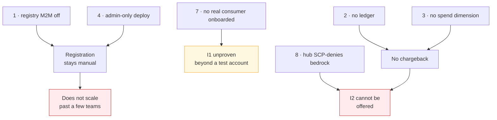

# Gaps and consortium asks

Each gap blocks or degrades a pattern. None is forked locally.

| # | Gap | Blocks | Interim |
|---|---|---|---|
| 1 | **Registry machine-to-machine auth is default-off** — needs `SERVICE_PRINCIPAL_AUTH_ENABLED` plus issuer/JWKS/audience and a `ServicePrincipal` whose `external_id` matches the token subject | Registration from code (Adoption) | Register in the portal UI; invoke from code |
| 2 | **No aggregated billing ledger** — pricing catalogue and per-entity attribution exist; token counts ride on spans; nothing joins them | Chargeback for P2 (Inference) | Showback by query |
| 3 | **No `spend` quota dimension** — only `requests` and `tokens` | Dollar budgets per team | Token ceilings as a proxy |
| 4 | **Deploy and credential issuance are platform-admin only** — `deployments.deployment.*` exists but the API does not consult it | Self-service for every pattern | Platform team performs both |
| 5 | **`list_models()` returns 403** — authorization resolves the model from the request body, and a list has none | Model discovery from code | Name the model explicitly |
| 6 | **Portal outage denies all traffic** — no local policy cache on the gateway | Availability of every pattern | Treat the control plane as on the request path |
| 7 | **Consumer-account rollout has not happened** — the Service Catalog product is published and verified end-to-end, but no real consumer is onboarded. All three environments share one **test** consumer account (`131935619052`) | I1 in practice | Onboard consumers onto their own spokes |
| 8 | **The ACP hub account is SCP-denied on `bedrock:*`** — so centralized cannot execute there without an organisation-level SCP change | I2 entirely | Consumer-account chaining, which is why it exists |
| 9 | **A2A is partial** — agent-to-agent works on the internal build; the Luminate gateway path is not equivalent | Multi-agent workloads | Internal build, or direct |

## Which gaps matter most

Three clusters, three consequences:

- **Gaps 1 and 4 together** mean every registration and every deployment is a platform-team action.
  With seven use cases specced, that is the constraint that decides whether this scales.
- **Gap 7** is a rollout gap, not a build gap. The Service Catalog product exists and provisions
  cleanly; what is missing is a real consumer on its own spoke instead of everything pointing at one
  shared *test* account.
- **Gaps 2, 3 and 8 together** mean **centralized** (I2) cannot be offered at all today: ACP cannot
  bill the spend back, *and* the hub account is SCP-denied from calling Bedrock in the first place.
  I2 is the pattern teams without an AWS account need, so both have to be settled before it can be
  promised to anyone.

## Relationship to other specs

| Gap | Owned or tracked by |
|---|---|
| 1, 4 | `gateway-environment-strategy` — Portal RBAC ask |
| 2, 3 | Consortium — raised for the wider platform |
| 5, 6, 9 | Consortium — Luminate gateway and catalogue |
| 7 | This spec — a Sun Life rollout decision |
| 8 | Sun Life Cloud / org governance — an SCP change, not a Luminate gap |

**Gaps 7 and 8 are ours.** Everything else needs the consortium; onboarding real consumers onto
their own spokes, and deciding whether to pursue an SCP exception plus a chargeback story for
centralized inference, are Sun Life decisions we can take without upstream.
