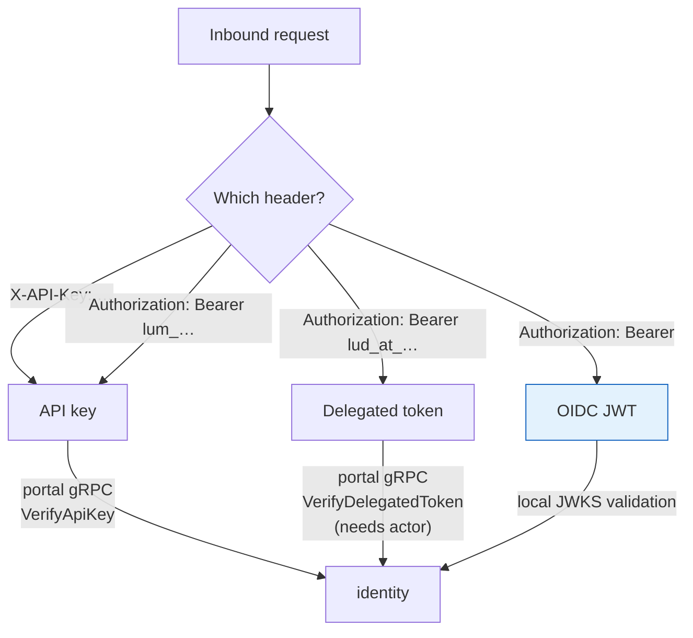
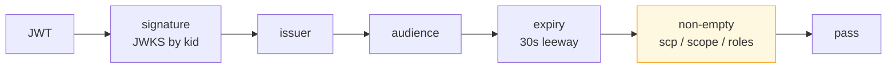
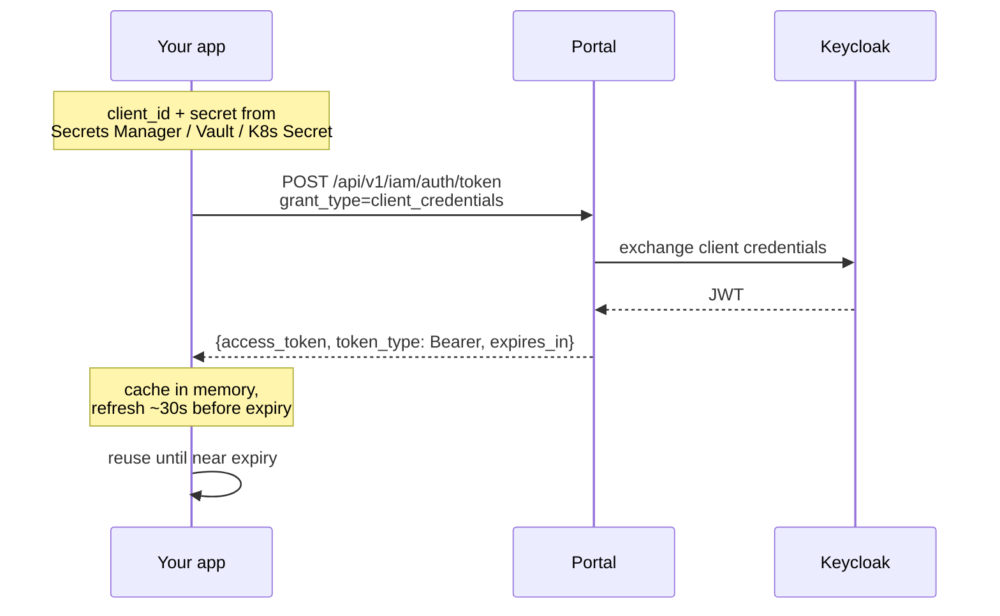
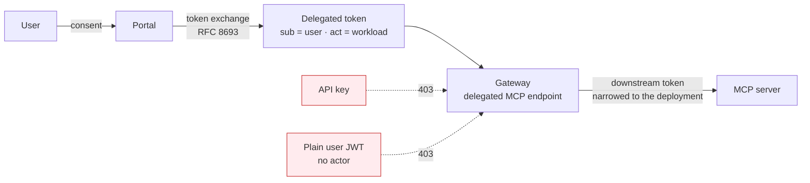

# Identity — credentials and token flows

## The four credential shapes

The gateway routes on the header before it validates anything.

| Shape | Validated by | Use it for |
|---|---|---|
| **OIDC JWT** — `Bearer <jwt>` | Gateway, locally against JWKS | Machine workloads. The normal pattern. |
| **API key** — `X-API-Key` or `Bearer lum_…` | Portal, per request | Simple callers; **not accepted on delegated MCP endpoints** |
| **Delegated token** — `Bearer lud_at_…` | Portal, per request | On-behalf-of-a-user MCP access |

## What the JWT path actually checks

All five must pass. The fifth is the one that surprises people.

A token that is otherwise perfect but carries no `scp`, `scope` or `roles` claim is refused — the
check exists so an app-only token cannot pass through as an unrestricted identity.

**Refusal reasons** the validator distinguishes: `invalid_signature`, `invalid_issuer`,
`invalid_audience`, `token_expired`, `malformed_token`, `jwks_unavailable`,
`missing_authorization_claim`. For API keys: `invalid_key`, `portal_unreachable`.

## Getting a token

| Property | Value |
|---|---|
| Endpoint | `POST {portal}/api/v1/iam/auth/token` |
| Grant | `client_credentials` (form body, or HTTP Basic) |
| Client id | `agent-<resource-uuid>-<client-uuid>` — retrievable later |
| Client secret | **Shown once.** Rotation issues a different secret |
| Lifetime | Read `expires_in` — commonly ~300s. Do not hard-code |
| **Rate limit** | **The endpoint is throttled.** Fetching per request fails under load |

**Cache the token.** This is the most common load-related failure: a client that mints a token per
request will pass in dev and throttle in production.

## Where the secret lives

| Runtime | Storage | Notes |
|---|---|---|
| AWS workload | Secrets Manager | Harness SDK reads it directly |
| Kubernetes / OpenShift | Vault → `VaultStaticSecret` → Secret | Rotation-survivable with `refreshAfter` |
| OpenShift, no Vault yet | `oc create secret generic` + `envFrom` | Minimum viable |
| Local dev | Environment variable | Dev only |

Never write a token to disk or a ConfigMap. The secret, not the token, is what gets stored.

## Delegated (on-behalf-of) access

For MCP calls that must carry a *user's* identity rather than the workload's.

Only a **machine identity** or a **delegated token with a complete actor** is eligible. An API key
gets a 403 — which looks identical to a policy denial unless you know to check endpoint
eligibility first.
