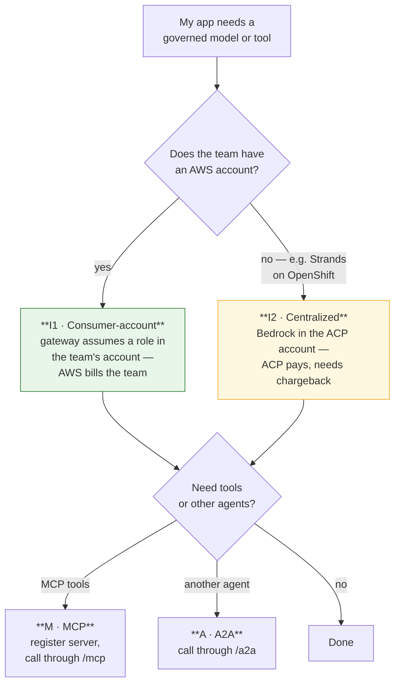
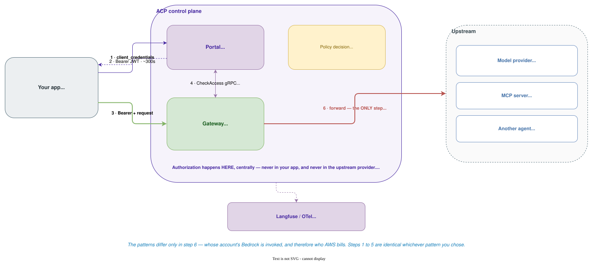
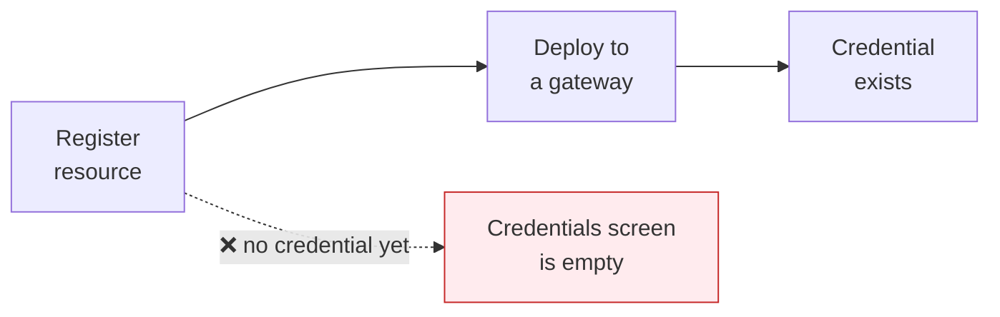

# D2 Design — Pattern Catalogue

> **Gate**: D2 — Design | **Status**: Draft | **D1 Approved**: TBD
>
> `d2-design.md` beside this directory is **generated** from these pages by
> `scripts/assemble_d2_design.py` — edit the pages, not the generated file.

## Pick your pattern

Two questions, answered independently: **where does the workload run**, and **whose Bedrock is
invoked**.

Hosting — the team's AWS account, a Bedrock AgentCore runtime, or OpenShift/Kubernetes — is a
separate choice that composes with either. The only hard constraint: **no AWS account means
centralized**, because there is nothing to assume into.

## The catalogue

| # | Pattern | Who it is for | Maturity |
|---|---|---|---|
| **I1** | **Consumer-account inference** — the gateway assumes a role in the consumer's account, so AWS bills the consumer | Teams with an AWS account. **The default.** | Mechanism proven; Service Catalog product missing |
| **I2** | **Centralized inference** — Bedrock enabled in the ACP workload account | Teams with **no** AWS account; Strands agents on OpenShift/K8s | Gated on chargeback |
| **H** | **Hosting shapes** — team AWS account, AgentCore runtime, OpenShift/K8s | Everyone; composes with I1 or I2 | Works today |
| **M** | **MCP tools** — register a server, call tools through `/mcp` | Any workload needing governed tools | Works today |
| **A** | **Agent-to-agent** — delegate through `/a2a` | Multi-agent workloads | Partial — see Gaps |
| **R** | **Registration** — get the resource into the catalogue | Everyone, first | Portal UI only |

## Every pattern shares one spine

Whatever the pattern, the governed call is the same shape.

The patterns differ only in **step 6** — whose account's Bedrock is invoked, and therefore who AWS
bills. Steps 1 to 5 are identical whichever pattern you chose.

The mechanics of each step — endpoints, payloads, error codes — live in
[`luminate-user-guides`](https://bitbucket.sunlifecorp.com/projects/EDAEACP/repos/luminate-user-guides/browse),
and [`acp-harness-sdk`](https://bitbucket.sunlifecorp.com/projects/EDAEACP/repos/acp-harness-sdk/browse)
does steps 1 to 3 for you. This spec names the pattern; it is not the reference manual.

## Reading order

| Page | Covers |
|---|---|
| **Identity** | The four credential shapes, the token exchange, storage, TTL, delegated tokens |
| **Invocation** | `/llm`, `/mcp`, `/a2a` — paths, authorization, failure modes |
| **Inference** | P1, P2, P3 side by side — IAM, identity, attribution |
| **Adoption** | SDK vs raw HTTP, and what registration actually requires today |
| **Gaps** | What is blocked, and the consortium ask that unblocks it |

## The rule that catches everyone

**A credential belongs to a `(resource, gateway)` pair.** Registering an agent creates a governed
identity; it does not create a credential. Until the resource is **deployed to a gateway**, the
Credentials screen has nothing to offer.

