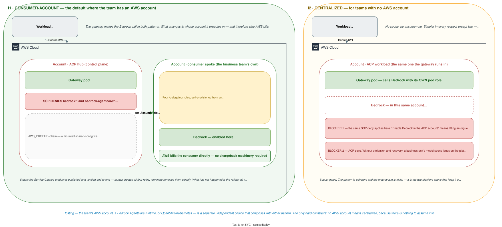
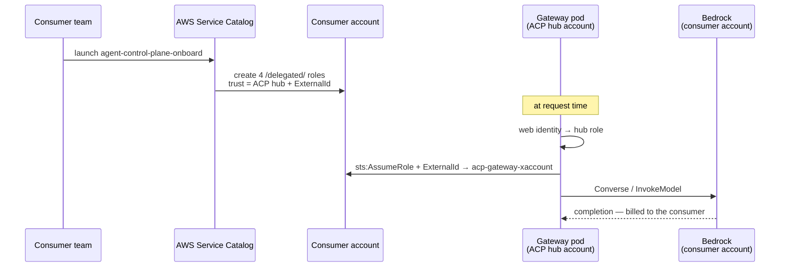
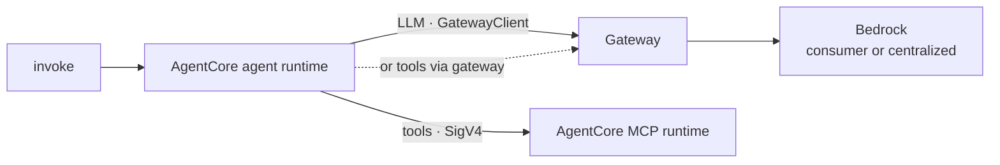
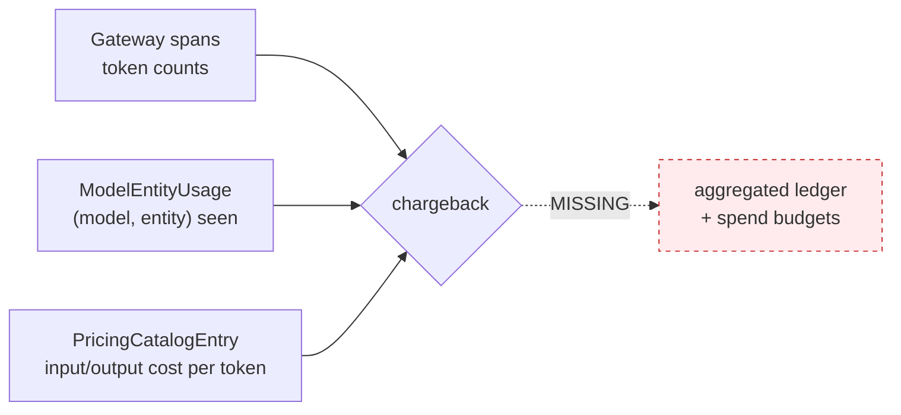

# Model inference — where the call executes, and who pays

Two independent questions. Conflating them is what makes this confusing.



**In both, the gateway makes the call.** The workload never holds a Bedrock credential. What
changes is *which account's Bedrock is invoked*, and therefore who AWS bills.

## Axis 1 — the billing decision

| | **Consumer-account** | **Centralized** |
|---|---|---|
| Bedrock invoked in | The **consumer's** AWS account | The **ACP workload** account |
| Gateway credential | Assumes a role in the consumer account | Its own pod role |
| AWS bills | **The consumer, directly** | **ACP** |
| Chargeback needed | **No** — AWS attributes it already | **Yes** — or ACP absorbs the spend |
| Consumer needs an AWS account | **Yes** | **No** |
| Enablement | AWS Service Catalog product deploys the role | Enable Bedrock in the ACP account |

**Consumer-account is the default** where the team has an AWS account: costs land where they are
incurred, with no chargeback machinery required. **Centralized exists for teams with no AWS
account** — and that is precisely why it needs a chargeback model, because ACP fronts the spend.

## Consumer-account — how the role gets there

[`acp-aws-service-catalog`](https://bitbucket.sunlifecorp.com/projects/T1KACP/repos/acp-aws-service-catalog/browse)
publishes an **AWS Service Catalog product** a business account self-provisions. It creates four
`/delegated/` roles under the `slf-aws-delegated-perm-boundary` permissions boundary — so **no
Cloud-team ticket is required** — with trust locked to a specific ACP hub principal and gated by an
**ExternalId** for confused-deputy protection.

| Role | Used by | Permissions |
|---|---|---|
| `acp-gateway-xaccount` | The AI gateway, for model / MCP / agent routing | `bedrock:InvokeModel*`, `bedrock:Converse*`, `bedrock-agentcore:InvokeAgentRuntime` |
| `acp-eval-judge` | Evaluation tooling (LLM-as-judge) | `bedrock:InvokeModel*` on approved judge models |
| `acp-agent-discovery` | Discovery service | read-only `List*` / `Get*` across Bedrock and AgentCore |
| `acp-bedrock-agent-exec` | Bedrock Agents service, for discovery test cases | `bedrock:InvokeModel*` on approved models |

Only the first is on the inference path; the others are why the product is a portfolio rather than
a single role.



Mechanically this is an AWS shared-config file mounted into the gateway, `AWS_PROFILE=chain`:

```ini
[profile chain]
role_arn        = <consumer spoke role>
source_profile  = base

[profile base]
role_arn                = <ACP hub role>            # per environment
web_identity_token_file = /var/run/secrets/sts-token/token
```

**Two properties worth keeping.** No OIDC provider is needed in the consumer account — the web
identity is exchanged only in the hub — and there is **no app-side assume-role**: the default
provider chain resolves it, so no application code knows about the chain.

### Why the chain exists at all

Not only for billing. **The ACP hub account is SCP-denied from `bedrock:*` and
`bedrock-agentcore:*`.** Role-chaining into a spoke is what puts the call inside an account where
Bedrock is permitted — SCPs are evaluated in the **spoke**, against the consumer's own guardrails.

That is the part worth remembering: the chain is not a billing convenience bolted on afterwards. It
is load-bearing. Remove it and the call does not become centralized — it fails.

### Where this stands today

The product is **published and verified end-to-end** in the dev test account: launching it created
all four roles with the boundary and hub trust, and terminating removed them cleanly. It ships via
two forked Cloud Engineering repos — a StackSet distributing the provisioning execution role, and a
portfolio publishing the product itself.

What is not yet real is the **multi-consumer** shape.

| Environment | Hub role (ACP account) | Spoke |
|---|---|---|
| dev | `360967146904` | `131935619052` |
| test | `692797214700` | `131935619052` |
| stage | `775755739292` | `131935619052` |

**The spoke is the same account in all three** — `t1k-acp-test-dev-ca`, a **test consumer account**,
not a model account and not a real consumer. The stage checklist already records that sharing it
with dev "is not acceptable long-term".

So the honest status: **the product exists and works; the rollout has not happened.** What remains
is onboarding real consumers onto their own spokes, and the ExternalId and trust-policy lifecycle
as consumers arrive and leave — not building the thing.

## Centralized — Bedrock in the ACP workload account

No spoke, no assume-role. Bedrock is enabled in the ACP workload account where the gateway already
runs, and the gateway calls it with its own pod role.

Simpler than the consumer-account chain in every respect except two, and both are real:

1. **ACP pays the bill.** Without a way to attribute and recover that spend, the pattern moves a
   business unit's model costs onto the platform's budget.
2. **The hub account is SCP-denied on Bedrock today.** "Enable Bedrock in the ACP account" is not a
   console toggle — it means lifting an organisation-level SCP on the account that hosts the
   control plane, or hosting the gateway somewhere the deny does not apply. That is a governance
   conversation, not a configuration change.

**This is still the pattern a Strands agent on OpenShift needs**, because there is no consumer
account to assume into. It is also the pattern most likely to be asked for, precisely because it
asks least of the consumer — which is why both blockers are worth settling deliberately rather than
discovering later.

## Axis 2 — where the workload runs

Hosting is independent of billing. Each hosting shape can use either Axis-1 pattern, except where
noted.

| Hosting | Consumer-account | Centralized | Notes |
|---|---|---|---|
| Team's AWS account | ✅ preferred | possible | The team already has an account; use it |
| Bedrock AgentCore runtime | ✅ | possible | LLM goes through the gateway, never direct boto3 |
| **OpenShift / Kubernetes, no AWS account** | ❌ nothing to assume into | ✅ **the only option** | The case that makes chargeback load-bearing |

### AgentCore hosting



The agent holds no model credential and no tool credential — the MCP runtime has its own IAM role.
Tools can go SigV4-direct to the runtime ARN **or** through `{gateway}/mcp/{endpoint}`; only the
gateway route is governed, so it should be the recommendation, but that decision is not yet
recorded.

### The non-pattern worth naming

A workload in its own AWS account can always call `bedrock-runtime` directly, bypassing the gateway.
That is not a pattern in this catalogue — it is the absence of one. **ACP sees nothing**: no policy
check, no trace, no kill switch, no token accounting. Named here so it is recognised when
encountered.

## Chargeback — what exists



**Exists.** A pricing catalogue with per-token USD costs — `input_cost_per_token`,
`output_cost_per_token` and large-context variants, with overrides and an audit log. Per-entity
attribution of which entity was seen using which model. Token counts on spans.

**Does not.** An aggregated billing ledger. `ModelEntityUsage` is a **presence index** — it records
that a `(model, entity)` pair was seen, with first and last seen timestamps, and carries **no token
counts and no cost**. And `Quota.dimension` is `requests` or `tokens` only, so a **dollar budget
cannot be expressed**.

**So chargeback today is showback-by-query** — join spans to the pricing catalogue yourself.
Adequate for visibility; not adequate for cross-charging a business unit.

**Which is the gate on centralized.** Consumer-account needs none of it, because AWS bills the
consumer directly. Centralized cannot be offered fairly until the ledger and a spend dimension
exist.
