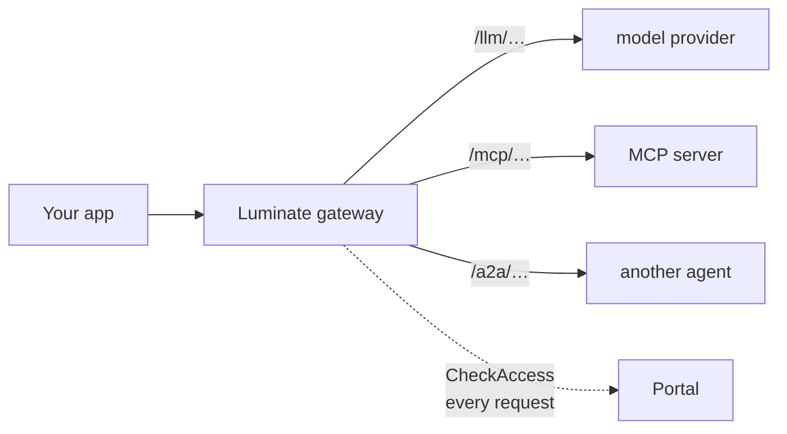
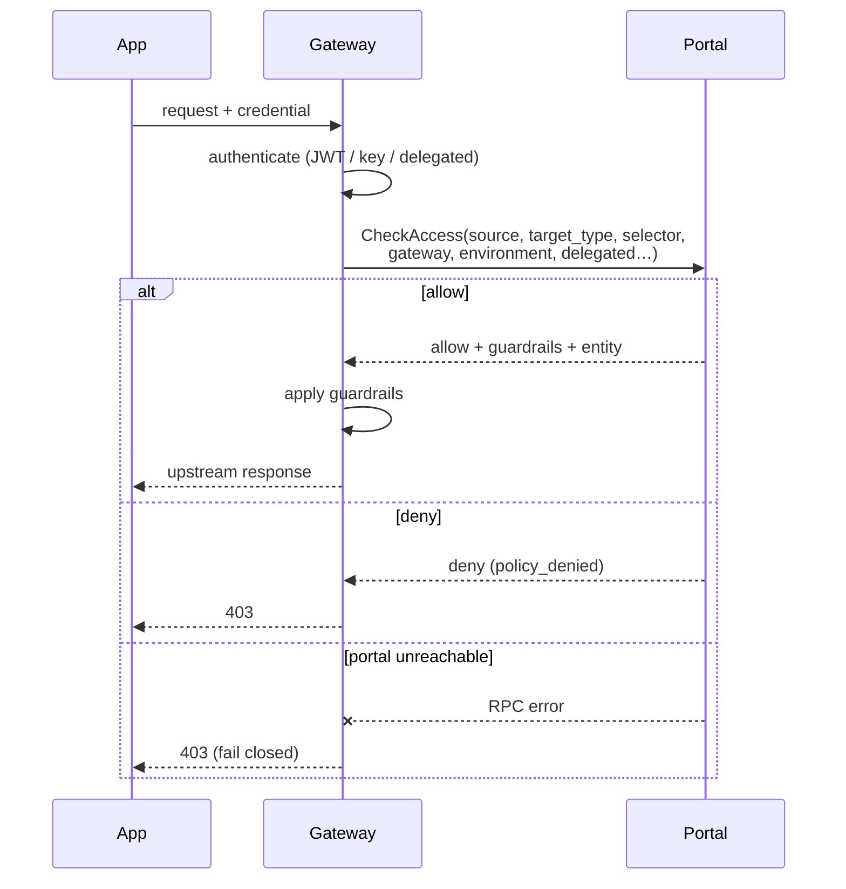
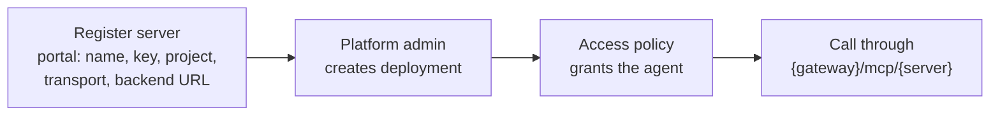

# Invocation — the three gateway surfaces



| Surface | Target type | Shape |
|---|---|---|
| `/llm/…` | `model` | OpenAI-compatible chat completions |
| `/mcp/…` | `mcp_server` | MCP over HTTP; API keys not accepted on delegated endpoints |
| `/a2a/…` | `agent` | Agent-to-agent delegation |

## LLM — the common case

```python
## Harness SDK — the same code on either target
from acp_aws_harness_sdk import ACPSettings, GatewayClient

settings = ACPSettings()                 # ACP_TARGET=luminate re-points everything
result = GatewayClient(settings).complete("Summarise this claim")
print(result.text, result.usage)
```

```bash
## Raw HTTP — the SDK is a convenience, not a dependency
curl -X POST "$GATEWAY/llm/v1/chat/completions" \
  -H "Authorization: Bearer $TOKEN" \
  -H 'Content-Type: application/json' \
  -d '{"model":"claude-3-haiku","messages":[{"role":"user","content":"hi"}]}'
```

Request and response are OpenAI-shaped, including `tools` / `tool_choice` for tool calling and
`usage` for token counts. Streaming is available over WebSocket, with automatic ping and a single
re-handshake on token expiry.

## Every request is authorized centrally



**The control plane is on the request path.** There is no local policy cache, so a portal outage
denies traffic rather than failing open. That is deliberate, and it is a availability
characteristic worth designing around.

## Failure modes

Read these in order — the first two are indistinguishable from the outside unless you know the rule.

| Symptom | Likely cause | Check |
|---|---|---|
| **401** | Credential rejected | The validator reason: audience, expiry, issuer, signature, or the missing `scope`/`roles` claim |
| **403** on a delegated MCP endpoint | Credential *type* ineligible | API key or plain user JWT used where a machine or delegated identity is required |
| **403** elsewhere | Access policy denied, **or the portal was unreachable** | Both surface as 403 |
| **403** on `list_models()` | Authorization resolves the model from the request body; a list has none | Name the model explicitly |
| **Empty gateway dropdown** in the portal | No `GatewayEnvironment` mapping | Not an auth problem at all |
| **Throttled token endpoint** | Minting a token per request | Cache and reuse until ~30s before expiry |

## MCP



Access to an MCP server is granted by **access policy**, not by a binding record. The backend URL
must include scheme and path. Tools are discovered from the server; the agent never holds the
tool's credentials.
