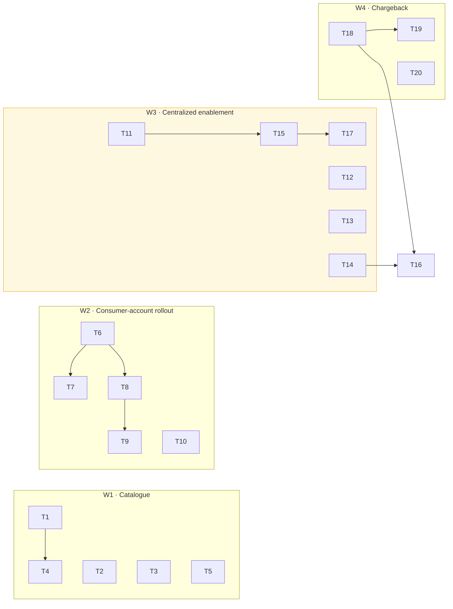

# ACP / Luminate Integration Patterns — D3: Implementation Plan

> **Gate**: D3 — Tasks | **Status**: Draft | **D2 Approved**: TBD
> **Epic**: [EACPP-1112](https://sunlife.atlassian.net/browse/EACPP-1112) · Board label `acp-product-team`

## Overview

Four workstreams. **W1** publishes the catalogue so teams can self-serve. **W2** turns the
consumer-account pattern from a verified product into an onboarded consumer. **W3** unblocks
centralized inference — an SCP change per hub account, plus the chargeback that makes it fair.
**W4** raises what only the consortium can fix.

W1 depends on nothing and should start now. W3's SCP tickets are long-lead and should be raised in
parallel rather than sequenced behind anything.

## W1 · Publish the catalogue

| Task | Description | Depends |
|------|-------------|---------|
| **T1** | Publish the **pattern catalogue and decision tree** into [`luminate-user-guides`](https://bitbucket.sunlifecorp.com/projects/EDAEACP/repos/luminate-user-guides/browse) so a team can pick its pattern without asking. (FR-1, FR-22) | — |
| **T2** | Document the **credential ordering rule** prominently — register, deploy, *then* the credential exists — plus storage by runtime and the token-endpoint rate limit. This is the most common blocker and it is currently one guide deep. (FR-6, FR-7, FR-8) | — |
| **T3** | Publish the **failure-mode table**: 401 by validator reason, 403 by policy vs endpoint eligibility, and the ones that look like auth failures but are not (unmapped gateway, `list_models()`). (FR-12, NFR-5) | — |
| **T4** | Point the **onboarding specs** (`gbd`, `mdx`, `aims`, `orcc`, `waldo`, `nova`, `ai-ready-data`) at the catalogue and reconcile any that assumed their own pattern. (FR-4, FR-23) | T1 |
| **T5** | Record the **AgentCore MCP route decision** — SigV4-direct to the runtime ARN vs through `{gateway}/mcp/{endpoint}`. Both work; only the gateway route is governed, so recommend one. (FR-16) | — |

## W2 · Consumer-account rollout

The [`acp-aws-service-catalog`](https://bitbucket.sunlifecorp.com/projects/T1KACP/repos/acp-aws-service-catalog/browse)
product is published and verified end-to-end. This is rollout, not build.

| Task | Description | Depends |
|------|-------------|---------|
| **T6** | Onboard the **first real consumer** onto its own spoke via the Service Catalog product, end to end: launch the product, wire the gateway, route a governed completion, confirm the spend lands in the consumer's account. (FR-14) | — |
| **T7** | Stop sharing the **test consumer account** across environments. `131935619052` is currently the spoke for dev, test *and* stage; the stage checklist already flags this as not acceptable long-term. (FR-14) | T6 |
| **T8** | Define the **ExternalId and trust-policy lifecycle** — issuance, rotation and revocation as consumers arrive and leave — so onboarding a consumer is not a bespoke IAM edit. (FR-19) | T6 |
| **T9** | Document the **consumer onboarding path** in the user guides: launch the product, hand back the account and role, get wired to a gateway. (FR-14, FR-22) | T6, T8 |
| **T10** | Reconcile the **hub role naming** — dev and stage use `acp-gateway-irsa`, test uses `luminate-gateway-irsa`. Harmless today, confusing at four environments. | — |

## W3 · Centralized inference enablement

Two independent blockers. The SCP tickets are **long-lead and should be raised in parallel**, one
per hub account, because they are organisation-level changes on the account hosting the control
plane rather than configuration.

### SCP enablement — one ticket per hub account

Each asks SLF cloud governance to permit `bedrock:*` and `bedrock-agentcore:*` in that account.
**Confirm the deny is actually present before raising** — it is verified on dev; the other three
should be checked rather than assumed.

| Task | Description | Depends |
|------|-------------|---------|
| **T11** | Enable Bedrock in the **dev** hub account `360967146904` (`t1k-agent-control-plane-dev-ca`) — request the `bedrock:*` / `bedrock-agentcore:*` SCP deny be lifted. **Deny confirmed on this account.** (FR-15) | — |
| **T12** | Enable Bedrock in the **test** hub account `692797214700` — confirm whether the SCP deny applies, and request it be lifted if so. (FR-15) | — |
| **T13** | Enable Bedrock in the **stage** hub account `775755739292` — confirm whether the SCP deny applies, and request it be lifted if so. (FR-15) | — |
| **T14** | Enable Bedrock in the **prod** hub account `035722575935` — confirm whether the SCP deny applies, and request it be lifted if so. (FR-15) | — |

| Task | Description | Depends |
|------|-------------|---------|
| **T15** | Once an SCP is lifted, add a **local-Bedrock mode** to the gateway values — `gateway.aws` currently assumes the role chain; centralized needs the pod role to call Bedrock in-account. Note `values-prod.yaml` has no `gateway.aws` block at all yet. (FR-15) | T11 |
| **T16** | **Decide and record whether centralized is offered**, and to whom. It is the only pattern that serves a workload with no AWS account, and it is the one that puts model spend on the platform's budget. (FR-15, FR-18) | T14, T18 |
| **T17** | Verify centralized end to end in the first enabled environment: a workload with **no AWS account** — a Strands agent on OpenShift — routing a governed completion. (FR-18) | T15 |

## W4 · Chargeback and consortium asks

| Task | Description | Depends |
|------|-------------|---------|
| **T18** | Build **showback**: join gateway spans to the pricing catalogue to produce per-team, per-model cost. The ingredients exist — per-token USD costs, per-entity attribution, token counts on spans — but nothing joins them. (FR-20, FR-21) | — |
| **T19** | Raise the **consortium asks**: an aggregated billing ledger, and `Quota.dimension = spend` so a dollar budget can be expressed. (FR-21, NFR-2) | T18 |
| **T20** | Raise the remaining **gateway and catalogue asks**: registry machine-to-machine auth on by default, `list_models()` authorization, legible denial reasons, and A2A parity on the Luminate path. (FR-3, NFR-5) | — |

## Sequencing

**T16 is the decision gate.** Centralized cannot be promised to anyone until both an SCP is lifted
and showback exists — which is why the SCP tickets and the showback work run in parallel and meet
there.

## Definition of Done

- The catalogue and decision tree are published in the user guides, and the onboarding specs
  reference them instead of re-deriving.
- The credential ordering rule and failure-mode table are documented where teams will find them.
- One real consumer is onboarded onto its own spoke, with spend landing in their account, and no
  environment still points at the shared test account.
- The ExternalId and trust-policy lifecycle is defined, not bespoke.
- An SCP ticket exists for each of the four hub accounts, with the deny confirmed or ruled out.
- Showback produces per-team, per-model cost; the ledger and spend-dimension asks are raised.
- A recorded decision on whether centralized inference is offered, and to whom.

## References

- Spec: [D0](d0-discovery.md) · [D1](d1-requirements.md) · [D2](d2-design.md)
  ([pages](d2-design/index.md))
- [`acp-aws-service-catalog`](https://bitbucket.sunlifecorp.com/projects/T1KACP/repos/acp-aws-service-catalog/browse) —
  the product, its four `/delegated/` roles, and the CPES publishing forks
- [`acp-harness-sdk`](https://bitbucket.sunlifecorp.com/projects/EDAEACP/repos/acp-harness-sdk/browse) ·
  [`acp-agentcore-sample`](https://bitbucket.sunlifecorp.com/projects/T1KACP/repos/acp-agentcore-sample/browse)
- [`luminate-user-guides`](https://bitbucket.sunlifecorp.com/projects/EDAEACP/repos/luminate-user-guides/browse) ·
  [`luminate-sunlife-deploy`](https://bitbucket.sunlifecorp.com/projects/EDAEACP/repos/luminate-sunlife-deploy/browse)
- Related: `gateway-environment-strategy` (EACPP-1089) ·
  [`aws-harness-integration`](../../integration/aws-harness-integration/d3-tasks.md) (EACPP-707) ·
  [`sunlife-deployment`](../sunlife-deployment/d3-tasks.md) (EACPP-596)
