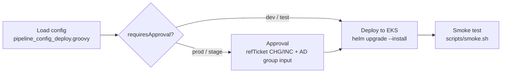

# Self-Service Onboarding — D0: Discovery

> **Gate**: D0 — Discovery | **Status**: Draft | **Epic**: [EACPP-1325](https://sunlife.atlassian.net/browse/EACPP-1325)

> **Measured, not assumed.** Every platform statement in this document was verified on
> 2026-09-16 against `luminate` `origin/main` **`91f57d500`** and `luminate-sunlife-deploy`
> `origin/main` **`e7f469e`**. Where a fact contradicts an earlier note, this document says so.

## Problem Statement

Onboarding a team to ACP is a sequence of database writes that only the ACP Product Team can
perform, and it is performed by hand.

The runbooks are written down — `acp-product-devkit` carries six skills covering tenancy,
machine identity, MCP deployment, delegated-MCP agent provisioning, platform deploy and
Bedrock wiring — and most of them ship a Python script. But every one of them is executed the
same way: a person on a laptop, with cluster credentials, running

```bash
kubectl --context <ctx> -n luminate exec -i deploy/luminate-backend -c luminate-backend \
  -- env APPLY=1 ONBOARD="$(cat request.json)" /opt/.venv/bin/python manage.py shell \
  < scripts/provision_team.py
```

That is not automation. It is a documented manual procedure with a script-shaped middle.

### Why it cannot simply be delegated to the teams

The published guidance is explicit. `luminate-user-guides` `docs/administration/deploying.md`
states of deployment: *"This is reserved for platform administrators. No role — not even Owner
on a project — can grant these."* Registration is self-service; **a registered resource is
invisible until an administrator deploys it**. So the bottleneck is structural, not cultural:

| Step | Self-service? | Who must act |
|---|---|---|
| Register an agent / model / MCP server / application | Yes | The team |
| Grant a role inside a project you already own | Yes | Project Owner |
| Create the folder and the project in the first place | **No** | ACP Product Team |
| Deploy the resource to a gateway | **No** | Platform administrator |
| Issue / rotate / revoke an OAuth credential | **No** | Platform administrator |
| Create the access policy that lets an agent call a model or MCP server | **No** | Platform administrator |
| Map a gateway to an environment | **No** | Platform administrator |
| Promote to STAGE or PROD | **No** | Project Owner approves, platform administrator acts |
| Per-agent machine identity on a `delegated_exchange` MCP server | **No** | Platform administrator |

Every new resource therefore costs the ACP Product Team **at least two** administrative
actions (deploy, and conditionally issue a credential), and every promotion costs **two more**.
The cost is linear in the number of resources and environments, and ACP is at the start of
its adoption curve.

### The specific pain, named

1. **Deployment is a mandatory hand-off with no queue.** `docs/getting-started/onboarding-intake.md`
   already asks the right questions — business area, contacts, project and ownership, people and
   access, resources, technical requirements — and is a good form. But it is a **page, not a
   record**: it is completed before a session, sent to the team, and from that point there is no
   status a requester can check and no queue to be in. Everything after intake routes to two
   named people through `docs/reference/troubleshooting.md` — Lalit Summan (Product Owner) and
   David Nguyen (Scrum Master). The form is the right starting point for the request contract;
   what is missing is everything downstream of submitting it.
2. **Secrets are handed to humans.** `docs/administration/credentials.md` tells the
   administrator to *"have the requester put it straight into their secret store ... as you
   issue it"* — a show-once secret, transcribed live, over whatever channel is at hand. The
   ask that opened this spec was for an "OAuth credential emailer". Emailing it is the wrong
   fix; **the credential should never reach a person at all**.
3. **Rotation has no overlap window.** The old secret stops the instant the new one is
   issued, so every rotation is a scheduled outage negotiated by hand.
4. **Verification is a separate act of goodwill.** `verify_access.py` and
   `verify_mcp_route.sh` exist and are good, but nothing forces them to run. A provisioning
   run that silently did nothing looks identical to one that worked.
5. **Several failures are silent by construction.** A gateway that is not joined to an
   environment produces an **empty dropdown with no error and nothing in the logs**. A
   `delegated_exchange` deployment whose audience cannot be exchanged is **withheld, not
   downgraded** — the database row exists, the API reports success, the route never appears.
6. **The scripts trust their arguments.** `provision-gateway.sh` in `luminate-sunlife-deploy`
   interpolated shell variables into Python executed by `manage.py shell -c` inside the
   production backend pod. Inert while a human ran it; **remote code execution the moment those
   became build parameters**. It has since been hardened — quoted heredoc, values through
   `os.environ` — and that hardened script is the reference implementation. **The devkit
   provisioning scripts have not had the same treatment**, and automating them without it would
   reintroduce the defect on a wider surface.

### What the journey spec already says

`acp-customer-journey` (EACPP-1134) documents the intake process as the **First Wave** model
and is candid about its status. DD-16: *"every step is scheduled rather than self-served ...
Target state is fully self-serve."* DQ-7 is left open: *"When and how does the journey move
from the First Wave (ACP-led, high-touch) model to the target self-serve, RA-led model?"*, with
the stated risk being *"First Wave quietly becoming permanent because no one owns the
transition."*

**This spec is that transition, for the platform-administration half of it.** The journey spec
ends where a use case is ready to register an agent; this one starts there.

## Opportunity

- **Cost per onboarding falls to the cost of reviewing a request.** The mechanical work —
  create, bind, deploy, verify, notify — stops consuming a person.
- **The request becomes a record.** Who asked, what was asked, who approved, what ran, what it
  proved. That record is the evidence an auditor asks for, and today it exists only as chat.
- **Secrets stop travelling through people.** Writing the credential to the requester's own
  Vault path or AWS Secrets Manager secret removes an entire class of exposure, and makes
  rotation something a pipeline can schedule rather than a meeting.
- **Silent failures become loud.** Verification promoted from an optional follow-up to a
  pipeline stage means the empty-dropdown and withheld-route failures are caught by the
  machine that caused them.
- **Delegation becomes safe later.** Once every administrative act runs through one contract
  with one executor and one audit trail, opening a step up to teams (EACPP-1109, delegable
  deployment once portal RBAC lands) is a policy change rather than a rebuild.

## Stakeholders

| Stakeholder | Role | Key Concern |
|-------------|------|-------------|
| Lalit Summan | ACP Product Owner | Named contact for every request today; wants the queue off his desk without losing control of what is granted |
| David Nguyen | ACP Scrum Master | Same; plus throughput and predictability for the team |
| ACP Product Team engineers | Operators | Stop hand-running runbooks; keep the ability to intervene when a request is unusual |
| Business-area tech leads | Requesters | Want a front door with a status, not a person to chase |
| Regional Architects | Journey owners (`acp-customer-journey`) | Need the self-serve transition designed, not improvised (DQ-7) |
| Enterprise Security / ISRA | Assurance | Credential custody, injection surface on a pipeline that writes to a production control plane, separation of duties on promotion |
| Global DevOps / Jenkins platform | Executor owner | Pipelines must follow the JTE conventions and the existing approval model (INT-08) |

## Scope

### In Scope

- A single **request contract** that every front door produces and the executor consumes.
- **Front doors**: a Jira request type, a ServiceNow catalog item, and a chatbot — normalising
  to the same contract. Which of the three ships first is a D3 sequencing decision, not a
  design fork.
- **Eight pipelines** covering the administrative acts listed above: tenancy, access grant,
  access policy, resource deployment, credential lifecycle, machine identity, environment
  promotion, and inventory/drift reporting.
- **Credential custody**: minting a credential and writing it into the requester's secret
  store (HashiCorp Vault KV v2 or AWS Secrets Manager) in one operation, so the plaintext
  never leaves the pipeline.
- **Verification** as a mandatory stage of every pipeline, with a defined pass condition.
- The **injection-safe execution pattern** every pipeline must use while the interim
  `kubectl exec` executor is in place.

### Out of Scope

- **Changing who is allowed to do what.** These pipelines execute the current authorisation
  model faster; they do not widen it. Delegating deployment to project Owners is EACPP-1109 and
  depends on upstream portal RBAC.
- **The intake, assessment and pattern-fit process** — that is `acp-customer-journey`
  Phase 1 (steps 1.1–1.9) and is not re-litigated here.
- **Deploying Luminate itself.** `sunlife-deployment` (EACPP-596) owns the Helm/EKS pipeline;
  this spec consumes its outputs and its configuration decisions.
- **Gateway topology.** `gateway-environment-strategy` (EACPP-1089) owns how many gateways
  exist and where; this spec deploys onto them.
- **Building the agent frameworks teams use.** `acp-harness-sdk` owns that seam.
- **Any change to the Luminate data model.** Where a pipeline is blocked by the platform, this
  spec records a gap and an escalation rather than designing around it.

## Capability Requirements

> Assessed against the [ACP Capability Map](../../../capability-map.md) on 2026-09-16.
> This is a platform spec rather than a use-case onboarding, so the table records the
> capabilities the **automation itself** depends on, not a business area's selections.

### Mandatory baseline — acknowledged

| Confirmed with | Date | Notes |
|---|---|---|
| ACP Product Team (this spec) | 2026-09-16 | The pipelines are the mechanism by which other use cases meet the mandatory baseline. Two mandatory capabilities carry direct constraints: **CAP-18 audit trail** is how a pipeline run becomes evidence, and **CAP-11 kill switch** must remain reachable without a pipeline — an emergency stop that depends on Jenkins being healthy is not an emergency stop. |

### Selected capabilities

| Capability | Why this spec needs it | Priority | Status today | Confirmed by |
|---|---|---|---|---|
| [CAP-06 — Machine identity and programmatic access](../../../capability-map.md#cap-06) | The executor must authenticate as something other than a human. This is the load-bearing one: the capability exists but is opted into on **three catalog viewsets only**, none of them administrative. See G-1. | P0 launch | ✅ Available — *but not on the surfaces this spec needs* | Verified in code 2026-09-16 |
| [CAP-28 — Provider credential custody](../../../capability-map.md#cap-28) | The credential pipeline writes the minted secret to Vault or AWS Secrets Manager instead of handing it over. Fully implemented upstream (read **and** write); **not enabled in the Sun Life deployment**. See G-2. | P0 launch | ✅ Available | Verified in code 2026-09-16 |
| [CAP-07 — RBAC and access policy](../../../capability-map.md#cap-07) | Tenancy, access-grant and access-policy pipelines all write role bindings and access policies. | P0 launch | ✅ Available | Capability map |
| [CAP-04 — Deployment & environment registry](../../../capability-map.md#cap-04) | The deployment and promotion pipelines create `Deployment` rows and their per-type children. | P0 launch | ✅ Available | Capability map |
| [CAP-18 — Audit trail](../../../capability-map.md#cap-18) | Each pipeline run must leave an immutable record attributable to a named requester and approver. | P0 launch | 🟡 Partial | Capability map |
| [CAP-14 — Lifecycle governance and approvals](../../../capability-map.md#cap-14) | STAGE/PROD promotion keeps a human approval with separation of duties; the pipeline executes the decision, it does not make it. | P1 fast follow | 🟡 Partial | Capability map |
| [CAP-05 — SSO and human identity](../../../capability-map.md#cap-05) | The requester and the approver must be named users, not a shared service account. | P0 launch | ✅ Available | Capability map |
| [CAP-21 — Single pane of glass](../../../capability-map.md#cap-21) | The portal remains the read surface; pipelines must not become a second source of truth for state. | P0 launch | ✅ Available | Capability map |
| [INT-02 — Secrets](../../../capability-map.md#int-02) | The Sun Life deployment must wire `CREDENTIAL_BACKENDS` before CAP-28 does anything here. | P0 launch | Not wired | Verified in `values/` 2026-09-16 |
| [INT-06 — GRC and ITSM systems of record](../../../capability-map.md#5-the-sun-life-integration-surface) | The ServiceNow front door and the change-record gate on production pipelines. | P1 fast follow | Integration surface | Capability map |
| [INT-08 — Build and release](../../../capability-map.md#5-the-sun-life-integration-surface) | Jenkins JTE is the executor; the approval, credential-binding and audit behaviour are inherited rather than rebuilt. | P0 launch | Integration surface | Capability map |

### Capabilities explicitly not required

| Capability | Why not |
|---|---|
| [CAP-25 — Just-in-time and break-glass access](../../../capability-map.md#cap-25) | Tempting, because a provisioning pipeline is exactly where time-bound elevation belongs. Designed but not built, and the pipelines work with standing access today. Revisit when CAP-25 ships. |
| [CAP-12 — Quotas, budgets and rate limits](../../../capability-map.md#cap-12) | Setting a quota is a platform-administrator act and could be a pipeline, but quotas are not enforced at the gateway, so automating the authoring would automate something inert. |
| [CAP-10 — Guardrails](../../../capability-map.md#cap-10) | Attaching guardrails is configuration of a governed resource, not onboarding. Out of scope; revisit if it becomes a routine request. |
| [CAP-22 — Federated / per-business-unit gateways](../../../capability-map.md#cap-22) | Not prioritised upstream and a ballot item rather than a schedule. The pipelines deploy onto whatever gateways `gateway-environment-strategy` says exist. |

> Any selected capability that is not ✅ becomes a row in the D1 Capability Gaps register and
> follows [Capability Gap Escalation](../../../process/capability-gap-escalation.md).

## Current-State Measurement

### What the devkit already automates, and what it does not

| Skill | Scripted | Still manual |
|---|---|---|
| `onboard-team-to-luminate` | Folder, project, just-in-time user rows, role bindings, three-level verification, handover message | Collecting the request, validating names against the live install, agreeing the environment mapping, choosing the Owner, sending the message |
| `luminate-machine-identity` | `ServicePrincipal` row + role binding | Enabling the feature flag, creating the Keycloak client, minting its credentials, decoding a token to find the `sub`, attaching the `luminate-exchange-aud` scope |
| `deploy-mcp-server-to-gateway` | `DeploymentService().create(...)`, route verification script | Two pre-flight checks (backend reachability, CA bundle), collecting the four inputs, deciding `external_audience`, telling the team the URL |
| `provision-agent-for-delegated-mcp` | Access policy, OAuth client, Keycloak client credentials, actor scope | **Step 4** — attaching `luminate-exchange-aud` as a default scope, which must go through the Keycloak admin API because the backend cannot do it |
| `deploy-luminate-sunlife` | Jenkins pipeline (`luminate-deploy-cd`) | Values edits, HTTPRoute and Vault manifests, infrastructure pre-checks |
| `luminate-gateway-bedrock` | — | IAM trust edits, provider/model rows, access policy, verification |

Only **one** of these — deploying Luminate itself — has a pipeline. That pipeline is the model
for the rest.

### The platform surfaces, as measured

| Surface | Path | Permission | Machine-callable? |
|---|---|---|---|
| Folders | `POST /api/v1/organization/folders/` | `OPAResourcePermission` | **No** |
| Projects | `POST /api/v1/organization/projects/` | `OPAResourcePermission` | **No** |
| Role bindings | `POST /api/v1/iam/role-bindings/` | `OPAResourcePermission` | **No** |
| Users / service principals | `POST /api/v1/iam/{users,service-principals}/` | per-viewset | **No** |
| Deployments | `POST /api/v1/deployment/deployments/` | `OPAResourcePermission` | **No** |
| Credentials on a deployment | `POST /api/v1/deployment/deployments/{id}/{generate,rotate,revoke}-credentials` | `OPAResourcePermission` | **No** |
| Application credentials | `POST /api/v1/catalog/applications/{id}/generate-credentials/` | per-viewset | **No** |
| Secrets | `POST /api/v1/credentials/secrets/`, `.../{id}/rotate/` | `OPAResourcePermission` | **No** |
| Access policies | `POST /api/v1/resource-access/access-policies/` | `OPAResourcePermission` | **No** |
| Catalog reads — agents, models, MCP servers | `GET /api/v1/catalog/{agents,models,mcp-servers}/` | `RegistryBearerAuthMixin` | **Yes** |

`DEFAULT_AUTHENTICATION_CLASSES` is `SessionAuthenticationWithChallenge` plus
`UserOAuthTokenAuthentication`. `RegistryBearerAuthMixin` — the service-principal
authenticator — appears on exactly three viewsets (`agents`, `mcp_servers`, `models`), and
`SERVICE_PRINCIPAL_AUTH_ENABLED` is `true` in the **dev** values file only; `false` in test,
stage and prod.

**Consequence.** An external pipeline can read the catalogue and can change nothing. Every
administrative act in this spec has to go through `kubectl exec` into the backend pod until
that changes. That is G-1, and it is the single most consequential finding in this document.

### Credential custody — an earlier verdict corrected

An earlier ACP note recorded that *"HashiCorp Vault is NOT a credential backend"* because
`backend/app/credentials/secret_backends/` held only `aws_sm.py`, `gcp_sm.py` and `env.py`.
**That is now stale.** At `91f57d500` the directory also holds `vault.py`, and alongside it a
`writer.py`:

- **Read** — `SecretBackend.fetch()`, implemented by `EnvBackend`, `GcpSecretManagerBackend`,
  `AwsSecretManagerBackend`, `VaultKvBackend`.
- **Write** — `SecretWriter.create/add_version/delete`, implemented by
  `GcpSecretManagerWriter`, `AwsSecretManagerWriter`, `VaultKvWriter`, dispatched by
  `CredentialWriter` on the `gcp_sm:` / `aws_sm:` / `vault:` prefix.
- `SecretViewSet.create()` calls `create_with_value()`, which writes the value into the cloud
  store inside a transaction and stores only a `secret_ref` on the `Secret` row.
- The Vault backend authenticates with a Kubernetes service-account JWT (static `VAULT_TOKEN`
  takes precedence), configured by `VAULT_ADDR`, `VAULT_MOUNT`, `VAULT_K8S_ROLE`,
  `VAULT_K8S_AUTH_PATH`, `VAULT_K8S_TOKEN_PATH`, `VAULT_NAMESPACE`.

Two things follow, and they pull in opposite directions:

1. The capability this spec needs for credential delivery **already exists upstream**. This is
   not a consortium ask.
2. `CREDENTIAL_BACKENDS` **is not set in any Sun Life values file** — dev, test, stage or prod.
   So the portal currently offers no backend at all, and nothing can be written anywhere. That
   is G-2, and it is Sun Life deployment configuration, not a component change.

There is also no code path connecting credential *minting* to the secret *writer*. They are
two separate surfaces, and bridging them is the credential pipeline's job (G-4).

### The executor pattern, as it exists today

`luminate-sunlife-deploy` carries five Jenkins pipelines — `Jenkinsfile`,
`Jenkinsfile_deploy`, `Jenkinsfile_gateway`, `Jenkinsfile_smoke`, `Jenkinsfile_terraform` —
each paired with a `pipeline_config_*.groovy` that returns a map of canonical settings. The
deploy pipeline's shape is:



with parameters `gitRef`, `environment`, `imageTag`, `refTicket`, `dryRun`, `rolloutStatus`;
agent label `iac-build-agent`; helm and kubectl pinned and pulled from Artifactory; and the AWS
credential bound per environment as `acp-eks-deploy-aws-<env>`. Approval is
`input(submitter: 'User_JenkinsProdACPLead_ML')` and the change ticket is shape-checked
`(?i)(CHG|INC)\d{7,}` so a Jira key cannot satisfy it.

**Everything this spec needs from an executor is already in that file.** The eight pipelines
are variations on it, not a new platform.

## Success Criteria

| Criterion | Measurement | Target |
|-----------|-------------|--------|
| SC-1 — No administrative act is performed by hand | Count of tenancy / deployment / credential / access changes in `audit_events` attributable to a pipeline run vs a laptop session, over a month | ≥ 90% pipeline-attributed |
| SC-2 — No secret reaches a person | Count of credentials delivered as a `secret_ref` vs as a plaintext value in a message | 100% by reference; zero plaintext |
| SC-3 — Every request has a record | Requests arriving through a front door vs requests arriving as direct messages to a named individual | ≥ 90% through a front door |
| SC-4 — Verification cannot be skipped | Pipelines whose verification stage is mandatory and fails the build | 8 of 8 |
| SC-5 — Silent failures are caught | The two known silent failures (unmapped gateway/environment, withheld delegated route) asserted by a pipeline stage | Both asserted |
| SC-6 — Time to provision | Wall-clock from an approved request to a verified result | < 30 minutes unattended |
| SC-7 — The injection surface is closed | Pipelines passing parameters through `env` + `os.environ` in a quoted heredoc, with a name-shape regex on every identifier | 8 of 8, asserted by review |

## Dependencies

| Dependency | Component/Team | Type | Risk |
|------------|---------------|------|------|
| `CREDENTIAL_BACKENDS` wired in the Sun Life values files | `sunlife-deployment` (EACPP-596) / ACP Product Team | **Hard** | Without it the credential pipeline can mint but not deliver — it would fall back to handing a secret to a person, which is the thing this spec exists to stop |
| Vault path and Kubernetes auth role for the `luminate` namespace | Vault platform team | **Hard** | The Vault backend logs in with the pod's service-account JWT; no role, no write |
| Machine authentication on administrative REST surfaces | Consortium (Luminate) | Soft | Only soft because `kubectl exec` is a working interim. It is the difference between a supported integration and a workaround |
| Jenkins folder, credentials and AD groups for the new jobs | Global DevOps / ACP Jenkins folder owners | **Hard** | Every pipeline needs a cluster credential and an approval group |
| ServiceNow catalog item and an integration account | INT-06 / ServiceNow platform | Soft | The Jira front door can ship first; ServiceNow is the enterprise-standard door and follows |
| Gateway ↔ environment mappings correct in each install | `gateway-environment-strategy` (EACPP-1089) | Soft | A missing mapping makes deployment fail silently; the inventory pipeline turns it into an alert |
| `acp-customer-journey` Phase 1 outcome | EACPP-1134 | Soft | The journey decides *whether* a use case is onboarded; these pipelines execute it |

## Risks

| Risk | Likelihood | Impact | Mitigation |
|------|-----------|--------|------------|
| R-1 — Command injection through a build parameter | **High** if unaddressed | **High** — RCE in the backend pod of a production control plane | Mandatory execution pattern: quoted heredoc, values via `env`, `os.environ` in the script, DNS-label regex on every identifier, fail closed. Proven necessary — `provision-gateway.sh` had exactly this defect |
| R-2 — A pipeline becomes a privilege-escalation path | Medium | High | The pipeline holds no more authority than the administrator it replaces; approval groups gate who may run it; every run is attributed to a named requester and approver |
| R-3 — The secret store is not wired, so the pipeline "temporarily" hands out plaintext | **High** | High | Make the write a **hard precondition**: if no backend is configured the credential pipeline fails rather than degrading. A degraded mode becomes the permanent mode |
| R-4 — Automation entrenches First Wave instead of ending it | Medium | Medium | Every pipeline records which step it would hand to the team once delegation lands (EACPP-1109); the inventory pipeline reports how many requests could already have been self-served |
| R-5 — `kubectl exec` executor becomes permanent | **High** | Medium | Named as an interim with an exit condition (G-1); the pipelines are written so the executor is one swappable stage |
| R-6 — Verification passes while nothing happened | Medium | High | Verification must drive the real surface — the viewset, the gateway config dump, the RFC 9728 endpoint — never a row count. A 401 from a gateway proves the host and prefix, not the route |
| R-7 — Front-door sprawl: three doors, three behaviours | Medium | Medium | One request contract, schema-validated at the boundary. A front door that cannot produce the contract does not ship |
| R-8 — Rotation cuts over with no overlap and breaks a workload | Medium | Medium | The rotation pipeline schedules and announces; it cannot create an overlap window that the platform does not have. Recorded as G-5 and escalated |

## Open Questions

- [ ] **Q-1** Which front door ships first — Jira or ServiceNow? Jira is reachable today and
      the team lives in it; ServiceNow is the enterprise standard, carries the approval
      record, and is what a change auditor expects.
- [ ] **Q-2** Does the chatbot front door have to be an ACP-registered agent governed by the
      platform it administers? Dog-fooding is attractive and the circularity is a real
      operational risk if the platform is the thing that is down.
- [ ] **Q-3** Where does the Vault path for a tenant's credential live — under the ACP
      namespace path, or the tenant's own? Ownership of the path decides who can rotate it
      without us.
- [ ] **Q-4** What happens to a request that a pipeline refuses? A failed build is not a
      response to a requester, and the front door needs a closed loop.
- [ ] **Q-5** Should the pipelines run against all four installs from one Jenkins folder, or
      one folder per install? The deploy pipeline uses a single folder with a per-environment
      credential; promotion crosses environments, which the existing shape does not model.
- [ ] **Q-6** Is there an approval that should *not* be human? Access-policy grants inside an
      already-onboarded project are the likeliest candidate for full automation.
